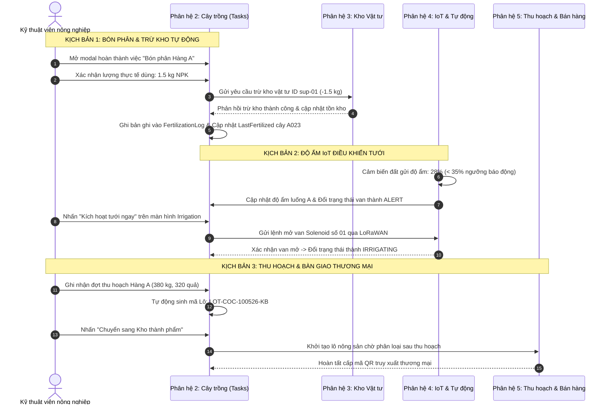

# TÀI LIỆU ĐẶC TẢ GIAO DIỆN NGƯỜI DÙNG (UI/UX SPECIFICATION)
## PHÂN HỆ 2: SẢN XUẤT & QUẢN LÝ CÁ THỂ CÂY TRỒNG
### Hệ Thống Quản Lý Trang Trại Thông Minh (Smart Farm Management System)

---

## 1. TỔNG QUAN PHÂN HỆ & KIẾN TRÚC GIAO DIỆN

### 1.1. Mục đích và Tầm nhìn
Phân hệ **Sản xuất & Quản lý Cá thể Cây trồng** (Crop Production & Individual Plant Management) là phân hệ cốt lõi trong hệ thống Smart Farm. Phân hệ được thiết kế theo triết lý **Nông nghiệp chính xác (Precision Agriculture)**, quản lý chi tiết tới từng cá thể cây (Individual Plant Profiling) thông qua định danh duy nhất (Mã cây/Mã QR và tọa độ GPS thực địa), thay vì chỉ quản lý chung chung theo diện tích.

Phân hệ hỗ trợ toàn bộ vòng đời canh tác:
1. **Định danh & Không gian**: Xuống giống, gắn thẻ định danh QR, định vị tọa độ từng cây trên sơ đồ phân khu/hàng/luống.
2. **Theo dõi sinh trưởng**: Chiều cao cây, đường kính thân, số tàu lá, chu kỳ ra hoa, số lượng buồng và quả.
3. **Chăm sóc & Dinh dưỡng**: Lập lịch bón phân chuẩn VietGAP, theo dõi định mức và ghi nhật ký phân bón.
4. **Tưới tiêu thông minh**: Giám sát độ ẩm đất theo luống, điều khiển van Solenoid tưới chính xác theo vùng.
5. **Bảo vệ thực vật (IPM)**: Thư viện nhận diện sâu bệnh, danh mục thuốc BVTV sinh học, quản lý ca bệnh (Disease Case) từ phát hiện đến điều trị dứt điểm.
6. **Thu hoạch & Năng suất**: Ghi nhận sản lượng theo lô/cây, phân loại phẩm cấp (Loại 1, Loại 2), cấp mã Lô truy xuất.
7. **Truy xuất nguồn gốc (Traceability)**: Cổng thông tin minh bạch dữ liệu vòng đời cây phục vụ đối tác và người tiêu dùng.

---

### 1.2. Nguyên tắc Thiết kế & Hệ thống Design System
Giao diện tuân thủ tiêu chuẩn thiết kế hiện đại, chuyên nghiệp, tối ưu hóa cho cả kỹ sư nông nghiệp tại văn phòng và kỹ thuật viên cầm tablet tại vườn:
- **Tông màu chủ đạo**:
  - *Primary (Xanh nông nghiệp)*: Emerald Green (`#059669`, `#10B981`, `#047857`) thể hiện sức sống cây trồng, mùa màng.
  - *Sidebar & Header Dark*: Deep Jungle Slate (`#0F2D32`, `#164047`) tạo độ sâu chuyên nghiệp, ổn định.
  - *Background*: Slate-50/100 (`#F8FAFC`, `#F1F5F9`) chống mỏi mắt khi làm việc ngoài trời hoặc phòng lab.
  - *Bảng màu trạng thái sức khỏe cây (Health Status Palette)*:
    - **NORMAL / GOOD (Bình thường / Tốt)**: Xanh ngọc lục bảo (`#059669` / bg `#ECFDF5`).
    - **WATCH / WARNING (Cần theo dõi)**: Vàng hổ phách (`#D97706` / bg `#FFFBEB`).
    - **SICK / CRITICAL (Đang bệnh / Nguy hiểm)**: Đỏ san hô (`#E11D48` / bg `#FFF1F2`).
    - **DEAD (Ngừng khai thác / Chết)**: Xám đen trung tính (`#334155` / bg `#F1F5F9`).
- **Typography**: Inter / Roboto, font-mono (`font-mono`) cho các mã định danh (`A001`, `CASE-2026-xxxx`, `LOT-COC-xxxx`), chỉ số số đo, ngày tháng và mã QR.
- **Bố cục (Layout Pattern)**: Cấu trúc Responsive 12 cột, thanh Sidebar bên trái (thu gọn được w-64 $\rightarrow$ w-16), Topbar điều hướng ngữ cảnh và khu vực làm việc trung tâm cuộn độc lập.

---

### 1.3. Sơ đồ Cấu trúc Điều hướng Phân hệ (Site Map & Screen Flow)

```mermaid
flowchart TD
    Root["Phân hệ 2: Sản xuất & Cây trồng (/production)"] --> P1["1. Tổng quan Sản xuất (/production/dashboard)"]
    Root --> P2["2. Sơ đồ Vườn & Định vị Cây (/production/map)"]
    Root --> P3["3. Cây trồng & Hồ sơ Cá thể (/production/plants)"]
    Root --> P4["4. Chỉ số Sinh trưởng (/production/growth)"]
    Root --> P5["5. Công việc & Lịch chăm sóc (/production/tasks)"]
    Root --> P6["6. Dinh dưỡng & Bón phân (/production/nutrition)"]
    Root --> P7["7. Nước & Tưới tiêu (/production/irrigation)"]
    Root --> P8["8. Đất & Vi khí hậu Môi trường (/production/environment)"]
    Root --> P9["9. Thư viện Sâu bệnh (/production/diseases)"]
    Root --> P10["10. Thuốc BVTV Sinh học (/production/pesticides)"]
    Root --> P11["11. Case Điều trị Bệnh (/production/disease-cases)"]
    Root --> P12["12. Thu hoạch & Năng suất (/production/harvests)"]
    Root --> P13["13. Cổng Truy xuất Nguồn gốc (/production/traceability)"]

    P3 --> P3_New["Thêm mới cây (/production/plants/new)"]
    P3 --> P3_Detail["Chi tiết cá thể cây (/production/plants/:id)"]
    P3_Detail --> P3_Edit["Chỉnh sửa cây (/production/plants/:id/edit)"]
    P3_Detail --> P3_QR["Modal in & Tải mã QR cá thể"]
    P3_Detail --> P3_Measure["Modal đo lường sinh trưởng"]

    P5 --> P5_Complete["Modal hoàn thành việc + Trừ kho"]
    P5 --> P5_Create["Modal giao việc mới"]

    P9 --> P9_Drawer["Drawer chi tiết sâu bệnh"]
    P10 --> P10_Calc["Modal tính liều lượng pha thuốc"]
    P11 --> P11_Drawer["Drawer theo dõi tiến trình Case"]
    P12 --> P12_Create["Modal ghi nhận lô thu hoạch mới"]
```



---

## 2. CHI TIẾT ĐẶC TẢ GIAO DIỆN TỪNG MÀN HÌNH

---

### MÀN HÌNH 1: TỔNG QUAN SẢN XUẤT (PRODUCTION DASHBOARD)
- **Đường dẫn (Route)**: `/production/dashboard` hoặc `/production`
- **Mục đích**: Cung cấp bức tranh toàn cảnh về sức khỏe đàn cây, tiến độ chăm sóc trong ngày, biểu đồ năng suất theo tháng và các cảnh báo khẩn cấp cần can thiệp.

#### Sơ đồ Bố cục Giao diện (Wireframe Layout)
```
+-----------------------------------------------------------------------------------------------+
| Header: "Tổng quan sản xuất & Cây trồng" [PHÂN HỆ 2]   [Sơ đồ vườn trực quan] [+ Xuống giống] |
| Vị trí: Trại Dừa An Phú · Quản lý định danh từng cá thể cây (A001 – A100)                    |
+-----------------------------------------------------------------------------------------------+
| [ KPI: Tổng cây ] [ KPI: Khỏe mạnh ] [ KPI: Cần theo dõi ] [ KPI: Đang bệnh ] [ Việc hôm nay ] [ Thu hoạch tháng ] |
+-------------------------------------------------------------+---------------------------------+
| KHỐI 1 (col-span-7): SƠ ĐỒ TRẠNG THÁI VƯỜN MA TRẬN         | KHỐI 2 (col-span-5): CÔNG VIỆC  |
| - Hàng A: [01][02][03][04]...[18:Vàng][23:Vàng][100:Xanh]   | HÔM NAY (05/10/2026)            |
| - Hàng B: [01][02]...[24:Đỏ]...[80:Xanh]                    | - Danh sách việc cần làm        |
| - Chú thích: (🟢 Bình thường | 🟡 Cần theo dõi | 🔴 Bệnh)   | - Nút "Xong" nhanh từng việc    |
+-------------------------------------------------------------+---------------------------------+
| KHỐI 3 (col-span-7): THEO DÕI SINH TRƯỞNG & NĂNG SUẤT       | KHỐI 4 (col-span-5): CẢNH BÁO   |
| - Biểu đồ cột: Số quả/cây bình quân qua 6 tháng (T05->T10)   | SỨC KHỎE CÂY KHẨN CẤP           |
| - Xu hướng tăng trưởng: 45 -> 52 -> 58 -> 64 -> 60 -> 68 quả | - Cây A018 (Bọ cánh cứng)       |
| - Nút liên kết: "Xem bảng đo lường chi tiết"                | - Cây B024 (Nấm lá hoại tử)     |
+-------------------------------------------------------------+---------------------------------+
```

#### Các Thành phần Giao diện & Tương tác:
1. **Thanh Header & Quick Actions**:
   - Tiêu đề cấp 1, tag huy hiệu `PHÂN HỆ 2`, định danh trang trại hiện tại.
   - Nút hành động nhanh: `Sơ đồ vườn trực quan` (chuyển hướng `/production/map`) và `+ Xuống giống cây mới` (mở form `/production/plants/new`).
2. **Cụm 6 Thẻ KPI Tương tác (Clickable KPI Cards)**:
   - *Tổng cây*: Hiển thị tổng số cá thể cây (Ví dụ: `1,250 cây`), nhấp để mở danh sách cây.
   - *Khỏe mạnh*: Tỷ lệ đạt chuẩn (`1,173 cây` ~ `93.8%`), chỉ số tích cực màu xanh.
   - *Cần theo dõi*: Số cây có biểu hiện thiếu dinh dưỡng hoặc sâu bệnh nhẹ (`52 cây`), nhấp để lọc nhanh cây `WATCH`.
   - *Đang bệnh*: Số cây đang trong diện điều trị ca bệnh (`25 cây`), nhấp chuyển sang `/production/disease-cases`.
   - *Việc hôm nay*: Số tác vụ chưa hoàn thành trong ngày, nhấp chuyển sang `/production/tasks`.
   - *Thu hoạch tháng*: Sản lượng tháng hiện tại (Ví dụ: `3,250 kg`), kèm nhãn tăng trưởng so với kỳ trước (`+14%`).
3. **Widget Sơ đồ Trạng thái Vườn Ma trận (Garden Matrix Status)**:
   - Hiển thị trực quan theo lưới ma trận các ô cây đại diện Hàng A (Dừa xiêm lùn) và Hàng B (Dừa dứa).
   - Màu sắc mỗi ô hiển thị trạng thái sức khỏe thực tế: Xanh (`NORMAL`), Vàng hổ phách (`WATCH`), Đỏ (`SICK`).
   - Hiệu ứng tương tác: Hover phóng to nhẹ (`hover:scale-110`), hiển thị Tooltip tên cây + mã số. Nhấp chuột vào bất kỳ ô cây nào để mở ngay màn hình Hồ sơ chi tiết cây đó.
4. **Widget Công việc Hôm nay (Today Tasks)**:
   - Danh sách các việc chăm sóc ưu tiên cao (Bón phân thúc đợt 2, Kiểm tra bọ cánh cứng, Tưới nước luống A).
   - Mỗi dòng hiển thị: Tên việc, Mã cây liên quan (nếu có), Phân khu, Người phụ trách.
   - Nút thao tác nhanh `Xong` (nút màu xanh kèm icon Check): Hoàn thành tức thời công việc mà không cần rời dashboard.
5. **Widget Biểu đồ Sinh trưởng & Năng suất (Growth Vector Chart)**:
   - Biểu đồ dạng cột (Bar Chart) trực quan thể hiện số quả bình quân trên cây từ Tháng 5 đến Tháng 10.
   - Hiển thị cột hiện tại nổi bật kèm nhãn chỉ số: `68 quả (Hiện tại)`.
6. **Widget Cảnh báo Sức khỏe Cây (Urgent Health Alerts)**:
   - Liệt kê các cây đang gắn cờ cảnh báo (A018, B024...), kèm mô tả triệu chứng tóm tắt và `StatusBadge`.
   - Nhấp vào từng dòng để mở trang chi tiết cây hoặc xem ca bệnh điều trị.

---

### MÀN HÌNH 2: SƠ ĐỒ VƯỜN & ĐỊNH VỊ CÁ THỂ CÂY (GARDEN MAP & PLANT LOCATOR)
- **Đường dẫn (Route)**: `/production/map`
- **Mục đích**: Quản trị không gian trực quan (Spatial Garden Map), cho phép xác định vị trí thực địa của từng cây trên từng hàng/luống, xem các lớp dữ liệu IoT, cảnh báo dịch hại và kích hoạt thông tin nhanh.

#### Sơ đồ Bố cục Giao diện (Wireframe Layout)
```
+-----------------------------------------------------------------------------------------------+
| Tiêu đề: "Sơ đồ vườn & Định vị cá thể cây"     Chú thích: 🟢 Bình thường | 🟡 Theo dõi | 🔴 Bệnh |
+-----------------------------------------------------------------------------------------------+
| Toolbar: [🔍 Tìm mã cây (A023)...] [Chọn Vườn ▼] [Chọn Sức khỏe ▼] [Lớp hiển thị ▼] [Zoom: + - 100%] |
+-----------------------------------------------------------------------------------------------+
| KHÔNG GIAN BẢN ĐỒ VƯỜN (CANVAS / INTERACTIVE MAP GRID):                                      |
|                                                                                               |
|  [Trạm IoT Môi trường 01 - Pin 98%]                                                          |
|  ====================================================================================         |
|  HÀNG A (Dừa Xiêm Xanh Lùn Bến Tre)                                                           |
|  [A001:🟢] [A002:🟢] [A003:🟡] [A004:🟢] ... [A018:🔴] ... [A023:🟡] ... [A050:🟢]            |
|  ~~~~~~~~~~~~~~~~~~~~~~~~~~~~~~~~~~~~~~~~~~~~~~~~~~~~~~~~~~~~~~~~~~~~~~~~~~~~~~~~~~~~ (Đường tưới)
|  HÀNG B (Dừa Dứa Thái Lan F1)                                                                |
|  [B001:🟢] [B002:🟢] [B003:🟢] ... [B024:🔴] ... [B040:🟢]                                   |
|  ====================================================================================         |
|                                                                                               |
|  [RightDrawer trượt ra khi click vào cây]:                                                    |
|  - Mã cây: A023 | Sức khỏe: CẦN THEO DÕI 🟡                                                   |
|  - Giống: Dừa Xiêm Xanh | Tuổi: 4 năm 2 tháng                                                  |
|  - Chiều cao: 4.5m | Quả: 34 trái                                                             |
|  - Sự cố: Thiếu đạm nhẹ lá già                                                                |
|  - Nút: [Xem hồ sơ đầy đủ] [Đổi trạng thái] [Tạo việc chăm sóc]                               |
+-----------------------------------------------------------------------------------------------+
```

#### Các Chức năng & Tương tác Nổi bật:
1. **Thanh Công cụ Bản đồ (Map Toolbar)**:
   - *Ô tìm kiếm trực tiếp*: Nhập mã cây (`A023`), bản đồ tự động cuộn và làm nổi bật (Highlight) vị trí cây đó.
   - *Bộ lọc Vườn (Garden Filter)*: Chuyển đổi giữa Vườn 01 (Khu Bắc), Vườn 02, Vườn 03.
   - *Bộ lọc Tình trạng (Health Filter)*: Lọc chỉ hiển thị cây Bình thường, Cần theo dõi hoặc Đang bệnh.
   - *Bộ lọc Giống (Variety Filter)*: Dừa Xiêm Xanh, Dừa Dứa, Dừa Sáp...
   - *Menu Quản lý Lớp (Layer Switcher Dropdown)*: Bật/tắt các layer:
     - Layer Cá thể cây (Plant Nodes).
     - Layer Hàng/Luống (Row Dividers & Boundaries).
     - Layer Cảm biến IoT (IoT Soil & Weather Stations).
     - Layer Cảnh báo bệnh tật (Disease Alerts).
     - Layer Tuyến đường ống tưới (Irrigation Pipeline).
   - *Bộ điều khiển Zoom*: Nút phóng to (`+`), thu nhỏ (`-`) và đặt lại tỉ lệ chuẩn 100%.
2. **Khu vực Hiển thị Bản đồ Tương tác**:
   - Minh họa không gian thực địa trang trại: bố trí các hàng cây song song, khoảng cách hàng theo chuẩn nông học (7m x 7m đối với dừa).
   - Mỗi cây là một nút tròn tương tác (Node) hiển thị mã rút gọn, chấm màu chỉ thị sức khỏe, biểu tượng trạng thái (đang bệnh có viền cảnh báo nhấp nháy nhẹ).
   - Vị trí các trạm cảm biến IoT cắm tại đầu luống hiển thị mức pin và giá trị độ ẩm đất thời gian thực.
3. **Ngăn Kéo Thông Tin Nhanh (Right Drawer)**:
   - Khi nhấp vào bất kỳ cây nào trên bản đồ, Drawer bên phải sẽ trượt ra mượt mà:
     - Header Drawer: Tên cây, Mã QR, StatusBadge.
     - Ảnh thực tế cây chụp gần nhất.
     - 4 chỉ số sinh trắc: Chiều cao, Hoành thân, Số lá, Số quả trên cây.
     - Lần bón phân & lần tưới gần nhất.
     - Các nút điều hướng nhanh: `Xem hồ sơ chi tiết` (chuyển sang `/production/plants/:id`), `Lập lịch chăm sóc`, `Đóng`.

---

### MÀN HÌNH 3: CÂY TRỒNG & HỒ SƠ CÁ THỂ (PLANT LIST & PROFILES)
- **Đường dẫn (Route)**: `/production/plants`
- **Mục đích**: Bảng dữ liệu quản lý toàn bộ danh bạ cá thể cây trồng trong trang trại, hỗ trợ tra cứu, sắp xếp, lọc đa tiêu chí và thực hiện thao tác hàng loạt.

#### Sơ đồ Bố cục Giao diện (Wireframe Layout)
```
+-----------------------------------------------------------------------------------------------+
| Tiêu đề: "Danh sách Cá thể Cây trồng"             [Sơ đồ vườn] [+ Xuống giống cây mới]       |
| Quản lý hồ sơ định danh, mã QR và sinh trắc học từng cây dừa                                  |
+-----------------------------------------------------------------------------------------------+
| Bộ lọc: [🔍 Tìm mã cây, tên, giống...] [Phân khu ▼] [Giống cây ▼] [Tình trạng sức khỏe ▼]    |
+-----------------------------------------------------------------------------------------------+
| BẢNG DỮ LIỆU CÁ THỂ CÂY (DATA TABLE):                                                         |
| [Mã cây] | [Tên / Giống cây]       | [Vị trí (Khu/Vườn/Hàng)] | [Tuổi cây] | [Giai đoạn]   | [Sức khỏe] | [Năng suất] | [Thao tác] |
|----------+-------------------------+--------------------------+------------+---------------+------------+-------------+------------|
| A001     | Dừa Xiêm Xanh Lùn #A001 | Khu Bắc · Vườn 01 · Hàng A | 4 năm      | Cho trái KT   | 🟢 NORMAL  | 52 kg/đợt   | 👁 ✏️ 📱   |
| A018     | Dừa Xiêm Xanh Lùn #A018 | Khu Bắc · Vườn 01 · Hàng A | 4 năm      | Cho trái KT   | 🔴 SICK    | 38 kg/đợt   | 👁 ✏️ 📱   |
| A023     | Dừa Xiêm Xanh Lùn #A023 | Khu Bắc · Vườn 01 · Hàng A | 4 năm 2 th | Cho trái KT   | 🟡 WATCH   | 45 kg/đợt   | 👁 ✏️ 📱   |
| B001     | Dừa Dứa Thái Lan #B001  | Khu Bắc · Vườn 01 · Hàng B | 3 năm 6 th | Cho trái bói  | 🟢 GOOD    | 30 kg/đợt   | 👁 ✏️ 📱   |
+-----------------------------------------------------------------------------------------------+
| Phân trang: Hiển thị 1 - 10 trên tổng số 100 cây                    [Trang trước] [1] [2] [Trang sau] |
+-----------------------------------------------------------------------------------------------+
```

#### Chi tiết Cột Dữ liệu trong Bảng:
| Cột | Ý nghĩa hiển thị | Định dạng / Kiểu dữ liệu |
|---|---|---|
| **Mã cây** | Định danh duy nhất của cây | Font mono, Badge nền xám nhạt (`A001`, `A023`) |
| **Tên / Giống cây** | Tên gọi và dòng giống nông học | Chữ đậm kèm dòng phụ tên giống (Dừa Xiêm Xanh Lùn Bến Tre) |
| **Vị trí** | Cấu trúc phân cấp không gian | Phân khu $\rightarrow$ Lô vườn $\rightarrow$ Hàng cây (`Khu Bắc · Vườn 01 · Hàng A`) |
| **Tuổi cây** | Thời gian sinh trưởng | Dạng chữ thân thiện (`4 năm 2 tháng`) hoặc số tháng |
| **Giai đoạn** | Chu kỳ sinh trưởng nông học | Kiến thiết cơ bản / Cho trái bói / Kinh doanh ổn định |
| **Sức khỏe** | Trạng thái sinh học | `StatusBadge` chuẩn màu sắc (Xanh / Vàng / Đỏ) |
| **Năng suất** | Khối lượng thu hoạch gần nhất | Căn phải, số kg/đợt thu hoạch |
| **Thao tác** | Hành động ngữ cảnh | Icon Xem chi tiết (`Eye`), Chỉnh sửa (`Edit`), Mã QR (`QrCode`) |

---

### MÀN HÌNH 4: HỒ SƠ CHI TIẾT CÁ THỂ CÂY (PLANT DETAIL PROFILE)
- **Đường dẫn (Route)**: `/production/plants/:id` (Ví dụ: `/production/plants/plant-023`)
- **Mục đích**: Trang trung tâm lưu trữ toàn bộ "bệnh án" và lý lịch cuộc đời của một cây dừa cụ thể, liên kết 8 khía cạnh dữ liệu.

#### Sơ đồ Bố cục Giao diện (Wireframe Layout)
```
+-----------------------------------------------------------------------------------------------+
| [<- Quay lại danh sách]                                                                       |
| Tiêu đề: "Dừa Xiêm Xanh Lùn #A023"  [MÃ: A023]  [🟡 CẦN THEO DÕI]                             |
| Vị trí: Khu Bắc / Vườn 01 / Hàng A                     [Mã QR cá thể] [Định vị map] [Chỉnh sửa] |
+-----------------------------------------------------------------------------------------------+
| HỆ THỐNG 8 TABS CHỨC NĂNG:                                                                    |
| [1. Tổng quan] [2. Sinh trưởng] [3. Công việc] [4. Dinh dưỡng] [5. Tưới tiêu] [6. Sâu bệnh] [7. Thu hoạch] [8. Dòng thời gian] |
+-----------------------------------------------------------------------------------------------+
| NỘI DUNG TAB ĐANG CHỌN (Ví dụ: Tab 1. Tổng quan):                                             |
|                                                                                               |
| Khối 1: 5 Thẻ Chỉ số Sinh trắc Chính:                                                         |
| [ Chiều cao: 4.5 m ] [ Hoành thân: 30.5 cm ] [ Tàu lá: 22 tàu ] [ Số buồng: 6 ] [ Số trái: 34 ] |
|                                                                                               |
| Khối 2 (Grid 2 cột):                                                                          |
| CỘT TRÁI: THÔNG TIN CÂY TRỒNG                 CỘT PHẢI: ĐIỀU KIỆN TẠI GỐC & CẢNH BÁO          |
| - Giống: Dừa Xiêm Xanh Lùn Bến Tre            - Độ ẩm đất tại gốc: 38% (Hơi khô)              |
| - Ngày xuống giống: 15/03/2022                - Độ pH đất: 6.2 (Thích hợp)                    |
| - Tuổi cây: 4 năm 2 tháng                     - Tưới gần nhất: Hôm nay, 06:30 (35L)           |
| - Giai đoạn: Đang cho trái kinh doanh         - Bón phân gần nhất: 12/09/2026 (NPK Hữu cơ)    |
| - Tọa độ GPS: 10.3356° N, 106.3553° E         - Vấn đề đang xử lý: ⚠️ Vàng lá chóp dưới       |
| - Mã thẻ QR: SMARTFARM:PLANT:A023:FARM001      (Đang áp dụng phác đồ vi lượng Bo + Magie)     |
+-----------------------------------------------------------------------------------------------+
```

#### Chi tiết 8 Tabs Dữ liệu trong Hồ sơ Cây:
1. **Tab 1: Tổng quan (Overview)**:
   - Thẻ sinh trắc học tổng hợp (Chiều cao, Hoành thân, Tàu lá, Buồng quả, Số quả).
   - Bảng thông tin nguồn gốc, giống cây, thời gian trồng, tọa độ GPS.
   - Thẻ chỉ số môi trường đất đo từ cảm biến tại luống (Độ ẩm đất %, pH).
   - Khung thông báo sự cố y tế cây trồng (Active Issues & Warnings).
2. **Tab 2: Chỉ số Sinh trưởng (Growth Metrics)**:
   - Lịch sử các lần đo đạc định kỳ (Ngày đo, Chiều cao, Hoành thân, Số lá mới, Số quả).
   - Biểu đồ đường tăng trưởng chiều cao và số lượng buồng quả qua các tháng.
   - Nút `+ Ghi nhận chỉ số mới` mở Modal nhập nhanh thông số của lần đo kiểm mới nhất.
3. **Tab 3: Công việc & Chăm sóc (Care Tasks)**:
   - Danh sách các việc được phân công chăm sóc riêng cho cây này: Tỉa tàu lá khô, Vun gốc, Bón phân vi sinh, Phun thuốc phòng ngừa bọ cánh cứng.
   - Trạng thái từng việc (`TODO`, `IN_PROGRESS`, `COMPLETED`), ngày đến hạn và người chịu trách nhiệm.
   - Nút hoàn thành nhanh kèm cập nhật nhật ký.
4. **Tab 4: Dinh dưỡng & Bón phân (Nutrition Logs)**:
   - Toàn bộ lịch sử các đợt bón phân cho cây: Ngày bón, Loại phân (NPK 16-16-8, Hữu cơ vi sinh, Vôi bột khử chua), Liều lượng thực tế (kg/gốc), Chi phí và Kỹ thuật viên thi hành.
5. **Tab 5: Nước & Tưới tiêu (Irrigation History)**:
   - Lịch sử cấp nước từ hệ thống tưới nhỏ giọt / phun mưa cục bộ.
   - Lưu lượng nước từng lần (lít/gốc), thời gian tưới, trạng thái độ ẩm đất trước và sau khi tưới.
6. **Tab 6: Sâu bệnh & Điều trị (Pest & Disease History)**:
   - Danh sách các ca bệnh từng xảy ra trên cây (Ví dụ: Bọ cánh cứng hại đọt dừa, Nấm thối nõn).
   - Mức độ nghiêm trọng, ngày phát hiện, phác đồ điều trị đã áp dụng, trạng thái phục hồi (`TREATING`, `RESOLVED`).
7. **Tab 7: Thu hoạch & Năng suất (Harvest History)**:
   - Lịch sử các lần thu hoạch quả trên cây: Ngày hái, Số lượng trái hái, Trọng lượng buồng ($kg$), Tỷ lệ quả Loại 1.
   - Mã lô thu hoạch liên kết (`Harvest Batch Lot Code`).
8. **Tab 8: Dòng thời gian Vòng đời (Interactive Lifecycle Timeline)**:
   - Dòng thời gian trực quan theo trục dọc (Vertical Timeline) ghi lại toàn bộ sự kiện từ ngày xuống giống, đo kiểm, bón phân, tưới nước, phát hiện bệnh, điều trị đến ngày thu hoạch.
   - Bộ lọc sự kiện nhanh: `Tất cả`, `Chăm sóc`, `Sâu bệnh`, `Thu hoạch`.

---

### MÀN HÌNH 5: BIỂU MẪU ĐĂNG KÝ XUỐNG GIỐNG / CHỈNH SỬA CÂY (PLANT FORM)
- **Đường dẫn (Route)**: `/production/plants/new` (Tạo mới) & `/production/plants/:id/edit` (Chỉnh sửa)
- **Mục đích**: Khởi tạo định danh cá thể mới khi xuống giống hoặc hiệu chỉnh thông tin sinh trắc và vị trí của cây.

#### Sơ đồ Bố cục Giao diện (Wireframe Layout)
```
+-----------------------------------------------------------------------------------------------+
| [<- Quay lại danh sách cây]                                                                   |
| Tiêu đề: "Đăng ký xuống giống cây mới" / "Chỉnh sửa cá thể cây: A026"                          |
| Khởi tạo hồ sơ định danh, gắn mã QR và vị trí trên sơ đồ vườn                                |
+-----------------------------------------------------------------------------------------------+
| KHUNG FORM NHẬP LIỆU (CARD CONTAINER 2 CỘT):                                                  |
|                                                                                               |
| [NHÓM 1: ĐỊNH DANH & GIỐNG CÂY]             [NHÓM 2: VỊ TRÍ KHÔNG GIAN & VƯỜN]               |
| - Mã định danh cây (*) : [ A026          ]   - Phân khu (*)         : [ Khu Bắc (Zone 1) ▼ ]  |
| - Tên định danh cây   : [ Dừa Xiêm Lùn.. ]   - Lô vườn (*)          : [ Vườn 01          ▼ ]  |
| - Giống cây (*)       : [ Dừa Xiêm Xanh..]   - Hàng / Luống (*)     : [ Hàng A           ▼ ]  |
| - Ngày xuống giống (*) : [ 05/10/2026     ]   - Tọa độ GPS Vĩ độ Lat : [ 10.335600           ]  |
| - Giai đoạn phát triển: [ Đang cho trái..]   - Tọa độ GPS Kinh độ Lng: [ 106.355300          ]  |
|                                                                                               |
| [NHÓM 3: CHỈ SỐ SINH TRẮC BAN ĐẦU]          [NHÓM 4: SỨC KHỎE & MÃ QR CODE]                   |
| - Chiều cao cây (m)   : [ 4.5            ]   - Tình trạng sức khỏe  : [ Bình thường (NORMAL)▼]|
| - Đường kính thân (cm): [ 31.0           ]   - Mã QR Code hệ thống  : [ SMARTFARM:PLANT:A026 ]|
| - Số tàu lá           : [ 24             ]   - Độ ẩm đất ban đầu (%): [ 40                   ]|
| - Số buồng quả hiện có: [ 6              ]   - Độ pH đất tại gốc    : [ 6.3                  ]|
| - Số lượng trái ước tính: [ 60           ]                                                    |
|                                                                                               |
| Thanh nút cuối trang:                                                                         |
|                                     [ Nút Hủy bỏ ]   [ Lưu thông tin / Đăng ký cá thể cây ]   |
+-----------------------------------------------------------------------------------------------+
```

#### Quy tắc Kiểm tra Hợp lệ (Validation Rules):
- `Mã cây (Code)`: Bắt buộc, không trùng lặp (Unique trong trang trại), tự động viết hoa (Ví dụ: `A026`).
- `Mã QR Code`: Tự động đồng bộ theo cú pháp: `SMARTFARM:PLANT:{MÃ_CÂY}:{MÃ_TRANG_TRẠI}`.
- `Vị trí (Khu / Vườn / Hàng)`: Bắt buộc chọn từ cây danh mục cấu trúc trang trại để đảm bảo tính toàn vẹn dữ liệu bản đồ.
- `Tọa độ GPS`: Kiểm tra định dạng số thực hợp lệ trong phạm vi ranh giới khu đất trang trại.

---

### MÀN HÌNH 6: THEO DÕI SINH TRƯỞNG CÁ THỂ (GROWTH TRACKING & ANALYTICS)
- **Đường dẫn (Route)**: `/production/growth`
- **Mục đích**: Giám sát tốc độ phát triển định kỳ của cây (chiều cao, tán lá, tỷ lệ đậu trái), so sánh với chuẩn nông học và phát hiện sớm hiện tượng cây bị suy thoái.

#### Bố cục & Tính năng Chính:
1. **Bộ chọn Cây & Khung thời gian**: Dropdown chọn nhanh cá thể cần phân tích sâu (A023, A001, A018...) hoặc xem biểu đồ trung bình toàn vườn.
2. **Thẻ So sánh Động lực Tăng trưởng**:
   - Tốc độ tăng chiều cao: $+0.3m$ so với cùng kỳ năm trước.
   - Biến động số lượng trái: $+12\%$ so với đợt đậu trái trước.
3. **Biểu đồ Sinh trưởng Trực quan**: Biểu diễn đồng thời chỉ số chiều cao thân và số lượng trái đậu qua các đợt đo kiểm.
4. **Bảng Lịch sử Đo kiểm Thực địa**:
   - Danh sách chi tiết các lần ghi nhận: Ngày đo, Chiều cao ($m$), Hoành thân ($cm$), Số tàu lá, Số phát hoa, Số buồng, Số quả, Ghi chú thể trạng, Tên kỹ thuật viên đo.
5. **Modal Ghi nhận Chỉ số Sinh trưởng Mới (+ Ghi nhận chỉ số)**:
   - Form popup nhập liệu: Ngày đo, các chỉ số số đo sinh trắc, nhận xét của kỹ thuật viên. Khi lưu, tự động cập nhật vào thông số hiện thời của cây trong hồ sơ cá thể.

---

### MÀN HÌNH 7: QUẢN LÝ CÔNG VIỆC & LỊCH CHĂM SÓC NÔNG NGHIỆP (TASK MANAGER)
- **Đường dẫn (Route)**: `/production/tasks`
- **Mục đích**: Lập kế hoạch, giao việc, giám sát thực hiện quy trình canh tác và thực hiện **nguyên tắc cốt lõi: Hoàn thành 1 lần $\rightarrow$ Tự động trừ kho vật tư, cập nhật chi phí và ghi nhật ký hồ sơ cây**.

#### 3 Chế độ Xem Linh hoạt (View Switcher):
1. **Chế độ Danh sách (List View)**: Bảng dữ liệu chi tiết có bộ lọc trạng thái (`TODO`, `IN_PROGRESS`, `COMPLETED`), loại việc (Tưới, Bón phân, Kiểm tra sâu bệnh, Cắt tỉa), mức ưu tiên (`LOW`, `MEDIUM`, `HIGH`, `URGENT`).
2. **Chế độ Lịch tháng (Calendar View)**: Lưới lịch biểu diễn các công việc phân bổ theo từng ngày trong tháng, mã màu theo loại công việc giúp phân bổ nhân công tối ưu.
3. **Chế độ Bảng Kanban (Board View)**: 3 cột trực quan:
   - Cột 1: *Cần làm (TODO)*.
   - Cột 2: *Đang thực hiện (IN_PROGRESS)*.
   - Cột 3: *Đã hoàn thành (COMPLETED)*.
   - Hỗ trợ kéo thả hoặc chuyển trạng thái tức thời.

#### Cơ chế Hoàn thành Công việc & Trừ Kho Vật tư (Task Completion Modal):
```
+-----------------------------------------------------------------------+
| TIÊU ĐỀ MODAL: XÁC NHẬN HOÀN THÀNH CÔNG VIỆC                          |
| Công việc: Bón phân thúc đợt 2 cho dãy cây Hàng A                      |
| Mã việc  : TSK-0104 · Đối tượng: Cây A023 · Người làm: Lê Văn C       |
+-----------------------------------------------------------------------+
| THÔNG TIN TRỪ KHO VẬT TƯ NÔNG NGHIỆP TỰ ĐỘNG (INTER-MODULE SYNC):     |
|                                                                       |
| Vật tư dự kiến: Phân bón NPK 16-16-8 Hữu cơ Vi sinh                   |
| Định mức kế hoạch: 1.5 kg                                             |
|                                                                       |
| Số lượng thực tế sử dụng (*):                                         |
| [ 1.5                                     ] kg                        |
|                                                                       |
| Ghi chú thực hiện & Tình trạng cây sau xử lý:                         |
| [ Đã bón quanh tán cách gốc 1.5m, tưới ẩm đất sau bón đạt yêu cầu. ] |
+-----------------------------------------------------------------------+
| [ Nút Hủy bỏ ]               [ Nút Xác nhận hoàn thành & Trừ tồn kho ] |
+-----------------------------------------------------------------------+
```
*Tác động hệ thống khi bấm xác nhận:*
1. Trạng thái công việc chuyển thành `COMPLETED`, ghi nhận thời gian hoàn tất (`completedAt`).
2. Tồn kho của mặt hàng `Phân bón NPK 16-16-8 Hữu cơ` trong **Phân hệ 3 (Vật tư nông nghiệp)** tự động bị giảm trừ đúng $1.5 kg$.
3. Một bản ghi mới được tự động sinh ra trong **Nhật ký bón phân (FertilizationLog)** của cây `A023`.
4. Ngày bón gần nhất (`lastFertilized`) trong hồ sơ cây `A023` được cập nhật thành ngày hiện tại.

---

### MÀN HÌNH 8: DINH DƯỠNG & BÓN PHÂN (NUTRITION & FERTILIZATION)
- **Đường dẫn (Route)**: `/production/nutrition`
- **Mục đích**: Chuẩn hóa quy trình dinh dưỡng theo tiêu chuẩn VietGAP cho từng giống dừa theo độ tuổi, theo dõi chu kỳ lặp lại và giám sát lịch sử bón phân thực tế.

#### Cấu trúc Giao diện:
1. **Thẻ Nổi bật Tình trạng Dinh dưỡng Cá thể Cây**:
   - Hiển thị tình trạng cây cần quan sát (như `A023`): Ngày bón gần nhất, loại phân, khối lượng và đồng hồ đếm ngược số ngày dự kiến đến kỳ bón kế tiếp.
2. **Tab 1: Quy trình Dinh dưỡng Chuẩn (Standard Nutrition Programs)**:
   - Danh sách các phác đồ chuẩn hóa theo giống (Dừa Xiêm Xanh Lùn, Dừa Dứa) và giai đoạn tuổi (1 - 3 năm tuổi, 4 - 6 năm tuổi).
   - Mỗi chương trình chỉ rõ: Chu kỳ bón (ví dụ: `45 ngày/lần`), Loại phân bón yêu cầu, Định mức bón cho từng gốc (ví dụ: `1.5 kg/cây`), Phương pháp áp dụng (Rải quanh tán, Hòa nước tưới gốc, Phun qua lá), Điều kiện độ ẩm đất yêu cầu trước khi bón.
3. **Tab 2: Lịch sử Bón phân Thực tế (Fertilization Logs)**:
   - Bảng tổng hợp nhật ký: Ngày thực hiện, Mã cây/Lô, Tên phân bón, Liều lượng, Kỹ thuật viên thi hành, Chi phí ước tính (VNĐ), Đánh giá hiệu quả sau bón.

---

### MÀN HÌNH 9: NƯỚC & TƯỚI TIÊU THÔNG MINH (SMART IRRIGATION)
- **Đường dẫn (Route)**: `/production/irrigation`
- **Mục đích**: Giám sát độ ẩm đất theo từng luống cây, kiểm soát lưu lượng nước tưới hàng ngày và điều khiển van điện từ Solenoid qua mạng không dây LoRaWAN.

#### Bố cục & Thành phần Giao diện:
1. **Cụm 4 KPI Nước & Tưới tiêu**:
   - *Số vùng tưới*: Tổng số van tưới độc lập đang vận hành.
   - *Nước tưới hôm nay*: Tổng thể tích nước tiêu thụ ($m^3$) kèm định mức lít/gốc.
   - *Đang tưới*: Số van điện từ đang mở thực tế.
   - *Cảnh báo ẩm thấp*: Số khu vực có độ ẩm đất dưới ngưỡng tối thiểu ($< 35\%$).
2. **Lưới Thẻ Vùng tưới (Irrigation Zone Cards)**:
   - Mỗi thẻ đại diện cho một cụm hàng cây (ví dụ: `Vùng tưới 01 - Dãy Hàng A: A001 - A050`).
   - Thanh hiển thị độ ẩm đất thời gian thực (Moisture Progress Bar):
     - Hiện tại: $28\%$ / Mục tiêu: $45\%$.
     - Màu sắc: Vàng cảnh báo (`ALERT`) nếu thiếu ẩm, Xanh dương (`IRRIGATING`) nếu đang tưới, Xanh lá nếu đạt chuẩn.
   - Thông số vận hành: Lưu lượng nước lần tưới gần nhất, Thời điểm tưới gần nhất.
   - Chế độ hoạt động: Tự động (AUTO - tưới theo luật cảm biến) hoặc Thủ công (MANUAL).
   - Nút điều khiển van tức thời: `Kích hoạt tưới ngay` (Mở van) / `Dừng tưới`.

---

### MÀN HÌNH 10: ĐẤT & VI KHÍ HẬU MÔI TRƯỜNG (ENVIRONMENT MONITORING)
- **Đường dẫn (Route)**: `/production/environment`
- **Mục đích**: Giám sát các chỉ số hóa lý của đất và khí tượng vi mô, hỗ trợ nông dân đưa ra quyết định canh tác phòng ngừa rủi ro thời tiết.

#### Bố cục & Thành phần Giao diện:
1. **Bộ lọc & Đồng bộ**:
   - Chọn Phân khu (Toàn trại, Khu Bắc, Khu Trung, Khu Nam).
   - Chọn Khoảng thời gian (24 giờ qua, 7 ngày qua, 30 ngày qua).
   - Nút `Đồng bộ dữ liệu IoT` với hiệu ứng xoay làm mới chỉ số tức thì.
2. **Bảng Chỉ số Môi trường Trung bình**:
   - Độ pH đất (Mục tiêu: $5.5 - 6.5$).
   - Độ dẫn điện EC ($mS/cm$ - kiểm tra độ mặn và dinh dưỡng hòa tan).
   - Độ ẩm đất trung bình (%).
   - Nhiệt độ không khí ($^\circ C$).
   - Độ ẩm không khí (%).
   - Lượng mưa tích lũy trong ngày ($mm$).
3. **Biểu đồ Xu hướng Khí tượng Vi mô (Microclimate Trends)**:
   - Biểu đồ đa đường kết hợp hiển thị biến thiên nhiệt độ và độ ẩm không khí theo các khung giờ trong ngày.
4. **Danh sách Trạm Cảm biến Môi trường Thực địa**:
   - Bảng quản lý các thiết bị cảm biến cắm tại vườn: Mã cảm biến, Tên trạm, Vị trí gắn, Độ sâu đầu dò đất (30cm / 60cm), Mức pin (%), Cường độ sóng LoRaWAN, Lần gửi tin cuối cùng.

---

### MÀN HÌNH 11: THƯ VIỆN SÂU BỆNH & DỊCH HẠI (DISEASE LIBRARY - IPM)
- **Đường dẫn (Route)**: `/production/diseases`
- **Mục đích**: Cơ sở tri thức chuẩn hóa về sâu bệnh hại trên cây dừa (Bọ cánh cứng, Bọ vòi voi, Nấm đốm lá, Thối đọt...), hỗ trợ chẩn đoán và tra cứu phác đồ điều trị sinh học.

#### Bố cục & Tính năng Chính:
1. **Thanh Tìm kiếm & Bộ lọc Chuyên dụng**:
   - Tìm kiếm nhanh theo tên tiếng Việt, tên khoa học hoặc từ khóa triệu chứng.
   - Lọc theo Mức độ nguy hiểm: `CRITICAL` (Đỏ - Nguy cơ chết cây), `HIGH` (Cam), `MEDIUM` (Vàng), `LOW` (Xanh).
   - Lọc theo Bộ phận bị hại: `Tán lá`, `Đọt non`, `Thân cây`, `Buồng trái`, `Bộ rễ`.
2. **Lưới Thẻ Sâu bệnh (Pest & Disease Grid)**:
   - Ảnh minh họa triệu chứng điển hình trên thực địa.
   - Tên thường gọi & Tên danh pháp khoa học in nghiêng.
   - Thẻ mức độ nguy hiểm và bộ phận gây hại chính.
   - Đoạn tóm tắt dấu hiệu nhận biết ngoài vườn.
3. **Ngăn Kéo Chi tiết Bệnh hại (Right Drawer Knowledge Base)**:
   - Khi nhấp vào thẻ sâu bệnh, Drawer trượt ra hiển thị:
     - Tác nhân gây bệnh (Vi nấm, Vi khuẩn, Côn trùng).
     - Triệu chứng lâm sàng chi tiết qua từng giai đoạn nhiễm.
     - Phác đồ điều trị khuyến nghị chuẩn VietGAP.
     - Biện pháp canh tác phòng ngừa lây lan.
     - Danh mục các loại thuốc BVTV sinh học phù hợp trong kho.
     - Nút hành động: `Mở Case điều trị cho cây bệnh` (chuyển sang `/production/disease-cases`).

---

### MÀN HÌNH 12: THUỐC BVTV SINH HỌC & AN TOÀN (PESTICIDE LIST)
- **Đường dẫn (Route)**: `/production/pesticides`
- **Mục đích**: Quản lý danh mục các chế phẩm bảo vệ thực vật sinh học, nấm đối kháng, bẫy Pheromone và kiểm soát nghiêm ngặt thời gian cách ly thu hoạch (PHI - Pre-Harvest Interval).

#### Bố cục & Tính năng Chính:
1. **Huy hiệu Cam kết Chuẩn mực**: Tag chứng nhận `100% Chế phẩm đạt tiêu chuẩn an toàn sinh học / VietGAP / GlobalGAP`.
2. **Bộ lọc Nhóm Chế phẩm**:
   - `BIOLOGICAL`: Chế phẩm vi sinh, nấm đối kháng Trichoderma, nấm xanh Metarhizium.
   - `PHEROMONE`: Bẫy dẫn dụ sinh học côn trùng (bọ vòi voi, bọ dừa).
   - `ORGANIC`: Dầu neem, dung dịch tỏi ớt gừng thảo mộc.
3. **Danh sách Thẻ Chế phẩm BVTV**:
   - Tên thương mại và hoạt chất chính.
   - Danh sách sâu bệnh mục tiêu đặc trị.
   - Liều lượng khuyến nghị chuẩn trên bình/phuy.
   - **Chỉ số PHI (Thời gian cách ly an toàn)**: Số ngày tối thiểu từ khi phun đến khi được phép hái quả (ví dụ: `3 ngày`, `7 ngày`).
   - Tồn kho khả dụng và đơn giá ước tính.
4. **Modal Tính toán Liều lượng Pha chế (Dosage Calculator Modal)**:
   - Người dùng bấm vào nút icon `Máy tính` trên thẻ thuốc.
   - Nhập số lượng cây cần xử lý (ví dụ: `30 cây`).
   - Hệ thống tự động tính toán:
     - Thể tích nước cần dùng: $60$ lít.
     - Khối lượng thuốc cần cân: $150$ gam.
     - Chi phí dự tính: $127,500$ VNĐ.
     - Nút `Tạo phiếu xuất kho vật tư` liên kết Phân hệ 3.

---

### MÀN HÌNH 13: QUẢN LÝ CASE ĐIỀU TRỊ BỆNH (DISEASE CASE MANAGER)
- **Đường dẫn (Route)**: `/production/disease-cases`
- **Mục đích**: Theo dõi toàn bộ quá trình điều trị từng cá thể cây bị bệnh theo quy trình y tế nghiêm ngặt, từ lúc phát hiện, chẩn đoán, điều trị, theo dõi đến khi dứt điểm.

#### Vòng đời Tiến trình Ca bệnh (Case Status Lifecycle):
```
[DETECTED: Phát hiện triệu chứng] 
       ↓
[DIAGNOSING: Lấy mẫu & Chẩn đoán tác nhân] 
       ↓
[TREATING: Phun chế phẩm & Điều trị tích cực] 
       ↓
[MONITORING: Theo dõi hồi phục & Cách ly] 
       ↓
[RESOLVED: Khỏi dứt điểm & Đóng hồ sơ]
```

#### Bố cục & Thành phần Giao diện:
1. **Cụm Thống kê Tiến độ Điều trị**:
   - Thẻ đếm số lượng ca bệnh theo 4 trạng thái: Tổng số ca, Đang điều trị (`TREATING`), Đang theo dõi (`MONITORING`), Đã khỏi dứt điểm (`RESOLVED`).
2. **Nút `+ Mở Case điều trị mới`**:
   - Mở Modal tạo hồ sơ: Chọn cây bệnh (gõ mã `A002`), Chọn loại bệnh từ Thư viện IPM, Chọn mức độ nguy cơ, Ghi nhận mô tả hiện trường ban đầu.
3. **Bảng Danh sách Ca bệnh**:
   - Mã ca bệnh (`CASE-2026-xxxx`), Mã cây & Giống cây, Vị trí thực địa, Tên bệnh, Ngày phát hiện, Mức độ nghiêm trọng, Trạng thái quy trình (`StatusBadge`).
4. **Ngăn Kéo Theo dõi Tiến trình Điều trị (Disease Case Drawer)**:
   - Hiển thị toàn bộ nhật ký lâm sàng từng ngày.
   - Bảng các phác đồ điều trị đề xuất (Tên thuốc, Liều lượng, Chi phí, Đánh giá hiệu quả %).
   - Nút chuyển trạng thái quy trình (ví dụ: Bấm `Chuyển sang Giai đoạn Đang điều trị` hoặc `Xác nhận cây đã khỏi bệnh`). Khi xác nhận khỏi bệnh, sức khỏe của cây trong hồ sơ cá thể tự động chuyển từ `SICK` về `NORMAL`.

---

### MÀN HÌNH 14: THU HOẠCH & SẢN LƯỢNG NÔNG SẢN (HARVEST MANAGER)
- **Đường dẫn (Route)**: `/production/harvests`
- **Mục đích**: Ghi nhận các đợt thu hoạch, phân loại chất lượng nông sản tại vườn (Loại 1, Loại 2, Loại thải), tự động sinh mã Lô thu hoạch (Lot Code) để phục vụ đóng gói và truy xuất.

#### Bố cục & Thành phần Giao diện:
1. **Cụm 4 Thẻ KPI Sản lượng**:
   - *Tổng khối lượng thu hoạch*: Số kg nông sản đã thu hoạch trong mùa vụ.
   - *Tổng số quả*: Tổng số trái hái.
   - *Tỷ lệ Đạt chuẩn Loại 1 (Grade A Ratio)*: Phần trăm quả đạt chuẩn cao cấp (ví dụ: $82\%$).
   - *Khối lượng Loại 2 & Quả loại*: Khối lượng hàng dạt để xử lý chế biến phụ phẩm.
2. **Nút `+ Ghi nhận Đợt thu hoạch mới`**:
   - Modal nhập liệu:
     - Chọn Phân khu và Lô vườn thu hoạch.
     - Chọn danh sách mã các cây được hái trong đợt (Multi-select: `A001, A002, A003, A004, B001...`).
     - Nhập tổng số quả hái được.
     - Nhập tổng khối lượng cân ($kg$).
     - Nhập khối lượng Loại 1 ($kg$), Loại 2 ($kg$), Quả loại ($kg$).
     - Ghi chú chất lượng (Độ chín, màu sắc vỏ, độ ngọt nước).
   - Khi bấm `Lưu đợt thu hoạch`: Hệ thống tự động sinh Mã Lô chuẩn hóa: `LOT-COC-{Timestamp}-{Khu}` (ví dụ: `LOT-COC-100526-KB`).
3. **Bảng Danh sách Các Đợt Thu hoạch**:
   - Mã đợt hái, Mã Lô sinh ra, Ngày thu hoạch, Phân khu, Số cây đã hái, Tổng sản lượng ($kg$), Phân loại Loại 1 / Loại 2, Trạng thái nhập kho (`PENDING_STORAGE` $\rightarrow$ `STORED`).
4. **Ngăn Kéo Chi tiết Lô Thu hoạch**:
   - Hiển thị danh sách các cây mẹ đóng góp quả vào lô hàng, mã QR của lô hàng và nút `Chuyển giao sang Kho thành phẩm (Phân hệ 5)`.

---

### MÀN HÌNH 15: CỔNG TRUY XUẤT NGUỒN GỐC & NHẬT KÝ VÒNG ĐỜI (TRACEABILITY PORTAL)
- **Đường dẫn (Route)**: `/production/traceability`
- **Mục đích**: Cung cấp giao diện tra cứu và xuất dữ liệu minh bạch toàn diện về nguồn gốc cây trồng và lô nông sản cho khách hàng, đối tác thu mua và người tiêu dùng cuối cùng.

#### Bố cục & Thành phần Giao diện:
1. **Thanh Tra cứu Trực quan**:
   - Ô nhập mã tìm kiếm: Hỗ trợ tìm kiếm theo Mã cây cá thể (`A023`, `A001`) hoặc Mã Lô thu hoạch (`LOT-COC-xxxxxx`).
   - Nút `In tem nhãn QR` (chuẩn bị in tem barcode dán lên từng trái dừa/thùng hàng).
   - Nút `Sao chép link truy xuất công khai` để chia sẻ cho khách hàng.
2. **Khung Thông tin Nguồn gốc Minh bạch (Traceability Certificate Card)**:
   - *Thông tin Trang trại & Pháp lý*: Tên trang trại, Chủ sở hữu, Địa chỉ hành chính, Tọa độ GPS khu vườn, Mã số vùng trồng xuất khẩu, Tiêu chuẩn canh tác VietGAP / GlobalGAP.
   - *Thông tin Cá thể Cây mẹ / Lô hàng*: Giống dừa, Ngày xuống giống, Tuổi cây, Vị trí hàng cây.
   - *Nhật ký Canh tác An toàn*:
     - Toàn bộ lịch trình bón phân hữu cơ vi sinh.
     - Lịch trình cấp nước tưới sạch.
     - Xác nhận không sử dụng hóa chất độc hại nằm ngoài danh mục.
     - Chứng thực tuân thủ thời gian cách ly an toàn (PHI) trước ngày hái quả.
   - *Thông tin Thu hoạch*: Ngày hái, Kỹ thuật viên kiểm tra phẩm cấp, Trọng lượng trung bình quả.

---

## 3. CÁC THÀNH PHẦN GIAO DIỆN DÙNG CHUNG (REUSABLE UI COMPONENTS)

Để đảm bảo tính nhất quán cao trên toàn bộ phân hệ, hệ thống sử dụng bộ thư viện thành phần giao diện dùng chung:

### 3.1. `StatusBadge` (Huy hiệu Trạng thái)
- **File nguồn**: `src/components/common/StatusBadge.tsx`
- **Ánh xạ màu sắc & nhãn hiển thị**:
  - `NORMAL` / `GOOD`: Nền xanh lá nhạt (`bg-emerald-50`), Chữ xanh đậm (`text-emerald-700`), Viền (`border-emerald-200`), Chấm tròn xanh lá (`bg-emerald-500`).
  - `WATCH` / `WARNING`: Nền vàng nhạt (`bg-amber-50`), Chữ hổ phách (`text-amber-800`), Viền (`border-amber-200`), Chấm tròn vàng (`bg-amber-500`).
  - `SICK` / `CRITICAL`: Nền đỏ nhạt (`bg-rose-50`), Chữ đỏ đậm (`text-rose-700`), Viền (`border-rose-200`), Chấm tròn đỏ (`bg-rose-500`).
  - `DEAD`: Nền xám nhạt (`bg-slate-100`), Chữ xám tro (`text-slate-700`), Viền (`border-slate-300`).
- **Kích thước**: `sm` (text-[10px], px-1.5 py-0.5) dùng trong bảng và ô ma trận; `md` (text-xs, px-2.5 py-1) dùng trong Header và Drawer.

### 3.2. `KpiCard` (Thẻ Chỉ số Hiệu suất)
- **File nguồn**: `src/components/common/KpiCard.tsx`
- **Cấu trúc**:
  - Icon đại diện nằm trong khung bo góc màu thương hiệu.
  - Nhãn chỉ số (`label`) viết hoa nhẹ, màu xám phụ (`text-slate-500`).
  - Giá trị chính (`value`) font chữ số lớn đậm (`font-mono font-bold text-2xl`).
  - Dòng chú thích (`caption`) giải thích ý nghĩa.
  - Huy hiệu xu hướng (`trend`): Tăng trưởng màu xanh kèm icon mũi tên lên (`TrendingUp`), Cần chú ý màu cam.
  - Hiệu ứng click: Đổi màu viền khi hover (`hover:border-emerald-500 cursor-pointer`), trạng thái `active` khi đang áp dụng bộ lọc theo KPI đó.

### 3.3. `RightDrawer` (Ngăn kéo Trượt Chi tiết)
- **File nguồn**: `src/components/common/RightDrawer.tsx`
- **Đặc điểm tương tác**:
  - Trượt mượt mà từ cạnh phải màn hình với độ rộng `max-w-md` hoặc `max-w-lg`.
  - Có lớp màn mờ (Backdrop overlay) làm tối nền chính, nhấp ra ngoài để đóng.
  - Header Drawer cố định có nút đóng `X`, thanh cuộn nội dung độc lập bên trong.
  - Footer Drawer chứa các nút hành động chính (Lưu, Duyệt, Chuyển tiếp).

### 3.4. `DataTable` (Bảng Dữ liệu Đa năng)
- **File nguồn**: `src/components/common/DataTable.tsx`
- **Đặc điểm**:
  - Hỗ trợ định nghĩa cột linh hoạt (`ColumnDef<T>`), căn lề trái/phải/giữa, độ rộng cố định.
  - Hỗ trợ sắp xếp cột (Sorting) khi nhấp tiêu đề cột.
  - Trạng thái rỗng (Empty State) với hình minh họa và nút gọi hành động rõ ràng.
  - Phân trang tích hợp sẵn ở chân bảng.

---

## 4. CƠ CHẾ ĐỒNG BỘ & TƯƠNG TÁC LIÊN PHÂN HỆ (INTER-MODULE INTEGRATION)

Phân hệ 2 hoạt động như trung tâm dữ liệu sinh học, kết nối chặt chẽ với các phân hệ khác:



---

## 5. TIÊU CHÍ ĐÁNH GIÁ CHẤT LƯỢNG GIAO DIỆN (ACCEPTANCE CRITERIA)

| Tiêu chí | Mô tả yêu cầu nghiệm thu giao diện |
|---|---|
| **Độ nhạy & Phản hồi (Responsiveness)** | Giao diện hiển thị hoàn hảo trên các độ phân giải màn hình: Desktop ($1920 \times 1080$, $1366 \times 768$), Tablet ngang ($1024 \times 768$), Tablet dọc ($768 \times 1024$). |
| **Định danh Cá thể Cây** | Mọi cá thể cây dừa đều có thể tra cứu trong vòng $\le 2$ thao tác (qua tìm kiếm mã hoặc nhấp trên sơ đồ vườn). |
| **Tốc độ Tương tác Bản đồ** | Bản đồ vườn (Garden Map) hỗ trợ zoom và pan mượt mà, phản hồi nhấp chọn cây mở Drawer không trễ quá $100ms$. |
| **Tính Toàn vẹn Dữ liệu Trừ kho** | Khi hoàn thành công việc có gắn vật tư dự kiến, hệ thống bắt buộc kiểm tra số lượng thực tế và hiển thị thông báo trừ kho rõ ràng. |
| **Bảo mật & Phân quyền** | Kỹ thuật viên hiện trường chỉ có quyền sửa chỉ số sinh trưởng và báo hoàn thành việc; chỉ Quản lý trang trại/Kỹ sư trưởng mới có quyền xóa cây hoặc đóng ca bệnh. |
| **Trải nghiệm Ngoài vườn** | Độ tương phản màu sắc đạt chuẩn WCAG AA, font chữ số to rõ ràng giúp kỹ thuật viên dễ đọc dưới ánh sáng mặt trời mạnh. |

---
*Tài liệu được biên soạn và cập nhật tự động vào hệ sinh thái tài liệu kỹ thuật Smart Farm Management System.*
