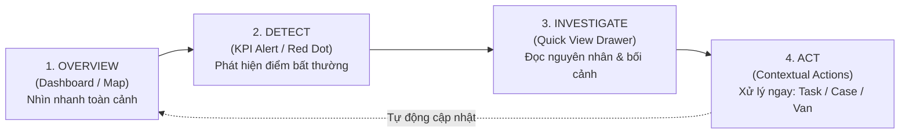

# BÁO CÁO UX AUDIT & ĐẶC TẢ CẢI TIẾN TOÀN DIỆN HỆ THỐNG SMART FARM
## CHUYỂN ĐỔI TỪ "CRUD ADMIN TEMPLATE" THÀNH "WORKSPACE VẬN HÀNH TRANG TRẠI THÔNG MINH"

---

## MỤC LỤC
1. [Triết lý Thiết kế & Nguyên tắc Vận hành Mới](#1-triết-lý-thiết-kế--nguyên-tắc-vận-hành-mới)
2. [Bảng UX Audit Toàn diện Hệ thống Hiện tại](#2-bảng-ux-audit-toàn-diện-hệ-thống-hiện-tại)
3. [Design System & Foundation Chuẩn hóa](#3-design-system--foundation-chuẩn-hóa)
4. [Tái cấu trúc App Shell & Information Architecture](#4-tái-cấu-trúc-app-shell--information-architecture)
5. [Đặc tả Thiết kế Chi tiết Từng Màn hình (P0 - P1 - P2)](#5-đặc-tả-thiết-kế-chi-tiết-từng-màn-hình)
   - [Nhóm P0: Cốt lõi Vận hành Hàng ngày](#nhóm-p0-cốt-lõi-vận-hành-hàng-ngày)
     - [1. App Layout & Shell](#1-app-layout--shell)
     - [2. Production Dashboard](#2-production-dashboard)
     - [3. Garden Map Workspace](#3-garden-map-workspace)
     - [4. Plant List & Directory](#4-plant-list--directory)
     - [5. Plant Detail Profile](#5-plant-detail-profile)
     - [6. Task Manager & Field Execution](#6-task-manager--field-execution)
   - [Nhóm P1: Chăm sóc, Sâu bệnh & Sản lượng](#nhóm-p1-chăm-sóc-sâu-bệnh--sản-lượng)
     - [7. Growth Tracking & Analytics](#7-growth-tracking--analytics)
     - [8. Nutrition & Fertilization](#8-nutrition--fertilization)
     - [9. Irrigation Management](#9-irrigation-management)
     - [10. Disease Case Progression](#10-disease-case-progression)
     - [11. Harvest & Yield Logging](#11-harvest--yield-logging)
   - [Nhóm P2: Tri thức, Môi trường & Minh bạch](#nhóm-p2-tri-thức-môi-trường--minh-bạch)
     - [12. Environment & Microclimate](#12-environment--microclimate)
     - [13. Disease Library (Search-First IPM)](#13-disease-library-search-first-ipm)
     - [14. Pesticides & Dosage Calculator](#14-pesticides--dosage-calculator)
     - [15. Traceability Visual Chain](#15-traceability-visual-chain)
6. [Đặc tả Trải nghiệm Thực địa (Field UX & Outdoor Mode)](#6-đặc-tả-trải-nghiệm-thực-địa-field-ux--outdoor-mode)
7. [Kiểm thử Màn hình Chuẩn 1366×768 & Tablet](#7-kiểm-thử-màn-hình-chuẩn-1366768--tablet)
8. [Tiêu chí Nghiệm thu & KPI Đánh giá Cải tiến](#8-tiêu-chí-nghiệm-thu--kpi-đánh-giá-cải-tiến)

---

## 1. TRIẾT LÝ THIẾT KẾ & NGUYÊN TẮC VẬN HÀNH MỚI

### 1.1. Chuyển đổi tư duy: Từ "Quản trị dữ liệu tĩnh" sang "Không gian vận hành chủ động"
Hệ thống hiện tại tuy đầy đủ nghiệp vụ nhưng đang mắc phải hội chứng **"CRUD Admin Fatigue"**:
- Quá nhiều Box/Card lồng nhau, viền dày đặc gây mỏi mắt (Visual Noise).
- Phân mảnh thông tin: Muốn xử lý 1 cây bị bệnh, người dùng phải chuyển qua 4-5 màn hình khác nhau (Dashboard $\rightarrow$ Menu $\rightarrow$ Submenu $\rightarrow$ Plant List $\rightarrow$ Detail $\rightarrow$ Task).
- Lạm dụng màu xanh nông nghiệp (`#059669`) ở khắp mọi ngóc ngách, làm mất đi khả năng tạo điểm nhấn cho các cảnh báo quan trọng.
- Chưa tối ưu cho môi trường thực địa: Nút bấm nhỏ, độ tương phản yếu dưới ánh nắng mặt trời, bảng biểu quá rộng đòi hỏi scroll ngang trên laptop 1366px và máy tính bảng ngoài vườn.

### 1.2. Chu trình UX Cốt lõi: Overview $\rightarrow$ Detect $\rightarrow$ Investigate $\rightarrow$ Act



- **Quy tắc 2 lần nhấp (Two-Click Rule)**: Từ bất kỳ điểm bất thường nào trên màn hình Overview (cây vàng lá, thiếu ẩm, task quá hạn), người dùng có thể kích hoạt hành động xử lý trong tối đa 2 lần nhấp chuột.
- **Side-effects Transparency**: Khi người dùng thao tác (như hoàn thành bón phân), giao diện phải dự báo trước và hiển thị ngay kết quả trừ kho, cập nhật nhật ký và ghi nhận chi phí.

---

## 2. BẢNG UX AUDIT TOÀN DIỆN HỆ THỐNG HIỆN TẠI

| # | Màn hình / Thành phần | UX Problem Hiện tại | Mức độ | Nguyên nhân Gốc rễ | Giải pháp Tối ưu (Redesign Recommendation) |
|---|---|---|:---:|---|---|
| **1** | **App Shell & Sidebar** | Sidebar chứa 13 item con ngang hàng phẳng lì, vượt chiều cao màn hình ở 768px; Topbar thiếu breadcrumb ngữ cảnh sâu; độ rộng Sidebar 256px chiếm diện tích vô ích. | **Critical** | Thiếu nhóm phân cấp thông tin (Information Architecture Grouping); layout chưa có responsive height. | Gom thành 4 nhóm nghiệp vụ có thể thu gọn (Sản xuất, Chăm sóc, Bảo vệ, Đầu ra); cố định chiều rộng 220px (thu gọn 64px); Topbar hiển thị breadcrumb động chuẩn hóa. |
| **2** | **Production Dashboard** | 6 thẻ KPI kích thước lớn chiếm 1/3 viewport; sơ đồ ma trận bị đóng khung trong card nhỏ; task hôm nay liệt kê rời rạc; biểu đồ sinh trưởng là vector tĩnh; "Card Fatigue" nghiêm trọng. | **Critical** | Thiết kế theo hướng dashboard báo cáo tĩnh thay vì "Mission Control" vận hành; nhồi nhét quá nhiều container lồng nhau. | Thay 6 Card bằng **Compact KPI Strip** 1 hàng; chia layout thành 3 khối vận hành: Sơ đồ sức khỏe trang trại, Khối việc khẩn cấp theo khung giờ (Overdue, Sáng, Chiều), Biểu đồ xu hướng sản xuất. Đảm bảo nhìn toàn bộ trên màn 1366×768 không cần cuộn. |
| **3** | **Garden Map** | Bản đồ bị nhét trong một thẻ Card con; thanh công cụ 4 dropdown dài lê thê chiếm diện tích; không có semantic zoom; click vào cây bị giật layout. | **Critical** | Coi Map là một widget phụ thay vì là "Core Workspace" trung tâm của trang trại. | Biến Map thành Full Workspace (chiếm 100% viewport còn lại); tinh gọn toolbar thành 1 ô tìm kiếm + nút Bộ lọc Popover gộp; áp dụng Semantic Zoom (xa: chấm màu, vừa: mã A023, gần: mã + nhãn bệnh); Quick Drawer trượt mượt mà. |
| **4** | **Plant List** | Bảng dữ liệu có quá nhiều text lặp lại (tên giống lặp từng dòng); không có chế độ Compact cho màn hình nhỏ; thanh lọc filter dàn hàng ngang dễ vỡ giao diện; thiếu Filter Chips thể hiện trạng thái đang lọc. | **High** | Thiếu hệ thống phân cấp mật độ hiển thị (Density switch); lọc dữ liệu chưa theo nguyên tắc Progressive Disclosure. | Thiết lập bộ chuyển Mật độ hiển thị (`Compact` cho desktop / `Comfortable` cho tablet); gộp bộ lọc phụ vào dropdown "Bộ lọc khác"; hiển thị thanh Active Filter Chips có nút xóa nhanh; tối ưu các cột quan trọng. |
| **5** | **Plant Detail Profile** | 8 Tab nằm ngang bị vỡ/tràn khi xem trên màn hình nhỏ; 5 thẻ KPI lớn lặp lại mã cây nhiều lần; thông tin phân tán làm tăng thời gian tra cứu. | **High** | Chia nhỏ thông tin thành quá nhiều tab con ngang hàng mà không có nhóm liên đới; thiếu sticky header ngữ cảnh. | Sticky Header tinh gọn; thay 5 KPI card bằng **Biometric Strip** gọn gàng; co gọn tab thành 4 tab chính + menu "Thêm ▾" khi màn hình $< 1200px$; bố cục 4 góc phần tư thông minh (Hồ sơ - Hiện trạng - Đo lường - Hoạt động kế tiếp). |
| **6** | **Task Manager** | 3 chế độ xem (List, Calendar, Board) cạnh tranh ngang hàng gây phân tâm; chưa có chế độ xem chuyên biệt cho công việc trong ngày; modal hoàn thành việc không hiển thị rõ hiệu ứng trừ kho. | **High** | Thiếu phân tách giữa góc nhìn người lập kế hoạch (Planner) và kỹ thuật viên thực địa (Field Operator). | Đặt chế độ **Hôm nay (Today View)** làm mặc định với phân nhóm Overdue, Buổi sáng, Buổi chiều; Card việc có nút bấm lớn $\ge 44px$; Modal xác nhận 2 bước hiển thị rõ "Tác động kho: -1.5kg NPK" và nhật ký sinh ra. |
| **7** | **Growth Tracking** | Dropdown chọn cây đơn điệu; biểu đồ không thể hiện rõ độ lệch chuẩn so với mục tiêu; bảng dữ liệu dày đặc số liệu thô. | **Medium** | Biểu diễn dữ liệu số học thuần túy, thiếu chỉ dẫn thị giác so sánh. | Tích hợp thẻ so sánh Delta ($\Delta$) tăng trưởng; biểu đồ kết hợp dải chuẩn sinh học VietGAP; form ghi nhận chỉ số hỗ trợ giá trị mặc định thông minh lấy từ lần đo gần nhất. |
| **8** | **Nutrition Manager** | Quy trình chuẩn và nhật ký thực tế nằm tách biệt; không tính toán được nhu cầu phân bón tổng hợp cho cả lô vườn. | **Medium** | Tách rời giữa lý thuyết quy chuẩn và thực tiễn thi công tại luống. | Thẻ tổng hợp nhu cầu phân bón trong tháng; liên kết 1-click từ quy trình chuẩn sang tạo hàng loạt công việc bón phân; hiển thị cảnh báo cây đến hạn bón. |
| **9** | **Irrigation Manager** | Nút "Tưới ngay" dễ bấm nhầm gây rủi ro mở van tràn nước ngoài vườn; hiển thị nhiều chi tiết kỹ thuật IoT không cần thiết cho kỹ sư nông nghiệp. | **High** | Trộn lẫn giữa giao diện vận hành nông học (Nước/Ẩm) và điều khiển kỹ thuật phần cứng IoT. | Loại bỏ thông số kỹ thuật IoT rườm rà (MQTT/Firmware); Card vùng tưới tối giản với thanh đo độ ẩm mục tiêu; nút kích hoạt van có **hộp thoại xác nhận 2 bước (Two-Step Confirmation)** hiển thị thời lượng và thể tích ước tính. |
| **10** | **Disease Cases** | Trạng thái bệnh thay đổi bằng Dropdown cơ học; không có trực quan hóa giai đoạn điều trị lâm sàng; thiếu nút chuyển tiếp nhanh theo quy trình y tế cây trồng. | **High** | Áp dụng mô hình CRUD database đơn giản cho một quy trình nghiệp vụ có tính tuần tự khắt khe. | Thay dropdown bằng **Clinical Stepper** (`Detected → Diagnosed → Treating → Monitoring → Resolved`); nút hành động theo ngữ cảnh (Contextual Action) chỉ hiển thị bước tiếp theo phù hợp; Drawer lưu vết tiền sử dùng thuốc. |
| **11** | **Harvest Manager** | Form tạo lô thu hoạch có 15 trường nhập cùng lúc gây nản lòng; chưa có tính năng gom nhanh danh sách cây mẹ đã hái. | **Medium** | Nhập liệu dạng biểu mẫu khối (Block Form) không phân cấp. | Chia quy trình thu hoạch thành Side-panel trượt 3 bước gọn gàng: 1. Chọn khu/cây $\rightarrow$ 2. Nhập sản lượng & Phân loại $\rightarrow$ 3. Xác nhận & Sinh mã Lô QR tự động. |
| **12** | **Environment** | 6 thông số đo hiển thị đồng hạng mặc dù độ ẩm đất và nhiệt độ quan trọng hơn lượng mưa; không báo rõ độ tươi mới của dữ liệu (Data Freshness). | **Medium** | Hiển thị dữ liệu cảm biến phẳng, thiếu phân cấp mức độ nghiêm trọng. | Nhóm thành cụm "Chỉ số trọng yếu đất" và "Vi khí hậu"; gắn nhãn thời gian thực (`Cập nhật 30 giây trước` hoặc `Cảnh báo: Dữ liệu cũ 45 phút trước`). |
| **13** | **Disease Library** | Bố trí như danh mục hàng hóa thương mại điện tử; người dùng ngoài vườn khó tra cứu triệu chứng thực tế khi cây gặp sự cố. | **Low** | Thiếu cơ chế tìm kiếm theo triệu chứng (Symptom-first Search). | Thiết kế giao diện **Search-first** với các gợi ý triệu chứng nhanh (Đọt non gãy, Vàng lá chóp, Nứt thân); Card thu gọn chỉ hiển thị hình ảnh + triệu chứng chính; toàn bộ phác đồ đưa vào Drawer. |
| **14** | **Pesticides** | Chưa có cảnh báo trực quan thời gian cách ly (PHI); công cụ tính liều lượng giấu sâu trong thẻ phụ. | **Low** | Chưa làm nổi bật yếu tố an toàn vệ sinh thực phẩm trước thu hoạch. | Huy hiệu đếm ngược PHI màu hổ phách cảnh báo an toàn; tích hợp máy tính pha chế 1-click ngay cạnh tên thuốc. |
| **15** | **Traceability** | Chỉ hiển thị bảng biểu và thông tin text đơn điệu, không hấp dẫn khi khách hàng quét mã QR trên quả dừa. | **Low** | Chưa tối ưu hóa trải nghiệm thị giác cho người tiêu dùng và đối tác mua buôn. | Thiết kế chuỗi truy xuất dạng trực quan (**Visual Supply Chain Journey**): Trang trại $\rightarrow$ Cây mẹ $\rightarrow$ Chăm sóc $\rightarrow$ Thu hoạch $\rightarrow$ Lô hàng; nút in tem nhãn chuẩn máy in mã vạch công nghiệp. |

---

## 3. DESIGN SYSTEM & FOUNDATION CHUẨN HÓA

### 3.1. Bảng màu Semantic (Semantic Color System)
Chấm dứt việc dùng màu xanh ở mọi nơi. Xanh lá chỉ phục vụ cho thương hiệu và chỉ số tích cực.

| Token | Giá trị Hex | Ứng dụng Chuẩn xác | Quy tắc Cấm kỵ |
|---|---|---|---|
| **Primary (Brand)** | `#059669` (Dark: `#047857`) | Nút hành động chính (Primary Button), Navigation đang chọn, điểm nhấn thương hiệu. | Không dùng làm nền cho các bảng dữ liệu lớn. |
| **Sidebar Canvas** | `#0F2D32` (Viền: `#164047`) | Nền thanh điều hướng bên trái, giữ độ tương phản cao, ổn định thị giác. | Không dùng màu đen thuần `#000000`. |
| **Surface Background** | `#F8FAFC` (Slate-50) | Nền toàn bộ không gian làm việc. | Không dùng nền trắng tinh chói mắt ngoài vườn. |
| **Card / Surface White** | `#FFFFFF` (Viền: `#E2E8F0`) | Bề mặt bảng biểu, panel, drawer, modal. Viền chuẩn mỏng 1px. | Không dùng viền quá đậm hoặc shadow quá dày. |
| **Health: Normal** | `#059669` (Bg: `#ECFDF5`) | Cây đạt chuẩn sinh trưởng, hoàn thành công việc, cảm biến ổn định. | Luôn đi kèm nhãn chữ hoặc icon (không chỉ dùng chấm tròn). |
| **Health: Watch** | `#D97706` (Bg: `#FFFBEB`) | Cây nghi thiếu phân, độ ẩm đất mấp mé ngưỡng, task sắp đến hạn. | Không dùng màu vàng neon khó đọc ngoài trời. |
| **Health: Critical** | `#E11D48` (Bg: `#FFF1F2`) | Cây nhiễm sâu bệnh nặng, van tưới hỏng, task quá hạn, cảm biến mất kết nối. | Không dùng hiệu ứng chớp tắt liên tục gây stress. |
| **Neutral Text** | `#0F172A` (Slate-900) | Tiêu đề chính, số liệu KPI quan trọng. | Đảm bảo độ tương phản $\ge 7:1$ so với nền trắng. |
| **Muted Text** | `#64748B` (Slate-500) | Nhãn giải thích, đơn vị đo, thời gian phụ. | Tối thiểu kích thước 11px font chữ. |

### 3.2. Hệ thống Typography (Inter + Tabular Numbers)
- **Font chính**: `Inter`, `-apple-system`, `BlinkMacSystemFont`, `sans-serif`.
- **Quy tắc Font Mono**: **Chỉ** áp dụng font monospace (`font-mono`) cho các mã định danh cần độ chính xác tuyệt đối từng ký tự:
  - Mã cây: `A023`, `B001`
  - Mã bệnh: `CASE-2026-0127`
  - Mã lô: `LOT-COC-100526-KB`
  - Mã tác vụ: `TSK-0104`
  - Tọa độ GPS: `10.3356, 106.3553`
- **Số liệu KPI**: Sử dụng Inter với tính năng `tabular-nums` để các con số thẳng hàng khi nhảy dữ liệu realtime mà không bị giật layout.

### 3.3. Phân cấp Kích thước & Trọng số (Type Hierarchy)
- **Page Title**: `20px` (Desktop) / `18px` (Tablet), font-bold (`font-weight: 700`), tracking-tight.
- **Section Heading**: `15px` / font-semibold (`600`), text-slate-900.
- **Card / Panel Title**: `13px` / font-bold (`700`), uppercase nhẹ hoặc capitalize rõ nét.
- **Body Text**: `13px` / font-normal (`400`), line-height: `1.5` (`leading-relaxed`).
- **Table Data Text**: `12px` / font-medium (`500`).
- **Metadata / Caption**: `11px` / font-normal (`400`), text-slate-500.
- **KPI Value**: `24px` - `28px` / font-bold (`700`), font-mono hoặc Inter tabular.

### 3.4. Hệ thống Spacing & Radius Chuẩn hóa
- **Thước đo Spacing**: Tuân thủ nghiêm ngặt bước nhảy $4px$: `4px` (1), `8px` (2), `12px` (3), `16px` (4), `24px` (6), `32px` (8).
- **Bo góc (Border Radius)**:
  - Button, Input, Badge: `rounded-md` ($6px$).
  - Card, Panel, Drawer: `rounded-lg` ($8px$).
  - Tuyệt đối tránh lạm dụng `rounded-2xl` hoặc `rounded-3xl` gây cảm giác trẻ con, thiếu tính công nghiệp nghiêm túc.
- **Bóng đổ (Elevation)**: Mặc định dùng `border border-slate-200 shadow-xs`. Không dùng `shadow-lg` hoặc `shadow-2xl` cho các khối nội dung thông thường; chỉ dùng `shadow-xl` cho Modal và Popover trôi nổi.

---

## 4. TÁI CẤU TRÚC APP SHELL & INFORMATION ARCHITECTURE

### 4.1. Kiến trúc Menu Sidebar Nhóm Tinh gọn
Sidebar hiện tại có 13 mục ngang hàng gây quá tải nhận thức. Tái cấu trúc thành 4 nhóm nghiệp vụ có thể thu gọn (Collapsible Groups), chiều rộng cố định $230px$ (thu gọn $64px$):

```text
┌──────────────────────────────────────────────┐
│ [Logo Sprout] SMART FARM    [Thu gọn <<]     │
│ TRẠI DỪA AN PHÚ · BẾN TRE                    │
├──────────────────────────────────────────────┤
│ ▾ SẢN XUẤT (PRODUCTION)                      │
│   ├─ Tổng quan sản xuất      (/production)   │
│   ├─ Sơ đồ vườn trực quan    (/map)          │
│   ├─ Cây trồng & Hồ sơ       (/plants)       │
│   └─ Công việc hôm nay       (/tasks)  [3]   │
│                                              │
│ ▾ CHĂM SÓC CÂY (CROP CARE)                   │
│   ├─ Sinh trưởng & Trái      (/growth)       │
│   ├─ Dinh dưỡng & Bón phân   (/nutrition)    │
│   ├─ Nước & Tưới tiêu        (/irrigation)   │
│   └─ Đất & Vi khí hậu        (/environment)  │
│                                              │
│ ▾ BẢO VỆ THỰC VẬT (IPM)                      │
│   ├─ Thư viện sâu bệnh       (/diseases)     │
│   ├─ Thuốc BVTV sinh học     (/pesticides)   │
│   └─ Case điều trị           (/cases)  [2]   │
│                                              │
│ ▾ ĐẦU RA & THƯƠNG MẠI                        │
│   ├─ Thu hoạch & Năng suất   (/harvests)     │
│   └─ Cổng truy xuất          (/traceability) │
├──────────────────────────────────────────────┤
│ ☀ Chế độ ngoài trời (Outdoor Mode) [OFF/ON]  │
│ [Avatar] KTV. Lê Văn C · Trực ca vườn        │
└──────────────────────────────────────────────┘
```

### 4.2. Topbar Chuẩn mực Toàn cục (Global Topbar)
Không đưa action cục bộ của từng trang lên Topbar. Topbar chỉ giữ chức năng định vị và tìm kiếm hệ thống:

```text
┌─────────────────────────────────────────────────────────────────────────────────────────────┐
│ [≡ Menu]  Trang trại An Phú  /  Khu Bắc  /  Vườn 01          [🔍 Tra cứu mã cây, bệnh...]  │
│                                                   [+ Thao tác nhanh ▾]  [🔔 2]  [Lê Văn C ▾]│
└─────────────────────────────────────────────────────────────────────────────────────────────┘
```

- **Breadcrumb Ngữ cảnh**: Thể hiện chính xác cấp bậc không gian đang chọn: `Trang trại / Phân khu / Lô vườn`.
- **Omni Search**: Ô tìm kiếm thông minh nhận diện nhanh định dạng: nhập `A023` $\rightarrow$ gợi ý mở cây; nhập `CASE` $\rightarrow$ gợi ý mở ca bệnh; nhập `LOT` $\rightarrow$ mở lô thu hoạch.
- **Nút "+ Thao tác nhanh (Quick Action ▾)"**: Dropdown chứa 5 tác vụ thực địa phổ biến nhất: *1. Xuống giống cây mới; 2. Ghi nhận đo sinh trưởng; 3. Giao việc chăm sóc; 4. Báo ca sâu bệnh; 5. Ghi nhận hái quả*.

### 4.3. Loại bỏ "Card Fatigue" & Chuẩn hóa Page Header
Tất cả các trang con đều tuân thủ cấu trúc Page Header không có thẻ card bao quanh:

```text
┌─────────────────────────────────────────────────────────────────────────────────────────────┐
│ Tên Trang Chính (20px, Bold)                [Thao tác phụ (Outline)] [Thao tác chính (Solid)]│
│ Mô tả dòng phụ ngắn gọn kèm số lượng tổng thể                                               │
├─────────────────────────────────────────────────────────────────────────────────────────────┤
│ (Tùy chọn) Thanh KPI Strip nhỏ gọn 1 dòng hoặc Thanh lọc Filter Bar                          │
└─────────────────────────────────────────────────────────────────────────────────────────────┘
```

---

## 5. ĐẶC TẢ THIẾT KẾ CHI TIẾT TỪNG MÀN HÌNH

---

### NHÓM P0: CỐT LÕI VẬN HÀNH HÀNG NGÀY

---

#### 1. APP LAYOUT & SHELL
- **Mục tiêu**: Khung giao diện ổn định, tiết kiệm từng pixel không gian hiển thị, tải trang siêu tốc.
- **Kích thước**:
  - Sidebar: Expanded $230px$, Collapsed $64px$, chuyển đổi bằng micro-animation $180ms$.
  - Topbar: Chiều cao chuẩn $48px$ (giảm từ $56px$), viền mỏng border-b.
  - Page Content: Padding $16px$ (Laptop 1366px) và $24px$ (Desktop lớn).

---

#### 2. PRODUCTION DASHBOARD
- **Đường dẫn**: `/production` hoặc `/production/dashboard`
- **Vấn đề hiện tại**: 6 card KPI to kềnh càng đẩy thông tin quan trọng xuống dưới nếp gấp màn hình (below the fold); ma trận cây bị nhét trong khung chật hẹp; danh sách công việc không phân biệt được việc nào khẩn cấp buổi sáng/buổi chiều.
- **Mục tiêu người dùng mới**: Người quản lý hoặc KTV mở Dashboard trong 5 giây phải trả lời được: *1. Đang có bao nhiêu cây gặp nguy hiểm? 2. Sáng nay tôi cần làm gì gấp? 3. Vườn nào đang khô thiếu nước?*

##### Phân cấp Ưu tiên Thông tin (Information Priority):
- **P0 (Thấy ngay lập tức)**: Dải KPI Strip 1 hàng; Cảnh báo sức khỏe cây nguy cấp (`SICK`); Việc quá hạn & việc ca sáng.
- **P1 (Sau 1 click/quét mắt)**: Ma trận trạng thái từng hàng cây A/B; Việc ca chiều; Xu hướng năng suất 6 tháng.
- **P2 (Trong chi tiết)**: Lịch sử hoàn thành việc cũ; Thông số kỹ thuật chi tiết.

##### Sơ đồ Bố cục Cải tiến (Wireframe 1366×768 Không Cuộn Trang):
```text
┌───────────────────────────────────────────────────────────────────────────────────────────────┐
│ TỔNG QUAN SẢN XUẤT & VẬN HÀNH CÂY TRỒNG                      [Sơ đồ vườn] [+ Xuống giống mới] │
├───────────────────────────────────────────────────────────────────────────────────────────────┤
│ [1,250 Tổng cây] | [1,173 Khỏe mạnh 93.8%] | [52 Cần theo dõi] | [25 Đang bệnh] | [18 Việc hôm nay] │
├───────────────────────────────────────────────────────────────┬───────────────────────────────┤
│ KHỐI TRÁI (60%): SƠ ĐỒ SỨC KHỎE VƯỜN MA TRẬN                  │ KHỐI PHẢI (40%): VIỆC HÔM NAY │
│ Phân khu Bắc · Vườn 01 (Lưới 180 cây)                         │                               │
│ HÀNG A (Dừa xiêm lùn - 100 cây):                              │ 🔴 QUÁ HẠN / KHẨN CẤP (2)     │
│ [01][02][03]...[18:🔴]...[23:🟡]...[50]                       │ 08:00 Phun trừ bọ đọt · A018  │
│ HÀNG B (Dừa dứa Thái Lan - 80 cây):                           │       [Bắt đầu] [Hoàn thành]  │
│ [01][02]...[24:🔴]...[80]                                     │                               │
│                                                               │ 🟡 CA SÁNG 08:00 - 11:30 (4)  │
│ Chú thích gọn: 🟢 172 Khỏe · 🟡 6 Theo dõi · 🔴 2 Nguy cấp    │ 09:30 Bón NPK Hàng A · 1.5kg  │
│                                                               │ 10:15 Đo ẩm đất trạm 01       │
├───────────────────────────────────────────────────────────────┤                               │
│ XU HƯỚNG NĂNG SUẤT 6 THÁNG (Bình quân 68 quả/cây · +14% tháng)│ 🟢 CA CHIỀU 13:30 - 17:00 (3) │
│ [Biểu đồ sparkline/cột phẳng siêu nét từ T05 đến T10]          │ 15:00 Tưới bù ẩm Vùng 01      │
└───────────────────────────────────────────────────────────────┴───────────────────────────────┘
```

##### Tương tác Cốt lõi:
- **Click vào ô cây đỏ `18:🔴`**: Ngay lập tức mở **Plant Quick Drawer** từ bên phải màn hình: hiển thị ảnh chụp sâu bệnh, chẩn đoán sơ bộ, nút `Mở ca điều trị ngay`. Không chuyển trang, không gián đoạn công việc.
- **Nút "Hoàn thành" trên Task**: Mở popup xác nhận nhanh 2 bước, trừ kho ngay tức khắc.

---

#### 3. GARDEN MAP WORKSPACE
- **Đường dẫn**: `/production/map`
- **Vấn đề hiện tại**: Map bị đóng khung trong card viền xám, thanh công cụ 4 dropdown dài choán hết 120px chiều cao; cây hiển thị text cồng kềnh khi thu nhỏ bản đồ.
- **Mục tiêu người dùng mới**: Map là một bàn làm việc không gian rộng mở 100% diện tích; tìm thấy cây bất kỳ trong $\le 2$ thao tác; xem trạng thái không giật lag.

##### Sơ đồ Bố cục Cải tiến (Full Workspace Layout):
```text
┌───────────────────────────────────────────────────────────────────────────────────────────────┐
│ [🔍 Mã cây (A023)...] [Vườn 01 ▾] [Sức khỏe: Tất cả ▾] [Bộ lọc khác (2)] [Lớp ▾]  [Fit] [-][+]│
├───────────────────────────────────────────────────────────────────────────────┬───────────────┤
│                                                                               │ QUICK PANEL   │
│   HÀNG A (Dừa Xiêm Xanh Lùn)                                                  │ (Drawer trượt)│
│   ● ● ● ● ● ● ● ● ● ● ● ● [A018:🔴] ● ● ● ● [A023:🟡] ● ● ●                   │               │
│                                                                               │ CÂY A023      │
│   ~~~~~~~~~~~~~~~~~~~~~~~~~~~~~~~~~~~~~~~~~~~~~~~~~~~~~~~~~~~~ (Đường tưới)   │ 🟡 THEO DÕI   │
│                                                                               │               │
│   HÀNG B (Dừa Dứa Thái Lan)                                                   │ Dừa xiêm xanh │
│   ● ● ● ● ● ● ● ● ● ● ● ● ● ● ● ● ● ● ● ● ● [B024:🔴] ● ●                     │ 4 năm 2 tháng │
│                                                                               │ 34 quả · 6 bg │
│   [📡 Trạm IoT 01: Ẩm đất 38% · Pin 98%]                                      │ Ẩm đất: 38%   │
│                                                                               │               │
│                                                                               │ ⚠️ Vàng lá nhẹ│
│                                                                               │               │
│                                                                               │ [Hồ sơ cây]   │
│                                                                               │ [Tạo việc]    │
│                                                                               │ [Báo bệnh]    │
└───────────────────────────────────────────────────────────────────────────────┴───────────────┘
```

##### Cơ chế Semantic Zoom (Phóng to Thông minh):
- **Mức Zoom xa ($< 70\%$)**: Tối ưu hiệu năng, mỗi cây là 1 chấm tròn nhỏ ($8px$) mang màu sức khỏe (Xanh, Vàng, Đỏ). Tuyệt đối không render chữ để tránh vỡ chữ và lag GPU.
- **Mức Zoom vừa ($70\% - 120\%$)**: Hiển thị chấm tròn to hơn ($20px$) chứa mã cây rút gọn: `01`, `18`, `23`.
- **Mức Zoom gần ($> 120\%$)**: Hiển thị đầy đủ ô badge: `A023` kèm biểu tượng cảnh báo nếu có sự cố.

---

#### 4. PLANT LIST & DIRECTORY
- **Đường dẫn**: `/production/plants`
- **Vấn đề hiện tại**: Quá nhiều chữ lặp lại vô ích (dòng nào cũng có "Dừa Xiêm Xanh Lùn Bến Tre"); thiếu tùy chọn Compact Density; thiếu Active Filter Chips.
- **Mục tiêu người dùng mới**: Quét danh sách nhanh bằng mắt, sắp xếp theo năng suất/sức khỏe, lọc dữ liệu minh bạch, chuyển trang không giật.

##### Sơ đồ Bố cục Cải tiến:
```text
┌───────────────────────────────────────────────────────────────────────────────────────────────┐
│ CÁ THỂ CÂY TRỒNG (1.250 cây đang theo dõi)                    [Mật độ: Dày ▾] [+ Xuống giống] │
├───────────────────────────────────────────────────────────────────────────────────────────────┤
│ [🔍 Tìm theo mã A001, tên, hàng...] [Khu Bắc ▾] [Sức khỏe ▾] [Bộ lọc thêm ▾]  [Xuất Excel]   │
├───────────────────────────────────────────────────────────────────────────────────────────────┤
│ Bộ lọc đang áp dụng: [Khu Bắc ×] [Cần theo dõi (WATCH) ×]               [Xóa tất cả bộ lọc]   │
├───────────────────────────────────────────────────────────────────────────────────────────────┤
│ Mã cây  Giống dừa   Vị trí thực địa      Tuổi    Giai đoạn       Sức khỏe    Trái  Cập nhật  …│
│───────────────────────────────────────────────────────────────────────────────────────────────│
│ A018    Xiêm lùn    Khu Bắc · V01 · HA   4.0 y   Kinh doanh      🔴 Bệnh      28   10p trước  │
│ A023    Xiêm lùn    Khu Bắc · V01 · HA   4.2 y   Kinh doanh      🟡 Theo dõi  34   2h trước   │
│ A001    Xiêm lùn    Khu Bắc · V01 · HA   4.0 y   Kinh doanh      🟢 Khỏe      58   1 ngày tr  │
│ B001    Dừa dứa     Khu Bắc · V01 · HB   3.5 y   Cho trái bói    🟢 Tốt       30   Hôm qua    │
├───────────────────────────────────────────────────────────────────────────────────────────────┤
│ Hiển thị 1 - 25 của 52 cây theo dõi                     Trang [1] 2 3 ... [Sau] · 25 dòng/trang│
└───────────────────────────────────────────────────────────────────────────────────────────────┘
```

- **Tính năng Mật độ (Density)**: Cho phép chuyển giữa `Compact` (chiều cao hàng $36px$, hiển thị được 15 dòng trên laptop 768px mà không cuộn) và `Comfortable` ($48px$ cho màn hình cảm ứng tablet).

---

#### 5. PLANT DETAIL PROFILE
- **Đường dẫn**: `/production/plants/:id`
- **Vấn đề hiện tại**: 8 tab ngang bị tràn dòng trên màn hình nhỏ; 5 card KPI sinh trắc to chiếm hết diện tích; thông tin phân tán.
- **Mục tiêu người dùng mới**: Gom toàn bộ thông tin sống còn vào **Quadrant Layout (4 góc phần tư)**; Sticky Header định vị tức thời.

##### Sơ đồ Bố cục Cải tiến:
```text
┌───────────────────────────────────────────────────────────────────────────────────────────────┐
│ [← Danh sách cây]   A023 · Dừa Xiêm Xanh Lùn Bến Tre    🟡 CẦN THEO DÕI    [Bản đồ] [Mã QR] [Sửa]│
│ Vị trí: Khu Bắc / Vườn 01 / Hàng A — Tọa độ: 10.3356° N, 106.3553° E                          │
├───────────────────────────────────────────────────────────────────────────────────────────────┤
│ DẢI SINH TRẮC COMPACT: Cao 4.5m  |  Thân 30.5cm  |  22 Tàu lá  |  6 Buồng  |  34 Quả trên cây │
│ ⚠️ VẤN ĐỀ HIỆN TẠI: Vàng chóp lá già do thiếu vi lượng đạm — Đang theo dõi bón bổ sung       │
├───────────────────────────────────────────────────────────────────────────────────────────────┤
│ [1. Tổng quan]  [2. Sinh trưởng]  [3. Chăm sóc & Việc]  [4. Sâu bệnh]  [Thêm ▾ (Dinh dưỡng...)] │
├───────────────────────────────────────────────────────────────┬───────────────────────────────┤
│ GÓC 1: LÝ LỊCH CÂY & ĐẤT TẠI GỐC                              │ GÓC 2: TÌNH TRẠNG HIỆN TẠI    │
│ - Xuống giống: 15/03/2022 (4 năm 2 tháng)                     │ - Độ ẩm đất: 38% (Hơi khô)    │
│ - Nguồn gốc: Cây đầu dòng Bến Tre                             │ - pH đất: 6.2 (Thích hợp)     │
│ - Chu kỳ ra buồng: 28 ngày/buồng                              │ - Lần tưới cuối: Hôm nay 06:30│
│ - Năng suất tích lũy: 340 kg                                  │ - Lần bón cuối: 12/09 (NPK)   │
├───────────────────────────────────────────────────────────────┼───────────────────────────────┤
│ GÓC 3: LẦN ĐO GẦN NHẤT (01/10/2026)                           │ GÓC 4: CÔNG VIỆC KẾ TIẾP      │
│ - Tăng trưởng chiều cao: +0.1m / quý                          │ 🟡 12/10: Kiểm tra rệp sáp đọt│
│ - Tỷ lệ đậu quả buồng mới: 85%                                │ 🟢 18/10: Bón thúc đợt 3      │
│ [Xem lịch sử đo đầy đủ →]                                     │ [Tạo việc mới cho cây này]    │
└───────────────────────────────────────────────────────────────┴───────────────────────────────┘
```

- **Tabs Responsive**: Trên màn hình $< 1200px$, 4 tab phụ (Tưới tiêu, Dinh dưỡng, Thu hoạch, Dòng thời gian) tự động đưa vào dropdown menu `Thêm ▾`, giữ thanh tab luôn nằm trên 1 hàng duy nhất.

---

#### 6. TASK MANAGER & FIELD EXECUTION
- **Đường dẫn**: `/production/tasks`
- **Vấn đề hiện tại**: Giao diện chia đều sức nặng giữa List, Calendar và Kanban; thiếu chế độ thực địa cho người trực tiếp làm việc; thao tác hoàn thành việc phức tạp.
- **Mục tiêu người dùng mới**: **Mặc định vào chế độ "Hôm nay (Today View)"**; hoàn thành công việc chỉ trong 2 bước với minh bạch tồn kho vật tư.

##### Sơ đồ Bố cục Cải tiến (Today View Mặc định):
```text
┌───────────────────────────────────────────────────────────────────────────────────────────────┐
│ CÔNG VIỆC CHĂM SÓC NÔNG NGHIỆP                                       [+ Giao việc chăm sóc]   │
│ Chế độ xem: [● Hôm nay (12)]  [Danh sách]  [Lịch tháng]  [Bảng Kanban]                        │
├───────────────────────────────────────────────────────────────────────────────────────────────┤
│ HÔM NAY · THỨ HAI, 05/10/2026                                                                 │
│                                                                                               │
│ 🔴 VIỆC QUÁ HẠN & KHẨN CẤP (1 việc cần xử lý ngay)                                            │
│ ┌───────────────────────────────────────────────────────────────────────────────────────────┐ │
│ │ 08:00 · Báo động sâu bệnh      Cây: A018 (Hàng A)       Người làm: Lê Văn C               │ │
│ │ Phun chế phẩm trừ bọ cánh cứng · Vật tư: Nấm xanh Metarhizium (50g)                       │ │
│ │ [Bắt đầu làm]                                          [✓ BÁO HOÀN THÀNH & TRỪ KHO]       │ │
│ └───────────────────────────────────────────────────────────────────────────────────────────┘ │
│                                                                                               │
│ 🟡 CA SÁNG 08:00 - 11:30 (2 việc)                                                             │
│ ┌───────────────────────────────────────────────────────────────────────────────────────────┐ │
│ │ 09:30 · Bón phân thúc đợt 2    Cây: A023 (Hàng A)       Người làm: Lê Văn C               │ │
│ │ Định mức: 1.5kg NPK 16-16-8 Hữu cơ vi sinh                                                │ │
│ │ [Bắt đầu làm]                                          [✓ BÁO HOÀN THÀNH & TRỪ KHO]       │ │
│ └───────────────────────────────────────────────────────────────────────────────────────────┘ │
└───────────────────────────────────────────────────────────────────────────────────────────────┘
```

##### Hộp thoại Hoàn thành Việc Tốc độ Cao (2-Step Quick Complete Modal):
```text
┌───────────────────────────────────────────────────────────────────────┐
│ HOÀN THÀNH VIỆC: Bón phân thúc đợt 2 cho cây A023                     │
├───────────────────────────────────────────────────────────────────────┤
│ Lượng phân NPK thực tế sử dụng: [ 1.5 ] kg (Khuyên dùng: 1.5 kg)      │
│                                                                       │
│ Ghi chú nhanh (Tùy chọn):                                             │
│ [ Đã bón quanh tán, tưới đẫm nước sau bón.                         ]  │
│                                                                       │
│ HIỆU ỨNG TỰ ĐỘNG KHI BẤM HOÀN THÀNH:                                  │
│  ✓ Trừ tồn kho Phân NPK: 350.0 kg → 348.5 kg                          │
│  ✓ Cập nhật ngày bón phân gần nhất của cây A023: Hôm nay              │
│  ✓ Ghi nhận chi phí vật tư: 37.500 VNĐ                                │
├───────────────────────────────────────────────────────────────────────┤
│                                 [Hủy bỏ]   [XÁC NHẬN HOÀN TẤT (Enter)]│
└───────────────────────────────────────────────────────────────────────┘
```

---

### NHÓM P1: CHĂM SÓC, SÂU BỆNH & SẢN LƯỢNG

---

#### 7. GROWTH TRACKING & ANALYTICS
- **Đường dẫn**: `/production/growth`
- **Cải tiến UX**:
  - Không bắt chọn cây từ dropdown trống: hiển thị sẵn danh sách 5 cây tiêu biểu đại diện cho các mức sức khỏe khác nhau.
  - Biểu đồ kết hợp dải chuẩn nông học (Benchmark Band): Người dùng nhìn vào thấy ngay cây mình đang cao hơn hay thấp hơn chuẩn VietGAP.
  - Form thêm chỉ số đo mới tự động điền sẵn các số đo của lần trước, KTV chỉ cần tăng giảm số đo thực tế (tiết kiệm $80\%$ thời gian gõ phím).

---

#### 8. NUTRITION & FERTILIZATION
- **Đường dẫn**: `/production/nutrition`
- **Cải tiến UX**:
  - Tích hợp tính năng **"Tạo kế hoạch bón phân đồng loạt"**: Chọn 1 quy trình chuẩn (ví dụ: Dừa 4 năm tuổi) $\rightarrow$ bấm nút `Lập lịch bón cho toàn Hàng A (100 cây)` $\rightarrow$ hệ thống tự động sinh 100 task con và tính tổng nhu cầu phân bón ($150kg$ NPK) gửi sang thủ kho chuẩn bị.

---

#### 9. IRRIGATION MANAGEMENT
- **Đường dẫn**: `/production/irrigation`
- **Cải tiến UX & An toàn Vận hành**:
  - **Loại bỏ nguy cơ click nhầm**: Nút `Tưới ngay` không kích hoạt trực tiếp van mà mở hộp thoại bảo vệ: *“Bạn có chắc chắn muốn mở van Vùng A trong 15 phút? Ước tính tiêu thụ: 420 lít nước. [Xác nhận bật van]”*.
  - Hiển thị trực quan thanh độ ẩm: Ngưỡng cảnh báo ($<35\%$), Ngưỡng mục tiêu ($40\% - 55\%$), Ngưỡng úng nước ($>70\%$).

---

#### 10. DISEASE CASE PROGRESSION
- **Đường dẫn**: `/production/disease-cases`
- **Cải tiến UX theo Quy trình Lâm sàng (Clinical Stepper)**:
  - Thay thế hoàn toàn dropdown trạng thái bằng Stepper 5 bước:
    `① Phát hiện (Detected) → ② Lấy mẫu (Diagnosed) → ③ Đang trị (Treating) → ④ Theo dõi (Monitoring) → ⑤ Khỏi bệnh (Resolved)`.
  - Nút bấm hành động chuyển bước ngữ cảnh:
    - Khi đang ở bước *Treating*, nút chính hiển thị: `[Ghi nhận lần phun thuốc]`.
    - Khi phun đủ liệu trình, nút hiển thị: `[Chuyển sang Giai đoạn Theo dõi Hồi phục]`.
    - Khi cây hồi phục hoàn toàn, bấm `[Xác nhận Khỏi bệnh & Đóng Ca]` $\rightarrow$ Hệ thống tự động cập nhật sức khỏe cây trong hồ sơ từ `SICK` về `NORMAL`.

---

#### 11. HARVEST & YIELD LOGGING
- **Đường dẫn**: `/production/harvests`
- **Cải tiến UX Tốc độ Cao (Side-Panel Logger)**:
  - Thay form dài bằng Side-Panel trượt 3 bước:
    - *Bước 1*: Chọn Hàng cây / Cây mẹ vừa hái (hỗ trợ nút `Chọn cả Hàng A`).
    - *Bước 2*: Cân tổng khối lượng ($380kg$) $\rightarrow$ Nhập tỷ lệ Loại 1 ($300kg$), Loại 2 ($60kg$), Quả loại ($20kg$).
    - *Bước 3*: Hệ thống tự động sinh mã Lô `LOT-COC-051026-KB` kèm mã QR in nhanh ra tem nhãn dán lên sọt hàng.

---

### NHÓM P2: TRI THỨC, MÔI TRƯỜNG & MINH BẠCH

---

#### 12. ENVIRONMENT & MICROCLIMATE
- **Đường dẫn**: `/production/environment`
- **Cải tiến UX**:
  - Nhóm chỉ số theo mức độ quan tâm: Khối trên cùng là **Độ ẩm đất & Nhiệt độ**; khối dưới là EC, pH và Lượng mưa.
  - Hiển thị nhãn độ tươi mới của dữ liệu: `Cập nhật 15 giây trước` (Màu xanh); nếu trạm mất sóng LoRa hiển thị: `⚠️ Mất kết nối 45 phút trước (Dữ liệu cũ)` (Màu vàng).

#### 13. DISEASE LIBRARY (SEARCH-FIRST IPM)
- **Đường dẫn**: `/production/diseases`
- **Cải tiến UX**:
  - Giao diện lấy ô tìm kiếm làm trung tâm (Search-First).
  - Đưa ra các thẻ gợi ý triệu chứng nhanh ngoài thực tế: `[Lá non bị cắn rách hình chữ V]`, `[Đọt héo rũ có mùi hôi]`, `[Đốm nâu lá già]`. KTV bấm vào gợi ý là lọc ra ngay bệnh cần tìm.

#### 14. PESTICIDES & DOSAGE CALCULATOR
- **Đường dẫn**: `/production/pesticides`
- **Cải tiến UX**:
  - Đặt biểu tượng cảnh báo **Thời gian cách ly an toàn (PHI)** ở góc trên mỗi thẻ thuốc. Nếu thuốc có PHI = 7 ngày, hệ thống sẽ cảnh báo không được phun cho các cây dự kiến thu hoạch trong tuần tới.
  - Máy tính liều lượng tích hợp: Nhập số cây cần phun $\rightarrow$ Tự động ra số gam thuốc + số lít nước cần pha.

#### 15. TRACEABILITY VISUAL CHAIN
- **Đường dẫn**: `/production/traceability`
- **Cải tiến UX**:
  - Chuyển đổi từ dạng bảng tĩnh sang **Hành trình Chuỗi Cung ứng Trực quan**:
    `Trang trại An Phú ➔ Cây mẹ A023 ➔ Chăm sóc hữu cơ ➔ Thu hoạch 05/10 ➔ Lô hàng LOT-COC-051026-KB`.
  - Nút bấm tối ưu cho in ấn: `Xuất tem QR chuẩn máy in Zebra/Godex (50x30mm)`.

---

## 6. ĐẶC TẢ TRẢI NGHIỆM THỰC ĐỊA (FIELD UX & OUTDOOR MODE)

Khi kỹ thuật viên mang thiết bị di động / máy tính bảng ra ngoài vườn dừa:
1. **Chế độ Ngoài trời (Outdoor High-Contrast Mode)**:
   - Kích hoạt qua công tắc trên Topbar hoặc tự động nhận diện sensor ánh sáng.
   - Khi bật: Nền chuyển sang trắng tuyệt đối (`#FFFFFF`), chữ đen đậm (`#000000`), tăng viền các ô lên `2px solid #000000`, tắt toàn bộ shadow mờ, kích thước chữ tăng thêm $1px$.
2. **Kích thước Điểm chạm Cảm ứng (Touch Target)**:
   - Mọi nút bấm tác vụ nhanh trên tablet có chiều cao tối thiểu $44px$ (tuân thủ Human Interface Guidelines).
   - Khoảng cách giữa các nút bấm tối thiểu $8px$ tránh bấm nhầm khi đeo găng tay lao động.
3. **Quy trình Quét mã QR 1 Chạm (Scan & Go)**:
   - KTV quét mã tem gắn trên thân cây dừa $\rightarrow$ Mở ngay màn hình **Plant Quick Action**:
     - *Nút to 1*: Ghi số đo sinh trưởng mới.
     - *Nút to 2*: Báo hoàn thành việc chăm sóc.
     - *Nút to 3*: Chụp ảnh báo ca bệnh.
     - *Nút to 4*: Ghi nhận sản lượng quả vừa hái.

---

## 7. KIỂM THỬ MÀN HÌNH CHUẨN 1366×768 & TABLET

| Độ phân giải | Khu vực Kiểm tra | Yêu cầu Đạt Chuẩn (Acceptance Checklist) |
|---|---|---|
| **Laptop 1366×768** | Dashboard | Dải KPI Strip + Ma trận vườn Hàng A/B + Danh sách việc khẩn cấp hiển thị đầy đủ trong chiều cao 768px mà không xuất hiện thanh cuộn dọc (Zero vertical scroll for P0 content). |
| **Laptop 1366×768** | Plant List | Bảng dữ liệu ở chế độ Compact hiển thị tối thiểu 12 dòng; không xuất hiện thanh cuộn ngang (No horizontal scrollbar). |
| **Laptop 1366×768** | Garden Map | Map chiếm tối thiểu $620px$ chiều cao khả dụng; thanh toolbar không bị rớt dòng thành hàng thứ hai. |
| **Tablet 1024×768 (Ngang)** | App Shell | Sidebar tự động thu gọn về dạng icon $64px$; các thẻ Card chuyển thành lưới 2 cột cân đối. |
| **Tablet 768×1024 (Dọc)** | Task Manager | Danh sách công việc Today View chuyển thành luồng 1 cột; nút bấm chuyển sang độ cao cảm ứng $\ge 44px$. |

---

## 8. TIÊU CHÍ NGHIỆM THU & KPI ĐÁNH GIÁ CẢI TIẾN

1. **Tốc độ Truy cập Thông tin Cây (Plant Discovery)**:
   - Tìm kiếm và mở hồ sơ bất kỳ cây nào: $\le 2$ thao tác (Nhập mã tại Topbar hoặc nhấp trên Map). Thời gian thực hiện: $\le 3$ giây.
2. **Tốc độ Hoàn thành Tác vụ (Task Completion Speed)**:
   - Từ lúc mở việc đến khi xác nhận trừ kho thành công: $\le 2$ bước xác nhận. Thời gian: $\le 5$ giây.
3. **Giảm Tải Nhận Thức (Cognitive Load Reduction)**:
   - Giảm số lượng Card container lồng nhau trên Dashboard từ 14 card xuống còn 3 khối chức năng chính.
   - Giảm chiều cao thanh công cụ Map từ $120px$ xuống còn $44px$ (tăng $35\%$ diện tích quan sát bản đồ).
4. **Độ Tin cậy Dữ liệu Liên phân hệ (Data Integrity)**:
   - $100\%$ các tác vụ hoàn thành có tiêu hao vật tư đều phản ánh trực tiếp vào tồn kho của Phân hệ 3 và ghi vào lý lịch của cây trong Phân hệ 2.

---
*Tài liệu đặc tả cải tiến UI/UX được lưu trữ chính thức tại thư mục kỹ thuật của dự án Smart Farm Management System.*
