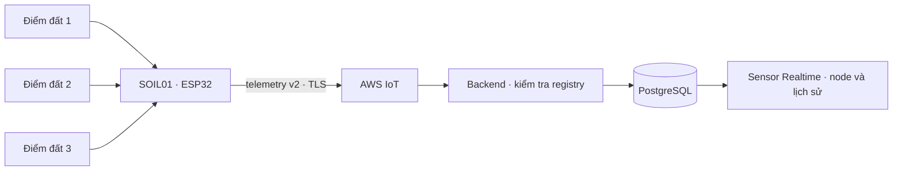

# Chương 27 — Node đất ba điểm cho một dãy cây

> Cập nhật sau chương này: V18 thêm [cảnh báo từng điểm](CHAPTER_28_SOIL_ALERTS.md).
> Các mục “chưa có soil alerts” và số test trong chương27 mô tả lượt V17;
> rule/valve/coordinator từ SOIL vẫn chưa triển khai.


Ngày **15/10/2026, giờ Việt Nam**. Đây là bước đầu A3 trong
[lộ trình nông nghiệp](../plan/AGRICULTURAL_IOT_DEVICE_ROADMAP.md): có SOIL01
độc lập để quan sát ba điểm đất. Chưa triển khai controller van IRRIGATION01,
quyền dùng chung bơm hoặc quy tắc tưới từ nhiều điểm.

## 1. Một node, ba điểm đo

SOIL01 là một ESP32 riêng, khác ENV01 đang điều khiển PUMP01 và trạm WATER01.
Ba kênh SOIL1/SOIL2/SOIL3 cùng thuộc khu vực khai báo của node, có phiên bản
hiệu chuẩn và mẫu mới nhất riêng. Chưa có vị trí/zone riêng cho từng kênh.
Có thể khai báo SOIL02, SOIL03 ở các khu vực khác; mỗi node độc lập cần danh
tính MQTT, certificate và project local riêng.



Đường AWS trong sơ đồ là luồng triển khai dự kiến của SOIL01. Lượt cloud này
kiểm tra encoder native → router → PostgreSQL → toàn ứng dụng bằng fixture
local, không kết nối SOIL01 thật tới AWS/Wokwi.

Metric duy nhất ở bước này là SOIL_MOISTURE, đơn vị %. Số 0 là phép đo hợp lệ;
lỗi phải là SENSOR_FAULT/value=null. Mất dữ liệu hoặc lỗi một điểm không biến
thành đất khô, không thay giá trị bằng 0 và không lấy trung bình để bật bơm.

## 2. Hợp đồng và lưu dữ liệu

Đọc [schema đất v2](../../contracts/iot/v2/soil-telemetry.schema.json) và
[mẫu packet](../../contracts/iot/v2/examples/soil-telemetry.json).
Envelope v2 dùng deviceId, bootId, sequence, timestamp, uptimeMs, readings và
nguồn dataSource tùy chọn. Hợp đồng nước v2 và legacy ENV/v1 được giữ lại.

- POST `/api/v1/nodes/soil` nhận nodeId/name/areaId/channels; không có nodeType
  trong body. API khai báo 1–8 kênh đất; form và firmware demo dùng đúng ba
  kênh SOIL1/SOIL2/SOIL3.
- Migration **V17** chỉ mở rộng constraint node_type cho SOIL/v2, giữ bảng,
  mẫu, danh tính ENV/WATER và binding PUMP01 đã có. Chạy Flyway cùng backend;
  không sửa checksum migration cũ hay xóa volume để nâng cấp.
- Chỉ topic `smartfarm/FARM001/SOIL01/telemetry` khớp packet deviceId mới nhận.
  Mọi channel/metric/unit/calibration phải khớp registry trước khi ghi cả
  packet. Kênh cuối sai cũng không để lại phần đầu của packet.
- Packet trùng node/boot/sequence không ghi lại hoặc đổi nguồn mẫu đã lưu.
  Packet cũ có thể nằm trong history nhưng không ghi đè mẫu mới hơn. Packet
  một phần chỉ cập nhật những điểm có mặt, không làm mới điểm bị thiếu.
- VALID cần số hữu hạn 0–100; không ép boolean, chuỗi, null thành số.
  SENSOR_FAULT bắt buộc null. Trùng kênh, trường JSON trùng, payload >4096 byte,
  timestamp quá tương lai hoặc metric nước trên node đất bị từ chối.
- dataSource và calibrationVersion là thông tin khai báo, không chứng minh
  thiết bị thật hoặc việc hiệu chuẩn đã được kiểm định.

History dùng cùng API `/api/v1/nodes/{id}/channels/{channel}/history`, range
[from,to) tối đa 31 ngày, limit 1–1000, lọc nguồn/chất lượng, cursor gắn với
node/kênh/bộ lọc. Xem [chương 25](CHAPTER_25_WATER_HISTORY.md) về giới hạn
max-ID khi phân trang; đây không phải snapshot transaction tồn tại xuyên mọi
request. UI lấy tối đa 100 mẫu/trang; CSV chỉ xuất trang đang hiển thị.

Cảnh báo đất legacy và quy tắc tưới hiện tại vẫn đọc ENV01. Chưa phát sinh
cảnh báo tự động cho SOIL01 hoặc thêm số đếm vào Overview/Device Monitoring.
Water alerts tiếp tục chỉ đánh giá WATER; SOIL không tạo water alert cursor.

## 3. Xem trên Windows trước khi chạy mô phỏng

Tại gốc repo, Git Bash:

```bash
git pull --ff-only origin feat/day1-iot-foundation
```

Giữ PostgreSQL Healthy. Restart backend bằng terminal Git Bash mới để chạy
migration V17; giữ profile AWS/config database đã có. Terminal frontend riêng
chạy `npm run dev`. Khi chỉ thử node đất, khởi động backend ở chế độ không
điều khiển bằng Git Bash từ gốc repo:

```bash
SMARTFARM_CONTROL_ENABLED=false bash tools/backend/run_backend_windows.sh
```

Không chạy lệnh backend trong terminal frontend đang chiếm.

Vào **IoT & Tự động hóa → Sensor Realtime → Node & trạm nước**. Trong màn
**Node đất & trạm nước**, chọn **Khai báo node đất**:

1. Mã SOIL01, tên dãy cây và khu vực đã có.
2. Giữ hiệu chuẩn cả ba kênh là **SIM_LINEAR_V1** cho firmware mô phỏng này.
3. Lưu khai báo. Chưa có packet thì cả ba điểm hiển thị —/Chưa có dữ liệu.

Nếu lưu mất phản hồi, form khóa gửi lại và có **Kiểm tra khai báo** để đọc
đối chiếu toàn bộ loại node/kênh. Không bấm tạo mã mới chỉ để chữa timeout.
Khai báo registry không tự tạo Thing/cert hoặc thêm phần cứng vào Wokwi.

## 4. Chuẩn bị SOIL01 riêng trên máy local

Các lệnh AWS bên dưới là hướng dẫn chạy trên Windows, **chưa chạy AWS thật
trong lượt cloud này**. Dùng profile đã có quyền provisioning theo policy
hẹp của SOIL01; không gắn AdministratorAccess để chữa AccessDenied.
Helper giữ tên file lịch sử `provision_water_node.py` nhưng có lựa chọn mới
`--node-type SOIL`; mặc định không có flag vẫn là WATER như trước.

Render policy trước; thay YOUR_ACCOUNT_ID bằng ID tài khoản local của bạn:

```bash
./.local/day1-venv/Scripts/python.exe tools/aws/provision_water_node.py \
  --node-type SOIL --node-id SOIL01 --region ap-southeast-1 \
  --account-id YOUR_ACCOUNT_ID
```

Không có --apply thì không gọi AWS. Policy được tạo trong `.local/aws/SOIL01`:
device chỉ được Connect client SOIL01 và Publish topic telemetry riêng, không
có quyền command/subscribe/retained hoặc publish sang ENV01/WATER01.
Provisioner IAM JSON dành cho người cấu hình local, không phải policy gắn vào
certificate. Xem [chương 23](CHAPTER_23_WATER_NODE_MONITOR.md) về cách phân biệt.
Sau khi cấu hình quyền đúng và sẵn sàng tạo tài nguyên, chạy:

```bash
AWS_PROFILE=smartfarm ./.local/day1-venv/Scripts/python.exe tools/aws/provision_water_node.py \
  --node-type SOIL --node-id SOIL01 --region ap-southeast-1 \
  --account-id YOUR_ACCOUNT_ID --apply
```

Helper kiểm tra account, loại Thing/manifest, giữ checkpoint khi tạo cert bị
ngắt và không tự tạo cert mới khi kết quả không rõ. Đừng xóa lock/checkpoint
để lặp lại khi chưa đối chiếu trạng thái AWS. Không copy cert ENV01 sang SOIL01.

Tải CA công khai bằng TLS có xác minh, rồi chuẩn bị project riêng. Backend
phải đang chạy để helper đọc khai báo SOIL01 qua API local:

```bash
curl --fail --show-error --location \
  https://www.amazontrust.com/repository/AmazonRootCA1.pem \
  --output .local/aws/SOIL01/AmazonRootCA1.pem

./.local/day1-venv/Scripts/python.exe tools/water/prepare_local_node.py \
  --node-type SOIL --node-id SOIL01 \
  --ca-file .local/aws/SOIL01/AmazonRootCA1.pem
```

Helper yêu cầu đúng ba kênh và SIM_LINEAR_V1, kiểm tra cặp key/cert và CA local,
không gọi AWS. Project nằm ở **.local/soil-nodes/SOIL01**, không ghi đè config
ENV/WATER. Nếu đã có project thì build lại; muốn cập nhật source public dùng
`--node-type SOIL --node-id SOIL01 --refresh-source`. Config/cert giữ nguyên;
source tự sửa sẽ làm refresh dừng để bảo toàn thay đổi.

## 5. Build và chạy Wokwi

Trong Git Bash tại gốc repo, dừng nếu một lệnh lỗi:

```bash
./.local/day1-venv/Scripts/python.exe -m platformio run \
  --project-dir .local/soil-nodes/SOIL01
./.local/day1-venv/Scripts/python.exe -m platformio run \
  --project-dir .local/soil-nodes/SOIL01 -t buildfs
./.local/day1-venv/Scripts/python.exe tools/wokwi/merge_flash.py \
  --project-dir .local/soil-nodes/SOIL01
```

Mở diagram.json/wokwi.toml **trong project SOIL01 vừa tạo**, dùng gateway riêng
đang chạy và extension Wokwi đã kích hoạt. Sơ đồ ENV01 cũ không tự xuất hiện
ba điểm đất. Flash đã merge chứa private key: giữ local, không commit/upload.

| Thiết bị mô phỏng | GPIO | Thao tác |
|---|---|---|
| Núm SOIL1 | ADC1 34 | Xoay để đổi điểm đất 1 |
| Núm SOIL2 | ADC1 35 | Xoay để đổi điểm đất 2 |
| Núm SOIL3 | ADC1 32 | Xoay để đổi điểm đất 3 |
| Công tắc FAULT1/2/3 | 27/14/25 | Trái = lỗi, phải = bình thường |

Dùng ADC1 để đọc khi Wi-Fi hoạt động. Mỗi điểm map raw 0→0%, 4095→100%; đây là
thang demo **SIM_LINEAR_V1**, không phải phần trăm độ ẩm thể tích của đất.
Firmware chỉ cho SOIL_SIMULATOR=1 ở bước này. Không đổi thành PHYSICAL rồi
coi đã nghiệm thu. Mạch cảm biến đất thật, hiệu chuẩn từng probe, ngưỡng theo
cây/loại đất và phát hiện đứt dây vẫn cần làm sau. ADC chạm 0/4095 tự nó không
phân biệt đất khô/ướt với dây lỗi; công tắc fault chỉ là tín hiệu thử rõ ràng.

Firmware lấy mẫu mỗi 5 giây, có bootId mới sau reboot, TLS có kiểm tra server
và certificate riêng. Không subscribe command, không có đầu ra bơm/van.
Khi offline vẫn lấy mẫu local; không có kho lưu rồi replay các cửa sổ cũ.
PUBACK chỉ xác nhận broker nhận publish, không chứng minh DB đã commit.

## 6. Ca nghiệm thu local còn chờ người dùng

| Ca AWS/Wokwi SOIL01 | Kết quả thực tế |
|---|---|
| TLS/PUBACK và web hiện đúng ba giá trị | Chưa chạy |
| Xoay một núm, hai điểm còn lại giữ đúng giá trị riêng | Chưa chạy |
| Fault từng điểm → —/lỗi, hai điểm kia vẫn đo | Chưa chạy |
| Dừng gateway → sau 30 giây từng điểm thành dữ liệu cũ | Chưa chạy |
| Nối lại/reboot → mẫu mới đúng nguồn và bootId | Chưa chạy |
| History/CSV giữ 0, null, calibration và nguồn | Chưa chạy |

Ghi commit, node/channel, bootId/sequence, giờ đo/nhận và ảnh/log không chứa
bí mật. Không đánh dấu các ca này đạt chỉ từ kết quả test cloud bên dưới.

## 7. Bằng chứng cloud và lỗi gặp trong đợt này

**152 backend tests**, **22 browser node/history**, **13 unit frontend**,
**17 Python hồi quy WATER** và **7 Python SOIL** đạt, không skip; native C++
encoder/model và ESP32 firmware/buildfs/merge trên project public tạm đạt.
FS cloud chỉ có .gitkeep, không có cert/key và không kết nối AWS. Browser
fixture tách với smoke toàn app thật dưới đây.

Smoke toàn app qua API/PostgreSQL test `soil_node_smoke` đạt: native fixture
đi qua router, ba packet/bảy channel_sample, điểm 0/100/lỗi độc lập, điểm cũ
không bị packet một phần làm mới, history/filter/download CSV đúng ba hàng.
MQTT/control tắt, command/run0, không API ghi từ browser. Runtime giữ dữ liệu
thử này; không dùng schema demo của người dùng.

Nâng cấp schema `flow_guard_smoke` V16→V17 giữ OFF/FLOW_SENSOR_FAULT, hai dòng
history và command0. Lần query kiểm tra đầu dùng sai tên cột `state`; database
báo không tồn tại. Đã đọc V3 và sửa query thành `reported_state`; đây là lỗi
câu lệnh xác minh, không phải lỗi migration. Không sửa/xóa dữ liệu để vượt lỗi.

Chi tiết và lệnh kiểm tra trong [báo cáo SOIL](../implementation/LOCAL_SOIL_NODE_REPORT.md).
Bước sau: thiết kế IRRIGATION cho một dãy, binding sensor/zone và quyền dùng
chung bơm trước khi mở rộng bốn dãy.
