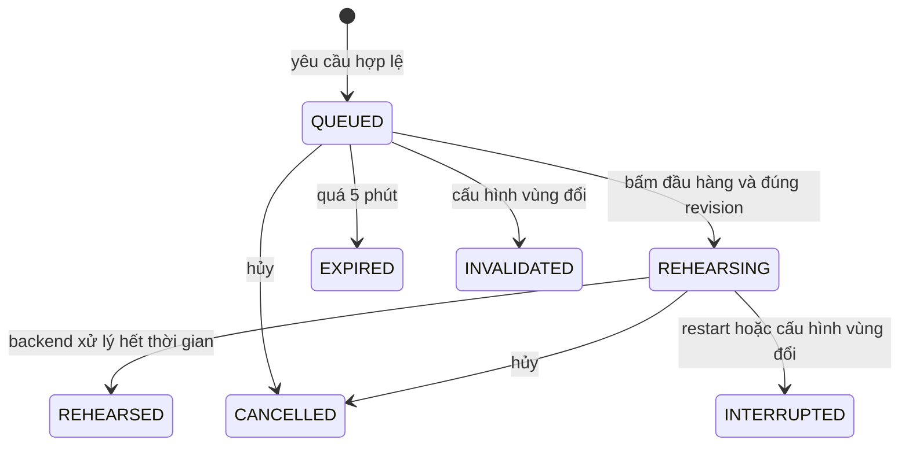

# Chương 33 — Hàng chờ nhiều vùng trước khi điều phối bơm

Ngày triển khai: 15/10/2026, giờ Việt Nam.

## Vì sao bắt đầu bằng diễn tập

Một bơm phục vụ nhiều vùng cần nhận đúng lượt và không nhận lại lệnh cũ sau
mất mạng. [Controller van](CHAPTER_32_IRRIGATION_VALVE_DEMO.md) đã có boot và
ordinal, nhưng PUMP01 v1 chưa có cùng hợp đồng. GPIO của van cũng chưa chứng
minh vị trí cơ khí. Vì vậy V21 xây ledger FIFO và một suất diễn tập độc quyền,
chưa kết nối hàng chờ với PUMP01, VALVE01 hoặc rule ENV01.

Chế độ API cố định `PREVIEW_ONLY`. Không có cờ đổi nó sang điều khiển thật.
Một lượt “Đã diễn tập” chỉ nói backend đã xử lý khoảng thời gian, không nói đã
mở van, bật bơm, có lưu lượng hoặc tưới đủ nước. Không cần AWS, gateway hay
simulator để thử chức năng này. Nếu backend đang chạy MQTT cho chức năng
khác, chi phí của chức năng đó vẫn phụ thuộc cấu hình và lưu lượng hiện hành.

## Người dùng thao tác

Cập nhật nhánh `feat/day1-iot-foundation`, khởi động PostgreSQL, backend và
frontend theo [Windows runbook](WINDOWS_RUNBOOK.md). Giữ database/volume hiện
có; Flyway thêm V21 sau V20. Không tạo lại certificate hoặc flash ESP32.

1. Trong Sensor Realtime → Node & trạm nước → Vùng tưới, tạo vùng nguồn
   `SIMULATOR`, mỗi vùng gắn ba kênh đất hợp lệ như chương 29. Nhiều vùng cần
   các bộ kênh riêng; không gán một kênh vào hai vùng.
2. Mở **Điều khiển Actuator → Mở hàng chờ tưới diễn tập**.
3. Chọn vùng, thời gian 1–30 giây, bấm **Thêm lượt chờ**. Đất không cần khô
   và không cần telemetry mới vì đây là diễn tập thứ tự, chưa đánh giá tưới.
4. Thêm lượt cho vùng tiếp theo. Bấm **Diễn tập lượt đầu hàng** để bắt đầu
   đúng lượt đầu. Chỉ một lượt được diễn tập tại một thời điểm.
5. Hết giờ, backend ghi “Đã diễn tập”. Lượt kế tiếp vẫn chờ cho đến khi bấm
   nút. **Hủy lượt #...** kết thúc lượt chờ/đang diễn tập, không phát lệnh OFF.
6. Restart backend giữa lượt: lượt đó thành “Diễn tập bị gián đoạn”, lý do
   backend khởi động lại. Không tự tiếp tục hay tự chuyển sang lượt sau.

Tối đa 50 lượt chưa kết thúc, gồm lượt đang diễn tập. Mỗi lượt được chờ tối
đa 5 phút tính theo giờ server; thời gian diễn tập được tính riêng từ khi
bắt đầu. Bộ dọn backend chạy mỗi giây nên trạng thái hết hạn/kết thúc có thể
xuất hiện ở lần tick và polling kế tiếp. GET không tự chuyển trạng thái.

Nếu mất phản hồi HTTP, lưu mã yêu cầu và bấm **Đọc kết quả theo mã**. UI không
tự gửi lại. Một mã enqueue trùng với cùng vùng/phiên bản/thời gian trả lại
record cũ, kể cả đã hết hạn; đổi nội dung cùng mã bị từ chối. Đọc một lượt
bằng ID không phụ thuộc giới hạn 20 lượt lịch sử hiển thị.

## Dữ liệu và đồng thời

V21 thêm `irrigation_queue_state` và `irrigation_queue_request`, không sửa các
migration đã phát hành. Mỗi item giữ bản chụp cấu hình vùng, revision, ticket,
request UUID, thời điểm enqueue/hết hạn/bắt đầu/kết thúc và lý do.

Mọi mutation và tick khóa cùng singleton bằng PostgreSQL `FOR UPDATE`.
Partial unique index chặn hai dòng `REHEARSING`. Phiên bản hàng chờ chống
thao tác trên snapshot cũ; bắt đầu luôn nêu rõ request UUID, không dùng một
API “start next” mơ hồ có thể bắt đầu nhầm lượt khi retry đến muộn.

Bắt đầu khóa đọc cấu hình vùng, kiểm tra nguồn SIMULATOR và revision. Sửa
vùng làm queued invalidated hoặc active interrupted ở lần xử lý kế tiếp.
Thao tác bắt đầu không vượt một head đã hết hạn/đổi vùng trước khi dọn;
backend trả 409 để đọc lại. Không có đánh giá độ ẩm hay liên động nước trong
hàng chờ này. Một suất diễn tập **không phải lease điều khiển PUMP01**; màn
thủ công và rule ENV01 hoạt động độc lập.

Ứng dụng hiện hướng tới một backend đang vận hành. Khóa DB đã kiểm tra với
hai service instance tranh lượt; việc boot bất kỳ backend nào sẽ ngắt lượt
diễn tập đang lưu. Chưa có leader election/lease để triển khai active-active.

API dưới `/api/v1/irrigation-queue`:

| Phương thức/đường dẫn | Nội dung |
| --- | --- |
| GET gốc | mode, giờ server, revision, active, toàn bộ waiting ≤50, history ≤20 |
| POST `/requests` | requestId, zoneId, zoneRevision, durationSeconds, requestedAt |
| GET `/requests/{id}` | record theo UUID, kể cả ngoài history |
| POST `/requests/{id}/rehearse` | revision hàng chờ đã xem |
| POST `/requests/{id}/cancel` | revision hàng chờ đã xem |

JSON phải đúng trường/kiểu, không trùng key hoặc trailing JSON; requestedAt
cho enqueue mới nằm trong quá khứ 10 giây/tương lai 2 giây. DB là nguồn thời
gian. UI đọc polling, hủy response cũ, không ghi khi mở trang, không đánh dấu
hoàn tất từ bộ đếm phía trình duyệt. Dữ liệu cũ/lỗi API khóa mutation, phục
hồi sau lần đọc hợp lệ. Sau mutation phải có snapshot mới trước thao tác tiếp.

## Bằng chứng đã chạy

- Backend toàn bộ **229/229**, skip0; trong đó 17 ca queue: FIFO hai vùng,
  đúng biên timer/TTL, idempotency, stale revision, hủy, zone/source đổi,
  restart, lookup ngoài20, capacity50, hai service tranh cùng/khác request,
  HTTP strictness, GET không ghi và tick không được chạy trước khi startup
  đánh dấu lượt cũ gián đoạn.
- Browser fixture queue **12/12**, unit parser **5/5**; browser van hồi quy
  **9/9**. Browser fixture không phải backend thật hoặc nghiệm thu simulator.
- Lint/build đạt; Vite còn cảnh báo cấu hình `__dirname` và bundle lớn đã có.
- Full app React→Vite proxy→Spring→PostgreSQL riêng: tạo ba lượt hai vùng;
  lượt1 hết1giây, lượt2 diễn tập30giây, lượt3 chờ. Dừng/restart tiến trình
  backend thật; lượt2 `INTERRUPTED/BACKEND_RESTARTED`, lượt3 không tự bắt đầu,
  sau đó hủy lượt3. Lịch sử giữ `REHEARSED`, `INTERRUPTED`, `CANCELLED`.
- Nâng schema fixture van V20→V21: node/zone/binding/status/command/run trước
  và sau giống nhau. Không chỉnh volume demo của người dùng.
- Trong schema full-app queue: pump_command0, watering_run0,
  irrigation_demo_command0. MQTT/control/valve-demo đều tắt. Bản jar cuối
  đã kiểm tra restart thêm lượt4 sau khi bổ sung gate startup; lượt này cũng
  INTERRUPTED/BACKEND_RESTARTED, không resume. Schema giữ4lượt kết thúc.

Schema `irrigation_queue_smoke` giữ bằng chứng, không chạy lại prepare hoặc
xóa/seed để làm dữ liệu trông mới. Helper fixture từ chối schema khác và seed
lại. Script `tools/frontend/smoke_irrigation_queue.py` có phase prepare/restart/inspect;
restart phải do người chạy thực sự dừng/khởi động backend giữa hai phase.
Phase inspect chỉ đọc bằng chứng đã giữ lại. Chỉ dùng với schema/zone fixture
chuyên biệt, không dùng trên database demo.

## Lỗi đã gặp và cách sửa

Lượt test đơn lẻ ban đầu giả định singleton rule/binding luôn tồn tại, trong
khi fixture cũ đã xóa chúng. Sửa assertion snapshot thành JSON aggregate có
thể rỗng, không tạo lại dữ liệu để che thay đổi. Lượt đầu có16 lỗi setup;
lượt sau16/16 đạt.

Lượt hồi quy đầu có8 lỗi SoilNodeTest do vùng QZONE từ lần chạy đơn lẻ chưa
được dọn trước đó. Bổ sung cleanup fixture queue/zone/node trong `finally`;
chỉ tác động schema test và ID test sở hữu. Dữ liệu sót được cleanup test mới
loại bỏ, kiểm tra QZONE=0, rồi chạy lại toàn bộ229/229 không skip. Không bỏ
assertion, tắt test hoặc xóa schema. Test profile tắt tick nền để context
Spring được cache không tự sửa queue của ca khác; test chủ động điều khiển
giờ. Tick production vẫn được kiểm tra trong full-app process thật. Bổ sung gate
startup: scheduler chỉ xử lý sau khi recovery đã commit, tránh một lượt cũ
quá giờ bị ghi nhầm REHEARSED trong lúc ứng dụng còn khởi động; test thứ17
kiểm tra trực tiếp trường hợp đó.

## Còn lại trước khi điều phối thiết bị

Cần hợp đồng PUMP01 chống lệnh cũ/boot/replay và cơ chế ngăn manual/rule cũ
tranh cùng bơm; mapping nhiều van/vùng và feedback phù hợp; trình tự mở van,
xác nhận, bật bơm, tắt bơm, xác nhận, đóng van; liên động phao/flow/timeout,
UNKNOWN và recovery khi publish/ACK/status không rõ. NVS/reboot, nhiều backend
và nghiệm thu thủy lực riêng vẫn còn sau. Không nối ledger preview thẳng vào
`PumpService.create` rồi coi đã có coordinator an toàn.

Năm ca Windows tại máy người dùng vẫn **Chưa chạy**:

| Ca | Kết quả mong đợi | Thực tế |
| --- | --- | --- |
| Hai vùng và hủy | FIFO, chỉ một active, hủy không chạy lượt sau | Chưa chạy |
| Hết giờ | lịch sử Đã diễn tập, simulator không bật đèn do queue | Chưa chạy |
| Đổi vùng | bản cũ mất hiệu lực, yêu cầu lại đúng revision | Chưa chạy |
| Restart giữa lượt | interrupted, không resume, dữ liệu còn | Chưa chạy |
| HTTP mất phản hồi | đọc theo ID, không tự POST lại | Chưa chạy |

Không có ca AWS/Wokwi/GPIO mới được thực hiện hoặc tuyên bố đạt trong chương này.

## Bổ sung V26 — bản chụp nhánh

Hàng chờ vẫn PREVIEW_ONLY. Khi vùng đã có nhánh cấu hình, POST tạo lượt phải
gửi thêm circuitId/circuitRevision đã duyệt; backend chụp toàn bộ nhánh.
Đổi nhánh hoặc thêm nhánh sau lượt chưa ánh xạ làm lượt cũ mất hiệu lực,
không tự chuyển van/trạm. Lượt trước V26 giữ circuit_snapshot null.
Xem [chương38](CHAPTER_38_IRRIGATION_CIRCUITS.md) cho contract và bằng chứng.
