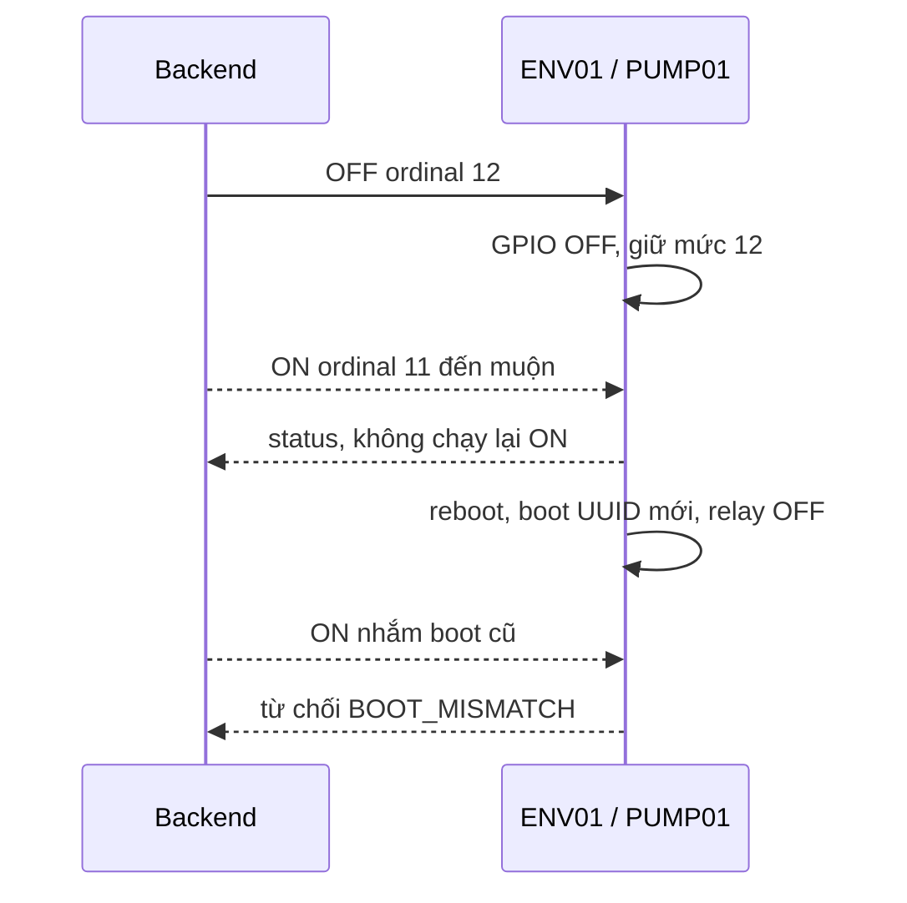

# Chương 34 — Chặn lệnh MQTT cũ tại PUMP01

Ngày triển khai: 15/10/2026, giờ Việt Nam.

## Phần nào được bảo vệ

Sau [hàng chờ diễn tập](CHAPTER_33_IRRIGATION_QUEUE_PREVIEW.md), bước tiếp theo
là làm cho lệnh ON đã cũ không thể bật lại relay sau một OFF mới hơn hoặc một
lần reboot. Bản này bổ sung metadata boot/ordinal vào MQTT PUMP01 và kiểm tra
ở cả backend lẫn firmware ENV01. Hai phía mặc định **tắt chế độ mới**; pull
code không tự đổi chế độ điều khiển hiện hành.

Đây chưa phải coordinator nhiều van. Queue vẫn PREVIEW_ONLY, chưa lease bơm,
chưa loại trừ manual/rule theo chủ sở hữu và chưa có trình tự van→bơm. HTTP
POST hiện vẫn tạo yêu cầu mới; một HTTP ON bị giữ rồi đến server sau OFF có
thể được cấp ordinal mới. Vì vậy bản này chỉ tuyên bố chặn **MQTT** cũ, chưa
có idempotency/expectedBoot/thời điểm ý định cho HTTP. Không nối queue vào
PumpService chỉ vì có ordinal. ACK GPIO chưa chứng minh bơm vật lý có nước.

## Vấn đề và hợp đồng

V1 dùng command UUID và cache ngắn hạn để không gia hạn timer khi nhận trùng.
Tuy nhiên một ON chưa từng đến thiết bị vẫn có thể đến sau OFF, nếu thời gian
lệnh còn hiệu lực. Sau reboot, RAM cache cũng mất. Chế độ mới dùng đồng thời:

- `targetBootId`: ON và RESET phải nhắm đúng UUID của lần khởi động hiện tại.
- `ordinal`: số tăng dần từ sequence PostgreSQL, nằm trong1..9007199254740991.
- Firmware giữ mức ordinal đã tiêu thụ trong RAM; lệnh bằng/thấp hơn mức đó
  không thay GPIO, không gia hạn timer và chỉ gửi status, không ACK mâu thuẫn.
- Một lệnh có metadata hợp lệ nhưng bị từ chối vì nước/khóa/clock/BUSY vẫn
  tiêu thụ ordinal. Phát lại không biến một lần từ chối thành lần bật sau đó.



Vẫn schemaVersion1, client ENV01 và các topic cũ, QoS1/non-retained:
`smartfarm/FARM001/PUMP01/{command,ack,status}`. Metadata tùy chọn chỉ xuất hiện
khi opt-in; các ví dụ v1 không metadata tiếp tục hợp lệ. Không IAM/cert/Thing
mới. Đọc [hợp đồng](../../contracts/iot/v1/PUMP_COMMAND_FENCING.md).

| Bản tin | `commandFence` |
| --- | --- |
| Command | version1, ordinal, targetBootId |
| ACK | version1, ordinal; bootId ngoài object là boot thực tế |
| Status | version1, lastOrdinal, restartRequired |

Decoder firmware kiểm tra đúng trường/kiểu, UUID, UTC giây canonical, số thứ
tự an toàn, không duplicate key, trailing JSON, escape hoặc NUL nhúng. Payload
retained không chạy. Timer, phao, khóa mạng và flow guard cũ vẫn ở đường áp
GPIO; ordinal không cấp phép vượt các điều kiện đó. Chưa nghiệm thu tương tác
các timer/ISR trên phần cứng thật trong đợt này.

## Backend và V22

V22 thêm sequence, singleton `pump_dispatch_gate`, ordinal/target boot trên
pump_command, capability/lastOrdinal/restart latch trên pump_status. Không
sửa migration đã phát hành và không tự bật control.

Dispatch mới khóa singleton DB, kiểm tra OFF mới ≤15giây, đúng capability,
lockout và tất cả lệnh chưa xác nhận. Kiểm tra ordinal chưa thấy trên **toàn
bộ lịch sử**, không chỉ20lệnh đang hiển thị: hết hạn ACK không chứng minh một
ON đã biến mất khỏi mạng. Thiết bị phải báo đã đi qua ordinal đó hoặc báo
boot mới; các lệnh còn pending vẫn được chặn thận trọng đến khi giải quyết.

Reservation commit trước callback lưu tham chiếu run và trước publish. Do đó
ACK đến ngay trong publish không deadlock hoặc bị SENT ghi đè. Publish chưa
rõ giữ PUBLISH_UNCERTAIN, không tự gửi lại ON. Khóa DB chỉ bảo vệ reservation,
không giữ qua chờ MQTT; publish có thể đến sai thứ tự và firmware là phía
chặn ordinal thấp. Cơ chế này chưa phải lease/chủ sở hữu bơm.

ACK cho command fenced phải đúng ordinal, và ON/RESET phải đúng target boot.
ACK legacy không hoàn tất command fenced. ACK không thay status. Trong cùng
boot, status không giảm ordinal, bỏ metadata hoặc xóa restart latch; boot mới
cần timestamp mới hơn. lastOrdinal>0 phải khớp một command đã lưu (OFF có thể
qua boot). lastOrdinal0 không được báo ON; restartRequired đòi OFF+locked.

Manual và rule ENV01 hiện có đều gọi PumpService nên đi qua đường fenced khi
bật cờ. Rule chưa có quyền sở hữu chung với coordinator và không được tự xem
là đã nghiệm thu ở chế độ mới. Khôi phục database/sequence từ bản cũ cần xử lý
vận hành riêng; không tự hạ ordinal hoặc cho phép một lastOrdinal không biết.
Không có NVS tự resume ON hoặc tự phục hồi job.

## Nâng cấp lệch chế độ và lệnh tắt

| Backend | Firmware | ON/RESET | OFF |
| --- | --- | --- | --- |
| Cũ | Cũ | Đường v1 hiện tại | Đường v1 hiện tại |
| Mới | Mới | Cần OFF/capability/ordinal mới và không khóa | Fenced, được phép nhắm boot khác để dừng |
| Mới | Cũ/chưa nhận capability | Chặn | Fallback v1 để thiết bị cũ vẫn nhận tắt |
| Cũ | Mới | Backend chặn khi đã thấy capability; firmware từ chối v1 ON/RESET | Legacy emergency OFF, đóng và khóa đến reboot |

OFF legacy hợp lệ ở firmware fenced không có ordinal để loại hết lệnh đang
trên đường truyền. Vì vậy nó đóng relay, khóa safety và đặt restartRequired
không thể reset trong cùng boot. ON/RESET tiếp theo bị FENCE_RESTART_REQUIRED;
chỉ reboot tạo target boot mới mới kết thúc latch này. UI giải thích nguyên
nhân, không mời reset và không tự bật lại. OFF fenced mới vẫn được nhận.

## Thử trên Windows/Wokwi

Tạm tắt rule, yêu cầu OFF và đối chiếu trạng thái. Cập nhật nhánh và restart
backend để V22 migrate, giữ database/volume/cert. Nếu chỉ dùng chế độ cũ,
không cần sửa cờ. Muốn thử chế độ mới, làm cả hai phía; không gửi key lên chat.

Trong file **private** `firmware/esp32/config/config.local.h`, thêm/sửa:

```cpp
#define FARM_CONTROL_ENABLED 1
#define FARM_PUMP_FENCING_ENABLED 1
```

Giữ endpoint, certificate và cấu hình phao/flow đang dùng. Không sao chép đè
file private bằng config.example.h. Sau đó ở Git Bash từ repository root:

```bash
./.local/day1-venv/Scripts/python.exe -m platformio run --project-dir firmware/esp32
./.local/day1-venv/Scripts/python.exe -m platformio run --project-dir firmware/esp32 -t buildfs
./.local/day1-venv/Scripts/python.exe tools/wokwi/merge_flash.py --project-dir firmware/esp32
```

Chỉ buildfs từ data riêng đã có đúng certificate/key/RootCA của ENV01. Flash
image chứa key phải giữ local. Dừng simulator ENV01 cũ trước khi mở lại bằng
image mới; không chạy hai client cùng ENV01. Không dùng build public cloud
làm firmware kết nối AWS: build kiểm tra không có endpoint/certificate.

Ở terminal backend Git Bash riêng, sau khi cài JDK21/PostgreSQL như runbook:

```bash
export SMARTFARM_CONTROL_ENABLED=true
export SMARTFARM_PUMP_FENCING_ENABLED=true
bash tools/backend/run_backend_windows.sh
```

Giữ frontend chạy ở terminal riêng. Màn Điều khiển Actuator hiển thị bảo vệ
MQTT của backend và thiết bị. Chờ status mới, đúng chế độ và OFF rồi thử ON
thời hạn ngắn. Cả flag mới lẫn control flag đều cần đúng; metadata phù hợp
không thay cho freshness/MQTT/lockout. Helper Windows không tự chuẩn bị DB
integration test; không đặt SMARTFARM_TEST_DB_URL vào DB demo để chạy test.

Nếu đã gửi emergency OFF từ backend chưa nâng cấp, reboot simulator sau khi
đã sửa hai cờ. Không cố reset latch cũ hoặc tắt kiểm tra ordinal. Muốn quay về
v1 cần dừng/tắt có xác nhận, đổi **cả** firmware/backend và reboot; không chỉ
hạ một cờ rồi kỳ vọng các ON bị chặn sẽ tự chạy lại.

## Bằng chứng và ca chưa chạy

Đã chạy247 backend, không skip (17 PumpFencingTest và một ca legacy interop
mới trong PumpControlTest);6browser pump mới,12queue browser hồi quy,
17Python contracts, native fenced model/parser và RelaySafety cũ, lint/build.
Firmware public default và opt-in, buildfs rỗng và merge4MiB đạt. Dòng generic
“Contains private key” của helper merge không có nghĩa build kiểm tra này có
key: data chỉ.gitkeep, không copy PEM/config private/endpoint của người dùng.

Full app thật React→Vite→Spring→PostgreSQL riêng nhận packet từ native encoder;
fixture chỉ thay timestamp để kiểm tra receive, không phải telemetry live.
Control/MQTT/valve-demo tắt, fencing profile bật để kiểm tra hiển thị. Native
metadata giữ qua restart process backend thật; web không gửi API write,
controls tắt. Pump commands/watering_run/queue/valve commands đều0. Fixture
pump_fence_smoke được giữ lại, không seed/làm mới timestamp lần nữa.

V21→V22 trên fixture queue giữ nguyên4lượt, revision queue và command/run0.
Không reset DB demo5433 hoặc các schema khác. [Báo cáo](../implementation/LOCAL_PUMP_FENCING_REPORT.md)
phân biệt rõ kiểm tra local với sáu ca Windows/AWS/Wokwi mới còn **Chưa chạy**:

| Ca | Mong đợi | Thực tế |
| --- | --- | --- |
| Hai phía opt-in | ON ngắn, ACK cùngordinal/boot, tự OFF đúng hạn | Chưa chạy |
| OFF mới, MQTT ON cũ tới sau | relay vẫn OFF, không gia hạn/chạy lại | Chưa chạy |
| Reboot rồi phát lại MQTT ON/RESET boot cũ | không bật hoặc mở khóa | Chưa chạy |
| MQTT trùng/ON bị từ chối rồi phục hồi nước | không biến thành lượt mới | Chưa chạy |
| Lệch profile, legacy OFF | OFF và khóa đến reboot; web giải thích | Chưa chạy |
| Mạng/flow/phao với profile mới | OFF/lockout, không tự resume | Chưa chạy |

## Các lỗi trong quá trình xây dựng

Native compile đầu tiên dùng `auto` sao chép ArduinoJson MemberProxy (v7
không copy được); đổi sang JsonObjectConst. Chuỗi lệnh ban đầu không fail-fast
nên fixture sinh rỗng và Java nhận MissingNode; sửa quy trình set-e, chỉ chạy
test sau khi compiler và generator thành công. Không bỏ fixture assertion.

Ca ACK tới muộn ban đầu tự tạo sequence sau status OFF, trái thứ tự phát
thực tế; sửa tạo ACK trước rồi trì hoãn receive. Sau khi siết lastOrdinal0
không được ON, test hạ ordinal cần kỳ vọng reject cho gói bất khả thi, và vẫn
kiểm tra frame OFF hợp lệ có ordinal thấp bị bỏ qua. Không nới kiểm tra code.

Một test Mockito.verify gọi phương thức throws Exception cần khai báo throws;
đã sửa chữ ký test. Browser đầu dùng nhãn lịch sử “Bật có thời hạn”, trong khi
UI hiện tại là “Bật đèn”; đọc DOM rồi sửa selector, không đổi sản phẩm để làm
test qua. Cuối cùng toàn bộ247 backend và6browser mới đều đạt, không skip.
