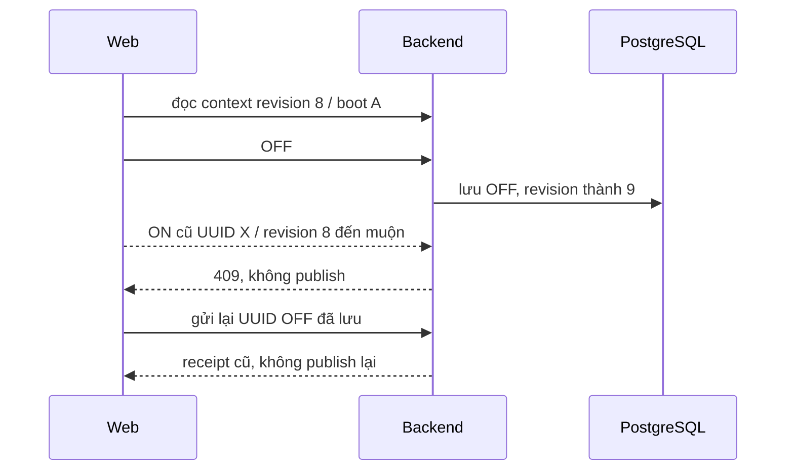

# Chương 35 — Ý định HTTP và đối chiếu yêu cầu điều khiển

15/10/2026, giờ Việt Nam. Tiếp [MQTT fence V22](CHAPTER_34_PUMP_COMMAND_FENCING.md).

> Cập nhật tiếp theo: [V24 quyền sử dụng bơm](CHAPTER_36_PUMP_OWNERSHIP.md) bổ sung loại trừ thủ công/tự động. Phần “chưa ownership” bên dưới ghi phạm vi tại mốc V23.

## Từ thứ tự MQTT đến ý định người dùng

MQTT ordinal không chặn được một HTTP ON bị giữ trên đường đến server: nếu
server vừa nhận OFF rồi mới nhận ON đó, nó có thể cấp ordinal mới. V23 bổ
sung UUID yêu cầu, phiên bản ý định server, boot đã xem và hạn xác nhận.
Chỉ bật luồng này khi backend đã opt-in SMARTFARM_PUMP_FENCING_ENABLED=true.
Chế độ legacy mặc định vẫn dùng đường cũ, không được tuyên bố có HTTP fence.

Queue vẫn PREVIEW_ONLY. Chưa lease bơm, chưa loại trừ manual/rule giữa nhiều
backend, chưa nối nhiều van hoặc điều khiển nông nghiệp không giám sát. HTTP
receipt, MQTT ACK và GPIO/status là những bằng chứng khác nhau.

## Người dùng thấy gì

Vẫn vào Điều khiển Actuator. Khi hai phía dùng V22 và backend bật fencing,
web tự dùng API yêu cầu mới. Không flash lại firmware chỉ vì V23; firmware
V22, client ENV01, topics/cert/IAM giữ nguyên. Cần pull và restart cả backend
lẫn frontend để migration V23 và UI mới cùng hoạt động. Frontend cũ gửi ON/
RESET vào đường cũ bị409 trong profile protected; OFF vẫn có đường dự phòng.

Khi bấm ON/RESET, web chụp UUID và context server đã đọc. Không lấy giờ máy
Windows làm thời điểm review. Context quá cũ, chưa ready hoặc có yêu cầu chưa
đối chiếu thì không cho ON/RESET. Web không tự POST lúc mount, reconnect hoặc
reload. Bấm lại sau một409 là ý định mới, cần đọc trạng thái mới.

Trước POST, web ghi request vào sessionStorage của tab. Nếu response mất,
reload cùng tab vẫn có UUID để **Đọc yêu cầu ...** qua GET. Cùng request chỉ
được đối chiếu, không tự phát lại. UUID không chứa secret, nhưng không phải
một cơ chế xác thực người dùng. Nếu storage không khả dụng, mã vẫn hiển thị
trong phiên hiện tại; bản lưu server là nguồn đối chiếu.

404 chưa chứng minh request không thể tới sau đó: UI giữ trạng thái chưa rõ.
Người dùng có thể yêu cầu OFF mới. Sau response OFF hợp lệ, UI khép các mục
đối chiếu cũ; bản đã lưu vẫn còn trong DB/lịch sử. OFF mới đã thay phiên ý định
nên các ON/RESET cũ chưa tới bị chặn. Điều này không tuyên bố GPIO đã tắt.

Nếu không có context mới hoặc đã có20mục chưa đối chiếu, nút tắt dùng đường
OFF dự phòng. Luồng này vẫn tăng phiên ý định khi backend ở profile protected,
nhưng không có idempotency HTTP như `/requests`. Không tự retry lệnh tắt này.

## API và transaction

Pump status thêm `commandFence.intent` khi profile protected:
revision, asOf (UTC server), bootId và ready. Mọi lần reserve lệnh fenced nội
bộ/HTTP, kể cả OFF dự phòng, đều tăng intent_revision. Startup tăng revision
trước khi cho nhận HTTP mới; context trước restart không thể cấp một ON mới.

| API | Hành vi |
| --- | --- |
| POST `/api/v1/actuators/PUMP01/requests` | 202 receipt cho request đã lưu hoặc cùng request đã có |
| GET `/api/v1/actuators/PUMP01/requests/{id}` | receipt HTTP theo UUID, không giới hạn20lệnh hiển thị |
| POST `/api/v1/actuators/PUMP01/commands` | Trong protected profile chỉ còn OFF thủ công; ON/RESET trả409 |

Body mới: requestId UUID, action, durationSeconds (ON1–3600; OFF/RESET null),
expectedBootId (ON/RESET bắt buộc), intentRevision và reviewedAt. Review quá
khứ10giây/tương lai2giây bị chặn. ON/RESET phải đúng revision hiện tại và boot;
OFF trong hạn được phép qua revision/boot cũ để giữ khả năng yêu cầu dừng.
OFF không có context mới có thể dùng API dự phòng.

V23 thêm intent_revision ở pump_dispatch_gate và ba cột HTTP trên pump_command.
UUID request đồng thời là command_id. Mọi reservation khóa cùng gate DB với
MQTT dispatcher V22. Hai request trùng ở hai service instance chỉ tạo/publish
một lệnh. Cùng UUID đổi action/duration/boot/revision/review trả409. Thời gian
review được chuẩn hóa microsecond theo DB; UI đối chiếu cùng độ chính xác,
không coi hai review lệch1microsecond là cùng một ý định.

Lookup bản đã lưu xảy ra trước kiểm tra freshness, MQTT, boot hoặc cờ control.
Vì vậy receipt cũ vẫn đối chiếu được khi offline, review hết hạn, restart hoặc
control bị tắt. Đây là đọc kết quả, không mở lại quyền dispatch. Request từng
bị từ chối trước reservation không có record; không bảo đảm idempotency cho
một UUID chưa bao giờ được lưu.

Manual hold nằm cùng transaction reservation HTTP, chỉ cho request mới. Replay
không pause một rule vừa được người dùng bật lại. Nếu transaction rollback,
record và manual hold cùng rollback. Sau commit mới chờ publish/PUBACK; request
trùng chỉ đọc PENDING/terminal, không giữ khóa DB qua network. Nếu tiến trình
chết giữa commit và publish, PENDING được giữ để đối chiếu; không tự phát ON.

Publish chưa rõ trả receipt PUBLISH_UNCERTAIN (hoặc terminal nếu ACK đã tới),
không tự retry. Synchronous ACK không bị SENT ghi đè. V22 vẫn kiểm tra tất cả
ordinal chưa được thiết bị thấy, cả ngoài20lệnh; receipt không gỡ freshness/
lockout/phao/flow hoặc thay status. GET receipt không sweep expiry; ledger có
thể còn SENT trước lần sweep thông thường, không được suy ra GPIO đang chạy.

## OFF lúc MQTT offline

Một OFF hợp lệ trong protected mode vẫn reserve, tăng phiên ý định và lưu
FAILED/MQTT_UNAVAILABLE khi biết transport không sẵn sàng. Không publish và
không nói thiết bị đã OFF. ON dùng review trước OFF bị chặn sau khi mạng về.
Không có cơ chế tự gửi OFF khi reconnect; cần yêu cầu mới khi mạng sẵn sàng,
đối chiếu OFF/status rồi xử lý khóa. Đọc lại UUID OFF cũ chỉ trả thất bại cũ.

Đường OFF dự phòng cũng giữ stop intent rồi trả503 khi MQTT offline; lịch sử
là nơi đối chiếu. Hành vi này thay đổi so với V22: transport không sẵn sàng
không còn đồng nghĩa mọi OFF đều chưa được lưu. Chỉ lỗi validation/DB trước
reservation mới không có bản lưu. Không thể hứa đã lưu khi database bị lỗi.

## Bằng chứng đã chạy

- **262 backend**, skip0;15ca HTTP mới: replay/mismatch, OFF fence/boot/restart,
  offline OFF, cấm endpoint cũ, review clock, unknown publish, rollback,
  lookup ngoài20, disabled-control replay, hai instance và startup gate, HTTP.
- **11 browser pump** (6ca mode cũ và5ca HTTP mới), **4unit parser**; lint/build
  đạt. Parser thử thay body/review, kể cả1microsecond, và không nhận receipt
  SUCCESS/ON mâu thuẫn state hoặc FAILED không có lý do.
- Full app React→Vite→Spring→PostgreSQL riêng, native pump status, một OFF
  fixture FAILED/MQTT_UNAVAILABLE. UI hydrate UUID từ sessionStorage và GET
  receipt; script gửi lại đúng UUID với runtime controlfalse, vẫn chỉ đọc kết
  quả cũ. Chạy trước/sau restart process thật: revision tăng, record không
  nhân đôi; không có MQTT/GPIO/AWS.
- Fixture harness chỉ cho schema pump_http_smoke trống, bắt buộc MQTT/control/
  valve-demo false và không tồn tại CommandTransport. Một service instance
  local riêng bật reservation để thử OFF offline; nó không thể publish vì
  provider không có transport. Không giả lập rằng runtime có quyền điều khiển.
- V22→V23 fixture queue giữ nguyên4record, revision queue và command/run0.
  Không reset DB demo5433. Không đổi firmware/wire schema, không cần build Pio
  lại chỉ để kiểm tra HTTP; bằng chứng firmware V22 nằm ở chương34.

Schema pump_http_smoke giữ1OFF failed và native status0; watering_run/queue/
valve_command0. Không seed/làm mới timestamp lại. Readiness helper
`tools/frontend/smoke_pump_http.py` chỉ replay UUID fixture cố định đã tồn tại
với controlfalse; không chạy trên DB demo. Artifact /tmp không được push.

## Lỗi đã gặp

Helper test tên status(UUID) che matcher MockMvc.status(), làm testCompile
lỗi; đổi tên report. Mockito.publishCommand khai báo checked Exception nên
ca test cần throws Exception; đã sửa chữ ký. Browser ban đầu còn kỳ vọng OFF
body v1 trong protected profile; sửa kỳ vọng có UUID/review, không sửa product
để giữ một hành vi đã thay thế. Sau đó32target backend và11browser đạt, rồi
full262/262 không skip. Kiểm tra identity phát hiện Date.parse chỉ giữ milli-
second; đổi so sánh review sang epoch microsecond và thêm ca lệch1microsecond.
Không bỏ assertion, nới timeout hoặc reset schema để qua test.

## Trước khi nối coordinator

Chưa có lease/chủ sở hữu và fencing giữa manual/rule nhiều backend, chưa có
chuỗi van mở→pump ON→pump OFF→van đóng, feedback thật hoặc NVS/recovery job.
Startup mỗi backend invalidates review; đây không phải active-active leader
election. Giữ queue chỉ diễn tập cho đến khi hoàn tất quyền bơm và interlock.

Sáu ca Windows/AWS/Wokwi mới vẫn **Chưa chạy**:

| Ca | Mong đợi | Thực tế |
| --- | --- | --- |
| Cùng UUID gửi lại | một record/publish, không gia hạn timer | Chưa chạy |
| ON HTTP cũ sau OFF |409, LED không bật lại | Chưa chạy |
| Mất response/reload | còn UUID, GET đọc, không POST tự động | Chưa chạy |
| Reboot ESP32 hoặc restart backend | context cũ không cấp ON mới | Chưa chạy |
| MQTT offline rồi OFF |failed có lý do; ON cũ không hồi sinh | Chưa chạy |
| Đối chiếu OFF rồi phục hồi mạng/khóa |chỉ lệnh mới có xác nhận, không auto resume | Chưa chạy |
