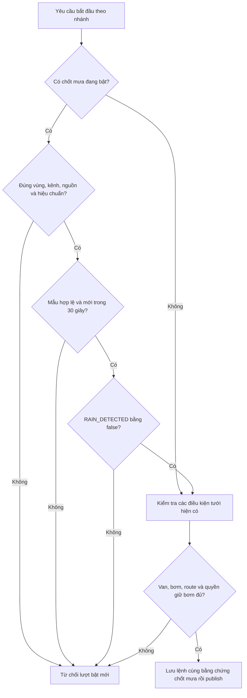

# Chương 52 — Chốt mưa trước khi bắt đầu tưới theo vùng

Ngày 16/10/2026, giờ Việt Nam. Tiếp nối [node thời tiết](CHAPTER_51_WEATHER_NODE.md)
và [phiên tưới từng bước](CHAPTER_49_OPERATOR_IRRIGATION_SESSION.md).

## Bài toán và giới hạn

Đất khô chưa đủ để quyết định bật tưới khi khu vực đang mưa. V38 cho mỗi vùng
chọn một kênh RAIN_DETECTED từ node WEATHER/v2 cùng khu vực. Nhiều vùng có thể
chung một node thời tiết; mỗi vùng lưu chính sách riêng, mặc định chưa cấu hình.
Chỉ khi người vận hành bật chốt, mẫu không mưa hợp lệ mới qua điều kiện này.
Các chốt nước, van, boot, thứ tự lệnh, bơm OFF và quyền giữ bơm vẫn áp dụng.

**Đây là chốt trước khi bắt đầu, không phải bộ giám sát dừng liên tục.** Mưa
xuất hiện sau khi ON đã được giữ chỗ không tự phát sinh OFF; người vận hành
cần tắt. Hết mưa không tự tạo phiên, mở van, gửi lại ON hay tiếp tục phiên cũ.
Không dùng LIGHT để suy ra mưa hoặc nhu cầu nước. Chưa có dự báo, mm mưa,
bốc thoát hơi, coordinator nhiều nhánh hoặc queue dispatch. A3/A4 còn mở.

## Sơ đồ quyết định

## Cấu hình và hợp đồng API

Giữ PostgreSQL volume, cập nhật code và restart backend để Flyway áp V38.
Migration thêm zone_rain_gate và pump_command.weather_gate JSONB, không seed
policy, mẫu hoặc lệnh, không sửa checksum migration cũ. Chính sách chứa:
zoneId/zoneRevision, nodeId/channelId, expectedSource, calibrationVersion,
enabled và revision. Revision vùng bị đổi làm binding bật hiện CONFIG_CHANGED;
phải kiểm tra lại rồi lưu phiên bản mới khi hệ thống nghỉ.

Vào **Sensor Realtime → Node & trạm nước → Vùng tưới → Chốt mưa <mã vùng>**;
cũng có nút trong **Điều khiển Actuator → Cấu hình nhánh tưới**. Chọn node
WEATHER cùng khu vực, kênh RAIN_DETECTED/boolean, kiểm tra nguồn/hiệu chuẩn rồi
bật chốt và lưu. Nguồn theo vùng, SIMULATOR hoặc PHYSICAL, vẫn do thiết bị
khai báo; không chứng minh cảm biến vật lý được kiểm định. Không tự tạo board,
certificate hoặc quyền IAM. Backend phải đã nhận telemetry của node thời tiết
qua luồng V37; khai báo registry không làm cảm biến tự hoạt động.

| API | Ý nghĩa |
| --- | --- |
| GET /api/v1/irrigation-zones/{id}/weather | Cấu hình, lý do chặn, mẫu gốc, asOf và validUntil |
| PUT cùng đường dẫn | Lưu cấu hình, không gửi lệnh; trả policy đã tăng revision |

Body PUT gồm expectedRevision (0 nếu chưa có), zoneRevision, nodeId, channelId,
expectedSource, calibrationVersion (có thể null), enabled. Gửi sai phiên bản
trả 409; không ghi đè tự động. Chỉ bật khi backend đã có CONTROL_ENABLED,
PUMP_FENCING_ENABLED, PUMP_CIRCUIT_ROUTE_REQUIRED và
IRRIGATION_CIRCUIT_DEMO_ENABLED=true, như [chương 47](CHAPTER_47_PUMP_CIRCUIT_ROUTE.md).
Không bật các flag chỉ để bỏ lỗi: cần đúng profile LED và route đã kiểm tra.
Đổi hoặc tắt policy yêu cầu không có phiên tưới đang giữ chỗ và bơm đã nghỉ,
không còn lệnh/quyền giữ chưa xác nhận. Có thể tắt binding kênh đã mất khi
đủ điều kiện nghỉ; không xóa dữ liệu để bỏ chốt.

## Độ mới, lỗi và bằng chứng lệnh

| Trạng thái | Ý nghĩa với lượt bật mới |
| --- | --- |
| NOT_CONFIGURED / DISABLED | Chốt chưa áp dụng; không đồng nghĩa không mưa |
| DRY | Qua riêng chốt mưa, vẫn kiểm tra các chốt khác |
| RAIN | Chặn |
| MISSING / STALE / CLOCK_SKEW / SENSOR_FAULT | Chặn, không đổi null/lỗi thành false |
| SOURCE_MISMATCH / CALIBRATION_MISMATCH | Chặn |
| CONFIG_CHANGED / CHANNEL_UNAVAILABLE | Chặn đến khi xem lại binding |

Cả observedAt và receivedAt phải mới dưới 30 giây, không vượt giờ backend
quá 2 giây. Hết hạn tại đúng mốc 30 giây. Chỉ đọc mẫu thực sự chứa kênh mưa;
packet chỉ có ánh sáng, packet trùng hoặc polling HTTP không làm mới mẫu mưa.
UI dùng clock tiến theo performance.now, không kéo giờ lùi khi nhận asOf cũ;
API lỗi/hết độ mới phản hồi hiện chưa xác nhận, không tiếp tục hiện được phép.
Giá trị trong mục **Mẫu đã lưu** là lịch sử, khác kết quả chốt hiện tại.

Backend kiểm tra chốt khi tạo phiên, trước bước OPEN và trong proof ON.
Quan trọng hơn, tại transaction giữ chỗ ON, backend kiểm tra lại và lưu nguyên
policy + sample + thời hạn trong pump_command.weather_gate. Ingest WEATHER,
lưu policy và ON fenced dùng cùng pump_dispatch_gate để tuần tự hóa quyết
định, không giữ khóa qua network publish. Đây là bằng chứng tại lúc giữ chỗ,
không cam kết thời tiết sẽ giữ nguyên đến khi thiết bị nhận hoặc suốt lần tưới.

Nếu bất kỳ policy đang bật, ON không có route không được dùng để đi vòng;
đường legacy cũng bị chặn. OFF không cần mẫu mưa và không ghi weather_gate;
RESET giữ điều kiện reset hiện có. UUID đã lưu được đối chiếu trước, không
publish lại hoặc thay bằng chứng cũ chỉ vì mưa/không mưa đã đổi.

Mất phản hồi PUT khiến UI khóa sửa/gửi lại. **Đối chiếu chốt mưa** chỉ GET:
chỉ xác nhận khi toàn bộ binding và revision tăng đúng một khớp yêu cầu.
Khác cấu hình vẫn giữ kết quả chưa rõ; không tự PUT lại. Lỗi 400/404/409 yêu
cầu đọc cấu hình mới nhất trước khi sửa. Polling không ghi đè bản nháp đang sửa.

## Kiểm chứng cloud ngày 16/10/2026

- 544 backend đạt, 19 ca mới: nguồn/hiệu chuẩn/area/revision, thiếu/lỗi/cũ/
  lệch giờ, partial/duplicate, chặn ON sau preview, OFF, chống bypass, phiên
  đang mở và không tự tạo OFF sau mưa. MQTT transport giả lập.
- 45 browser node/vùng (8 ca chốt mưa mới), 75 browser nhánh/phiên và 17
  browser pump hồi quy đạt; 28 unit parser node/history/weather/zone/rain đạt.
- Lint/build đạt. Vite vẫn có cảnh báo __dirname và kích thước bundle vốn có.
- V37→V38 giữ nguyên 10 bảng dữ liệu WEATHER cũ; không seed policy.
- Schema riêng rain_gate_smoke nhận 5 packet từ native WeatherPacket.h qua
  router/DB thật: MISSING → DRY → DRY → RAIN → SENSOR_FAULT → RAIN.
  Không đăng ký transport; pump_command/watering_run không phát sinh. Không phải packet AWS/Wokwi live.
- Full app/API/PostgreSQL thật mở màn chốt mưa, binding và mẫu cũ, quay lại
  đúng trang; GET-only, không request ngoài loopback hoặc lỗi JS. Restart JVM
  giữ nguyên 12 bảng cấu hình/mẫu/lệnh/phiên được đối chiếu; mẫu không được
  làm mới. Runtime demo cloud giữ MQTT/control=false.

[Bàn giao chi tiết](../implementation/LOCAL_ZONE_RAIN_GATE_REPORT.md).

## Nghiệm thu Windows/AWS/Wokwi — tất cả Chưa chạy

Dùng LED mô phỏng và board WEATHER riêng theo chương51, giữ các giới hạn
bơm/van của chương47. Không dùng các ca cloud để đánh dấu đã chạy thiết bị thật.

| Ca | Thao tác và kết quả cần kiểm tra | Kết quả live |
| --- | --- | --- |
| 1 | Kết thúc phiên, OFF/CLOSED mới; chọn đúng vùng/node/kênh và bật chốt; lưu không gửi lệnh | Chưa chạy |
| 2 | WEATHER không mưa, mẫu mới; các proof còn lại đủ; tạo phiên/OPEN/ON5s, ACK và status khớp | Chưa chạy |
| 3 | Trước ON đổi sang có mưa, đợi backend nhận; chốt chặn, không xuất hiện lệnh ON mới | Chưa chạy |
| 4 | Fault mưa, dừng board quá30s, sai nguồn/hiệu chuẩn: từng trường hợp chặn lượt bật mới | Chưa chạy |
| 5 | Khi LED đang ON đổi sang mưa: không kỳ vọng tự OFF; gửi OFF và xác nhận status, rồi CLOSE/FINISH | Chưa chạy |
| 6 | Restart backend, kiểm tra binding/mẫu cũ còn; không replay ON; xem lại trạng thái phiên phục hồi | Chưa chạy |

Kết thúc với LED/bơm OFF, van CLOSED, phiên khép đúng proof. Không xóa DB,
đổi giờ hoặc làm mới sample giả để vượt chốt.
