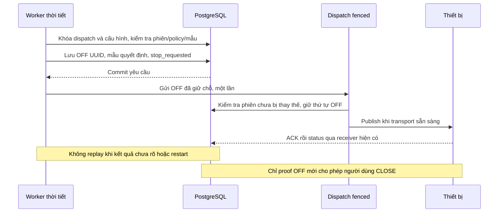

# Chương 53 — Yêu cầu dừng phiên tưới khi thời tiết không còn cho phép

Ngày 17/10/2026, giờ Việt Nam; đợt kiểm tra bắt đầu cuối ngày 16/10.
Tiếp nối [chốt mưa trước ON](CHAPTER_52_ZONE_RAIN_GATE.md) và
[phiên tưới có xác nhận](CHAPTER_49_OPERATOR_IRRIGATION_SESSION.md).

## Phạm vi mới

V38 chặn lượt bắt đầu, nhưng thời tiết có thể đổi sau ON. V39 thêm lựa chọn
**Yêu cầu OFF khi thời tiết không cho phép trong phiên tưới** cho từng vùng.
Mặc định false, kể cả các policy đang bật trước nâng cấp. Tùy chọn chỉ áp dụng
cho phiên OPERATOR_STEPS đã giữ chỗ ON, không cho mọi lệnh ON trực tiếp, quy
tắc ENV01 cũ hay hàng chờ. Không tự OPEN, ON, CLOSE, FINISH hoặc resume.

Khi bật cả backend lẫn policy, worker kiểm tra phiên đang ở DISPATCHING_ON
hoặc WAIT_ON. Có mưa, mẫu thiếu/cũ/lỗi/lệch giờ, sai nguồn/hiệu chuẩn hoặc
binding đổi sẽ yêu cầu dừng. Mẫu hợp lệ không mưa tiếp tục qua chốt; packet
LIGHT riêng không làm mới RAIN. Phiên PREPARED/WAIT_OPEN chưa gửi ON thì
chốt V38 đã ngăn bắt đầu, không cần tạo một OFF tự động mới.

Đây là giám sát ở backend theo chu kỳ danh định 1 giây, không cam kết độ trễ
thời gian thực. Backend, scheduler, broker và mạng phải hoạt động; thiết bị
vẫn cần thời hạn bật và bảo vệ cục bộ. Không suy ra ACK/GPIO mô phỏng thành
bơm hay đường nước vật lý đã dừng. Không dùng tính năng này cho bơm thật
trước khi có thiết kế và nghiệm thu phần cứng phù hợp.

## Từ quyết định đến kết quả gửi



Mỗi phiên tối đa một bản ghi irrigation_weather_stop, liên kết request_id
với irrigation_session_action. Bằng chứng giữ nguyên View chốt mưa lúc quyết
định, gồm policy revision, nguồn, calibration, boot/sequence và timestamp.
Không ghi đè bằng mẫu không mưa mới hơn. Stop latch và action commit trước
khi byte tới transport; worker không giữ khóa DB qua network publish.

ON đang dispatch thì mưa tới: OFF đánh dấu stop_requested, nên ON chưa giữ
chỗ không vượt session guard; ON đã giữ chỗ vẫn chịu thứ tự fence với OFF.
Hai worker cạnh tranh chỉ một worker tạo yêu cầu. OFF thủ công đã có trước
thì không tạo yêu cầu thời tiết mới. OFF thủ công chen vào khi gửi không bị
kết quả trả về muộn ghi đè. Callback trong transaction dispatch ngăn yêu cầu
OFF thời tiết đã bị thay thế đụng vào một bước thủ công hoặc phiên mới.

| Kết quả | Cách hiểu |
| --- | --- |
| RESERVED | Đã giữ chỗ, chưa xác nhận kết quả gọi |
| RETURNED | Có kết quả gọi; cần xem ledger và status thiết bị |
| UNRESOLVED | Chưa rõ kết quả gọi, cần người vận hành xử lý |
| command FAILED / MQTT_UNAVAILABLE | Đã lưu OFF nhưng không có transport để gửi |
| command PUBLISH_UNCERTAIN | Không biết publish đã tới đâu; không tự gửi lại |
| command EXECUTED | Có ACK trong ledger, vẫn cần trạng thái thiết bị và proof OFF |

RETURNED có thể đi cùng FAILED hoặc PUBLISH_UNCERTAIN, không phải “đã tắt”.
Mất MQTT vẫn giữ identity yêu cầu; khi mạng có lại worker không tự replay.
Thiếu intent sẵn sàng thì lưu action UNRESOLVED và phiên RECOVERY_REQUIRED,
không gửi. Người vận hành có thể gửi OFF mới theo luồng hiện có, đợi proof,
rồi CLOSE/FINISH. Restart đưa phiên chưa khép về RECOVERY_REQUIRED và action
RESERVED về UNRESOLVED; không lấy yêu cầu cũ để tiếp tục gửi.

## Cấu hình Windows

Giữ PostgreSQL volume, git pull và restart backend để áp V39. Chưa có
firmware, certificate, topic hoặc IAM mới cho riêng worker. WEATHER board
vẫn phải được kết nối và backend nhận telemetry đúng như chương51.

Dùng terminal **Git Bash** backend với profile LED theo nhánh đã nghiệm thu:

```bash
export SMARTFARM_CONTROL_ENABLED=true
export SMARTFARM_PUMP_FENCING_ENABLED=true
export SMARTFARM_PUMP_CIRCUIT_ROUTE_REQUIRED=true
export SMARTFARM_IRRIGATION_CIRCUIT_DEMO_ENABLED=true
export SMARTFARM_IRRIGATION_SESSION_ENABLED=true
export SMARTFARM_IRRIGATION_RAIN_STOP_ENABLED=true
export SMARTFARM_IRRIGATION_DEMO_ENABLED=false
bash tools/backend/run_backend_windows.sh
```

Giữ nguyên cấu hình profile AWS/database của terminal đã chạy được. Không
dán export Bash vào PowerShell. Tên property Spring là
smartfarm.irrigation.rain-stop-enabled, mặc định false. Chu kỳ kiểm tra
smartfarm.irrigation.rain-stop-poll-ms mặc định1000; không giảm để thay cho
bảo vệ thiết bị. Không bật flag MQTT/thực hiện AWS từ môi trường cloud thử.

Kết thúc phiên hiện tại, xác nhận bơm nghỉ rồi vào **Vùng tưới → Chốt mưa**.
Chọn đúng WEATHER/RAIN cùng khu vực, nguồn/calibration, bật chốt và chọn thêm
chế độ OFF trong phiên. Lưu cần đúng revision và profile backend; không sửa
policy khi phiên đang giữ chỗ. Bỏ chọn chốt cũng bỏ stopOnRain trong cùng
lần lưu. Client cũ không gửi field này được hiểu false. Các policy V38 sau
migration vẫn admission-only, không tự đổi hành vi.

**Lịch sử dừng do thời tiết** hiển thị 20 yêu cầu mới nhất của vùng, nguồn
mẫu tại quyết định và kết quả gọi/lệnh riêng. GET
/api/v1/irrigation-zones/{id}/weather/stops trả zoneId, asOf, workerEnabled,
items. workerEnabled phản ánh cấu hình flag backend lúc đọc, không chứng
minh thiết bị đang kết nối hoặc scheduler đang đáp ứng trong một giây.
Màn này chỉ đọc, không có nút gửi lại; lỗi API không giữ nhãn cấu hình mới.

## Bằng chứng cloud

- 567 backend đạt, 23 ca mới: opt-in/profile, rain và mọi nhóm unknown,
  stale khi LIGHT mới, một yêu cầu/phiên, concurrent worker, manual OFF,
  ON publish chen mưa, callback gửi muộn, thiếu intent và restart.
- 51 browser node/vùng (6 mới),75 nhánh/phiên,17 pump hồi quy;31 unit parser
  (3 mới). Lint/build đạt, không skip. Cảnh báo Vite cũ vẫn còn.
- V38→V39 giữ12 bảng cũ sau khi bỏ field stop_on_rain mới khỏi phép so sánh;
  field mới mặc định false, bảng yêu cầu dừng rỗng. Không seed event/lệnh.
- Scheduler thật trong schema weather_stop_verified_smoke, transport giả:
  packet native mưa cùng native valve OPEN/pump ON tạo một OFF, ACK/status
  khớp; không tự CLOSE hoặc ON. Phiên ở WAIT_OFF sau thử. Đây là mô phỏng,
  không phải broker AWS/GPIO live. Native pump helper có thêm timer OFF ở
  mốc logical tương lai; ca này nhận ACK/ON trước mốc đó, không ingest sự
  kiện timer. ACK/status OFF được tạo từ packet OFF native với metadata
  UUID/ordinal của lệnh giả lập, không tuyên bố kiểm thử firmware OFF mới.
- Full app/API/DB thật đọc lịch sử và quay lại đúng trang, GET-only, không
  request ngoài loopback hoặc lỗi JS. Startup chuyển phiên sang RECOVERY;
  restart tiếp theo giữ12 bảng khác nguyên vẹn, phiên RECOVERY chỉ tăng
  revision thêm một để vô hiệu thao tác cũ, không thêm command/event.

[Bàn giao](../implementation/LOCAL_SESSION_WEATHER_STOP_REPORT.md).

## Nghiệm thu AWS/Wokwi — Chưa chạy

Chỉ dùng LED và các board riêng của chương47/51, ON5s trong cửa sổ van30s.
Vì phiên ngắn, chủ động đổi switch mưa ngay sau ACK ON; không tăng giới hạn
bơm để tạo ca thử. Thực hiện từng ca rồi dừng, xác nhận OFF/CLOSED và khép
phiên trước ca tiếp theo.

| Ca | Kết quả mong đợi | Live |
| --- | --- | --- |
| 1: policy cũ, chưa chọn tự dừng | Chỉ gate trước bắt đầu; không tự đổi hành vi | Chưa chạy |
| 2: opt-in, từ không mưa sang mưa khi WAIT_ON | Một OFF UUID và evidence, ACK/status khớp; người dùng CLOSE/FINISH | Chưa chạy |
| 3: fault hoặc nguồn/hiệu chuẩn không khớp trong phiên | Lưu lý do tương ứng và yêu cầu OFF; không tự ON khi hồi phục | Chưa chạy |
| 4: tắt board thời tiết | Mẫu cũ chặn lượt mới; phiên còn chưa giải quyết yêu cầu dừng khi hết độ mới | Chưa chạy |
| 5: mất MQTT/backend giữa lần tưới | Không hứa OFF từ backend; timer/interlock thiết bị bảo vệ, recovery thủ công, không replay | Chưa chạy |
| 6: OFF thủ công đồng thời hoặc restart sau claim | Không ON trở lại, không gửi lặp OFF cũ, không ghi đè bước thủ công mới | Chưa chạy |

Không dùng mock để đánh dấu đạt ca live; không xóa DB/NVS để giải phóng
phiên hoặc làm mới timestamp để vượt chốt.
