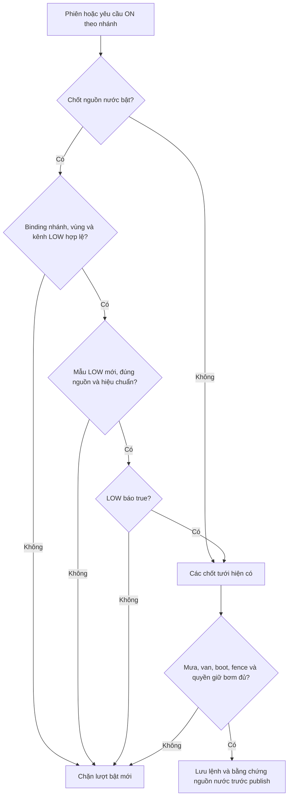

# Chương 54 — Chốt nguồn nước trước khi bắt đầu tưới theo nhánh

Ngày 17/10/2026, giờ Việt Nam. Tiếp nối [cấu hình nhánh/bơm](CHAPTER_47_PUMP_CIRCUIT_ROUTE.md),
[trạm nước](CHAPTER_23_WATER_NODE_MONITOR.md) và [chốt mưa](CHAPTER_52_ZONE_RAIN_GATE.md).

## Vì sao cần chốt riêng

Đất cần tưới và van mở chưa chứng minh nguồn nước sẵn sàng. V40 cho mỗi
nhánh chọn **Bật chốt nguồn nước cho nhánh**. Khi bật, chỉ phao đã gán ở
lowChannelId của waterNodeId báo true, hợp lệ, đúng nguồn/hiệu chuẩn và mới
trong30 giây mới qua điều kiện bắt đầu. Mặc định chưa cấu hình, không tự
bật cho các nhánh hiện có. false/null/mất dữ liệu không đổi thành có nước.

Đây là **admission trước khi bắt đầu**, chưa phải giám sát dừng liên tục khi
LOW thay đổi sau ON. Chế độ dừng do thời tiết V39 chỉ xem thời tiết, không tự
mở rộng sang phao. LOW=true không chứng minh bơm chạy, nước tới nhánh, lưu
lượng đủ hoặc phần trăm bồn. LOW=false chỉ nói không có nước tại vị trí phao,
không khẳng định bồn hoàn toàn rỗng. Bảo vệ chạy cạn/lưu lượng và timer tại
thiết bị vẫn cần thiết; [chương26](CHAPTER_26_LOCAL_FLOW_GUARD.md) là prototype
local flow guard riêng, không phải flow proof xuyên controller đã hoàn tất.

## Binding nhiều nhánh và nhiều trạm

Lấy nguyên waterNodeId/lowChannelId từ cấu hình nhánh, không cho màn chốt
chọn một trạm khác để vượt điều kiện. Nhiều nhánh có thể dùng chung một trạm,
nhưng mỗi nhánh lưu policy enabled/revision riêng. Trạm dùng chung nhiều vùng
không bị ép cùng areaId như node mưa; định danh và tuyến đã khai báo phải được
người vận hành kiểm tra đúng thực tế. Nguồn theo expectedSource của nhánh,
SIMULATOR hoặc PHYSICAL do thiết bị khai báo, chưa chứng nhận phần cứng.

Policy giữ circuitId, circuitRevision, calibrationVersion của kênh LOW,
enabled và revision. Thay revision nhánh/vùng, source hoặc hiệu chuẩn làm
binding bật không còn hợp lệ; cần đọc lại, rà soát rồi lưu khi bơm nghỉ và
phiên cũ đã khép. Không tự thay binding bằng kênh mới nhất có tín hiệu true.
Registry và DB còn có khóa ngoại bảo vệ kênh được nhánh tham chiếu; không xóa
constraint để sửa hoặc bỏ chốt.

## Sơ đồ kiểm tra

| Trạng thái | Ý nghĩa |
| --- | --- |
| NOT_CONFIGURED / DISABLED | Chốt chưa áp dụng, không có kết luận nước sẵn sàng |
| AVAILABLE | LOW báo có nước, qua riêng chốt này |
| EMPTY | LOW báo không có nước, chặn lượt bật mới |
| MISSING / STALE / CLOCK_SKEW / SENSOR_FAULT | Chặn, không thay thiếu/lỗi thành true |
| SOURCE_MISMATCH / CALIBRATION_MISMATCH | Chặn |
| CONFIG_CHANGED / CHANNEL_UNAVAILABLE | Chặn đến khi rà soát binding |

Cả observedAt và receivedAt dưới30 giây, không vượt giờ backend quá2 giây;
hết hạn tại đúng30 giây. Chỉ mẫu thực sự chứa LOW được tính. Packet FLOW mới,
packet từ trạm khác, packet trùng hoặc polling HTTP không làm mới mẫu LOW.
Không yêu cầu FLOW>0 trước bật bơm: trước ON lưu lượng có thể là0. V40 chưa
dùng FLOW để chứng minh nước chạy hoặc điều chỉnh lượng/thời hạn tưới.

## API và transaction

- GET /api/v1/irrigation-circuits/{id}/water-gate trả config nhánh, policy,
  calibration khai báo hiện tại, asOf, state, allowed, validUntil và mẫu gốc.
- PUT cùng đường dẫn nhận expectedRevision (0 khi chưa có), circuitRevision,
  calibrationVersion (có thể null), enabled; trả policy tăng revision đúng1.
- V40 thêm circuit_water_gate và pump_command.water_gate JSONB, không seed
  policy/sample/lệnh và không sửa checksum migration trước.

Lưu bật chốt cần profile control/fence/route-required/circuit-demo của
chương47. Mọi lần sửa/tắt đều cần không có phiên giữ chỗ và bơm nghỉ theo
proof/ownership hiện có. Có thể tắt binding không còn hợp lệ khi đủ điều
kiện nghỉ, không cần xóa dữ liệu. Sai revision trả409, không ghi đè.

Chốt được kiểm tra lúc tạo phiên, trước bước OPEN và tại pump proof ON.
Tại transaction giữ chỗ ON, backend kiểm tra lại và lưu toàn bộ View trong
pump_command.water_gate; bằng chứng mưa lưu ở field riêng. Ingest WATER và
WEATHER, policy và ON dùng pump_dispatch_gate để tuần tự hóa quyết định,
không giữ khóa qua network publish. Bằng chứng chỉ nói điều kiện tại lúc
giữ chỗ, không bảo đảm LOW còn true khi thiết bị nhận hay suốt lần tưới.

Nếu có bất kỳ water policy đang bật, ON không có route, kể cả đường legacy,
không được đi vòng. Route của nhánh khác chưa bật policy vẫn dùng các chốt
của chính nhánh đó. OFF không đòi mẫu nước; RESET giữ điều kiện reset cũ.
UUID đã có được đối chiếu trước, không publish lại hay đổi bằng chứng khi
mẫu mới khác đi. Không tự OFF hoặc resume chỉ do LOW đổi sau admission.

## Sử dụng tại Windows

Giữ PostgreSQL volume, git pull/restart backend để áp V40, restart frontend.
Không có flag mới riêng cho water gate; dùng đúng profile LED theo nhánh đã
thiết lập ở chương47. Chính chốt không thêm certificate/topic/IAM; nếu trạm
chưa gửi dữ liệu phải hoàn thành luồng board WATER ở chương23 trước. Khai báo
registry không tự thêm board vào simulator hoặc cấp quyền AWS.

Vào **Điều khiển Actuator → Cấu hình nhánh tưới → Chốt nguồn nước <mã>**.
Kiểm tra ID trạm/phao, nguồn, revision và calibration rồi bật/lưu. Có thể lưu
khi chưa có mẫu để chốt ngay ở MISSING. Sau đó phải có mẫu LOW mới để qua
điều kiện. Mục “Mẫu đã lưu” là lịch sử, khác kết quả chốt hiện tại.

Khi hiệu chuẩn kênh đã đổi, bấm **Dùng hiệu chuẩn kênh hiện tại** sau khi đã
rà soát, rồi lưu phiên bản mới. API lỗi hoặc dữ liệu phản hồi cũ không giữ
nhãn sẵn sàng. UI dùng clock monotonic, polling không kéo giờ lùi hoặc ghi
đè bản nháp đang sửa. Conflict cần đọc cấu hình mới nhất. Mất phản hồi PUT
khóa gửi lại; **Đối chiếu chốt nguồn nước** chỉ GET và chỉ xác nhận khi toàn
bộ request cùng revision tăng đúng1 khớp. Kết quả khác vẫn giữ chưa rõ.

## Kiểm tra cloud

- 592 backend đạt,25 ca mới: bool/quality/source/calibration/clocks, partial/
  duplicate, nhầm trạm, policy độc lập cùng trạm, revision/registry drift,
  chặn ON sau preview, lưu bằng chứng, duplicate, OFF/RESET và phiên đang mở.
- 84 browser nhánh/phiên/history (9 water gate mới),51 node/vùng,17 pump hồi
  quy và36 unit parser (5 mới) đạt; không skip.9 ca water gate được kiểm tra
  lại sau guard chặn submit không có thay đổi. Lint/build đạt, cảnh báo Vite cũ.
- V39→V40 giữ13 bảng cũ khi bỏ field water_gate mới khỏi so sánh pump_command;
  field mới null cho lệnh cũ, policy rỗng. Không biến lệnh cũ thành bằng chứng mới.
- Native WaterPacket.h→router→PostgreSQL ở schema riêng water_gate_smoke:
  MISSING→AVAILABLE→EMPTY→SENSOR_FAULT→AVAILABLE,4 mẫu/12 readings, FLOW=0;
 0command/run/session, không transport. Không gọi đây là AWS/Wokwi live.
- Full app/API/DB thật hiển thị binding, mẫu cũ, làm mới vẫn STALE và quay lại
  đúng danh sách; GET-only, không request ngoài loopback hoặc lỗi JS.
  Restart JVM giữ14 bảng được chọn, không refresh mẫu hoặc dispatch.

[Bàn giao chi tiết](../implementation/LOCAL_CIRCUIT_WATER_GATE_REPORT.md).

## Nghiệm thu AWS/Wokwi — tất cả Chưa chạy

Dùng LED và các board riêng đã chạy được, giữ giới hạn ON5s/van30s của các
chương trước. Sau từng ca xác nhận OFF/CLOSED và khép phiên. Không dùng test
cloud để đánh dấu live đạt hoặc tăng thời hạn bơm chỉ để tạo tình huống.

| Ca | Kết quả cần xác nhận | Live |
| --- | --- | --- |
| 1: bật policy khi bơm nghỉ | Đúng nhánh/trạm/LOW/source/calibration; lưu không gửi lệnh | Chưa chạy |
| 2: LOW=true mới, FLOW=0 trước ON | Qua chốt nước, các proof khác đủ mới cho OPEN/ON5s; ACK/status đúng | Chưa chạy |
| 3: LOW=false hoặc fault trước ON | Chặn lượt mới, không có lệnh ON mới | Chưa chạy |
| 4: tắt trạm hoặc chỉ FLOW tiếp tục | Mẫu LOW hết độ mới thành STALE, không được FLOW làm mới hộ | Chưa chạy |
| 5: trạm khác báo true, trạm đã chọn false | Không đi vòng; OFF vẫn yêu cầu được, đợi proof thật | Chưa chạy |
| 6: restart/mất phản hồi lưu | Binding còn, không replay ON; PUT chỉ GET đối chiếu; mẫu cũ vẫn cũ | Chưa chạy |

Chốt LOW không tự dừng sau ON. Không xóa DB/NVS, bỏ khóa ngoại hoặc sửa
sample timestamp để vượt điều kiện. A3 còn flow proof xuyên controller,
giám sát nước khi đang chạy, coordinator nhiều route và dispatch queue.

V41 ở [chương55](CHAPTER_55_SESSION_WATER_STOP.md) bổ sung lựa chọn giám sát
LOW trong phiên operator. Policy V40 giữ admission-only sau nâng cấp; cần
bật riêng cả flag backend và stopOnUnavailable, không tự đổi hành vi cũ.
