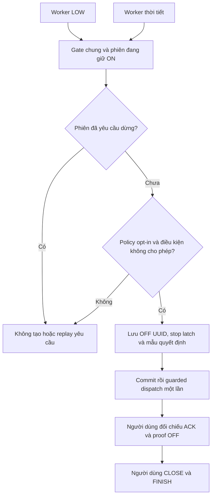

# Chương 55 — Yêu cầu dừng phiên tưới khi nguồn nước không còn hợp lệ

Ngày 17/10/2026, giờ Việt Nam. Tiếp nối [chốt LOW trước ON](CHAPTER_54_CIRCUIT_WATER_ADMISSION.md)
và [dừng do thời tiết](CHAPTER_53_SESSION_WEATHER_STOP.md).

## Từ chốt bắt đầu sang giám sát phiên

V41 thêm **Yêu cầu OFF khi nguồn nước không cho phép trong phiên tưới** cho
policy của từng nhánh. Field stopOnUnavailable và flag backend đều mặc định
false; các policy V40 giữ admission-only sau nâng cấp. Chỉ phiên
OPERATOR_STEPS đã giữ chỗ ON, đang DISPATCHING_ON/WAIT_ON và chưa yêu cầu
dừng được giám sát. Không áp dụng cho mọi direct ON hoặc quy tắc ENV01 cũ.

Khi bật chế độ, LOW=false, thiếu mẫu, lỗi, cũ, lệch giờ, sai nguồn/hiệu chuẩn
hoặc binding không còn hợp lệ đều yêu cầu OFF. LOW=true hợp lệ tiếp tục qua
chốt. Packet FLOW mới không làm mới LOW cũ. Nguồn/calibration/độ mới dùng
cùng quy tắc V40, không tạo một cách hiểu phao khác cho worker.

**LOW không chứng minh có lưu lượng hoặc phần trăm bồn.** LOW=true nhưng
FLOW=0 không tự thành lỗi của chế độ này. Chưa có flow proof xuyên controller,
thời gian mồi và hysteresis lưu lượng tại backend. Bảo vệ local/edge của
[chương26](CHAPTER_26_LOCAL_FLOW_GUARD.md) là phần riêng, chưa nghiệm thu thiết
bị thật. Khi backend hoặc mạng dừng, không hứa server sẽ gửi OFF; timer và
interlock tại thiết bị vẫn cần thiết. Chu kỳ worker danh định1s không phải
cam kết độ trễ thời gian thực.

## Một quyền dừng cho nước và thời tiết

Hai worker dùng chung transaction gate, stop_requested và identity bước OFF
của phiên. Điều kiện nào giữ quyền trước lưu lý do và mẫu của chính điều
kiện đó; không cam kết thứ tự ưu tiên nước hay mưa. Worker còn lại thấy phiên
đã yêu cầu dừng thì không tạo OFF hoặc event thứ hai. Lịch sử nước có thể
rỗng nếu thời tiết hoặc người dùng đã yêu cầu dừng trước; xem cả lịch sử
thời tiết và các bước phiên, không suy ra chưa từng có OFF.



Bảng irrigation_water_stop giữ tối đa một event/phiên, liên kết
irrigation_session_action và lưu nguyên View nguồn nước tại quyết định.
Shared stop latch dưới pump_dispatch_gate ngăn cả hai nguồn cùng claim.
Không tự OPEN, ON, CLOSE, FINISH hoặc resume khi nước/mạng có lại.

Giống V39, action/evidence commit trước IO; không giữ khóa DB qua publish.
ON đang gửi thì LOW đổi không được phục hồi WAIT_ON khi callback về muộn.
OFF thủ công mới không bị kết quả tự động về muộn ghi đè. Callback trong
transaction dispatch chặn OFF tự động đã bị thay thế tác động lên bước
thủ công hoặc phiên mới. Hai worker cạnh tranh cũng chỉ một yêu cầu.

## Kết quả gửi khác trạng thái bơm

| Dữ liệu lịch sử | Cách hiểu |
| --- | --- |
| RESERVED | Đã giữ chỗ, chưa xác nhận kết quả gọi |
| RETURNED | Có kết quả gọi, chưa chứng minh đã gửi hoặc bơm OFF |
| UNRESOLVED | Kết quả gọi chưa rõ, cần người vận hành xử lý |
| FAILED / MQTT_UNAVAILABLE | OFF đã lưu nhưng không có transport để gửi |
| PUBLISH_UNCERTAIN | Publish chưa rõ kết quả, không tự gửi lại |
| EXECUTED | Có ACK trong ledger; vẫn cần status/proof OFF mới |

Mất intent sẵn sàng vẫn lưu event/action UNRESOLVED và phiên RECOVERY_REQUIRED,
không dispatch. Mất MQTT có thể trả RETURNED với command FAILED. Restart
đưa phiên chưa khép về RECOVERY_REQUIRED, không replay ON/OFF cũ. Người dùng
có thể yêu cầu OFF mới, đợi proof rồi CLOSE/FINISH theo luồng đã có. Nước có
lại không tự tiếp tục tưới. Phiên WAIT_ON chưa khép có thể được yêu cầu OFF
ngay cả khi timer thiết bị đã hết; event không khẳng định bơm vật lý đang ON.

## Windows và giao diện

Giữ database volume, git pull/restart backend để áp V41. Giữ profile LED theo
nhánh/session của chương47/49 và trong **Git Bash backend** thêm:

```bash
export SMARTFARM_IRRIGATION_WATER_STOP_ENABLED=true
bash tools/backend/run_backend_windows.sh
```

Flag mặc định false; property Spring là smartfarm.irrigation.water-stop-enabled,
poll smartfarm.irrigation.water-stop-poll-ms mặc định1000. Có thể giữ rain-stop
bật đồng thời nếu cần, hai nguồn vẫn chung một stop latch. Legacy demo phải
tắt và board WATER phải đã gửi đúng telemetry; chính worker không thêm
certificate, topic, IAM hoặc firmware. Không dán export Bash vào PowerShell.

Khép phiên cũ, xác nhận bơm nghỉ, vào **Điều khiển Actuator → Cấu hình nhánh →
Chốt nguồn nước**. Bật gate, chọn thêm chế độ OFF trong phiên rồi lưu. Tắt
gate cũng tắt mode trong cùng request. Lưu cần đúng revision, profile và
điều kiện nghỉ; không thay policy giữa phiên. Client bỏ field mới được hiểu
false. Mất phản hồi PUT chỉ GET đối chiếu, phải khớp cả stopOnUnavailable,
không nhận admission-only làm kết quả lưu đúng của yêu cầu giám sát.

**Lịch sử dừng do nguồn nước** chỉ GET,20 yêu cầu gần nhất của nhánh, không
có nút gửi lại. API /api/v1/irrigation-circuits/{id}/water-gate/stops trả
circuitId/asOf/workerEnabled/items, tách operationState và commandState/errorCode.
workerEnabled phản ánh flag lúc đọc, không chứng minh kết nối/scheduler sống.
Mẫu trong event là bằng chứng lịch sử, không bị polling đổi thành mẫu mới.

## Bằng chứng cloud

615 backend đạt (23 mới),91 browser nhánh/phiên/history (7 mới),51 node/vùng,
17 pump và39 unit parser (3 mới), lint/build đạt, không skip. Kiểm tra shared
claim nước/mưa đồng thời, manual OFF, ON/late dispatch race, missing intent,
MQTT unavailable/uncertain và restart; hồi quy V39/V40 giữ nguyên.

Scheduler thật trong schema water_stop_verified_smoke, transport giả: nhận
WaterPacket LOW=true rồi false; native valve OPEN/pump ACK/ON và template
OFF ACK/status tạo đúng một OFF có bằng chứng, không auto CLOSE/ON. Native
pump helper phát thêm timer OFF ở logical tương lai; ca này chỉ nhận ACK/ON
trước mốc đó. Không tính thành test firmware/bơm/AWS thật mới. V40→V41 giữ14
bảng cũ khi bỏ field stop_on_unavailable mới khỏi so sánh policy; fieldfalse,
event0. Full app/API/DB thật GET-only trước/sau restart đạt, không external/
JS errors. Đối chiếu15 bảng sau restart:14 bảng không đổi, phiên RECOVERY
chỉ revision+1 để vô hiệu thao tác cũ, không thêm command/event.
[Bàn giao](../implementation/LOCAL_SESSION_WATER_STOP_REPORT.md).

## Nghiệm thu AWS/Wokwi — tất cả Chưa chạy

Chỉ LED, chọn thời hạn trong giới hạn phiên hiện có (có thể10s để đợi chu kỳ
telemetry5s), van30s. Không tăng hard limit. Mỗi ca xong phải xác nhận
OFF/CLOSED và khép phiên, không xóa DB/NVS để bỏ chốt.

| Ca | Kết quả cần xác nhận | Live |
| --- | --- | --- |
| 1: policy V40, chưa opt-in | Giữ admission-only, không tự bật chế độ mới | Chưa chạy |
| 2: LOW true→false sau ON | Một OFF UUID/evidence, ACK/status đúng; CLOSE/FINISH thủ công | Chưa chạy |
| 3: fault hoặc mẫu LOW cũ | Lưu lý do tương ứng, yêu cầu OFF; FLOW mới không làm mới LOW | Chưa chạy |
| 4: LOW false và mưa cùng lúc | Một yêu cầu tự dừng tổng, lý do của nguồn giữ quyền trước | Chưa chạy |
| 5: OFF thủ công đồng thời hoặc mất MQTT | Không ghi đè bước mới, không replay khi mạng có lại, đối chiếu proof | Chưa chạy |
| 6: restart trước/sau giữ chỗ OFF | RECOVERY, giữ evidence, không tự tiếp tục hoặc gửi lại | Chưa chạy |
