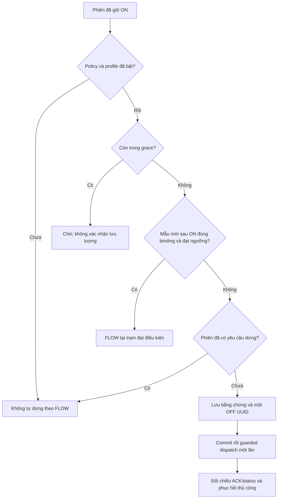

# Chương 56 — Giám sát lưu lượng tại trạm trong phiên tưới

Ngày 17/10/2026, giờ Việt Nam. Tiếp nối [chốt LOW](CHAPTER_54_CIRCUIT_WATER_ADMISSION.md),
[dừng khi LOW không hợp lệ](CHAPTER_55_SESSION_WATER_STOP.md) và
[phiên có xác nhận](CHAPTER_49_OPERATOR_IRRIGATION_SESSION.md).

## Vấn đề và giới hạn

LOW báo có nước chưa chứng minh có lưu lượng. V42 bổ sung giám sát kênh
FLOW_RATE/L/min của trạm WATER/v2 đã gán cho nhánh. Người dùng tự chọn ngưỡng
minimumLpm (>0, tối đa1000) và graceSeconds (1–8 giây). Giá trị form2L/phút,
5giây chỉ là gợi ý, chưa hiệu chuẩn cho hệ thống nông nghiệp thực tế.
Không thêm node, topic, IAM, certificate hay firmware trong bước này.

Policy và flag SMARTFARM_IRRIGATION_FLOW_STOP_ENABLED mặc định tắt. Chỉ phiên
OPERATOR_STEPS đã giữ ON, chưa yêu cầu dừng, ở DISPATCHING_ON/WAIT_ON được
đánh giá. Direct ON và quy tắc ENV01 cũ không nằm trong phạm vi. Bơm vẫn chỉ
bật1–10giây trong phiên, van30giây; thời hạn phiên phải dài hơn thời gian
chờ, không tăng giới hạn thiết bị để thử tính năng này.

FLOW tại trạm chung **không chứng minh nước đã tới từng nhánh/luống**, không
định vị tắc, rò rỉ hay xác nhận bảo vệ chạy khô phần cứng. Cần khảo sát đường
ống, hiệu chuẩn và nghiệm thu thiết bị thật. Bảo vệ local của
[chương26](CHAPTER_26_LOCAL_FLOW_GUARD.md) là một phần riêng.

## Khi nào yêu cầu OFF

Mốc thời gian là created_at của bước ON đã lưu tại server, không lấy thời
gian client hoặc suy ra thời điểm vật lý bơm bật. Mốc được giữ trước dispatch,
nên thời gian chờ cũng bao gồm độ trễ gửi. Trước hạn chỉ báo GRACE; đúng hạn
bắt đầu kiểm tra FLOW. Config/channel/anchor không hợp lệ có thể yêu cầu
OFF ngay mà không chờ hết grace.

Sau grace, mẫu phải thỏa tất cả điều kiện:

- Đúng trạm và kênh FLOW của nhánh, đúng nguồn và hiệu chuẩn đã duyệt.
- observedAt và receivedAt đều **sau** mốc ON, đều mới dưới10giây; lệch tương
  lai trên2giây bị từ chối. Đúng biên10giây là STALE.
- quality=VALID, giá trị hữu hạn và không âm; giá trị bằng ngưỡng được chấp nhận.

Mẫu trước ON, missing, fault/null, stale, skew, sai nguồn/calibration hoặc
revision/config drift đều yêu cầu OFF. LOW-only/trạm khác/duplicate không
làm mới FLOW. Một mẫu FLOW dưới ngưỡng sau grace đủ yêu cầu dừng; **chưa có
lọc nhiều mẫu, hysteresis hoặc nhận diện xung độc lập**. Cần chọn grace theo
chu kỳ telemetry thực tế, không khẳng định FLOW_OK là kiểm chứng đường ống.

## Chung quyền dừng với LOW và mưa

Ba worker giữ cùng pump_dispatch_gate/circuit gate và stop_requested của
phiên. Nguồn claim trước ghi event của mình; không cam kết FLOW, LOW hay
mưa ưu tiên. Manual OFF đã yêu cầu cũng chặn auto claim. Không tự ON/CLOSE/
FINISH/resume khi FLOW hoặc mạng trở lại. Lịch sử FLOW rỗng có thể do nguồn
khác giữ quyền trước, cần xem lịch sử LOW, thời tiết và các bước phiên.

irrigation_flow_stop giữ session/request/circuit/evidence, tối đa một event
mỗi phiên; action/evidence commit trước IO. Mất intent giữ UNRESOLVED và
RECOVERY_REQUIRED. RETURNED chỉ là kết quả gọi, có thể kèm command
FAILED/MQTT_UNAVAILABLE hoặc PUBLISH_UNCERTAIN; không tự gửi lại. ACK EXECUTED
vẫn cần status/proof OFF mới. Callback muộn không thay OFF thủ công mới.
Restart không replay hoặc tự tiếp tục phiên. Backend/network ngừng thì
worker không đảm bảo gửi OFF; timer/interlock tại thiết bị vẫn cần thiết.
Worker danh định1giây, không phải cam kết thời gian thực.

## API và cách dùng web

| Đường dẫn dưới /api/v1/irrigation-circuits/{id} | Mục đích |
| --- | --- |
| GET /flow-guard | Policy, backend flag, phiên/mốc ON, quyết định và mẫu |
| PUT /flow-guard | Lưu policy với expectedRevision/circuitRevision/hiệu chuẩn |
| GET /flow-guard/stops | 20 quyết định dừng gần nhất, operation và command riêng |

Chỉ sửa policy lúc không có phiên đang mở và bơm đã nghỉ có xác nhận. Cần
profile control/fence/route/circuit/session/flow-stop để bật. Migration V41→V42
không seed policy hoặc tạo lệnh OFF; startup vẫn chuyển phiên cũ sang recovery. Khi flag worker tắt, web báo chưa bật,
không tự coi policy đã lưu là bộ giám sát đang chạy.

Điều khiển Actuator → Cấu hình nhánh tưới → **Giám sát FLOW {mã nhánh}**.
Duyệt calibration, ngưỡng và thời gian chờ rồi lưu. Mất phản hồi PUT phải
GET đối chiếu đúng revision/toàn bộ body, gồm ngưỡng và grace; không tự retry.
Polling/error/dữ liệu cũ không được giữ nhãn FLOW_OK vô thời hạn. Hết grace
trên đồng hồ monotonic của giao diện chỉ yêu cầu đọc đánh giá mới, chưa tự
suy ra server đã gửi OFF. Lịch sử là bằng chứng tại thời điểm quyết định.

## Nghiệm thu AWS/Wokwi — tất cả Chưa chạy

Chỉ LED mô phỏng, giữ hard limit hiện tại. Tắt những policy khác trong một
ca riêng nếu muốn chắc lý do được FLOW claim, chỉ chỉnh khi phiên đã khép.
Không xóa DB/NVS/volume để bỏ chốt. Mỗi ca kết thúc cần OFF/proof, CLOSE và
FINISH thủ công hoặc quy trình recovery đã có.

| Ca | Kết quả cần xác nhận | Live |
| --- | --- | --- |
| 1: nâng cấp, chưa opt-in | Policy/flag tắt; không có OFF mới | Chưa chạy |
| 2: FLOW sau ON đạt ngưỡng | Qua grace, mẫu mới được hiển thị; không suy ra nước tới luống | Chưa chạy |
| 3: FLOW=0/dưới ngưỡng sau grace | Một OFF UUID/evidence; xác nhận ACK/status riêng | Chưa chạy |
| 4: thiếu/fault/FLOW cũ hoặc chỉ LOW mới | Có lý do đúng; không lấy mẫu trước ON làm proof | Chưa chạy |
| 5: FLOW/LOW/mưa cùng lỗi, hoặc manual OFF | Một yêu cầu tự động tổng, không ghi đè manual OFF | Chưa chạy |
| 6: mất MQTT hoặc restart trước/sau claim | Giữ evidence, không replay/resume; xử lý recovery | Chưa chạy |

Kết quả cloud và lệnh thử nằm trong
[bàn giao V42](../implementation/LOCAL_SESSION_FLOW_STOP_REPORT.md).

## Bằng chứng cloud đã chạy

643 backend (28 mới),98 browser nhánh/phiên/history (7 mới, 7 FLOW chạy lại
sau chỉnh ràng buộc form),46 unit parser (7 mới), lint/build đạt, không skip.
Test mới gồm grace đúng biên, mẫu trước ON, hai clock, quality/source/cal,
config/anchor/channel mất, ngưỡng, duration, tranh claim LOW/FLOW, manual
OFF, callback muộn, missing intent, mất MQTT, publish chưa rõ và restart.

Scheduler thật100ms trong schema flow_stop_verified_smoke, native WaterPacket
FLOW=0 sau ON → fake OFF → ACK/status → PostgreSQL đạt. Có2pump command
ON/OFF,1valve OPEN,1eventFLOW,1session; không auto CLOSE/ON. Native helper
và transport giả chỉ là bằng chứng tích hợp local, không tính là một lượt
AWS/Wokwi/phần cứng mới. Nâng schema water_stop_verified_smoke V41→V42 bằng
Flyway-only giữ15bảng đã đối chiếu nguyên vẹn, bảng policy/event mới rỗng;
lượt migrate thứ hai không thay đổi.

Full app thật qua Vite/backend/DB, GET-only trước/sau restart đạt, không
external request/JS error. Đối chiếu17bảng:16bảng không đổi; phiên đã RECOVERY
chỉ revision+1, không thêm command/event. Không refresh timestamp fixture để
biến dữ liệu lịch sử thành live. Hai lượt backend bị khởi chạy chồng schema
đã bị loại khỏi bằng chứng; kết quả643 là lượt verify chạy tuần tự sau đó.
