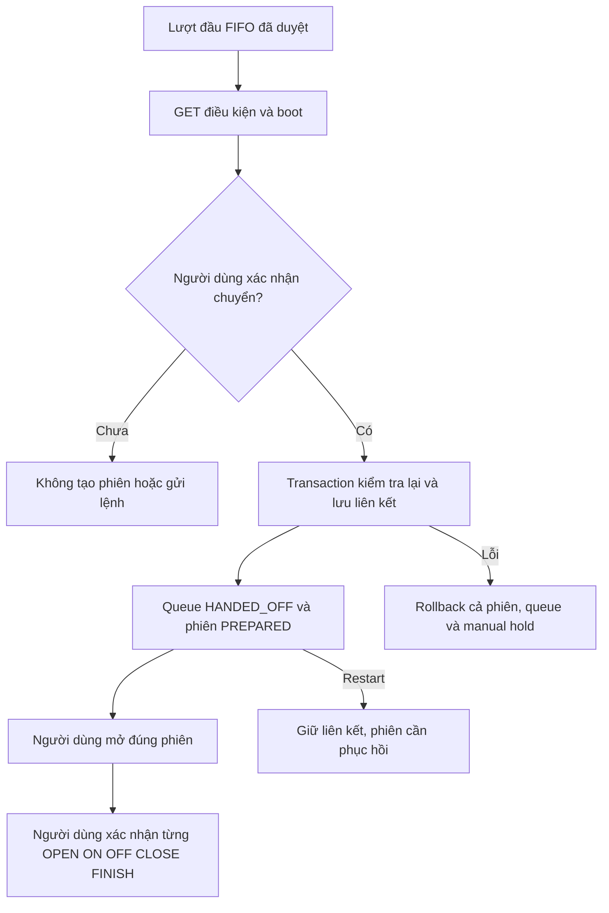

# Chương 57 — Chuyển lượt đầu hàng sang phiên tưới có xác nhận

Ngày17/10/2026, giờ Việt Nam. Tiếp nối
[hàng chờ diễn tập](CHAPTER_33_IRRIGATION_QUEUE_PREVIEW.md) và
[phiên có xác nhận](CHAPTER_49_OPERATOR_IRRIGATION_SESSION.md).

## Từ kế hoạch sang chuẩn bị phiên

V43 cho phép chuyển **đúng lượt đầu hàng** sang một phiên PREPARED. Đây là
thao tác được xác nhận riêng, chưa gửi OPEN/ON hoặc một lệnh MQTT nào. Sau
đó người dùng mở đúng phiên để xác nhận từng bước theo quy trình đã có.
Lượt tiếp theo không tự bắt đầu. Không tự đổi route của bơm hoặc điều phối
nhiều vùng; một boot bơm vẫn chỉ khai báo một route.

SMARTFARM_IRRIGATION_QUEUE_HANDOFF_ENABLED mặc địnhfalse. Cần profile phiên,
control/fence/route/circuit đã bật đúng, legacy demo=false. Không seed hàng
chờ, node hoặc phiên khi nâng cấp. Dữ liệu lịch sử và UUID cũ được giữ lại.
Không thêm certificate, IAM, MQTT topic hoặc firmware.

## Điều kiện chuyển

- Lượt còn QUEUED, đứng đầu FIFO, chưa hết hạn5phút; không có rehearsal đang chạy.
- Hàng chờ revision đúng bản vừa duyệt. Có bản chụp nhánh, vùng/nhánh còn khớp
  toàn bộ cấu hình và revision; không chuyển ngầm sang tuyến mới.
- Thời hạn đã xếp hàng1–10giây; lượt diễn tập11–30giây không bị tự rút ngắn.
  Nếu có policy FLOW, thời hạn phải dài hơn grace đã đặt.
- Profile phiên và boot bơm/van còn đúng; bơm OFF có xác nhận, van CLOSED mới,
  route/proof phù hợp và không có phiên khác giữ quy trình.
- Chốt LOW/mưa đã bật vẫn được kiểm tra. Các kiểm tra ON, timeout và
  supervisor FLOW/LOW/mưa hiện có vẫn áp dụng khi xác nhận các bước sau.

Không cần đất khô để lập kế hoạch hoặc tạo phiên do người dùng yêu cầu.
Đây chưa phải quyết định nông học tự động hay bằng chứng đã tưới. Thiết bị
vẫn cần timer/interlock cục bộ khi backend/mạng ngừng.

## Atomicity và chống tạo trùng

irrigation_queue_handoff liên kết một queue request với duy nhất một
session UUID, lưu body đã duyệt và prepared_at. Transaction giữ gate theo
thứ tự pump → queue → circuit → zone; kiểm tra lại trước khi tạo phiên,
chuyển queue sang HANDED_OFF và tăng revision. Nếu tạo phiên thất bại,
cả thay đổi manual hold của rule cũ cũng rollback.

HANDED_OFF/OPERATOR_SESSION_PREPARED là kết thúc **lượt hàng chờ**, không
phải bắt đầu/kết thúc tưới. started_at/planned_end_at của rehearsal vẫnnull;
finished_at chỉ đánh dấu lúc giao kế hoạch. Nó khác REHEARSED và không
chứng minh nước chảy, bơm ON hay GPIO đã đổi.

Gửi lại đúng body, kể cả sau restart, trả cùng liên kết và trạng thái phiên
hiện tại. Body khác bị từ chối; không nhận một phiên đã tạo trực tiếp làm
phiên của queue. Không tự tạo UUID mới khi mất phản hồi. Tranh chấp với
cancel/rehearse hoặc hai request chuẩn bị chỉ có một kết quả được lưu.

Sau handoff, nút hủy queue không tắt hay hủy phiên. Nếu request hủy đến muộn,
web báo lượt đã chuyển và hướng người dùng mở phiên. Việc dừng phải dùng
OFF/recovery của phiên, đối chiếu ACK/status/proof như trước. Không đóng
van hoặc FINISH chỉ vì queue chuyển sang trạng thái kết thúc.

## Web và API

Điều khiển Actuator → **Mở hàng chờ tưới diễn tập** → thêm lượt với nhánh
đã duyệt → **Chuẩn bị phiên từ lượt đầu hàng** → đọc điều kiện → xác nhận.
Sau khi lưu, **Mở phiên đã chuyển**. Hàng chờ cũ vẫn có phần diễn tập, mode
PREVIEW_ONLY không được đổi thành một bộ dispatch tự động. Màn hình mới
có mode OPERATOR_PREPARATION riêng.

| API dưới /api/v1/irrigation-queue/requests/{id} | Ý nghĩa |
| --- | --- |
| GET /session-handoff | Điều kiện, queue revision, review boot, bản chuyển nếu đã có |
| POST /session-handoff | Body queueRevision + session gồm UUID/revision/boot/duration/reviewedAt |

GET không tạo UUID, phiên hoặc lệnh. POST chỉ chuẩn bị, không chuyển bước
thiết bị. Đọc readiness dùng query không khóa trong transaction read-only;
đường ghi giữ khóa để chống race. Chú ý SELECT FOR SHARE không hợp lệ trong
transaction PostgreSQL read-only; lỗi này đã được phát hiện và sửa khi test.

Trình duyệt giữ body chưa rõ kết quả theo queue ID trong sessionStorage,
bao gồm session UUID. Reload rồi mở bản chuyển vẫn chỉ GET; cần đối chiếu
đúng body, kể cả queue revision và microsecond của reviewedAt. Không tự
retry POST hoặc nhận một phiên khác là thành công. Nếu storage không ghi
được, mã vẫn giữ trong bộ nhớ và màn hình báo hạn chế qua reload. Uniqueness
trên server vẫn ngăn một lượt tạo nhiều phiên.

Thiếu receipt khi GET chưa chứng minh POST cũ đã thất bại; giữ mã và kiểm
tra, không tự gửi lại. Poll cũ trước mutation không được khôi phục quyền
chuẩn bị. Điều kiện cũ, lỗi API, sai ID hoặc hết TTL làm nút xác nhận vô hiệu.
Restart giữ queue HANDED_OFF và liên kết, phiên RECOVERY_REQUIRED; không
tự OPEN/ON, replay hoặc chuẩn bị lượt kế tiếp.

## Nghiệm thu AWS/Wokwi — tất cả Chưa chạy

Giữ hard limit phiên1–10s và van30s, chỉ LED. Không xóa DB/NVS/volume để bỏ
chốt. Chuẩn bị phiên không thay việc xác nhận trực tiếp từng bước.

| Ca | Điều cần xác nhận | Live |
| --- | --- | --- |
| 1: flag mặc định tắt và chỉ mở màn hình | Không tạo phiên/lệnh | Chưa chạy |
| 2: đúng lượt đầu, nhánh và proof mới | Một liên kết + PREPARED, chưa có OPEN/ON | Chưa chạy |
| 3: đổi cấu hình/boot, hết TTL, thời hạn>10s | Từ chối; không retarget hoặc rút ngắn | Chưa chạy |
| 4: mất phản hồi POST và reload | Đối chiếu đúng mã bằng GET, không tạo phiên thứ hai | Chưa chạy |
| 5: hủy/rehearse hoặc phiên khác đồng thời | Một kết quả; queue cancel không tắt phiên đã chuyển | Chưa chạy |
| 6: restart rồi mở phiên liên kết | Recovery, không replay hoặc tự chạy lượt sau | Chưa chạy |

[Báo cáo kiểm tra và bàn giao](../implementation/LOCAL_QUEUE_SESSION_HANDOFF_REPORT.md).
