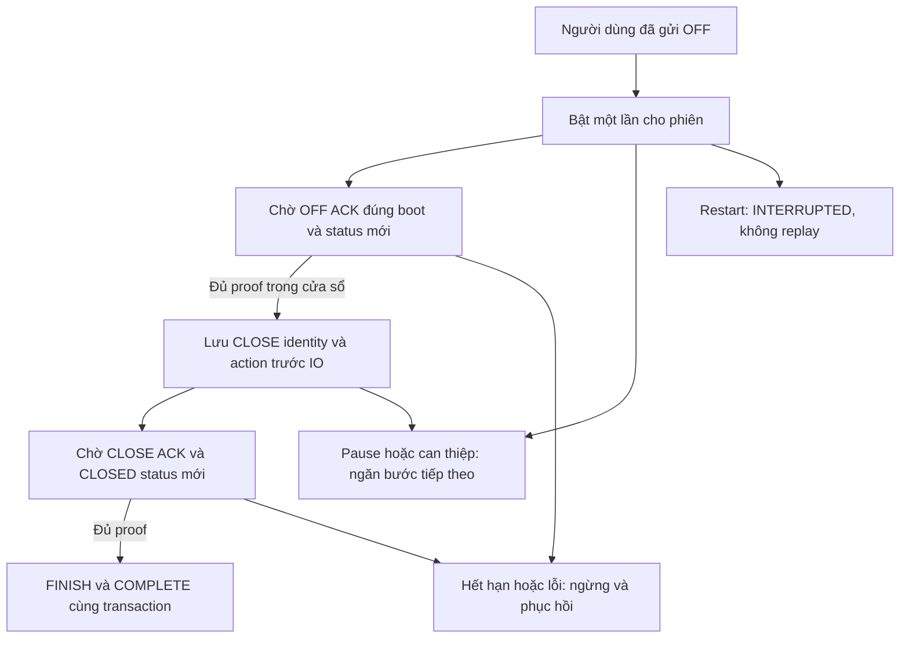

# Chương 58 — Tự khép phiên sau khi đã yêu cầu OFF

Ngày17/10/2026, giờ Việt Nam. Tiếp nối
[phiên có xác nhận](CHAPTER_49_OPERATOR_IRRIGATION_SESSION.md) và
[chuyển hàng chờ sang phiên](CHAPTER_57_QUEUE_SESSION_HANDOFF.md).

## Tự động hóa phần cuối của một phiên

V44 cho phép người dùng bật **một lần cho riêng phiên** sau khi đã gửi OFF.
Backend chờ ACK OFF đúng boot và trạng thái OFF mới phủ các lệnh; sau đó
được gửi một CLOSE. Chỉ khi ACK CLOSE và trạng thái vị trí CLOSED mới phù
hợp, backend mới FINISH phiên. Chưa tự OPEN/ON/OFF, đổi route hoặc chạy lượt
kế tiếp. Đây là phần cuối có opt-in của quy trình, chưa coordinator tưới
nhiều vùng hoặc bằng chứng van/bơm vật lý đã hoạt động.

SMARTFARM_IRRIGATION_SESSION_CLOSURE_ENABLED mặc địnhfalse. Không seed
quyền tự khép cho phiên cũ, không sửa timer/firmware/IAM/topic/certificate.
Profile chỉ LED mô phỏng theo route, cùng các flag control/fence/route/
circuit/session hiện có. Bật flag chưa tự tác động lên phiên; người dùng
phải duyệt riêng sau OFF, khi phiên ở WAIT_OFF.

## Quyền thực hiện được giữ hẹp

Khi bật, client gửi armId, expectedRevision, offId và reviewedAt mới. Server
kiểm tra scope phiên, revision, đúng OFF đã gửi, trạng thái lệnh OFF SENT hoặc
EXECUTED, nhánh/profile và boot bơm/van còn đúng. Không bật trước OFF, trên
phiên recovery hoặc khi OFF đã thất bại/chưa rõ. Một phiên chỉ có một định
nghĩa; body khác không được thay thế hoặc bật lại định nghĩa đã kết thúc.

irrigation_session_closure giữ body, OFF đã duyệt, UUID CLOSE/FINISH dự kiến,
armed_at/deadline, state/reason/finished_at. Cửa sổ quyết định **15giây** từ
lúc bật, worker danh định1giây. Đây không phải cam kết thời gian thực hoặc
thu hồi packet đã giữ chỗ/gửi. Mất backend/mạng vẫn cần timer và interlock
cục bộ; không tăng hard limit thiết bị để thử tính năng này.

ACK không tự thay status. OFF ACK sai boot, OFF status cũ/không phủ ordinal,
ACK CLOSE chưa có status CLOSED hoặc proof lỗi đều không cho chuyển bước.
Bộ kiểm tra phiên hiện có vẫn kiểm tra pump idle, route/config và proof;
worker không vượt qua các chốt bằng cách gọi transport trực tiếp.

CLOSE_RESERVED được commit cùng action/phase phiên trước IO. Evaluator khác
thấy đã giữ identity thì không gửi lại. Trước khi command CLOSE commit có
callback kiểm tra quyền chưa bị pause/thay thế, thời hạn và phiên/OFF còn
đúng. FINISH cùng transaction với COMPLETE, không phát command mới.

## Can thiệp và kết quả chưa rõ

Thao tác mới trong phiên do người dùng xác nhận sẽ PAUSED chế độ; duplicate
một thao tác cũ không tạo can thiệp mới. OFF khẩn ngoài phiên chuyển phiên
sang recovery; worker ngừng khi thấy trạng thái đổi. Pause chỉ ngăn bước
chưa được nhận, **không thu hồi CLOSE đã giữ chỗ/gửi**. Không tự khép tiếp
sau pause, dù ACK/CLOSED tới muộn; vẫn có thể xử lý thủ công theo proof.

Mất transport, publish chưa rõ hoặc thiếu kết quả CLOSE giữ UNRESOLVED và
recovery; không retry. Hết cửa sổ chuyển EXPIRED/recovery khi worker đánh giá.
Đổi boot/binding/profile ngắt tiến trình. Restart đánh dấu quyền đang hoạt
động INTERRUPTED và phiên chưa khép RECOVERY_REQUIRED, không phát lại bước.
Scheduler cũng bị chặn trước khi xử lý phục hồi startup hoàn tất, tránh dùng
quyền cũ trong khoảng trước ApplicationReadyEvent. COMPLETE cũ giữ nguyên và chỉ là kết quả lịch sử, không chứng minh trạng
thái hiện tại. Không tự resume hoặc tạo một quyền mới sau lỗi.

| State | Cách hiểu |
| --- | --- |
| ARMED | Đã lưu quyền; chờ ACK/status OFF, chưa gửi CLOSE |
| CLOSE_RESERVED | Đã giữ identity CLOSE, chưa xác nhận kết quả gửi |
| WAIT_CLOSED | Chờ ACK và status CLOSED mới, chưa FINISH |
| COMPLETE | Đã FINISH bằng proof trong mô hình hiện tại |
| PAUSED / INTERRUPTED | Không thực hiện bước tự động tiếp theo |
| EXPIRED / UNRESOLVED | Cần đối chiếu và phục hồi thủ công, không gửi lại |

## Giao diện và API

Trong **Phiên tưới có xác nhận**, sau OFF chọn **Tự khép phiên sau OFF**,
đọc mã OFF/boot/điều kiện rồi bật một lần. Có thể ngừng bước tự khép tiếp
theo; muốn xử lý OFF thủ công thì quay lại phiên. Phiên đã khép vẫn tra cứu
được qua **Xem tự khép {sessionId}** trong danh sách phiên gần đây.

API dưới /api/v1/irrigation-circuits/{circuit}/session/{session}/closure:
GET chỉ đọc, POST lưu Arm, POST /pause với armId ngăn bước kế tiếp. Body và
UUID chưa rõ được giữ qua reload bằng sessionStorage; chỉ GET đối chiếu đúng
body/revision/OFF và microsecond reviewedAt. Pause chưa rõ không được coi
là đã ngừng khi GET vẫn ARMED/WAIT_CLOSED. Không tự POST lại sau reload.
Nếu browser storage lỗi, giữ mã trong memory và báo hạn chế qua reload.

Polling cũ trước mutation không khôi phục quyền bật. Hết15giây trên đồng hồ
monotonic của web chỉ yêu cầu đọc kết quả server, chưa tự gán EXPIRED hoặc
khẳng định đã dừng. Flag backend chỉ là cấu hình, không phải heartbeat của
worker hoặc chứng nhận trạng thái cơ khí.

## Nghiệm thu AWS/Wokwi — tất cả Chưa chạy

Chỉ LED; giữ giới hạn phiên/van hiện có. Position feedback độc lập cần được
đặt đúng sau lệnh CLOSE, không tự lấy ACK làm tiếp điểm. Không xóa DB/NVS/
volume để bỏ chốt hoặc bật lại quyền cũ.

| Ca | Điều cần xác nhận | Live |
| --- | --- | --- |
| 1: mặc định tắt, mở màn hình trước OFF | Không có quyền hoặc CLOSE mới | Chưa chạy |
| 2: gửi OFF rồi bật, có ACK/status đúng | Một CLOSE, chờ CLOSED mới FINISH; không ON/next | Chưa chạy |
| 3: chỉ ACK hoặc status cũ/sai boot | Không chuyển bước; hết hạn cần recovery | Chưa chạy |
| 4: pause/manual OFF/CLOSE đồng thời | Không có bước tự động tiếp theo, không thu hồi lệnh đã gửi | Chưa chạy |
| 5: transport mất/publish chưa rõ | Giữ identity, không replay CLOSE khi mạng về | Chưa chạy |
| 6: restart trước/sau CLOSE reservation | INTERRUPTED/recovery, không tự FINISH hoặc replay | Chưa chạy |

[Bàn giao và bằng chứng cloud](../implementation/LOCAL_SESSION_CLOSURE_REPORT.md).
