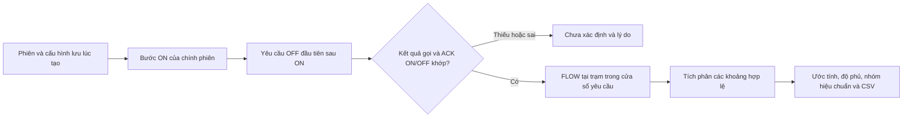

# Chương 59 — Xem lượng nước ước tính theo phiên tưới

Ngày 21/10/2026. Đây là báo cáo chỉ đọc, dùng schema V44 hiện có, không có
migration hoặc cờ điều khiển mới.

## Người trồng xem được gì?

Vào **IoT & Tự động hóa → Điều khiển Actuator → Cấu hình nhánh tưới →
Lịch sử mọi phiên tưới** (hoặc lịch sử của một nhánh). Chọn phiên rồi bấm
**Đọc lượng nước phiên**. Báo cáo cho biết trạm/kênh FLOW gốc, nguồn khai báo,
ước tính trên phần có mẫu, số giây có mẫu và số giây chưa được phủ. Có thể
đọc lại hoặc tải **CSV lượng nước phiên**. Mở lịch sử chưa tự tải FLOW.

Ví dụ: cửa sổ yêu cầu dài 10 giây, hai mẫu 6 L/phút cách nhau 5 giây cho
ước tính 0,5 lít. Báo cáo vẫn ghi 5 giây chưa có dữ liệu; không nhân đôi
ước tính để bù. Hai mẫu FLOW bằng 0 mới có thể tạo khoảng đo 0 lít. Không
có mẫu hoặc chỉ một mẫu là **Chưa xác định**.

## Ý nghĩa của cửa sổ và lượng nước

- Bắt đầu là giờ server lưu bước ON được tham chiếu bởi phiên. Kết thúc là
  giờ lưu yêu cầu OFF đầu tiên trong các bước của phiên sau ON, kể cả khi
  người dùng thử OFF lại. OFF ngoài phiên không tự được ghép vào lịch sử này.
  Không lấy giờ FINISH, thời hạn ON hoặc OFF mới nhất để kéo dài khoảng tính.
- Cần bước RETURNED và lệnh có payload/identity khớp, EXECUTED, ACK đúng boot
  bơm ban đầu, reportedState đúng ON/OFF, sequence và giờ nhận ACK. Thiếu
  bằng chứng, publish chưa rõ, OFF đầu thất bại hoặc ACK boot khác thì chưa
  tính. ACK này vẫn chưa chứng minh chuyển động hay thời gian bơm vật lý.
- Dùng cấu hình lưu trong phiên: waterNodeId, flowChannelId, expectedSource,
  zone và revision. Không chuyển sang trạm mới khi sửa cấu hình hiện tại.
  Nếu kênh gốc bị xóa hoặc đổi loại thì báo không còn kênh phù hợp.
- FLOW tại trạm dùng chung có thể bao gồm nước đi nơi khác. Đây **không phải
  phân bổ nước cho luống**, hiệu suất tưới, thời gian chạy thực tế hoặc số
  đo đồng hồ đã hiệu chuẩn. Không cộng các báo cáo phiên thành tổng nông trại.

Thuật toán TRAPEZOID_V1 dùng lại [báo cáo FLOW](CHAPTER_31_WATER_VOLUME.md):
chỉ cặp mẫu liên tiếp, đúng nguồn, VALID, cùng boot/hiệu chuẩn, sequence
liên tiếp, khoảng đo tối đa 15 giây; loại giờ lệch và receipt quá trễ.
Không lọc bỏ packet lỗi rồi nối qua khoảng trống; không ngoại suy hai đầu.
Mẫu đúng giờ OFF bị loại theo khoảng nửa mở `[from,to)`. Tối đa 24 giờ và
25.000 packet; vượt giới hạn trả lý do rõ. Khác hiệu chuẩn giữ riêng từng
nhóm, không có tổng; hiệu chuẩn chưa ghi nhận phải được hiểu là chưa biết.

## API và tính nhất quán

GET `/api/v1/irrigation-session-history/{circuitId}/{sessionId}/water-usage`.
Đọc REPEATABLE_READ; không gọi readiness, dispatch, hết hạn lệnh hoặc sửa
phase. `mode=SESSION_STATION_FLOW`, `state=ESTIMATED|UNAVAILABLE`; giữ riêng
`reason`, `onId`, `offId`, cửa sổ, cấu hình gốc, `asOf` và báo cáo FLOW.

Không đóng băng vĩnh viễn kết quả: ACK hoặc mẫu đến muộn có thể thay đổi lần
đọc tiếp theo; `asOf` là giờ đọc, không phải chứng nhận dữ liệu đã đủ. Phiên
RECOVERY_REQUIRED vẫn có thể có báo cáo lịch sử nếu đủ bằng chứng, không
được hiểu là phiên đã phục hồi. Hai lần đọc và restart không tạo thêm bản
lưu báo cáo. CSV chứa mã phiên/ý định, nguồn, cửa sổ, nhóm hiệu chuẩn, độ phủ,
giờ đọc và nhãn STATION_FLOW_NOT_BED_ALLOCATION; không tự tải thêm phiên.

UI kiểm tra khớp phiên/trạm/nguồn và timestamp tới microsecond. Đổi phiên
hủy kết quả cũ; lỗi API không giữ số lít cũ để xuất. Cải tiến độ chính xác
microsecond cũng áp dụng cho màn hình lượng nước chung; ô ngày đang trống
trả phạm vi không khớp, không làm component lỗi.

## Windows và nghiệm thu thực tế — Chưa chạy

Pull nhánh đang làm, restart backend bằng profile hiện có và chạy frontend;
không cần tạo certificate hoặc bật flag điều khiển mới cho báo cáo.
Không xóa volume, lịch sử hoặc NVS để tạo số liệu đẹp.

| Ca | Điều cần kiểm tra | AWS/Wokwi |
| --- | --- | --- |
| 1 | Phiên có ACK ON/OFF, ít nhất hai FLOW đúng nguồn; xem độ phủ và CSV | Chưa chạy |
| 2 | Không ON/không OFF/chưa có ACK; Chưa xác định, không 0 lít | Chưa chạy |
| 3 | FLOW fault/mất mẫu/reboot/đổi hiệu chuẩn không bị nối qua | Chưa chạy |
| 4 | OFF đầu chưa rõ rồi OFF lại; không kéo dài cửa sổ hoặc che lỗi đầu | Chưa chạy |
| 5 | Đọc lại/restart giữ lịch sử và không gửi thêm lệnh | Chưa chạy |

Cloud đã kiểm chứng bằng test và dữ liệu lịch sử tổng hợp riêng, chưa dùng
AWS/Wokwi hoặc nước/bơm thật cho chức năng này. Chưa thêm daily rollup,
ngân sách lít, dừng theo thể tích hoặc coordinator toàn chu kỳ.

[Bàn giao và bằng chứng](../implementation/LOCAL_SESSION_WATER_USAGE_REPORT.md).
