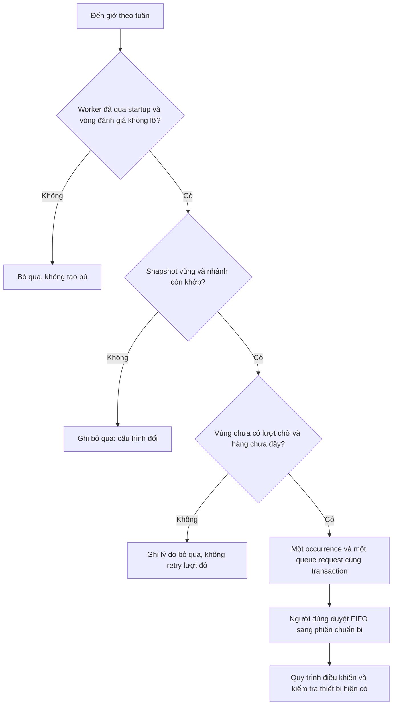

# Chương 60 — Lịch tưới theo vùng tạo lượt chờ

Ngày 22/10/2026, schema V45. Lịch này lập kế hoạch để người dùng duyệt;
không tự mở van, bật bơm, chuyển route hoặc chạy lượt tiếp theo.

## Thiết lập trong ứng dụng

Vào **Sensor Realtime → Node & trạm nước → Vùng tưới → Lịch tưới {mã vùng}**.
Nút Vùng tưới nằm trong màn hình quản lý node; từ đó mỗi vùng có lịch riêng.
Cần vùng SIMULATOR và một nhánh đã gán đúng cấu hình hiện tại để bật lịch.

Chọn các thứ, giờ theo Việt Nam (Asia/Ho_Chi_Minh, UTC+7), thời lượng yêu
cầu 1–10 giây và bật lịch tạo lượt. Mỗi vùng có tối đa 8 dòng giờ, mỗi dòng
chọn một hoặc nhiều thứ. Không cho hai dòng trùng cùng thứ/giờ. Một lịch
06:00 thứ Hai/Sáu và 18:00 mỗi ngày vẫn là hai dòng độc lập.

Bấm **Lưu lịch vùng** để lưu phiên bản. Giao diện đọc lại server trước PUT
để lấy mốc review mới, nhưng không tự thay mapping hoặc revision của form.
Nếu cấu hình đổi, đọc đối chiếu rồi chọn **Dùng mapping và lịch hiện tại**,
kiểm tra lại trước khi lưu. Có thể tắt lịch dù mapping cũ không còn khớp.

**Tắt lịch chỉ ngăn lượt mới.** Lượt đã được lập vẫn tồn tại trong hàng chờ;
muốn hủy cần thao tác tại hàng chờ. Việc tắt lịch không tắt bơm hoặc hủy
phiên đang chạy. Phần điều khiển/OFF của phiên giữ luồng riêng hiện có.

## Luồng lập kế hoạch



Lịch không yêu cầu đất đang khô để lập lượt, không xác nhận đủ nước/mưa/
lưu lượng hoặc trạng thái van. Các điều kiện này được đối chiếu lại khi
handoff/chuẩn bị và chạy phiên, theo các gate đang bật. QUEUED chỉ là đã
lập yêu cầu, chưa có phiên hoặc lệnh MQTT và chưa chứng minh đã tưới.

Dùng chung hàng chờ V21/V43: tối đa 50 lượt QUEUED/REHEARSING, TTL 5 phút,
FIFO và handoff thủ công. Nếu cùng vùng đang chờ hoặc diễn tập thì ghi
ZONE_ALREADY_WAITING; hàng đầy ghi QUEUE_FULL. Không retry tự động khi
hàng trống trở lại. Thời lượng 1–10 giây giữ theo giới hạn demo hiện có,
chưa phải thời lượng phù hợp để tưới nông nghiệp thật.

## Chống tạo trùng và phục hồi

- Khóa queue → circuit → schedule state, giữ snapshot vùng/nhánh khi lưu và
  so sánh đầy đủ khi đến giờ, không chỉ nhìn revision. Chỉnh vùng/nhánh không
  tự áp vào lịch cũ; ghi CONFIG_CHANGED và cần người dùng duyệt lại.
- Unique `(zone_id,due_at)` cho mỗi lần đến giờ. Occurrence giữ revision và
  definition của lịch lúc đó; link UUID tới queue request. Cả hai và cursor
  commit cùng transaction. Lỗi DB rollback tất cả, không có nửa lượt.
- Chỉ đánh giá khoảng `(last_tick,now]` khi khoảng cách tối đa 30 giây.
  Worker mặc định mỗi giây; khoảng cách hơn 30 giây ghi GAP_SKIPPED, tiến
  cursor và không tạo bù khoảng đó. Không ghi một occurrence riêng cho mọi
  lần bị bỏ lỡ trong downtime. Đồng hồ lùi không lùi cursor hoặc lập lại.
- Mỗi lần backend start reset cursor tới thời điểm hiện tại, ghi
  STARTUP_SKIPPED rồi mới cho scheduler chạy. Giờ trong quá khứ, kể cả cùng
  phút startup, không được phát lại. Lịch lưu sau một mốc đến giờ không tạo
  bù mốc đã qua. Queue cũ vẫn theo chính sách TTL, không tự biến thành phiên.

Flag `SMARTFARM_IRRIGATION_QUEUE_SCHEDULE_ENABLED` mặc định false. Tắt flag
không xóa lịch hoặc lượt cũ; bật lại cần restart, bắt đầu đánh giá từ hiện
tại. Worker đăng ký scheduler riêng kể cả khi MQTT và queue maintenance
đang tắt. Mốc lastTickAt là quan sát lưu, không bảo đảm worker hiện sống;
nextDueAt là giờ dự kiến theo lịch, chưa hứa sẽ tạo lượt hay chạy bơm.

## API, trạng thái và mất phản hồi

GET/PUT `/api/v1/irrigation-zones/{zone}/queue-schedule`.
GET REPEATABLE_READ chỉ đọc; PUT kiểm tra revision hiện tại (0 nếu chưa có),
reviewedAt mới, timezone, slot, thời lượng và binding trước khi bật.
Plan có revision, definition, snapshots và updatedAt; GET có nextDueAt,
workerEnabled, cursor/result và 20 occurrence gần nhất. Chưa có retention
hoặc lịch sử mọi lần sửa plan; occurrence giữ definition lịch sử của nó.

PUT mất phản hồi giữ nguyên body vào sessionStorage theo vùng; reload chỉ
GET đối chiếu đúng definition, revision+1 và review timestamp tới microsecond.
Không tự gửi lại. Nếu chưa khớp, có thể tiếp tục đọc hoặc **Bỏ ý định chờ và
đọc bản hiện tại**; đây chỉ là bỏ ý định trên trình duyệt, không rollback
server. Storage lỗi được báo và chỉ giữ pending trong memory. GET lỗi/
sai vùng ngăn lưu bằng dữ liệu cũ. Thời lượng/giờ đang sửa không bị tự lưu.

## Windows

Giữ DB/volume và profile cũ. Pull nhánh, dừng backend cũ rồi trong Git Bash
backend thêm:

```bash
export SMARTFARM_IRRIGATION_QUEUE_SCHEDULE_ENABLED=true
bash tools/backend/run_backend_windows.sh
```

Frontend chạy ở terminal riêng bằng `npm run dev`. Flyway thêm ba bảng V45,
không seed lịch hoặc thay các gate/flag điều khiển. Không cần certificate,
IAM hoặc firmware mới để lập lịch; thiết bị hoạt động vẫn cần cấu hình và
nghiệm thu riêng. Muốn ngăn lượt mới ngay, lưu tắt từng lịch; muốn tắt toàn
worker thì đổi flag=false và restart backend. Không xóa DB để ngừng lịch.

## Nghiệm thu tại máy Windows — Chưa chạy

| Ca | Điều cần đối chiếu | Live |
| --- | --- | --- |
| 1 | Flag tắt: không bật được lịch, không có lượt mới | Chưa chạy |
| 2 | Đến phút đã chọn: một occurrence/link/lượt, không MQTT hoặc auto handoff | Chưa chạy |
| 3 | Vùng đang chờ/hàng đầy: ghi skip, không retry khi giải phóng | Chưa chạy |
| 4 | Đổi mapping: lịch cũ bị skip, không âm thầm đổi trạm/nhánh | Chưa chạy |
| 5 | Mất phản hồi PUT/reload: GET đối chiếu, không PUT lặp | Chưa chạy |
| 6 | Restart/lỡ giờ/tắt lịch: không tạo bù; lượt cũ không tự hủy/chạy | Chưa chạy |

[Bàn giao và kiểm thử cloud](../implementation/LOCAL_ZONE_QUEUE_SCHEDULE_REPORT.md).
Đây là lịch lập queue, chưa coordinator tưới toàn chu kỳ, route switching,
queue dispatch tự động, điều khiển bơm/van thật hoặc nghiệm thu phần cứng.
