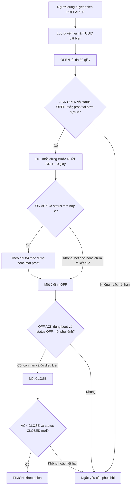

# Chương 61 — Tự điều phối một phiên trên một nhánh

Ngày 22/10/2026, schema V46. Người dùng duyệt một phiên PREPARED để backend
tự chuyển OPEN → ON có thời hạn → OFF → CLOSE → FINISH theo bằng chứng.
Đây là bước điều phối một phiên mô phỏng; lịch vùng vẫn chỉ lập hàng chờ,
chưa tự nhận lượt tiếp theo hoặc đổi route bơm.

## Cách sử dụng

Vào **IoT & Tự động hóa → Điều khiển Actuator → Cấu hình nhánh tưới →
Phiên tưới có xác nhận {nhánh}**. Chuẩn bị một phiên mới 1–10 giây bằng
luồng hiện có hoặc duyệt thủ công lượt đầu hàng chờ. Giữ route/revision và
boot của bơm, van đúng cấu hình; phiên phải chưa có OPEN/ON/OFF.

Mở **Chu trình tự động một phiên**, đọc điều kiện và bấm **Duyệt chạy một
phiên**. Không cần bật thêm tính năng tự khép sau OFF: chu trình giữ riêng
phần CLOSE/FINISH. Không cho arm đồng thời hai cơ chế cho cùng phiên.
Phiên cũ có thể xem qua **Xem chu trình {mã phiên}**.



ACK không thay thế status. OPEN cần bằng chứng vị trí và proof tại bơm theo
luồng phiên cũ; ON cũng cần admission nước/mưa đang bật. Trong RUNNING,
worker kiểm tra lại proof bơm/route. Các supervisor LOW/FLOW/mưa đã bật vẫn
dùng chung chốt OFF với phiên; nếu supervisor hoặc thao tác bên ngoài thắng,
chu trình ngắt và không tự đóng van tiếp.

## Thời hạn và ý nghĩa trạng thái

- Cửa sổ toàn chu trình cố định 30 giây từ lúc arm. OPEN có thời hạn 30
  giây; chờ proof OPEN tối đa 10 giây. ON chờ proof tối đa 5 giây.
- Thời lượng bơm 1–10 giây lấy từ phiên. `stopAt` được lưu khi giữ ý định
  ON, trước IO, không tính từ ACK hoặc từ thời điểm bơm vật lý bắt đầu quay.
  Worker mặc định 250 ms; đây không phải cam kết thời gian thực.
- Tới mốc dừng, ON chưa rõ kết quả hoặc mất proof khi chạy, giữ một OFF.
  Deadline đã hết sau ON vẫn cho phép thử OFF này một lần; không CLOSE muộn.
- Chỉ CLOSE khi OFF ACK EXECUTED/OFF đúng boot và status mới có sequence
  sau ACK, phủ ordinal; các kiểm tra idle/freshness hiện có vẫn phải đạt.
  ON chưa xác nhận còn làm idle bị chặn, dù OFF đã có proof. Không bỏ guard
  để ép chu trình hoàn tất.
- COMPLETE nghĩa là khép phiên với OFF/CLOSED xác nhận. Xem thêm
  `stopReason`: khép an toàn không chứng minh đã tưới đủ hoặc đủ thời lượng.
  ACK/status từ mô phỏng chưa chứng minh GPIO, van cơ khí hoặc nước tới luống.

**Ngừng tự chuyển bước không phải OFF.** Nút này kết thúc quyền tự chuyển
bước và đưa phiên sang phục hồi; không thu hồi packet đã giữ/gửi. Dùng
**Yêu cầu OFF khẩn PUMP01** riêng khi cần dừng. HTTP 202 mới là đã lưu yêu
cầu, phải chờ proof/kiểm tra thiết bị. Nút OFF có luồng riêng, vẫn dùng được
khi POST arm hoặc pause chưa đối chiếu xong.

Restart backend ngắt chu trình đang hoạt động, đưa phiên chưa khép về
RECOVERY_REQUIRED. Không phát lại OPEN/ON, không tự OFF hoặc resume sau
restart. Khi backend/mạng ngừng, vẫn cần timer và interlock độc lập tại
thiết bị. Tính năng này không thay thế phần bảo vệ tại board.

## Giao dịch và mất phản hồi

V46 thêm bảng `irrigation_session_cycle`, không seed quyền. Lưu arm UUID,
revision đã duyệt, timestamp và năm UUID OPEN/ON/OFF/CLOSE/FINISH trước IO.
Khóa pump dispatch → circuit giữ nguyên thứ tự chung. Mỗi bước đi qua
session service, action ledger, fence và guarded commit hiện có; callback
kiểm tra lại quyền, identity, phase, binding và deadline. ON tới muộn bị
chặn khi mốc dừng đã qua. Trạng thái *_RESERVED không được gửi lại.

GET/POST `/api/v1/irrigation-circuits/{circuit}/session/{session}/cycle`;
POST `/cycle/pause` nhận `{armId}`. Arm cần review mới trong 10 giây,
revision hiện tại, SIMULATOR và boot/config gốc còn khớp. POST trùng đúng
body chỉ đọc lại bản đã lưu, không tạo quyền mới kể cả khi đã kết thúc.
Thao tác manual mới được chấp nhận ngắt quyền; đọc lại thao tác cũ không
ngắt lần nữa. Bước FINISH và COMPLETE commit cùng giao dịch.

UI lưu nguyên ý định ARM/PAUSE trong sessionStorage. Mất phản hồi/reload chỉ
GET đối chiếu đúng UUID/body/revision/thời gian tới microsecond; không tự
POST lại. GET vẫn thấy active sau pause chưa rõ không được gọi là đã dừng.
Dữ liệu cũ/lỗi API khóa arm; đồng hồ UI chỉ nhắc đọc backend, không tự suy
ra thiết bị OFF. Không tạo quyền thứ hai cho phiên bị ngắt hoặc hết hạn.

## Windows

Giữ DB/volume/private files. Pull nhánh, dừng backend cũ; dùng Git Bash
backend với profile LED theo nhánh/phiên hiện có:

```bash
export SMARTFARM_IRRIGATION_CYCLE_ENABLED=true
bash tools/backend/run_backend_windows.sh
```

Cần các cờ control, pump fencing, circuit route, circuit demo và session
đã bật đúng profile; legacy demo=false. Flag cycle mặc định false, chỉ mở
khả năng duyệt từng phiên, không tự arm phiên nào. Frontend terminal riêng
chạy `npm run dev`. Không cần migration firmware/IAM/topic mới cho đợt này;
board vẫn cần đúng firmware, route, certificate và policy đã nghiệm thu.

Muốn ngừng tự chuyển bước của phiên hiện tại dùng nút tương ứng rồi đối
chiếu kết quả; OFF là thao tác riêng. Chỉ tắt flag/restart không bảo đảm bơm
đã OFF. Không xóa DB/NVS hoặc sửa timestamp để bỏ các chốt phục hồi.

## Nghiệm thu Windows/AWS/Wokwi — Chưa chạy

| Ca | Điều cần đối chiếu | Live |
| --- | --- | --- |
| 1 | Default false/PREPARED; chỉ arm sau review đúng nhánh/boot; không tự lấy hàng chờ | Chưa chạy |
| 2 | Một phiên 5 giây: OPEN proof → ON → OFF proof → CLOSE proof → COMPLETE; đúng bốn lệnh | Chưa chạy |
| 3 | Thiếu ACK hoặc status OPEN/ON/OFF/CLOSED: không tự coi bước đã xong; không lặp lệnh | Chưa chạy |
| 4 | Pause/manual OFF/supervisor OFF; không phát thêm ON/CLOSE, OFF vẫn độc lập khi POST chưa rõ | Chưa chạy |
| 5 | Mất phản hồi/reload và hai tab: GET đúng quyền; không rearm/replay | Chưa chạy |
| 6 | Restart giữa OPEN hoặc ON/đổi boot/mất mạng/hết hạn: recovery, không resume; timer board kiểm tra riêng | Chưa chạy |

[Bằng chứng cloud và bàn giao](../implementation/LOCAL_IRRIGATION_CYCLE_REPORT.md).
Chưa có nghiệm thu AWS/Wokwi/GPIO thật, tự chuyển nhiều route, tự duyệt
queue từ lịch, dừng theo số lít hoặc bảo đảm an toàn phần cứng nông nghiệp.
