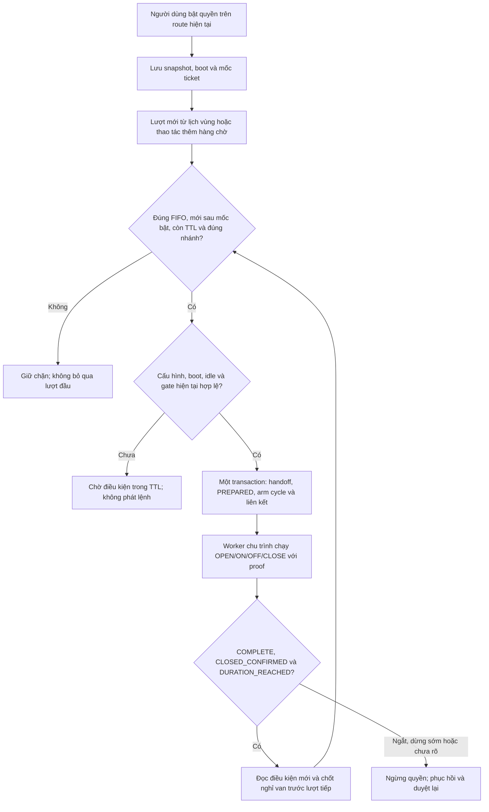

# Chương 62 — Tự nhận lượt mới trên route hiện tại

Ngày 22/10/2026, schema V47/V48. Bước này nối hàng chờ với chu trình một
phiên ở chương61. Người dùng bật quyền riêng cho một nhánh/boot hiện tại;
lượt mới phù hợp có thể được tạo phiên và chạy mà không duyệt lại từng lượt.
Chưa đổi route hoặc điều phối nhiều vùng trên cùng bơm.

## Luồng sử dụng

Vào **IoT & Tự động hóa → Điều khiển Actuator → Mở hàng chờ tưới diễn tập
→ Tự nhận lượt mới theo route**. Kiểm tra nhánh, vùng, revision và boot đang
hiển thị rồi bấm **Bật tự nhận lượt mới**. Cần bơm OFF, các van CLOSED mới,
không có phiên giữ bơm và đủ profile/gate hiện có.

Quyền được gắn với cấu hình đầy đủ và boot bơm/van; không tự chuyển sang
nhánh khác. Nếu đã có ticket37 lúc bật, chỉ ticket lớn hơn37 được xét tự
động. Ticket37 còn đứng đầu thì worker dừng ở đó; phải hủy hoặc xử lý thủ
công, không tự bỏ qua để lấy ticket38.



Thời lượng vẫn 1–10 giây; TTL hàng chờ vẫn 5 phút. Sau CLOSE còn chốt nghỉ
hai giây hiện có trước OPEN mới. Không rút ngắn chốt hoặc tự sửa thời lượng
lượt11–30 giây thành10 giây. FIFO đầu thuộc route khác thì bị chặn, dù lượt
sau thuộc route đang được cấp quyền.

Quyền này không suy ra nhu cầu tưới từ độ ẩm đất. Lịch vùng chỉ yêu cầu theo
giờ; gate LOW/mưa và supervisor FLOW chỉ áp dụng khi đã cấu hình bật. Không
coi việc có queue hoặc COMPLETE là bằng chứng nước đã tới luống.

## Điều kiện ngừng và khởi động lại

Mặc định backend không bật khả năng tự nhận. Sau khi bật profile, người dùng
vẫn phải duyệt quyền trong UI. Mỗi lần bật lưu watermark mới, chỉ nhận các
lượt sinh sau đó. Các lượt tồn tại trước bật hoặc trong lúc đã ngừng không
được tự nhận khi bật lại.

- Backend restart luôn tắt quyền và tăng revision nếu đang bật; không tự
  catch-up. Cycle đang chạy theo chính sách recovery chương61, không resume.
- Đổi snapshot nhánh, boot hoặc route làm quyền ngừng, không âm thầm cập
  nhật binding. Worker chậm hơn30 giây hoặc đồng hồ lùi cũng ngừng quyền.
- Lệnh bơm/van hoặc phiên ngoài các cycle được liên kết từ quyền hiện tại
  được xem là tiếp quản thủ công. Lượt đánh giá tiếp theo ngừng nhận mới;
  reservation dùng chung pump gate để không tạo phiên chen qua lệnh đó.
- Cycle PAUSED/EXPIRED/INTERRUPTED/UNRESOLVED hoặc COMPLETE vì dừng sớm
  không cho tự lấy lượt tiếp. Hoàn tất an toàn khác chạy đủ theo kế hoạch.
  Cần xử lý phục hồi rồi bật một quyền mới khi nhánh sẵn sàng.
- Cảm biến/status chưa mới làm handoff chưa đủ điều kiện. Không xóa request
  hoặc tự coi proof đã có; khi dữ liệu mới hợp lệ có thể xét lại trong TTL.

**Ngừng nhận lượt mới không phải OFF.** Nút ngừng chỉ chặn phiên chưa tạo;
không hủy queue, pause cycle hoặc tắt bơm của phiên đã tạo. Có thể bấm ngừng
khi yêu cầu bật chưa rõ kết quả. Mở **Xem chu trình tự nhận {mã lượt}** để
xem tiến trình và dùng OFF riêng nếu cần. Packet đã giữ/gửi không thu hồi.

## Giao dịch, chống trùng và API

V47 thêm state singleton và link request→session→arm. V48 thêm identity cho
thao tác ngừng. Không seed quyền bật; dữ liệu phiên và queue cũ được giữ.
State có revision, definition đã duyệt, watermark ticket/ordinal, timestamp
và kết quả đánh giá. Link lưu phiên bản quyền và definition lịch sử.

Khóa **pump → queue → circuit → dispatch state**, rồi dùng kiểm tra zone
của handoff hiện có. Trong một transaction, worker kiểm tra chính xác lượt
đầu, gọi handoff tạo PREPARED, arm năm UUID cycle rồi ghi link. Không IO
thiết bị trong transaction này; cycle chỉ dispatch sau commit. Lỗi insert
link rollback cả handoff/session/arm và queue. Hai worker chỉ tạo một link.

GET/PUT `/api/v1/irrigation-queue/dispatch`; POST `/dispatch/stop` nhận
`{stopId}`. PUT có changeId, expectedRevision, reviewedAt và snapshot/boots
đã xem. Review mới trong10 giây, future tối đa2 giây, so sánh config đầy đủ.
PUT cùng definition hiện tại chỉ đọc lại; không bật lại sau startup disable.
Ngừng tăng revision ngay cả khi đang tắt để chặn PUT bật được duyệt từ trước.
Lặp stopId gần nhất chỉ đọc trạng thái hiện tại, không ngừng quyền mới.

UI giữ pending enable qua sessionStorage/reload và chỉ GET đối chiếu đúng
body, boot, revision, timestamp tới microsecond. Không tự PUT lại. Phản hồi
bật tới sau thao tác ngừng không được ghi đè thông báo quyền đã ngừng.
Nếu pending không đối chiếu được, có thể ngừng nhận riêng; sau GET xác nhận
disabled ở revision cao hơn ý định cũ, **Bỏ ý định đã bị chặn** mới bỏ pending.
Đây không rollback request. GET lỗi hoặc dữ liệu cũ không cho bật; nút ngừng
vẫn độc lập. Kết quả ngừng chưa rõ không được coi là OFF hoặc đã ngừng.

## Windows

Giữ DB/volume/private files và profile LED theo nhánh hiện có. Pull nhánh,
dừng backend cũ, dùng Git Bash backend:

```bash
export SMARTFARM_IRRIGATION_QUEUE_HANDOFF_ENABLED=true
export SMARTFARM_IRRIGATION_CYCLE_ENABLED=true
export SMARTFARM_IRRIGATION_QUEUE_DISPATCH_ENABLED=true
bash tools/backend/run_backend_windows.sh
```

Cần control/fence/route/circuit/session profile đúng, legacy demo=false.
Frontend terminal riêng `npm run dev`. Muốn lịch vùng tạo lượt mới, bật thêm
`SMARTFARM_IRRIGATION_QUEUE_SCHEDULE_ENABLED=true` trước khi restart và bật
plan từng vùng. Lịch vẫn không tự cấp quyền nhận: phải bật quyền UI trước
giờ đến hạn. Không cần firmware/IAM/topic mới; board đang dùng vẫn cần
certificate, feedback và route đúng. Không đổi sang nhánh khác bằng cách
chỉ sửa form backend; multi-route firmware còn chờ.

## Nghiệm thu Windows/AWS/Wokwi — Chưa chạy

| Ca | Điều cần đối chiếu | Live |
| --- | --- | --- |
| 1 | Default tắt; bật đúng nhánh/boot; lượt đã có trước mốc bật không được tự nhận | Chưa chạy |
| 2 | Lượt mới cùng nhánh,5s: một link/session/arm và bốn lệnh; đủ ACK/status mới COMPLETE | Chưa chạy |
| 3 | Lượt đầu nhánh khác/cũ/hết TTL/quá10s chặn FIFO; không bỏ qua lấy lượt sau | Chưa chạy |
| 4 | Lượt mới tiếp theo chỉ sau COMPLETE bình thường, chốt nghỉ và proof mới; hai tab không tạo trùng | Chưa chạy |
| 5 | Ngừng nhận khi PUT bật chưa rõ; không sinh phiên mới, phiên đã tạo không tự OFF | Chưa chạy |
| 6 | Restart/đổi boot/config/manual OFF/supervisor hoặc worker gap: ngừng quyền, không catch-up/resume | Chưa chạy |

[Bàn giao và bằng chứng cloud](../implementation/LOCAL_QUEUE_DISPATCH_REPORT.md).
Chưa nghiệm thu AWS/Wokwi/GPIO thật, đổi nhiều route, tưới theo lít hoặc
an toàn phần cứng. Test với native model giữ state vẫn dùng feedback giả.
