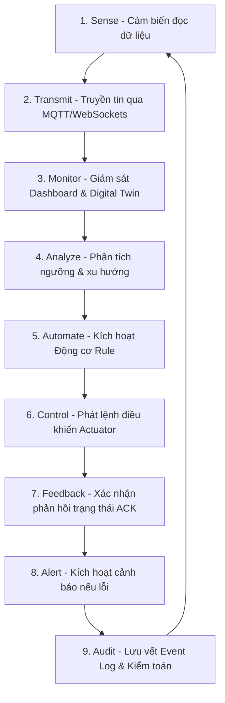
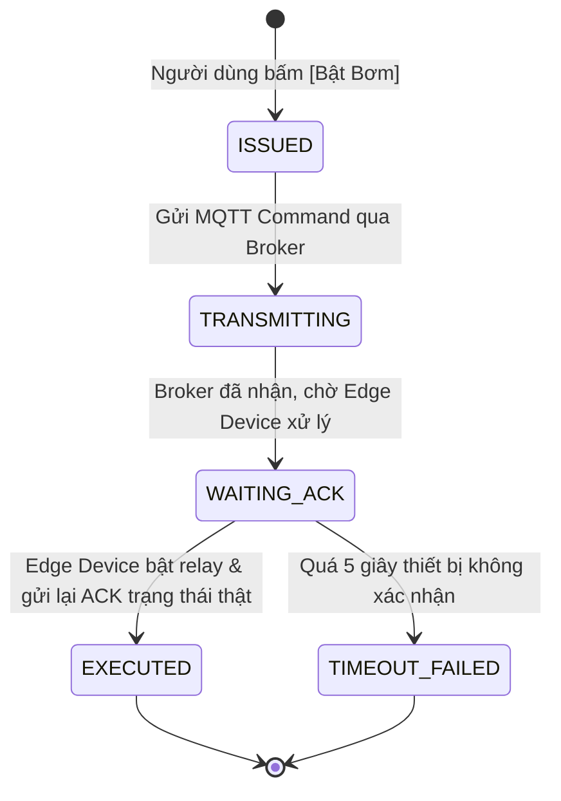

# TÀI LIỆU CONTEXT PHÂN HỆ 4: IOT & TỰ ĐỘNG HÓA
## (IoT & Automation Subsystem Context Specification)

> **Dự án**: Smart Farm Management System  
> **Phân hệ**: 04 — IoT & Tự Động Hóa (IoT & Automation)  
> **Vị trí tài liệu**: `docs/context/IOT_CONTEXT.md`  
> **Trạng thái**: Đặc tả mục tiêu lịch sử; có cập nhật định hướng nông nghiệp ngày 14/10/2026, chưa phải xác nhận Production Ready
> **Đối tượng sử dụng**: AI Pair Programmers, Senior Software Engineers, Solution Architects, Embedded/Firmware Developers, QA Engineers.


## Cập nhật định hướng 14/10/2026

Ưu tiên IoT phục vụ cây trồng/tưới trước, sau đó chăn nuôi và camera. Đọc
[lộ trình thiết bị nông nghiệp](../plan/AGRICULTURAL_IOT_DEVICE_ROADMAP.md)
để biết 18 nhóm node, bố trí 100 cây / 4 dãy, trạm nước, danh tính/capabilities và
backlog A0–A6. Đây là ý tưởng đã cập nhật, chưa phải các thiết bị mới đã chạy.

Nền code hiện tại `9730558`: ENV01 và PUMP01 cùng một ESP32; AWS IoT TLS →
Spring Boot/PostgreSQL → React polling. Relay/phao opt-in có code/tests cloud,
Wokwi live mới còn chờ. Topic hiện hành `smartfarm/{farmId}/{deviceId}/...`;
không có segment `dien`. Dùng `PUMP01/command`, `PUMP01/ack`, `PUMP01/status`.
Không đổi tên PUMP01 thành controller IRRIGATION01 chỉ vì ý tưởng có tên này.

Cập nhật A1/V14: có physical node/channel/actuator mapping, water telemetry v2
và Sensor Realtime → Node & trạm nước. Đọc [chương22](../book/CHAPTER_22_NODES_AND_WATER_CHANNELS.md)
và [contract nước](../../contracts/iot/v2/README.md). Registry không provision
AWS. Sau đó A2 có firmware monitor WATER riêng, V15 dataSource và chẩn đoán
phao/flow, xem [chương23](../book/CHAPTER_23_WATER_NODE_MONITOR.md). Chưa có
WATER live được nghiệm thu hoặc điều khiển PUMP01 từ telemetry nước v2.
V16 thêm cảnh báo nước và xác nhận đã xem, [chương 24](../book/CHAPTER_24_WATER_ALERTS.md):
hai mẫu fresh liên tiếp, đợt riêng theo nguồn; không dispatch command, không
coi flow 0 là lỗi bơm. Overview/Event Log/Safety chưa hợp nhất water alerts.
Sau V16 có [history/CSV nước](../book/CHAPTER_25_WATER_HISTORY.md) theo channel,
range/source/quality và cursor; chưa tính tổng lít/chi phí.
15/10/2026 có [flow guard local opt-in](../book/CHAPTER_26_LOCAL_FLOW_GUARD.md)
trên ENV01 GPIO25, mã/build/native; chưa Wokwi live hoặc WATER binding. Status
FLOW_LOW/FLOW_SENSOR_FAULT chỉ nhận OFF/locked, chưa chứng minh guard enabled.

15/10/2026 nền A3 có [SOIL ba điểm](../book/CHAPTER_27_SOIL_MULTIPOINT.md):
V17, SOIL/v2, registry/UI/history/CSV và firmware mô phỏng riêng. SOIL1–3 giữ
mẫu riêng, SIM_LINEAR_V1 chưa phải calibration vật lý; partial không refresh
điểm thiếu. Chưa có IRRIGATION/zone coordinator/soil alerts hoặc tưới từ SOIL.
Windows/AWS/Wokwi mới chưa nghiệm thu; rule vẫn ENV01. Xem
[bàn giao](../implementation/LOCAL_SOIL_NODE_REPORT.md).

Sau nền SOIL V17, V18 thêm [cảnh báo từng kênh đất](../book/CHAPTER_28_SOIL_ALERTS.md):
hai mẫu mới, ngưỡng demo30/35, lỗi/null riêng, episode/source/ACK/note. Không
hồi tố, không đóng vì thiếu dữ liệu, không dispatch. Tab Trung tâm Cảnh báo
→ Đất nhiều điểm; Overview/EventLog/Safety chưa hợp nhất soil alerts. Wokwi
live mới còn chờ; firmware và rule ENV01 giữ nguyên.

V19 thêm [vùng tưới ba điểm](../book/CHAPTER_29_IRRIGATION_ZONES.md): mapping
độc quyền node/channel, source/ngưỡng/revision và khảo sát2/3 khi cả ba điểm
mới/cùng packet. UI trong Sensor Realtime → Node & trạm nước → Vùng tưới.
Chưa actuator/controller/coordinator hoặc rule từ SOIL; rule ENV01 vẫn độc lập.
Cloud API/PostgreSQL/browser đạt, năm ca live mới chưa nghiệm thu.

15/10/2026 tổng quan nông nghiệp thêm snapshot inventory/zone, count cảnh báo
ENV+WATER+SOIL và nguồn/độ mới theo kênh; survey và inventory cùng mốc.
activeAlertCount cũ chỉ ENV, UI cộng ba nhóm. EventLog/Safety/DeviceMonitoring/
header chưa hợp nhất; rule ENV01 không dùng zone.179 backend/15browser/6unit
và full-app local fresh/stale đạt, không AWS/Wokwi mới. Đọc
[chương30](../book/CHAPTER_30_AGRICULTURE_OVERVIEW.md).

15/10/2026 có [ước tính lượng nước FLOW](../book/CHAPTER_31_WATER_VOLUME.md):
hình thang đoạn hợp lệ, source/boot/seq/calibration/quality/receipt/gap, coverage,
no extrapolation; màn Nước & Điện bỏ tổng giả, Điện chưa có đo. Không migration
hoặc firmware mới.194backend/16browser/5unit/full-app lịch sử giữ lại đạt,
MQTT/controlfalse; Windows/AWS/Wokwi mới chưa chạy. Chưa coordinator A3.

15/10/2026 A3 có [controller van LED](../book/CHAPTER_32_IRRIGATION_VALVE_DEMO.md):
IRRIGATION01/VALVE01 riêng, V20 binding/ledger/status, HTTP/MQTT fences và
manual timer1–30s. Cờ mặc định false; chưa pump/coordinator/rule SOIL hoặc
feedback van thật.212 backend/9 browser/2 unit/native/build/full-app cloud đạt;
sáu ca live chưa chạy. Hai ID được dành riêng, không gán làm ENV/WATER/SOIL.

Các mục HiveMQ, browser MQTT/WebSockets, SLA<1s, topic/JSON mẫu và Production
Ready bên dưới là đặc tả lịch sử hoặc mục tiêu, không phải mô tả runtime mới.
Đối chiếu [hợp đồng đang dùng](../../contracts/iot/v1/README.md),
[bảng nghiệm thu](../book/ACCEPTANCE_STATUS.md) và báo cáo implementation
trước khi code. Nếu mâu thuẫn, giữ contract/source hiện hành; thiết kế migration
trước khi áp dụng mục tiêu mới.

---

## 1. TỔNG QUAN & BỐI CẢNH HỆ THỐNG (SYSTEM OVERVIEW)

### 1.1 Sứ mệnh cốt lõi (Mission Statement)
Phân hệ **IoT & Tự Động Hóa** là "hệ thần kinh và cơ bắp" của toàn bộ hệ thống Smart Farm Management System. Phân hệ này chịu trách nhiệm:
1. **Thu thập dữ liệu môi trường liên tục (Sensing)**: Thu thập các chỉ số thổ nhưỡng, vi khí hậu, nguồn nước và điện năng từ mạng lưới cảm biến trải rộng khắp các nhà màng, khu vườn và lô canh tác.
2. **Giám sát thời gian thực (Real-time Telemetry)**: Phản ánh trạng thái môi trường và thiết bị với độ trễ thấp (< 1 giây), không yêu cầu người dùng phải reload trang.
3. **Điều khiển thiết bị chấp hành (Actuator Control)**: Điều khiển từ xa các thiết bị cơ điện (bơm tưới, van điện từ phân khu, quạt đối lưu, lưới cắt nắng, hệ thống phun sương) với cơ chế bảo vệ an toàn (Safety Interlock).
4. **Vận hành tự động theo điều kiện (Rule-based Automation)**: Khởi chạy các kịch bản tưới tiêu và điều hòa khí hậu tự động dựa trên điều kiện thực tế (IF-THEN-SAFETY), giảm thiểu tối đa sự can thiệp thủ công của con người.
5. **Cảnh báo sớm & Phản ứng khẩn cấp (Fail-safe & Critical Alerting)**: Tự động ngắt bơm khi chạy cạn (Dry-run protection), đóng van khi rò rỉ nước, cảnh báo cảm biến bất thường hoặc đứt tín hiệu Gateway.

---

### 1.2 Vòng lặp vận hành 9 bước (The 9-Stage IoT Operational Loop)



---

### 1.3 Ranh giới nghiệp vụ: Phân định Phân hệ 3 vs Phân hệ 4

Một trong những sai lầm phổ biến nhất trong thiết kế Smart Farm là nhập nhằng giữa **Quản lý Tài sản (Phân hệ 3)** và **Vận hành IoT Thời gian thực (Phân hệ 4)**. Ranh giới chuẩn mực được định nghĩa như sau:

| Tiêu chí | Phân hệ 3: Vật Tư & Tài Sản | Phân hệ 4: IoT & Tự Động Hóa |
| :--- | :--- | :--- |
| **Câu hỏi giải quyết** | Thiết bị là gì? Mua ngày nào? Giá bao nhiêu? Serial số mấy? Khấu hao bao lâu? Lịch bảo dưỡng định kỳ khi nào? | Thiết bị có đang Online không? Đang gửi giá trị gì? Bơm đang bật hay tắt? Tốn bao nhiêu kWh? Rule nào đang chạy? |
| **Bản chất dữ liệu** | **Dữ liệu tĩnh / Master Data & Vòng đời**: Purchase Order, Depreciation, Maintenance History, Spare parts. | **Dữ liệu động / Time-series & Telemetry**: MQTT Packets, Ping/Heartbeat, Relay State, Alerts. |
| **Khóa liên kết (Foreign Key)** | `asset_id` (VD: `AST-PUMP-001`) | `device_id` (VD: `P01`, `ENV01`, `SM-03`) liên kết qua trường `asset_ref_id`. |
| **Hành vi chuyển giao** | Khi thiết bị hỏng cần sửa $\rightarrow$ Tạo phiếu bảo trì tài sản. | Khi cảm biến mất mạng > 6h hoặc bơm quá dòng $\rightarrow$ Phát hiện lỗi kỹ thuật và bắn sang Phân hệ 3. |

---

### 1.4 Ma trận tương tác liên phân hệ (Inter-subsystem Integration)

```text
┌────────────────────────────────────────────────────────────────────────┐
│ Phân hệ 1: Hạ tầng trang trại (Trang trại → Khu → Vườn → Lô)          │
└───────────────────────────────────┬────────────────────────────────────┘
                                    │ Cung cấp tọa độ vật lý & ranh giới lô
                                    ▼
┌────────────────────────────────────────────────────────────────────────┐
│ Phân hệ 4: IOT & TỰ ĐỘNG HÓA                                          │
│ - Thu thập Telemetry: Nhiệt độ, Độ ẩm, EC, pH, Ánh sáng                │
│ - Điều khiển Actuator: Bơm, Van, Quạt, Lưới che                         │
│ - Tự động hóa: Rule Engine, Lịch tưới, Fail-safe                       │
└──────┬────────────────────────────┬─────────────────────────────┬──────┘
       │ Đẩy dữ liệu môi trường     │ Báo cáo lỗi hỏng hóc        │ Đẩy số liệu
       │ phục vụ biểu đồ sinh trưởng│ thiết bị cần sửa chữa       │ điện/nước
       ▼                            ▼                             ▼
┌──────────────┐             ┌──────────────┐             ┌──────────────┐
│ Phân hệ 2:   │             │ Phân hệ 3:   │             │ Phân hệ 6:   │
│ Sản Xuất &   │             │ Vật Tư &     │             │ Báo Cáo &    │
│ Cây Trồng    │             │ Tài Sản      │             │ Phân Tích    │
│ (Lịch tưới,  │             │ (Phiếu sửa   │             │ (Hiệu suất   │
│ stress cây)  │             │ chữa, bảo trì│             │ tài nguyên)  │
└──────────────┘             └──────────────┘             └──────────────┘
```

---

## 2. MÔ HÌNH DỮ LIỆU & THỰC THỂ CỐT LÕI (CORE DOMAIN ENTITIES)

### 2.1 Thực thể Thiết bị IoT (`IoTDevice`)

```typescript
export type DeviceCategory = 'SENSOR' | 'ACTUATOR' | 'GATEWAY' | 'CONTROLLER' | 'METER';

export type DeviceSubtype = 
  | 'SOIL_MOISTURE' | 'AIR_TEMP_HUMIDITY' | 'LIGHT_PAR' | 'CO2' | 'EC_PH' | 'WEATHER_STATION'
  | 'WATER_PUMP' | 'SOLENOID_VALVE' | 'MISTING_FAN' | 'EXHAUST_FAN' | 'SHADE_SCREEN' | 'GROW_LIGHT'
  | 'LORA_GATEWAY' | 'ESP32_EDGE' | 'WATER_FLOW_METER' | 'POWER_ENERGY_METER';

export type DeviceOperationalStatus = 
  | 'ONLINE'        // Đang gửi telemetry / heartbeat bình thường
  | 'OFFLINE'       // Mất kết nối vượt quá ngưỡng Keep-alive timeout
  | 'DEGRADED'      // Tín hiệu yếu (RSSI < -85dBm) hoặc pin yếu (< 20%)
  | 'WARNING'       // Giá trị đo vượt ngưỡng cảnh báo
  | 'ERROR'         // Thiết bị báo lỗi phần cứng hoặc kẹt cơ khí
  | 'MAINTENANCE'   // Đang trong quy trình bảo trì, vô hiệu hóa tự động
  | 'DISABLED';     // Tắt thủ công bởi người quản trị

export interface IoTDevice {
  deviceId: string;              // Mã định danh vật lý (VD: 'ENV01', 'P01', 'VALVE-A1')
  name: string;                  // Tên hiển thị (VD: 'Cảm biến vi khí hậu Nhà màng 1')
  category: DeviceCategory;
  subtype: DeviceSubtype;
  farmId: string;                // Thuộc trang trại (Phân hệ 1)
  zoneId: string;                // Thuộc khu vực/nhà màng (VD: 'Zone-A')
  gatewayId?: string;            // Gateway trung chuyển (nếu kết nối qua LoRa/Zigbee)
  hardwareModel: string;         // VD: 'ESP32 DevKit C V4 + DHT22'
  firmwareVersion: string;       // VD: 'v1.4.2-edge'
  macAddress: string;            // Địa chỉ MAC duy nhất
  ipAddress?: string;            // Địa chỉ IP cục bộ nếu dùng WiFi/Ethernet
  status: DeviceOperationalStatus;
  lastSeen: Date;                // Thời điểm nhận gói tin gần nhất
  signalStrengthDbm?: number;    // Chỉ số RSSI (-50 dBm tốt, -90 dBm kém)
  batteryPercent?: number;       // Mức pin % (áp dụng cho node không dây)
  assetRefId?: string;           // Khóa ngoại sang Phân hệ 3 (Tài sản)
  assignedCropZoneRef?: string;  // Khóa ngoại sang Phân hệ 2 (Lô cây trồng hưởng lợi)
}
```

---

### 2.2 Dữ liệu Chuỗi Thời Gian Telemetry (`TelemetryPoint`)

```typescript
export interface TelemetryPoint {
  id: string;
  deviceId: string;
  timestamp: Date;
  metrics: {
    temperature?: number;      // Nhiệt độ không khí (°C)
    humidity?: number;         // Độ ẩm không khí (% RH)
    soilMoisture?: number;     // Độ ẩm đất (%)
    soilTemperature?: number;  // Nhiệt độ đất (°C)
    lightLux?: number;         // Cường độ sáng (Lux hoặc µmol/m²/s PAR)
    ec?: number;               // Độ dẫn điện dinh dưỡng (mS/cm)
    ph?: number;               // Độ chua đất/dung dịch (0-14)
    co2Ppm?: number;           // Nồng độ CO2 (ppm)
    flowRateLpm?: number;      // Lưu lượng dòng chảy tức thời (Lít/phút)
    waterTotalM3?: number;     // Tổng lượng nước tích lũy (m³)
    voltageVolt?: number;      // Điện áp pha (V)
    currentAmpere?: number;    // Dòng điện tiêu thụ (A)
    activePowerKw?: number;    // Công suất tác dụng tức thời (kW)
    energyTotalKwh?: number;   // Tổng điện năng tiêu thụ tích lũy (kWh)
  };
  rawPayload: string;          // Chuỗi JSON nguyên bản phục vụ kiểm tra
}
```

---

### 2.3 Lệnh Điều Khiển & Phản Hồi (`DeviceCommand`)

Để đảm bảo an toàn tuyệt đối khi điều khiển cơ điện (tránh trường hợp mạng lag nhưng web vẫn báo "đã bật"), hệ thống áp dụng cơ chế **Command State Machine** 4 bước:



```typescript
export type CommandAction = 'TURN_ON' | 'TURN_OFF' | 'SET_SPEED' | 'OPEN_PERCENT' | 'EMERGENCY_STOP';

export interface DeviceCommand {
  commandId: string;
  deviceId: string;
  action: CommandAction;
  params?: {
    durationMinutes?: number;  // Tự động ngắt sau X phút (Auto shutoff timer)
    targetPercent?: number;    // Áp dụng cho van tiết lưu / lưới cắt nắng (0-100%)
    overrideSafety?: boolean;  // Cờ cưỡng chế ghi đè an toàn (yêu cầu quyền Admin)
  };
  issuedBy: string;            // 'USER:nguyenvana' hoặc 'AUTOMATION:Rule-Irrig-A1'
  issuedAt: Date;
  state: 'ISSUED' | 'TRANSMITTING' | 'WAITING_ACK' | 'EXECUTED' | 'TIMEOUT_FAILED';
  confirmedAt?: Date;
  errorMessage?: string;
}
```

---

### 2.4 Động Cơ Quy Tắc Tự Động (`AutomationRule`)

Một quy tắc tự động được cấu thành từ 4 khối logic:

```text
[TRIGGER] (Khi nào?)
  → [CONDITIONS] (Điều kiện phụ kèm theo là gì?)
  → [ACTIONS] (Thực hiện hành động cơ điện nào?)
  → [SAFETY LIMITS] (Giới hạn bảo vệ chống sự cố là gì?)
```

```typescript
export interface AutomationRule {
  ruleId: string;
  name: string;                // VD: 'Tưới hạ nhiệt Nhà màng A khi quá nóng'
  enabled: boolean;
  priority: number;            // 1-100 (Ưu tiên càng cao xử lý trước; Safety Rules = 100)
  mode: 'AUTO' | 'SEMI_AUTO' | 'NOTIFY_ONLY';
  
  // Khối 1: Trigger chính
  trigger: {
    sensorDeviceId: string;
    metricKey: 'temperature' | 'humidity' | 'soilMoisture' | 'ec' | 'ph';
    operator: '>' | '<' | '>=' | '<=' | '==' | 'BETWEEN';
    thresholdValue: number;
    thresholdValue2?: number;  // Khi dùng BETWEEN
    durationSeconds: number;   // Phải thỏa mãn liên tục trong X giây (chống nhiễu cảm biến)
  };

  // Khối 2: Điều kiện phụ (AND/OR Logic)
  auxiliaryConditions: Array<{
    type: 'SENSOR' | 'ACTUATOR_STATE' | 'TIME_WINDOW' | 'WEATHER_FORECAST';
    targetId: string;
    conditionOperator: string;
    expectedValue: any;
  }>;

  // Khối 3: Chuỗi hành động liên hoàn (Action Pipeline)
  actions: Array<{
    sequenceOrder: number;
    actuatorDeviceId: string;
    command: CommandAction;
    delaySecondsBefore: number; // Chờ X giây mới bật (VD: mở van trước 3s rồi mới bật bơm)
    durationSeconds: number;    // Chạy trong bao lâu thì ngắt
  }>;

  // Khối 4: Giới hạn an toàn (Fail-safe limits)
  safetyLimits: {
    maxDailyRuntimeMinutes: number; // Tổng thời gian chạy tối đa trong ngày
    cooldownMinutes: number;        // Thời gian nghỉ giữa 2 lần kích hoạt liên tiếp
    abortIfCondition?: {            // Dừng khẩn cấp nếu điều kiện này vi phạm
      sensorDeviceId: string;
      metricKey: string;
      operator: string;
      thresholdValue: number;
    };
  };

  statistics: {
    totalRuns: number;
    successfulRuns: number;
    lastTriggeredAt?: Date;
    estimatedWaterConsumedM3: number;
  };
}
```

---

### 2.5 Quản Lý Cảnh Báo (`IoTAlert`)

```typescript
export type AlertSeverity = 'CRITICAL' | 'WARNING' | 'INFO';

export type AlertType = 
  | 'PUMP_DRY_RUN'           // Bơm chạy nhưng không có lưu lượng nước (nguy cơ cháy buồng bơm)
  | 'WATER_LEAKAGE'          // Lưu lượng nước đo được bất thường khi không có van nào mở
  | 'SENSOR_OFFLINE'         // Cảm biến ngắt kết nối quá thời gian quy định
  | 'SENSOR_STUCK_ANOMALY'   // Cảm biến bị đơ giá trị không đổi suốt 24 giờ
  | 'SENSOR_DRIFT_OUT_RANGE' // Giá trị nhảy vọt phi lý trong thời gian ngắn
  | 'VALVE_MALFUNCTION'      // Van từ không mở được dù đã phát lệnh
  | 'BATTERY_CRITICAL'       // Pin trạm quan trắc < 15%
  | 'TANK_EMPTY'             // Bể chứa cạn dưới mức an toàn;

export interface IoTAlert {
  alertId: string;
  severity: AlertSeverity;
  type: AlertType;
  deviceId: string;
  zoneId: string;
  title: string;
  message: string;
  triggeredAt: Date;
  acknowledgedAt?: Date;
  acknowledgedBy?: string;
  resolvedAt?: Date;
  status: 'OPEN' | 'ACKNOWLEDGED' | 'RESOLVING' | 'RESOLVED' | 'DISMISSED';
  autoCreatedMaintenanceTaskId?: string; // Tự động tạo Task bảo trì nếu CRITICAL
}
```

---

## 3. KIẾN TRÚC KỸ THUẬT & HẠ TẦNG TRUYỀN THÔNG (COMMUNICATION ARCHITECTURE)

### 3.1 Mô hình kết nối Hybrid Dual-Transport

```text
┌─────────────────────────────────────────────────────────────┐
│                 HIẾT BỊ NGOẠI VI (FIELD / HARDWARE)          │
│                                                             │
│   ESP32 DevKit C V4        LoRa Node          Modbus RS485  │
│   (WiFi Station)           (SX1278)           (Bơm / Biến tần)│
└──────────────┬──────────────────┬─────────────────────┬─────┘
               │                  │                     │
               ▼                  ▼                     ▼
┌─────────────────────────────────────────────────────────────┐
│             EDGE GATEWAY (TẠI NÔNG TRẠI)                    │
│   - Nhận tín hiệu từ LoRa / Zigbee / RS485                  │
│   - Lưu trữ cục bộ khi mất Internet (Offline Queue)         │
│   - Thực thi Edge Rules (Tự động tưới dù mất Internet)     │
└──────────────────────────────┬──────────────────────────────┘
                               │
               TCP Port 1883   ▼ (Giao thức MQTT tiêu chuẩn)
┌─────────────────────────────────────────────────────────────┐
│             PUBLIC / PRIVATE MQTT BROKER                    │
│   - Broker Host: broker.hivemq.com (Hiện tại MVP)           │
│   - EMQX Enterprise Cluster (Production Roadmap)            │
│   - Quản lý Topic, QoS 0/1/2, LWT (Last Will & Testament)   │
└──────────────┬──────────────────────────────┬───────────────┘
               │                              │
  TCP 1883     │                              │ WebSockets 8884
  (Backend)    ▼                              ▼ (Browser Frontend)
┌────────────────────────────┐  ┌─────────────────────────────┐
│ SPRING BOOT BACKEND        │  │ REACT / VITE FRONTEND       │
│ - Ingestion Pipeline       │  │ - SensorRealtime.tsx        │
│ - Lưu TimescaleDB/Postgres │  │ - ControlCenter.tsx         │
│ - Chạy Rule Engine Tập trung│ │ - DigitalTwinView.tsx       │
└────────────────────────────┘  └─────────────────────────────┘
```

---

### 3.2 Quy chuẩn Hệ thống Topic MQTT (MQTT Topic Hierarchy)

Để tránh xung đột dữ liệu giữa các trang trại và thiết bị, toàn bộ hệ thống tuân theo chuẩn phân cấp topic nghiêm ngặt:

```text
smartfarm / {tenant_id} / {farm_id} / {zone_id} / {device_id} / {direction_or_type}
```

#### Bảng danh mục Topic chuẩn:

| Mục đích | Cấu trúc Topic | Ví dụ thực tế | Hướng truyền tin | QoS |
| :--- | :--- | :--- | :--- | :---: |
| **Telemetry (Cảm biến)** | `.../{deviceId}/telemetry` | `smartfarm/dien/FARM001/ENV01/telemetry` | Thiết bị $\rightarrow$ Broker $\rightarrow$ Frontend/Backend | 0 |
| **Lệnh điều khiển (Command)**| `.../{deviceId}/command` | `smartfarm/dien/FARM001/P01/command` | Frontend/Backend $\rightarrow$ Broker $\rightarrow$ Actuator | 1 |
| **Xác nhận trạng thái (State/ACK)**| `.../{deviceId}/state` | `smartfarm/dien/FARM001/P01/state` | Actuator $\rightarrow$ Broker $\rightarrow$ Frontend/Backend | 1 |
| **Nhịp tim / Sống còn (LWT / Status)**| `.../{deviceId}/status` | `smartfarm/dien/FARM001/ENV01/status` | Broker (LWT) / Thiết bị (Keep-alive) | 1 |
| **Cấu hình từ xa (Config)**| `.../{deviceId}/config` | `smartfarm/dien/FARM001/ENV01/config` | Backend $\rightarrow$ Thiết bị | 1 |

---

### 3.3 Hợp đồng Dữ liệu JSON (Data Schemas)

#### 1. Telemetry Payload Schema
```json
{
  "deviceId": "ENV01",
  "temperature": 31.5,
  "humidity": 74.2,
  "soilMoisture": 42.0,
  "rssi": -65,
  "battery": 92,
  "uptimeSec": 14205,
  "timestamp": 1728140400000
}
```

#### 2. Command Payload Schema
```json
{
  "commandId": "CMD-20261005-0089",
  "deviceId": "P01",
  "action": "TURN_ON",
  "durationSeconds": 600,
  "requestedBy": "USER:quocdien",
  "timestamp": 1728140405000
}
```

#### 3. State ACK Payload Schema
```json
{
  "commandId": "CMD-20261005-0089",
  "deviceId": "P01",
  "state": "ON",
  "currentDrawAmp": 4.2,
  "flowRateLpm": 18.5,
  "timestamp": 1728140407000
}
```

#### 4. Last Will and Testament (LWT / Status)
Khi thiết bị bất ngờ mất điện hoặc rớt mạng mà không kịp gửi lệnh ngắt, MQTT Broker tự động phát broadcast tin nhắn LWT:
```json
{
  "deviceId": "ENV01",
  "status": "OFFLINE",
  "reason": "CONNECTION_LOST_UNEXPECTEDLY",
  "timestamp": 1728140450000
}
```

---

## 4. BẢNG DANH MỤC CÁC MODULE UI HIỆN CÓ TRONG CODEBASE

Toàn bộ phân hệ đã được tổ chức theo module chuyên biệt tại `src/modules/iot/`:

```text
src/modules/iot/
├── alerts/
│   └── IoTAlertCenter.tsx       # Trung tâm cảnh báo, phân loại khẩn cấp & chu trình xử lý
├── automation/
│   └── AutomationManager.tsx    # Trình quản lý quy tắc, visual rule builder, lịch tự động
├── control/
│   └── ControlCenter.tsx        # Bảng điều khiển actuator, bơm, van, safety interlocks
├── dashboard/
│   └── IoTDashboard.tsx         # Dashboard tổng thể trang trại, farm map, nhịp tim thiết bị
├── devices/
│   └── DeviceMonitor.tsx        # Danh mục thiết bị, giám sát RSSI, pin, firmware
├── digital-twin/
│   └── DigitalTwinView.tsx      # Bản sao số 2.5D/3D mô phỏng hiện trạng vật lý
├── events/
│   └── IoTEventLogger.tsx       # Nhật ký sự kiện kiểm toán bất biến (Audit Trail)
├── history/
│   └── HistoricalData.tsx       # Biểu đồ chuỗi thời gian, so sánh đa cảm biến, xuất CSV
├── realtime/
│   └── SensorRealtime.tsx       # Telemetry trực tiếp từ ESP32/Wokwi qua MQTT WebSockets
├── resources/
│   └── WaterEnergyMonitor.tsx   # Giám sát năng lượng tiêu thụ (kWh) và nước tưới (m3)
├── safety/
│   └── SafetyAndEdge.tsx        # Nút dừng khẩn cấp E-Stop, quy tắc bảo vệ phần cứng
├── topology/
│   └── IoTTopology.tsx          # Sơ đồ mạng IoT hình cây tương tác (Cloud-Gateway-Node)
└── IotPreview.tsx               # Cổng điều hướng tổng quan phân hệ
```

### Chi tiết nghiệp vụ từng Module:

1. **`SensorRealtime.tsx`**:
   - Sử dụng client MQTT WebSockets (`wss://broker.hivemq.com:8884/mqtt`).
   - Subscribe topic `smartfarm/dien/FARM001/ENV01/telemetry`.
   - Cập nhật số tức thì khi thanh trượt Wokwi thay đổi; vẽ Sparkline 15 điểm gần nhất; kèm MQTT packet console log thời gian thực.
   - Có bộ Simulator tích hợp sẵn để test trực tiếp trên Web.

2. **`ControlCenter.tsx`**:
   - Quản lý các cụm bơm và van tưới phân khu.
   - Kiểm tra an toàn: Không cho phép bật bơm nếu tất cả các van đều đang đóng (chống nổ đường ống áp lực).
   - Tự động đếm lùi thời gian ngắt (Auto shutoff timer).

3. **`AutomationManager.tsx`**:
   - Cung cấp giao diện dựng kịch bản trực quan không cần viết code.
   - Đặt ngưỡng kích hoạt đa điều kiện (Nhiệt độ $> 32^\circ\text{C}$ VÀ Độ ẩm đất $< 40\%$ VÀ Mực nước bể $> 25\%$).
   - Có tính năng **Rule Simulator** chạy đối soát trên dữ liệu lịch sử 7 ngày qua để kiểm tra rule có bị kích hoạt quá đà hay không trước khi áp dụng thực tế.

4. **`SafetyAndEdge.tsx`**:
   - **Emergency Stop (E-Stop)**: Một nút bấm cắt điện toàn bộ máy bơm và đóng mọi van từ trong toàn trang trại khi phát hiện rò rỉ áp lực hoặc cháy nổ.
   - Quản lý các quy tắc bảo vệ chạy cạn (Dry-run protection): Nếu bơm Bật nhưng cảm biến dòng chảy báo `0 L/min` sau 30 giây $\rightarrow$ Tự động ngắt bơm lập tức.

---

## 5. MÔ PHỎNG VÀ PHẦN CỨNG THỰC TẾ (SIMULATION PROFILE)

Để phục vụ phát triển độc lập không phụ thuộc vào nông trại thực địa, hệ thống tích hợp sẵn mô hình mô phỏng ảo trên **Wokwi**:

### 5.1 Cấu hình phần cứng mô phỏng ảo (`wokwi/diagram.json`)
- **Vi điều khiển**: `board-esp32-devkit-c-v4`
- **Cảm biến**: `wokwi-dht22`
- **Sơ đồ chân chuẩn xác**:
  - `dht1:VCC` $\rightarrow$ `esp:3V3`
  - `dht1:SDA` $\rightarrow$ `esp:15` *(Lưu ý: Pin ID trong Wokwi là `15`, không có chữ `D`)*
  - `dht1:GND` $\rightarrow$ `esp:GND.2`

### 5.2 Mã nguồn mẫu nhúng sẵn (`wokwi/sketch.ino`)
- Đã cấu hình kết nối WiFi ảo `Wokwi-GUEST`.
- Kết nối HiveMQ Broker `broker.hivemq.com:1883` với Client ID tự sinh ngẫu nhiên `random(10000, 99999)` chống trùng lặp.
- Đóng gói dữ liệu định kỳ mỗi 3 giây và gửi lên topic `smartfarm/dien/FARM001/ENV01/telemetry`.

### 5.3 Lộ trình chuyển sang phần cứng thực tế (Physical Hardware Migration)
Khi triển khai ngoài trang trại thật:
1. **Vi điều khiển**: ESP32-WROOM-32U (kèm anten rời tăng cự ly sóng) hoặc ESP32-S3.
2. **Cảm biến công nghiệp**: Thay thế DHT22 dân dụng bằng cảm biến công nghiệp truyền thông **Modbus RTU RS485** (cảm biến đất 7 trong 1: Nhiệt độ, Độ ẩm, EC, pH, Nito, Photpho, Kali chuẩn chống nước IP68).
3. **Mạng truyền thông**: Sử dụng module **LoRa SX1278 (433MHz / 868MHz)** cho các node cắm cọc ngoài trời cách Gateway 1-3km.

---

## 6. LỘ TRÌNH TÍCH HỢP BACKEND & CƠ SỞ DỮ LIỆU (BACKEND ROADMAP)

```text
┌─────────────────────────────────────────────────────────────┐
│                    GIAI ĐOẠN HIỆN TẠI (MVP)                 │
│                                                             │
│   Wokwi ESP32 ──(MQTT TCP)──► HiveMQ Broker                 │
│                                     │                       │
│   React Frontend ◄──(MQTT WSS)──────┘                       │
│   (Giao tiếp trực tiếp Broker để thử nghiệm nhanh UI/UX)   │
└─────────────────────────────────────────────────────────────┘
                               │
                               ▼
┌─────────────────────────────────────────────────────────────┐
│                    GIAI ĐOẠN 2 (SPRING BOOT INGESTION)       │
│                                                             │
│   Edge Devices ──(MQTT)──► Private Broker (EMQX)            │
│                                   │                         │
│                                   ▼                         │
│                   Spring Boot MQTT Ingestion Service        │
│                   ├── Paho MQTT / Spring Integration        │
│                   ├── TimescaleDB (Lưu Telemetry Time-series)│
│                   ├── PostgreSQL (Lưu Metadata & Rules)     │
│                   └── WebSocket Server (Đẩy STOMP xuống Web)│
└─────────────────────────────────────────────────────────────┘
```

---

## 7. ĐIỀU KIỆN MỞ RỘNG & LƯU Ý KỸ THUẬT (DEVELOPER CHEATSHEET)

1. **Giao thức WebSockets trên Trình duyệt**:
   - Không được dùng `mqtt://` hoặc cổng TCP 1883 trực tiếp trên JavaScript/TypeScript phía trình duyệt.
   - Bắt buộc dùng `wss://broker.hivemq.com:8884/mqtt` hoặc `ws://...`.
2. **Tránh Memory Leak trong React Component**:
   - Khi `useEffect` kết nối MQTT trong các component React, luôn phải return cleanup function để `client.end(true)` và hủy subscribe topic khi unmount component.
3. **Chống lặp Client ID**:
   - Không bao giờ hardcode một chuỗi cố định làm MQTT `clientId`. Mỗi tab trình duyệt hoặc node ESP32 phải tự sinh hậu tố ngẫu nhiên (ví dụ: `web-client-${Math.random().toString(16).slice(2)}`).
4. **Quy tắc an toàn cơ điện (Safety Rules)**:
   - Các lệnh điều khiển chấp hành tác động tới máy bơm áp lực lớn bắt buộc phải có Modal xác nhận xác nhận an toàn (Confirmation Dialog) và kiểm tra trạng thái van hồi nước.
