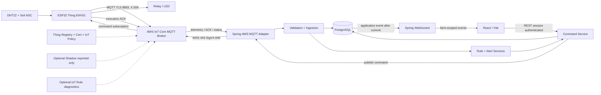

# ONE WEEK SMART FARM MVP PLAN

> Lưu ý 14/10/2026: đây là kế hoạch/audit lịch sử ngày 11/10. Nhiều phần đã
> được code sau mốc đó; không dùng “chưa implement” bên dưới làm trạng thái
> hiện tại. Xem [bảng nghiệm thu](../book/ACCEPTANCE_STATUS.md) và
> [ý tưởng/lộ trình nông nghiệp mới](../plan/AGRICULTURAL_IOT_DEVICE_ROADMAP.md).
> Danh mục 5 node mục tiêu mới không phải phạm vi được nghiệm thu trong 7 ngày cũ.


Ngày audit: 11/10/2026 (Asia/Ho_Chi_Minh). Repository: `NiDa30/smart-farm-management-system`, HEAD `5848a623d73390f914f423e8147f91147474c690`.

**Trạng thái: kế hoạch triển khai, chưa implement.** Những API, bảng, cấu hình AWS và firmware dưới đây là thiết kế đề xuất, không phải năng lực đã có. Hai tài liệu kế hoạch là thay đổi duy nhất trong lượt lập kế hoạch này.

## 1. Executive Summary

Repository đã có một frontend React khá rộng cho sáu phân hệ và một thử nghiệm ESP32/DHT22 → HiveMQ → browser. Chưa có backend chạy được, database, AWS IoT, authentication thật hay vòng lặp điều khiển có ACK thật. Đây là nền UI tốt để mở rộng, chưa phải hệ thống Smart Farm end-to-end.

Mục tiêu tuần: một trang trại `FARM001`, một ESP32 có DHT22 + đầu vào độ ẩm đất + relay/LED, hai thiết bị logic `ENV01` và `PUMP01`, một rule tưới, hai cảnh báo ngưỡng, history 1h/24h và log có correlation ID. Giữ React/Vite và tái sử dụng UI; bổ sung Spring Boot modular monolith, PostgreSQL và WebSocket. AWS IoT Core thật là điều kiện nghiệm thu bắt buộc.

**Khả thi có điều kiện:** cần hai kỹ sư full-time, mỗi người khoảng 6–7 giờ tập trung/ngày trong bảy ngày, tổng ngân sách khoảng 84–98 giờ, cùng AWS account/quyền IoT, thiết bị hoặc Wokwi và đường mạng dùng được ngay ngày 1. Một người phải làm toàn bộ từ số 0 trong 7 ngày là rủi ro cao; không cam kết đủ phạm vi. Không có AWS hoặc chưa nối được TLS ngày 1 thì phải dời mốc demo, không đổi sang broker local rồi gọi đó là MVP AWS.

Vai trò thực hiện: **A** backend/AWS/DB; **B** firmware/frontend; cả hai cùng integration và QA. Đây là phân công cho đội triển khai tương lai, không phải các tác vụ đã chạy. Ngân sách ngày 1–7 lần lượt 12, 12, 13, 12, 13, 12, 10 giờ công = 84 giờ, còn khoảng 14 giờ dự phòng nếu đội đạt mức 7 giờ/người/ngày. Cắt scope optional trước khi sử dụng thời gian dự phòng.

Các gate: G1 AWS TLS ngày 1; G2 cảm biến thật/ảo phát dữ liệu ngày 2; G3 dữ liệu lưu DB ngày 3; G4 realtime web ngày 4; G5 điều khiển + ACK ngày 5; G6 automation + fail-safe ngày 6; G7 demo và fault tests ngày 7. Không dùng UI simulator làm bằng chứng vượt gate IoT.

## 2. Repository Audit — CURRENT SYSTEM AUDIT

### 2.1 Phạm vi và bằng chứng

Audit inventory gồm 127 file project được Git theo dõi, trong đó 95 file dưới `src/`, 21 tài liệu dưới `docs/`, config/package/lockfile và hai file `wokwi/`. Đã quét nội dung toàn bộ file để xác định dependencies, state/data flow, integration points, TODO và marker certificate/private key; đọc sâu AppContext, route dispatcher, toàn bộ nhóm IoT, types, firmware và các đặc tả liên quan. Không tính `.git`, `node_modules`, `dist` là source. Không tìm thấy `AGENTS.md` áp dụng trong workspace.

Đặc tả nghiệp vụ được đối chiếu với code, không coi lời mô tả là implementation. Ví dụ `docs/context/IOT_CONTEXT.md` tự ghi “Production Ready”, mô tả Spring Boot/TimescaleDB, safety và audit bất biến; các năng lực này chưa tồn tại tương ứng trong source. Tài liệu này đưa backend sang giai đoạn 2 và dùng HiveMQ/EMQX; yêu cầu mới đưa backend và AWS IoT vào tuần MVP, nên kế hoạch này ưu tiên yêu cầu mới.

| Hạng mục | Thực trạng, file bằng chứng | Kết luận cho MVP |
|---|---|---|
| Current frontend | `package.json`, `src/main.tsx`, `src/App.tsx`, `src/index.css`: React 19, TypeScript, Vite 8, Tailwind 4, lucide; motion có dependency | Giữ framework và layout |
| Toolchain | Node 24.19.0, npm 11.9.0 đang chạy; lock cài Vite 8.3.2; chưa có pin Node hay CI | Pin toolchain đã kiểm chứng, giữ lock khi bắt đầu triển khai |
| Routing | `App.tsx:95–482`, `AppContext.tsx:338,2531`: dispatcher theo `currentRoute`, `navigate` chỉ là `setCurrentRoute` | Không có URL/history router thật; device detail cần thêm matching trước list |
| Current backend | Không có Java, `pom.xml`, Gradle, server entry hay REST controller. Express/dotenv/genai chỉ có dependency; không có server tương ứng | Tạo `backend/`; không giả định Express là backend hiện có |
| Current database | Không có SQL, migration, ORM hoặc DB config; dữ liệu là object TypeScript và state React | Tạo schema MVP mới, không có schema thật cần migrate |
| Current IoT implementation | `SensorRealtime.tsx:39–179` dùng MQTT WSS HiveMQ, topic `smartfarm/dien/FARM001/ENV01/telemetry`; nhận temp/humidity, history 15 điểm và log 10 dòng trong RAM | Có đường nhận MQTT thật trong code; chưa xác minh phiên live AWS/hardware |
| Firmware | `wokwi/sketch.ino` dùng `WiFiClient` + PubSubClient, TCP 1883, DHT22 GPIO15, publish mỗi 3 giây; reconnect blocking, client ID random | Reuse wiring và thao tác đọc DHT; cần TLS, soil, command/ACK, timer an toàn |
| Virtual hardware | `wokwi/diagram.json` chỉ ESP32 DevKit C V4 và DHT22 | Chưa có potentiometer/soil, relay, LED, pin map actuator |
| Current authentication | `AppContext.tsx:342` chọn `INITIAL_USERS[0]`; role/scope UI, user password chỉ validate form, không login/session/hash/authorization server | Bổ sung bảo vệ API; không tin `activeUser` từ browser |
| Existing APIs | Không thấy `fetch`, Axios, API service, WebSocket server/client ứng dụng; integration trực tiếp là MQTT | Toàn bộ REST/WS ở phần 10 là API mới |
| Persistence | Các domain state khởi tạo từ năm file `src/data/*MockData.ts`; không thấy localStorage/sessionStorage persistence | Reload làm mất thay đổi; history/log phải chuyển DB |
| Docker/CI/tests | Không có Dockerfile/compose, `.github` workflow hoặc test suite/script | Cần compose PostgreSQL, backend tests và browser smoke test |
| Environment | `.env.example` chỉ GEMINI_API_KEY/APP_URL placeholder; không thấy code dùng hai biến này; Vite đọc DISABLE_HMR | Chưa có AWS/DB config; không đưa credential vào VITE_* |
| Current reusable components | `DataTable`, `RightDrawer`, `KpiCard`, `StatusBadge`, `ConfirmModal`, `AppSidebar`, `AppTopbar` | Reuse; thêm UNKNOWN/STALE và command badges |

### 2.2 Các màn hình đã có và phần đang mock

| Phân hệ | Màn hình/component hiện có | Nguồn dữ liệu / mức hoàn thành |
|---|---|---|
| System | dashboard; FarmList/Detail/Wizard; AreaStructure; FarmMap; UserList/Detail/Form; RoleList/Permission; AuditLog; SystemSettings | UI CRUD, roles, backup/restore là state hoặc mô phỏng; chưa auth/backend |
| Production | ProductionDashboard; GardenMap; PlantList/Detail/Form; GrowthTracking; TaskManager; NutritionManager; IrrigationManager; EnvironmentMonitoring; DiseaseLibrary; PesticideList; DiseaseCaseManager; HarvestManager; TraceabilityView | Mock production và cập nhật state; tưới không điều khiển phần cứng |
| Resources | ResourceDashboard; MaterialList; SupplierList; PurchaseManager; InventoryManager; AssetManager; IoTAssetManager | Mock tài sản/kho/chi phí; không phải Thing Registry hay telemetry DB |
| Sales | SalesDashboard; CustomerManager; CRMActivityManager; ProductCatalog; PostHarvestClassification; FinishedGoodsInventory; PricingManager; QuotationManager; OrderManager; SupplyPlanningView; DeliveryManager; PaymentAndDebtManager; ClaimsAndReturnsManager; SalesTraceabilityView | Mock và business logic browser; không nằm trong slice tuần này |
| Analytics | ExecutiveDashboard; ProductionAnalytics; IoTResourceAnalytics; ResourceAnalytics; SalesFinanceAnalytics; BenchmarkView; AnomalyCenter; ForecastCenter; ReportBuilder | KPI/chart/forecast dựng sẵn hoặc tính trên mock; không coi dự báo AI là đã hoạt động |
| Preview | ProductionPreview, IotPreview, InventoryPreview, CommercePreview, ReportsPreview | UI phụ; không dùng để nghiệm thu backend |

| Màn hình IoT hiện có | Audit cụ thể | Reuse / thay đổi cần thiết |
|---|---|---|
| `/iot/dashboard` → `IoTDashboard.tsx` | Dùng `useApp`; nhiều zone metric hard-code; pump ID `PUMP-P01`; quick control gọi mock | Giữ cards; chỉ FARM001, ENV01/PUMP01; số liệu thật; bỏ số flow/energy không đo |
| `/iot/devices` → `DeviceMonitor.tsx` | Filter và drawer 9 tab; dùng snapshot selectedDevice; update config/OTA gọi state handler | Giữ list/drawer; detail lấy bằng ID từ store live; ẩn tab chưa được backend hỗ trợ |
| `/iot/devices/:id` | `startsWith('/iot/devices')` trả cùng list, chưa resolve ID/deep link | Reuse drawer làm detail, thêm route ID trước list; sync URL tối thiểu |
| `/iot/realtime` → `SensorRealtime.tsx` | MQTT browser HiveMQ thật, test publisher browser, không lưu DB, không soil timestamp nguồn/validation đầy đủ | Thay MQTT bằng REST bootstrap + WS; bỏ publisher giả lập khỏi demo live |
| `/iot/history` → `HistoricalData.tsx` | Dataset SM-01/02/03 hard-code; range 1h/24h/7d/30d chỉ state; CSV là `alert(...)` | Query DB 1h/24h; temp/humidity/soil; ẩn 7d/30d/export nếu chưa làm |
| `/iot/control` → `ControlCenter.tsx` | Timer WAITING_ACK; `controlActuator` tạo ACK giả sau 450ms (`AppContext.tsx:1590`), gán ON/flow/current | Thay bằng command API/WS; không fake success, không giữ mặc định 15 phút |
| `/iot/automation` → `AutomationManager.tsx` | Builder create/update state; simulator trả số cố định sau 1.2s; không rule engine | Reuse rule list/simple form; giới hạn một template LOW_SOIL; ẩn simulator/edge claim |
| `/iot/alerts` → `IoTAlertCenter.tsx` | Alert mock; acknowledge/resolve chỉ sửa state | Load alert thật; API acknowledge nếu giữ nút; action control cùng API bảo vệ |
| `/iot/events` → `IoTEventLogger.tsx` | RAM log, chỉ time string; export JSON là `alert(...)` | DB events UTC, correlation/filter/pagination; ẩn export chưa làm |
| digital-twin/topology/resources/safety | Sơ đồ, water/energy, OTA và safety presentation là mock; SafetyAndEdge OTA dùng timer | Phase 2; safety thật tuần này nằm backend + ESP32, không tuyên bố UI này đã bảo vệ thiết bị |

`src/types/index.ts` đã có IoTDevice, RealtimeMetric, IoTAutomationRule, AutomationExecution, IoTAlert, IoTEventLog và FailSafeRule. Reuse tên miền/formatters, nhưng không dùng toàn bộ interface hiện tại làm DTO bắt buộc: chúng yêu cầu nhiều trường không đo được, không có DeviceCommand persistent, đơn vị runtime đang là phút, IDs/topics không thống nhất. `IoTDeviceStatus` chưa có STALE, chỉ có `isStale`; dùng connectivity và freshness riêng thay vì trộn ERROR với OFFLINE.

### 2.3 Tài liệu đã đối chiếu

| Nhóm file | Vai trò khi lập kế hoạch |
|---|---|
| README.md, docs/README.md | Root README một dòng; docs index tập trung UI production/analytics, chưa có runbook |
| docs/Phân hệ 1.md, docs/phân hệ 2.md … docs/phân hệ 6.md | Đặc tả sáu phân hệ, screens, mock và hành vi mong muốn; không phải bằng chứng service đã chạy |
| docs/plan/Phanhe/p1.md … p6.md, docs/plan/he_thong_quan_ly_nong_nghiep_iot.md | Backlog rộng; lấy monitoring/control/automation làm slice, không triển khai ERP |
| docs/business flow end - to - end.md; docs/plan/Business Flow end-to-end/business flow.md | Business flow gần trùng; có Sense → MQTT → IoT Backend, dùng làm traceability nghiệp vụ |
| docs/context/IOT_CONTEXT.md; docs/context/README.md | Domain/ACK/safety conventions; có mâu thuẫn topic và backend roadmap; context README chứa link Windows không dùng được ở cloud |
| docs/UI_Mo_Ta_Phan_He_San_Xuat_Cay_Trong.md; docs/UX_AUDIT_AND_REDESIGN_SPECIFICATION.md | Reuse design và confirm control; không dành tuần để làm lại UX |
| docs/PHAN_HE_6_BAO_CAO_PHAN_TICH_SPECIFICATION.md | Phân biệt dữ liệu thật/ước tính; tránh đưa mock KPI vào dashboard MVP |

### 2.4 Kiểm tra đã thực hiện và technical debt trực tiếp

- `npm ci` mặc định thất bại do peer dependency Vite 8.3.2 cần esbuild ^0.27/^0.28, project pin ^0.25; `npm ci --legacy-peer-deps` đã cài thành công, không sửa manifest/lock. Đây là workaround hiện tại, không phải dependency conflict đã được sửa.
- `npm run build` chạy lại và PASS; bundle JS ~1.85 MB (~406 KB gzip), warning chunk >500KB và `__dirname` config-loader tương lai. Code splitting không nằm critical path.
- `npm run lint` chạy lại và FAIL TS2345 tại `SensorRealtime.tsx:179`: `showToast(..., 'error')` nhưng type chỉ nhận info/success/warning. Ngày 1 sửa nhỏ này trong task implementation; không che bằng skip typecheck.
- Onboarding trước đã kiểm tra bằng Chromium/Playwright: dashboard render, chuyển plant list thấy A001/A023, không có page error. Kiểm tra này chứng minh UI mock chạy, không chứng minh AWS, automation hay hardware.
- Java 21 và Docker daemon 28.4.0 có trong máy audit. Không có AWS CLI trên PATH. Chưa chạy Spring/Postgres vì chưa có source/config tương ứng; chưa kiểm tra AWS account, certificate, endpoint hoặc hardware.
- Chưa có test runner. TODO được tìm chủ yếu là giá trị `TaskStatus='TODO'` của nghiệp vụ, không phải TODO implementation; các lỗ hổng quan trọng nằm trong timer mô phỏng, hard-code history, export popup và thiếu integration.
- Không thấy PEM private-key/certificate marker trong file project hiện tại; đây không phải kiểm tra secret đầy đủ hay audit Git history. Secret scan toàn history phải có ngày 7.

## 3. Current vs Target Architecture

Hiện tại: mock files → AppContext → đa số UI; nhánh riêng Wokwi DHT22 → public HiveMQ TCP không TLS → SensorRealtime MQTT WSS. Hai nhánh không tạo thành một dữ liệu trung tâm, không có lưu trữ hay command thực.

Mục tiêu: firmware → AWS MQTT TLS → Spring ingestion → PostgreSQL → WS → React; chiều control quay lại qua Spring → AWS → ESP32 → relay/LED → ACK. Không rewrite frontend. Thêm `IotProvider` riêng thay vì refactor toàn bộ AppContext 2.681 dòng trong một tuần; giữ các phân hệ ngoài IoT ở chế độ prototype và gắn nhãn rõ.

**Quyết định ingestion:** backend subscribe AWS MQTT trực tiếp. IoT Rules không tự gọi được một Spring Boot local tùy ý. Không đặt Lambda/SQS/Kinesis/HTTP public ingestion vào critical path. Thing Registry, certificate và policy bắt buộc; IoT Rule diagnostic và Device Shadow là optional sau G5. Frontend chỉ REST + WebSocket tới backend, không MQTT/AWS private credentials.

## 4. MVP Scope

| Khả năng | Phạm vi nghiệm thu |
|---|---|
| Device monitoring | ENV01 sensor và PUMP01 actuator: ID/name/type, online/offline, lastSeen, freshness, trạng thái actuator xác nhận |
| Realtime | Nhiệt độ °C, độ ẩm không khí %RH, soil %; timestamp nguồn và thời gian server nhận; cập nhật không reload |
| History | PostgreSQL; query 1h/24h, tối đa 2.000 điểm response với bucket avg/min/max/count; xem được dữ liệu sau reload/restart |
| Alerts | HIGH_TEMPERATURE >35°C; LOW_SOIL_MOISTURE <30%; OFFLINE, COMMAND_TIMEOUT, MAX_RUNTIME critical |
| Manual control | START/STOP UI → ON/OFF contract, command lifecycle và ACK actual firmware; timeout không báo ON |
| Automation | Một template irrigation ENV01 soil <30% → PUMP01 ON; soil ≥35% hoặc 20s runtime → OFF; hard cap 30s |
| Safety | Timer local ESP32 bắt buộc; backend supervisor thứ hai; boot OFF; mất mạng/reboot không tự bật lại |
| Logs | TELEMETRY_RECEIVED, RULE_TRIGGERED, COMMAND_SENT, COMMAND_ACK, ALERT_CREATED, DEVICE_ONLINE/OFFLINE, SAFETY_TRIP; timestamps và IDs liên kết |
| Security | AWS least privilege; API operator/viewer; session/CSRF; secret ngoài Git; không endpoint control anonymous |

Một ESP32 có đủ hai vai trò logic, không bắt buộc hai bo mạch. AWS Thing vật lý là `ENV01`; `PUMP01` là actuator do Thing ENV01 điều khiển. DB ghi `PUMP01.controllerDeviceId=ENV01`. Policy của certificate ENV01 chỉ cho đúng hai namespace này. Nếu có hai ESP32 thật: Thing PUMP01 và certificate riêng, không chia sẻ private key; không biến thành yêu cầu tuần đầu.

LED/relay hoặc mini pump điện áp thấp là actuator demo. ACK xác nhận firmware đã đặt GPIO, không chứng minh nước chảy hay bơm cơ khí hoạt động; flow/current phải hiển thị “không có cảm biến”, không tiếp tục gán 342 L/min/14.2A như mock.

## 5. Out of Scope

Không nối toàn bộ production/resources/sales/accounting vào backend. Không CV nhận bệnh, digital twin nâng cao, AI forecasting, predictive maintenance, LoRaWAN production, Greengrass, OTA fleet management, HA multi-farm, hàng nghìn thiết bị, ERP/report builder. Không TimescaleDB/Kafka/microservices/Kubernetes. Flow sensor, water-level, solenoid, Shadow, IoT Rules diagnostic và deploy cloud backend chỉ làm nếu G1–G6 đã đạt và còn buffer. Không lấy các optional này thay cho command/ACK/fail-safe bắt buộc.

## 6. Architecture Diagram



DB không chủ động phát WS; Spring publish application event sau transaction commit. `CMD → MQTT` và `MQTT → AWS` là cùng adapter hai chiều. AWS không truy cập PostgreSQL trực tiếp.

```mermaid
sequenceDiagram
  participant U as React operator
  participant B as Spring Boot
  participant D as PostgreSQL
  participant A as AWS IoT
  participant E as ESP32
  U->>B: POST command ON + idempotency key
  B->>B: Auth, farm scope, freshness, safety
  B->>D: Create PENDING command
  B-->>U: 202 + commandId, PENDING
  B->>A: Publish command, QoS 1, retain=false
  A-->>B: PUBACK (broker receipt)
  B->>D: SENT (if not already advanced by ACK)
  A->>E: command ON, expiresAt, durationSeconds
  E->>E: Validate, dedupe, local safety; set GPIO
  E->>A: EXECUTED ACK SUCCESS, reportedState=ON
  A->>B: Device ACK
  B->>D: ACKNOWLEDGED then SUCCESS + event
  B-->>U: WS command.updated + device.updated after commit
  Note over U,E: UI shows ON only from confirmed reported state
```

## 7. MQTT Topic Design

Chốt namespace MVP `smartfarm/{farmId}/{deviceId}/{type}`. Thay cả firmware lẫn UI/backend contract; không cùng lúc subscribe broad legacy topic để “có dữ liệu”. `farm-001` trong mock UI khác `FARM001` protocol; mapper phải rõ, không suy ra từ display name. Các ID cũ PUMP-P01/P01/SM-03 không tự biến thành PUMP01.

| Topic | Publisher → subscriber | QoS / retain | Ghi chú |
|---|---|---|---|
| `smartfarm/FARM001/ENV01/telemetry` | ESP32 → backend | 1 / false | 5s/packet, 3 metrics cùng một mẫu |
| `smartfarm/FARM001/ENV01/status` | ESP32 hoặc LWT → backend | 1 / true | Online sau connect; OFFLINE LWT; heartbeat 10s |
| `smartfarm/FARM001/PUMP01/command` | Backend → ESP32 | 1 / false | Không retained ON; expiresAt bắt buộc |
| `smartfarm/FARM001/PUMP01/ack` | ESP32 → backend | 1 / false | commandId, stage, trạng thái GPIO thực |
| `smartfarm/FARM001/PUMP01/status` | ESP32 → backend | 1 / true | Report state lúc boot/change và heartbeat; không coi retained cũ là fresh |
| `smartfarm/FARM001/PUMP01/event` | ESP32 → backend | 1 / false | SAFETY_TRIP local, replay bounded sau reconnect |

Không dùng `smartfarm/FARM001/device/status` chung trong MVP vì cần ownership và LWT per-controller rõ. Một connection chỉ có một LWT: ENV01/status OFFLINE; backend lan truyền offline sang PUMP01 cùng controller. PUMP01 vẫn có status report riêng lúc online.

AWS IoT hỗ trợ QoS 0/1; không thiết kế QoS 2. QoS 1 có thể duplicate: dùng bootId+sequence/eventId/commandId để xử lý idempotent, không gọi “exactly once”. Subscribe backend giới hạn FARM001: `.../+/telemetry`, `.../+/status`, `.../+/ack`, `.../+/event`; policy vẫn phải cấp Subscribe topicfilter ARN và Receive topic ARN riêng.

## 8. Telemetry / Command Payload và trạng thái

### 8.1 Contract JSON v1

Ví dụ timestamp UTC; đây là dữ liệu minh họa, không phải packet đã nhận từ AWS.

```json
{
  "schemaVersion": 1,
  "deviceId": "ENV01",
  "bootId": "3e4d1219-4d80-456c-8561-ec0b744f5184",
  "sequence": 120,
  "temperature": 31.2,
  "humidity": 72.0,
  "soilMoisture": 28.0,
  "timestamp": "2026-10-11T03:01:05Z",
  "uptimeMs": 600000
}
```

```json
{
  "schemaVersion": 1,
  "commandId": "fa6e7cb8-0d86-46c3-a27c-caa1cb4546ab",
  "deviceId": "PUMP01",
  "action": "ON",
  "durationSeconds": 20,
  "issuedAt": "2026-10-11T03:01:07Z",
  "expiresAt": "2026-10-11T03:01:17Z"
}
```

```json
{
  "schemaVersion": 1,
  "commandId": "fa6e7cb8-0d86-46c3-a27c-caa1cb4546ab",
  "deviceId": "PUMP01",
  "bootId": "3e4d1219-4d80-456c-8561-ec0b744f5184",
  "sequence": 121,
  "stage": "EXECUTED",
  "status": "SUCCESS",
  "reportedState": "ON",
  "timestamp": "2026-10-11T03:01:08Z",
  "errorCode": null
}
```

Status gồm deviceId, bootId, sequence, timestamp, connection=ONLINE, reportedState nếu actuator, activeCommandId và safetyLockout. LWT dùng connection=OFFLINE và reason=CONNECTION_LOST; timestamp tại lúc set LWT không phải thời điểm mất mạng, backend lấy receivedAt. Event local có eventId, deviceId=PUMP01, type=SAFETY_TRIP, reason=MAX_RUNTIME, reportedState=OFF, source=EDGE, occurredAt và commandId cuối nếu có.

Validation: schemaVersion=1, payload ≤8KB, JSON số hữu hạn; DHT22 temperature −40..80°C, humidity/soil 0..100%; timestamp parse UTC, future skew >10s bị reject; sample quá cũ vẫn có thể lưu history với quality=STALE nhưng không chạy rule/update latest. Topic identity phải khớp registered device/payload/farm, không chỉ tin deviceId trong JSON. Device sequence tăng trong boot; duplicate/out-of-order không kéo lùi trạng thái mới. Invalid packet tạo rejection event/rate-limit, không tạo telemetry valid hay command.

Thời gian: sync SNTP trước MQTT TLS và trước khi chấp nhận ON. `receivedAt` server là cơ sở freshness, `measuredAt` nguồn để history; `uptimeMs`/monotonic local để runtime, không dùng wall clock để quyết định hard cap. Mẫu stale/out-of-order có cờ quality; không đoán soil từ humidity.

### 8.2 Command state machine

`PENDING → SENT → ACKNOWLEDGED → SUCCESS`; nhánh lỗi `FAILED` hoặc `TIMEOUT`. PENDING là DB accept; SENT chỉ sau broker PUBACK; ACKNOWLEDGED chỉ khi device ACK khớp commandId; SUCCESS chỉ sau stage EXECUTED/status SUCCESS. Firmware có thể gửi RECEIVED trước EXECUTED nếu xử lý chậm; với GPIO tức thì gửi EXECUTED một lần và backend ghi hai transitions trong cùng transaction. `FAILED` có errorCode; timeout 10s từ issuedAt, bao gồm publish và chờ ACK. Request không hợp lệ trả HTTP lỗi, không giả tạo command SUCCESS.

ACK có thể đến trước PUBACK callback: updates monotonic, callback không được kéo SUCCESS về SENT. Terminal TIMEOUT không đổi âm thầm thành SUCCESS khi late ACK; lưu LATE_ACK và reconcile reported state theo sequence, UI phân biệt “lệnh timeout” và “trạng thái thiết bị xác nhận sau đó”. QoS PUBACK không chứng minh actuator thực thi. Sau timeout trạng thái thực là UNKNOWN trừ khi nhận fresh status hợp lệ; STOP vẫn có thể yêu cầu nhưng không tuyên bố đã ngắt nếu chưa xác nhận.

Idempotency HTTP: `(farmId, requestedBy, idempotencyKey)` unique; retry cùng key+payload trả cùng commandId, khác payload trả 409. Mỗi pump tối đa một ON in-flight; STOP safety/manual có ưu tiên, không bị chặn sau ON pending. Device cache command IDs có TTL ≥5 phút; duplicate ON chỉ gửi lại ACK, **không reset timer**. ON có expiresAt ngắn, không replay sau restart; OFF idempotent, vẫn chấp nhận để đạt trạng thái an toàn.

Reset safety dùng action nội bộ `RESET_LOCKOUT` trên cùng command topic/pipeline, không mở quyền publish thêm. Endpoint safety-reset tạo command202; firmware chỉ chấp nhận khi GPIO OFF và điều kiện lỗi đã hết, trả EXECUTED ACK với reportedState=OFF và safetyLockout=false. Backend/UI chỉ clear lockout sau ACK/status xác nhận, không chỉ sửa cờ DB. API command thông thường chỉ nhận ON/OFF; RESET_LOCKOUT chỉ từ endpoint operator riêng và không bật actuator.

### 8.3 Freshness và connectivity

- Telemetry chu kỳ 5s; `FRESH` nếu valid sample age ≤15s, `STALE` >15s hoặc timestamp nguồn đã cũ. Không có mẫu hiển thị NO_DATA, không zero giả.
- Connectivity ONLINE khi fresh heartbeat/status; OFFLINE khi LWT hoặc không thấy heartbeat >30s. Heartbeat còn nhưng telemetry dừng thì ONLINE + STALE, không online “xanh” cho mọi metric.
- UI card luôn có value, unit, measuredAt, receivedAt/data age, freshness. Tuổi dữ liệu cập nhật theo timer UI dù không nhận WS. Các ngưỡng cấu hình một nơi backend/contract.
- Backend MQTT mất kết nối: farm feed UNAVAILABLE, disable ON/automation, UI mất freshness; không tuyên bố từng ESP32 đã OFF chỉ vì backend mất feed. Timer local vẫn bảo vệ.

## 9. AWS IoT Architecture

### 9.1 Provisioning và quyền

Ngày 1 chọn một AWS region gần demo và lấy account-specific `iot:Data-ATS` endpoint, không đoán hostname. Bật cost budget/cảnh báo nhỏ cho sandbox, gắn tags MVP/owner/expiry. Chủ AWS account thực hiện hoặc cấp role tạm cho người triển khai: describe endpoint, create/describe thing, create/activate certificate, create/attach IoT policy, attach principal, MQTT console test. Không cần IAM administrator blanket.

Tạo Thing ENV01, X.509 certificate ACTIVE, attach Thing + policy. Certificate public/private key và Amazon Root CA hợp lệ lưu ngoài Git hoặc thư mục ignored quyền hạn chế; không chụp màn hình key/copy vào issue. Verify endpoint/hostname/CA/TLS; không dùng setInsecure. Nếu có Thing PUMP01 riêng dùng principal/client ID riêng.

Policy device dùng ARN exact theo REGION/ACCOUNT đã resolve:

| Action | Resource scope cho principal ENV01 |
|---|---|
| `iot:Connect` | `arn:aws:iot:REGION:ACCOUNT:client/ENV01` |
| `iot:Publish` | Exact ENV01 telemetry/status và PUMP01 ack/status/event topics |
| `iot:Subscribe` | Exact `topicfilter/smartfarm/FARM001/PUMP01/command` |
| `iot:Receive` | Exact `topic/smartfarm/FARM001/PUMP01/command` |

Client ID ổn định ENV01, chỉ một active connection/Thing. Quy tắc random client ID của prototype browser không áp dụng firmware AWS đã khóa policy. Thử publish/sub vào FARM002 phải bị deny. ENV01 không được publish command. Backend không được pretend là ENV01.

### 9.2 Backend transport

Baseline backend: AWS IoT Device SDK for Java v2, MQTT3 over WebSocket TLS 443, SigV4 và AWS default credential provider chain; IAM role/temporary credentials cấp IoT Connect cho `smartfarm-backend-FARM001`, Publish exact PUMP01 command, Subscribe/Receive các filters FARM001. Server có clock đúng, credential session refresh. Không dùng frontend IAM access keys.

Ngày 1 bắt buộc spike connection/subscription/PUBACK qua SDK và native AWS CRT trên Linux Java21; kiểm tra proxy hỗ trợ WSS upgrade và signing. HTTPS Git proxy không đồng nghĩa đã có AWS auth, không suy ra TCP8883 hoặc WSS443 dùng được từ cloud. Nếu WSS/proxy/native library không chạy: backend ngoài cloud onboarding chạy laptop/EC2 với mạng AWS phù hợp; hoặc mTLS8883 certificate backend riêng nếu đường TCP thực sự được phép. Giữ cùng backend/source/DB/contract và ghi rõ môi trường demo. Không tắt TLS, không đưa AWS key vào browser, không đổi AWS thành HiveMQ.

Đích mạng cần cho triển khai: endpoint `*.iot.REGION.amazonaws.com` cụ thể được AWS trả; STS hostname nếu assume role; Maven Central, npm registry; Wokwi/platform firmware registry và SNTP cho board. Allowlist proxy phải hostname thực lấy từ SDK/setup; broad wildcard không phải phương án mặc định. Firmware/laptop cần TLS8883 outbound; backend WSS443. Credential và mạng là prerequisite cần xác minh khi triển khai, chưa được xác minh trong audit này.

### 9.3 MQTT Test Client, Shadow và Rules

AWS MQTT Test Client dùng để quan sát telemetry/ACK và một command chứng minh đường hai chiều, không thay backend trong demo cuối. Subscribe đúng topics, ghi 5 phút evidence, không gửi retained ON.

Shadow optional sau G5: named shadow `pump`, chỉ `reported.state`, `lastCommandId`, `safetyLockout`. Không điều khiển pump ON bằng desired persistent trong tuần MVP vì có thể bật lại sau reconnect; reported Shadow không thay command ACK và freshness. Policy thêm đúng reserved shadow topics khi thực sự triển khai.

IoT Rule optional sau G5: lọc telemetry FARM001 sang CloudWatch Logs diagnostic với role riêng và retention ngắn. Main persistence vẫn do Spring ingestion; không ghi duplicate rows từ hai đường. Nếu chưa làm Shadow/Rules, đánh dấu chưa làm; core AWS Thing/cert/policy/broker vẫn đủ baseline yêu cầu bắt buộc.

## 10. Backend Changes

### 10.1 Structure và runtime

Tạo `backend/` Java21, Spring Boot bản stable còn được hỗ trợ tương thích Java21 (pin version cụ thể ngày 1), Maven Wrapper, Spring Web/Validation, Data JPA, Security, WebSocket, Actuator và Flyway/PostgreSQL. Chốt AWS SDK v2 version qua spike ngày 1, không chọn version theo suy đoán từ frontend. Một process modular monolith, một PostgreSQL; không Redis/message bus tuần này.

```text
backend/
  pom.xml, mvnw, .mvn/wrapper/
  src/main/java/vn/smartfarm/
    SmartFarmApplication.java
    security/                 SecurityConfig, SessionController
    iot/
      device/                 DeviceController/Service/Repository/Entity/DTO
      telemetry/              TelemetryController/IngestionService/Repository/Entity/DTO
      mqtt/                   AwsMqttConfig, MqttListener, MqttPublisher, PayloadValidator
      command/                CommandController/Service/Dispatcher/Repository/Entity/DTO
      automation/             RuleController/Service/Engine, RunRepository, Rule/Run entities
      alert/                  AlertController/Service/Repository/Entity/DTO
      websocket/              FarmWebSocketHandler, EventEnvelope, EventBroadcaster
      event/                  EventController/Service/Repository/Entity/DTO
      scheduling/             PresenceScheduler, CommandTimeoutScheduler, SafetySupervisor
  src/main/resources/application.yml
  src/main/resources/db/migration/V1__iot_mvp.sql
  src/main/resources/db/migration/V2__seed_demo_devices.sql
  src/test/java/vn/smartfarm/iot/
```

Ingestion không chạy blocking transaction ngay MQTT callback: bounded queue/executor; validate → dedupe → insert telemetry/update latest & presence/event trong transaction → sau commit phát WS và evaluate rule. DB lỗi không được broadcast “đã lưu”; đánh dấu feed/storage degraded, khóa automation, ghi lỗi không chứa credential. Tuần này không có telemetry durable replay vô hạn: bounded queue, overflow metric/event, báo rõ khoảng trống history.

CommandService tạo command PENDING trong transaction; Dispatcher đọc command table như outbox tối thiểu, publish ngoài DB transaction, cập nhật trạng thái bằng compare-and-set/version. Không auto retry ON sau crash/publish uncertain; chuyển TIMEOUT/UNKNOWN và reconcile status. Backend restart load timers/runs, hủy ON quá hạn, ưu tiên OFF best-effort cho run chưa kết thúc; firmware local timer là lớp bảo vệ độc lập. Sau restart không auto enable automation cho đến khi thiết bị fresh/reconciled.

### 10.2 API contract

Tất cả `/api/iot` lấy farm scope từ authenticated session và kiểm tra device ownership server-side. `{id}` là code ENV01/PUMP01; command ID là UUID. GET trả JSON DTO, không expose Entity/private config. Error envelope: code/message/requestId/fieldErrors; 401 unauthenticated, 403 role/farm deny, 404 not found, 409 conflict, 422 invalid payload, 503 feed/storage unavailable. Lists có pagination `limit<=100`, cursor hoặc page, không trả toàn bộ event history.

| API | Request / output | Quyền |
|---|---|---|
| `POST /api/auth/login`, `POST /api/auth/logout`, `GET /api/auth/me` | Session cookie; me có role/farm; CSRF bootstrap qua GET endpoint | Login/public chỉ endpoint login, có rate limit |
| `GET /api/auth/csrf` | CSRF token cho mutation cùng origin | Session/bootstrap phù hợp Spring Security |
| `GET /api/iot/devices` | Farm devices + latest measurements, connection, lastSeen, freshness, version | VIEWER/OPERATOR |
| `GET /api/iot/devices/{id}` | Detail cùng DTO, reported state/safety lockout | VIEWER/OPERATOR |
| `GET /api/iot/devices/{id}/telemetry?range=1h\|24h&metric=temperature\|humidity\|soilMoisture` | points, unit, interval/bucket, sample count, UTC from/to; max 2.000 points | VIEWER/OPERATOR |
| `GET /api/iot/alerts?status=OPEN&limit=50` | Persisted alerts, timestamps, device/correlation IDs | VIEWER/OPERATOR |
| `PATCH /api/iot/alerts/{id}` | `{status:"ACKNOWLEDGED"}`; resolve chỉ khi condition hết; không clear safety lock | OPERATOR |
| `GET /api/iot/events?deviceId=...&commandId=...&type=...&limit=50` | Events có cursor/order receivedAt,id | VIEWER/OPERATOR |
| `POST /api/iot/devices/{id}/commands` | `{action:"ON",durationSeconds:20}`, Idempotency-Key + CSRF; 202 command DTO | OPERATOR + farm + interlocks |
| `GET /api/iot/commands/{id}` | status/times/error + reported state reference | VIEWER/OPERATOR |
| `GET /api/iot/automation/rules` | Single-template rules, sensor/actuator, thresholds, safety values, enabled/version | VIEWER/OPERATOR |
| `POST /api/iot/automation/rules` | Template IRRIGATION, sensor ENV01, actuator PUMP01, low=30, high=35, run=20, cap=30, cooldown=60 | OPERATOR; unsupported template rejected |
| `PATCH /api/iot/automation/rules/{id}` | enabled/thresholds/version; optimistic concurrency | OPERATOR |
| `GET /api/iot/automation/runs?ruleId=...` | Triggered run and ON/OFF command IDs/outcome | VIEWER/OPERATOR |
| `POST /api/iot/devices/PUMP01/safety-reset` | Explicit reset reason; only fresh reported OFF, no in-flight ON; 202 RESET_LOCKOUT command, clear sau device ACK | OPERATOR; audit required |
| `GET /actuator/health/readiness` | DB and MQTT readiness; restricted detail | Local/operator ops |

ON bị chặn khi controller offline, sensor stale/invalid, reported state UNKNOWN/ERROR, safety lockout hoặc storage/feed degraded. OFF là safe intent và được thử ngay cả state uncertain; mất MQTT trả unavailable/PENDING→FAILED/TIMEOUT, không ghi OFF thành công giả. Không cho caller override hard cap. Requester/source do backend xác định, không tin field requestedBy từ web.

### 10.3 WebSocket

Native WebSocket `/ws/iot`, session cookie và Origin allowlist, events một chiều server→client; browser không được gửi command qua WS. Farm membership do server quyết định khi handshake. Cùng origin Vite proxy `/api`, `/ws` tới backend:8080 khi dev; host deployment HTTPS/WSS nếu publish demo.

Envelope `{eventId,type,farmId,deviceId,occurredAt,receivedAt,entityVersion,payload}`; types telemetry.received, device.updated, command.updated, alert.created/updated, automation.run.updated, iot.event.created, feed.status. Sau commit mới phát; slow client bị ngắt thay vì giữ queue vô hạn. Backend phát command updates cho cả ACKNOWLEDGED/SUCCESS; UI có thể thấy chuyển rất nhanh, không dùng timer để giả chờ.

Client reconnect backoff+jitter 1..30s, on-open refetch devices/commands/alerts/recent events; merge theo entityVersion để snapshot chậm không đè event mới. Không đảm bảo replay WS toàn lịch sử trong tuần MVP: REST snapshot/history là nguồn phục hồi. Khi mất WS, UI hiện reconnecting và disabled ON; không giữ success xanh vì dữ liệu cũ.

## 11. Database Changes

PostgreSQL 16 hoặc bản stable đã kiểm chứng với driver/Flyway, image pin ngày 1; Docker Compose named volume, healthcheck, localhost binding. Chỉ seed metadata FARM001/ENV01/PUMP01/rule disabled; **không seed telemetry/ACK giả**. Farm hiện chưa có bảng persisted: MVP dùng `farm_id VARCHAR(32)` scope với giá trị FARM001, chưa FK đến mock farm. Backend authorize FARM001; thêm farm master table Phase 2.

| Bảng | Field cụ thể | Relationship / constraint |
|---|---|---|
| `iot_device` | `id UUID PK`, `farm_id`, `device_code`, `name`, `kind SENSOR/ACTUATOR`, `thing_name`, `controller_device_id UUID NULL`, `connection_status`, `last_seen_at TIMESTAMPTZ`, `last_telemetry_at`, `reported_state ON/OFF/UNKNOWN/ERROR`, `reported_at`, `boot_id`, `state_sequence BIGINT`, `safety_lockout BOOLEAN`, `version BIGINT` | Unique(farm_id,device_code); controller self-FK; PUMP01→ENV01; same farm validated |
| `iot_device_channel` | `id UUID PK`, `device_id UUID FK`, `metric_key`, `unit`, `min_value DOUBLE`, `max_value DOUBLE`, `enabled BOOLEAN` | Unique(device_id,metric_key); ENV01 temp/humidity/soil; không seed flow |
| `telemetry_measurement` | `id BIGSERIAL PK`, `device_id FK`, `boot_id UUID`, `sequence BIGINT`, `measured_at TIMESTAMPTZ`, `received_at TIMESTAMPTZ`, `temperature DOUBLE`, `humidity DOUBLE`, `soil_moisture DOUBLE`, `quality VARCHAR`, `raw_payload JSONB` | Unique(device_id,boot_id,sequence); CHECK ranges; một hàng/packet cho ba metrics; index(device_id,measured_at DESC) |
| `device_command` | `id UUID PK`, `farm_id`, `device_id FK`, `action ON/OFF/RESET_LOCKOUT`, `duration_seconds INT`, `source MANUAL/AUTOMATION/SAFETY`, `requested_by`, `idempotency_key`, `state`, `issued_at`, `expires_at`, `sent_at`, `acknowledged_at`, `completed_at`, `error_code`, `ack_payload JSONB`, `version BIGINT` | Unique(farm_id,requested_by,idempotency_key); partial unique in-flight ON/device; index(state,expires_at); cap 30; duration chỉ bắt buộc ON |
| `automation_rule` | `id UUID PK`, `farm_id`, `name`, `sensor_device_id FK`, `actuator_device_id FK`, `metric=soilMoisture`, `start_threshold=30`, `stop_threshold=35`, `run_seconds=20`, `max_runtime_seconds=30`, `cooldown_seconds=60`, `enabled`, `last_triggered_at`, `version` | Check start<stop, 0..100, run≤cap≤30; same farm for both devices |
| `automation_run` | `id UUID PK`, `rule_id FK`, `actuator_device_id FK`, `trigger_measurement_id FK`, `started_at`, `ended_at`, `state RUNNING/SUCCESS/FAILED/BLOCKED`, `on_command_id FK`, `off_command_id FK`, `end_reason`, `correlation_id UUID` | Partial unique(actuator_device_id) WHERE state=RUNNING; lock chống race; unique(rule_id,trigger_measurement_id) |
| `iot_alert` | `id UUID PK`, `device_id FK`, `type`, `severity`, `status`, `message`, `condition_key`, `created_at`, `last_observed_at`, `acknowledged_at/by`, `resolved_at`, `correlation_id` | Partial unique active device/type/condition; repeat packet updates same alert, không flood |
| `iot_event` | `id BIGSERIAL PK`, `event_id UUID UNIQUE`, `farm_id`, `device_id FK nullable`, `command_id FK nullable`, `automation_run_id FK nullable`, `measurement_id FK nullable`, `type`, `source`, `occurred_at`, `received_at`, `severity`, `details JSONB`, `correlation_id` | Index(farm_id,received_at DESC,id), command/run indexes; append-only service API; rejected packet device nullable |

Tất cả event/commands dùng UTC Instant/TIMESTAMPTZ; UI format tiếng Việt/Asia/Ho_Chi_Minh. Không dùng “Vừa xong” hoặc HH:mm:ss làm dữ liệu persistence. DB transaction lock/version bảo vệ rule từ hai packet đồng thời và command ACK race. Để MVP đơn giản, device latest metric lấy từ measurement newest hợp lệ, không tạo table cache nữa.

Migration V1 tạo bảng/index/check; V2 seed metadata idempotent unique keys. Flyway chạy khi startup; không `ddl-auto=create` và không xóa volume mỗi demo. 5s/sample là 17.280 row/ngày/sensor, một tuần ~121k rows, PostgreSQL bình thường đủ. Log telemetry từng packet phù hợp quy mô demo; retention mặc định 7 ngày có thể dọn sau demo; tuyệt đối không xóa command/event evidence giữa test. DB backup/snapshot trước demo ngày 7.

## 12. Frontend Changes

Tạo `src/services/http.ts`, `src/services/iotApi.ts`, `src/types/iotApi.ts`, `src/context/IotContext.tsx`, `src/hooks/useIotSocket.ts`, `src/modules/iot/auth/IotLogin.tsx`. Provider mới giữ DTO thật, không copy toàn bộ mock AppContext. UI IoT import `useIot`; layout/navigation vẫn `useApp`. Không hydrate mock IoT khi API lỗi; hiện empty/loading/error/reconnecting rõ.

Sửa có giới hạn các file đã có:

1. `App.tsx` + `AppSidebar.tsx`: route detail trước list; minimal browser history/popstate + restore URL hợp lệ, giữ dispatcher hiện tại; thêm login guard IoT. Không cần rewrite router tất cả module.
2. `DeviceMonitor.tsx`: ENV01/PUMP01 API, status/freshness/lastSeen timestamp; selected ID thay selected object stale; reuse RightDrawer cho `/iot/devices/:id`.
3. `SensorRealtime.tsx`: xóa đường MQTT và embedded guide HiveMQ trong màn hình live; WS + soil card + unit/source timestamp; không giữ browser telemetry publisher làm nguồn demo.
4. `HistoricalData.tsx`: fetch range/metric, render returned points, empty/gap/error đúng; không nối line qua khoảng offline như dữ liệu liên tục.
5. `ControlCenter.tsx`: giữ confirm modal, gọi API, track commandId; PENDING/SENT/ACKNOWLEDGED/SUCCESS/FAILED/TIMEOUT; state ON chỉ từ reportedState hợp lệ, duration seconds≤30, STOP accessible khi UNKNOWN. Không chuyển thành công theo Promise boolean/timer.
6. `AutomationManager.tsx`: list+edit/create template soil, enable/disable, runs; ẩn multi-action/OTA/edge simulator không làm; map đơn vị giây rõ.
7. `IoTAlertCenter.tsx`, `IoTEventLogger.tsx`, `IoTDashboard.tsx`: API + WS merge, correlation filter, counts từ DB, thay hard-coded zones bằng FARM001 summary.
8. `StatusBadge.tsx`, `AppTopbar.tsx`: live feed badge cho IoT, UNKNOWN/STALE/NO_DATA; tránh topbar mock “LoRa Live” gây hiểu nhầm; screen ngoài slice ghi prototype/mock.
9. `vite.config.ts`: proxy cùng origin `/api`,`/ws`; `.env.example`: non-secret backend base/settings nếu cần, không AWS secret. `package.json`/lock chỉ thêm test tooling khi implementation thực sự cần và review diff.

Không dùng adapter bịa battery/current/flow/firmware statistics để đáp ứng interface cũ. Không truyền `activeUser` mock thành proof authorization. Không nối tất cả system/sales UI vào user demo backend tuần này.

## 13. ESP32 Firmware Plan

Chọn Arduino framework trên ESP32 để reuse DHTesp, nhưng MQTT layer dùng ESP-IDF `esp-mqtt` qua Arduino-ESP32 đã pin để hỗ trợ publish QoS1 thật. PubSubClient hiện có chỉ publish QoS0; không giữ nó rồi ghi QoS1 trong tài liệu. Spike compile SDK/API sớm ngày 1, không đợi ngày 5 mới phát hiện MQTT callback/TLS không hỗ trợ.

```text
firmware/esp32/
  platformio.ini                  pin board/framework/libs, build profiles
  src/main.cpp                   setup/tasks orchestration
  src/Sensors.cpp                DHTesp + ADC read/calibration
  src/MqttTransport.cpp          AWS TLS connect, subscriptions, QoS1, LWT
  src/CommandHandler.cpp         validation/dedupe/ACK
  src/ActuatorSafety.cpp         GPIO, monotonic deadline, network loss policy
  include/*.h
  config/config.example.h        placeholders only
  config/config.local.h          ignored, Wi-Fi and endpoint/device config
  certs/                         ignored cert/key provisioning output
  README.md                      pin map, flash, secret provisioning, acceptance
  wokwi.toml                     firmware output, no secrets
```

Giữ `wokwi/diagram.json` và cập nhật phần cứng demo; `wokwi/sketch.ino` chuyển thành example/entry tham chiếu firmware authoritative, không duy trì hai implementations logic lệch nhau. Embedded code strings HiveMQ trong SensorRealtime cần bỏ/chuyển guide ngoài UI live để không hướng người dùng chạy transport cũ.

| Phần cứng | Pin đề xuất / test |
|---|---|
| DHT22 | Reuse GPIO15 hiện có cho Wokwi; board thật ưu tiên GPIO4 nếu GPIO15 boot strap gây khó; cấu hình qua macro |
| Soil moisture | GPIO34 ADC1 (input-only, tránh ADC2 khi Wi-Fi); Wokwi potentiometer đại diện analog sensor; thật dùng capacitive sensor 3.3V |
| Relay control | GPIO26 output, active-level configurable; OFF trước init Wi-Fi; check relay active-low |
| LED | GPIO27 + điện trở; relay switching LED/mini pump điện áp thấp, nguồn phù hợp; không nối tải mains trong demo |

Sensors: đo mỗi 5s, calibrate dry/wet raw ADC→0..100%, clamp nhưng báo lỗi out-of-expected calibration; nhiệt/ẩm NaN không gửi sample hợp lệ. Wokwi soil potentiometer là input phần cứng ảo được ghi nhãn simulation, không phải browser JSON generator. Firmware thật thay Wi-Fi/pin/calibration/credentials là chính, protocol không đổi.

TLS: WiFiClientSecure/esp-mqtt TLS config với root CA, client cert, private key; validate server hostname và thời gian. Provision secret file vào SPIFFS/LittleFS ngoài Git hoặc generate local header ignored tại build; key có thể nằm flash sau build, binary cũng phải private/ignored. Không paste PEM vào diagram/sketch tracked. Chọn profile provisioning đã test với simulator, không giả định Wokwi có một secrets API cụ thể.

**Wokwi gate:** validate private local project/VS Code extension + filesystem image/cert access và TLS outbound theo plan/account đang có ngày 1. Không chia sẻ public project chứa cert/private key. Nếu private provisioning hoặc network gateway không khả dụng, chuyển ESP32 vật lý ngày 1–2. Không dùng `setInsecure`, không publish credential trong Wokwi link để cứu deadline. Thiếu cả Wokwi private TLS và board thật là blocker của demo, không giải quyết bằng MQTT client laptop giả ESP32.

Wi-Fi/MQTT reconnect có bounded exponential backoff+jitter, không vòng `while` + `delay` làm nghẽn safety. Safety task riêng poll ≤10ms hoặc timer monotonic, không phụ thuộc callback network đang block. Timer ON starts tại lúc GPIO actual ON, cap firmware 30s bất kể backend gửi gì; normal requested duration 20s. Duplicate ON không gia hạn deadline; chặn command hết hạn, device ID sai, invalid duration hay chưa sync clock.

Khi boot/reset: GPIO OFF, state OFF, tạo bootId mới, sync time, connect AWS, subscribe command trước báo ONLINE, publish fresh statuses. Không lưu lại ON để tự resume. Nếu mất Wi-Fi/MQTT trong khi ON, OFF local ngay khi phát hiện và tuyệt đối ≤hard cap; event safety được queue bounded trong NVS để báo sau reconnect. Device lockout sau MAX_RUNTIME/fault chỉ reset bằng thao tác operator hợp lệ hoặc thủ tục vật lý đã định nghĩa; reset không tự ON.

Firmware nhận ON/OFF, đặt GPIO, gửi execution ACK với reportedState; reject có status FAILED/errorCode. RESET_LOCKOUT chỉ clear safety trong trạng thái OFF và ACK xác nhận, không đổi GPIO sang ON. Device state status kèm sequence/activeCommandId để reconcile. Event SAFETY_TRIP local và confirmed OFF không cần chờ command OFF từ backend. Khi local requested-duration20s tự tắt, publish fresh OFF status với reason=DURATION_COMPLETED; backend vẫn phát OFF idempotent và chỉ kết thúc run SUCCESS sau OFF execution ACK hoặc fresh status OFF gắn đúng activeCommandId/run. Không giả tạo ACK cho một OFF command mà device chưa nhận.

## 14. Security Plan

- Device cert/key không vào Git/history/public Wokwi/binary artifact công khai; `.gitignore` thêm các path local cert/key/filesystem images/build; `.env.example` và config.example chỉ placeholder. Không ignore toàn bộ firmware source.
- IAM backend qua default provider/role hoặc temporary AWS credentials ngoài repository; role farm scope, refresh expiry; browser không AWS keys/cert. Setup AWS bằng existing profile khi triển khai, không yêu cầu người dùng gửi secret trong chat.
- Certificate/policy ownership Thing/client/topic đúng; test deny cross farm và publish command bằng device cert. Provisioner quyền management riêng với runtime IoT permissions.
- Chưa có auth thật: ngày 3 thêm Spring Security session với hai account demo OPERATOR/VIEWER từ cấu hình private, BCrypt password hash. Frontend login tối thiểu; HttpOnly SameSite cookie, Secure ở HTTPS; CSRF cho mutations, Origin check WS, no wildcard CORS. Không dùng password mặc định tracked; operator chỉ FARM001.
- ON/OFF/rule/reset endpoints đều phải auth + role + farm; viewer đọc được nhưng mutation 403; UI disable không thay kiểm tra server. Rate-limit login/control; throttle command để tránh flood.
- Dev cùng origin qua Vite proxy. Backend/Postgres bind local/private, không publish endpoint anonymous; nếu demo remote cần HTTPS và deployment auth gate trước expose. API docs/Actuator details không public.
- JSON bounded/validated; không log auth headers/passwords/PEM; raw telemetry JSONB không chứa credentials. Control không có overrideSafety=true bỏ hard cap.
- Ngày 7 quét tracked files, Git history và artifacts bằng secret scanner đã pin + manual review AWS patterns, xác minh `.gitignore` qua `git check-ignore`. Nếu key bị commit: revoke/rotate trước demo, xóa file không đủ khắc phục.

## 15. Detailed Day 1 → Day 7 Plan

### DAY 1 — Audit + contracts + AWS IoT TLS gate (12 giờ công)

**GOAL:** chốt slice và chứng minh ESP32/Wokwi kết nối AWS thật; loại bỏ rủi ro provisioning/transport trước khi xây UI.

**TASKS:**

1. A+B (1h): review audit, freeze FARM001/ENV01/PUMP01, payload/topic/ACK state/freshness; record hardware và credentials prerequisites, không scope creep.
2. A (3h): resolve region/Data-ATS endpoint; create Thing ENV01, ACTIVE cert, scoped IoT policy, attach principal; backend IAM role; ghi resource IDs không có secret vào private runbook.
3. B (3h): firmware build skeleton, private certificate provisioning, boot OFF, Wi-Fi/time/TLS MQTT connect; gửi một telemetry packet từ ESP32 hoặc Wokwi thật tới topic AWS.
4. A (2h): spike Java SDK WSS443 SigV4 subscribe và PUBACK; verify network/temporary credential refresh/native CRT. Chọn supported pinned versions và demo host.
5. B (1h): fix TS2345 toast call/type nhất quán; ghi dependency workaround, pin Node; không refactor UI.
6. A+B (2h): kiểm tra AWS MQTT Test Client, policy deny, certificate privacy; chốt decisions và hoàn thiện runbook setup ban đầu.

**FILES / MODULES TO CHANGE:** `firmware/esp32/{platformio.ini,src/main.cpp,src/MqttTransport.cpp,config/config.example.h}`, `.gitignore`, `backend/pom.xml`/wrapper + connectivity spike, `src/modules/iot/realtime/SensorRealtime.tsx` toast fix, toolchain pin, `docs/implementation/AWS_SETUP.md` dự kiến.

**DEPENDENCIES:** AWS account/quyền IoT/IAM đã sẵn; certificate private provisioning, board/Wokwi private project, TLS egress, Java21/build tool.

**EXPECTED OUTPUT:** ENV01 Thing/cert/policy có metadata; ESP32 connected AWS; backend subscription spike; contract v1 được freeze.

**TEST:** AWS MQTT Test Client nhận packet mỗi 5s trong 5 phút; deny trái farm; backend thấy cùng packet. UI build/typecheck sau toast fix.

**DEFINITION OF DONE:** G1 đạt trên AWS thật với TLS verify; không secret tracked; backend transport đã chứng minh kết nối, không chỉ console screenshot.

**RISK:** Wokwi không hỗ trợ provisioning private/gateway; cloud không hỗ trợ raw MQTT/mTLS hoặc WSS upgrade; thiếu AWS quyền.

**BACKUP PLAN:** chuyển board thật hoặc backend host laptop/EC2 có kết nối phù hợp trong ngày; cắt Shadow/Rules/deploy remote. Nếu cuối ngày vẫn không AWS TLS, tuyên bố blocker và điều chỉnh deadline, không đổi broker cho demo cuối.

### DAY 2 — Full telemetry + hardware + local safety nền tảng (12 giờ công)

**GOAL:** sensor thật/ảo → AWS Test Client với ba metrics; hardware sẵn cho control, hard cap bắt đầu được kiểm tra ngay.

**TASKS:**

1. B (2h): thêm soil ADC/potentiometer, relay/LED và pin config; DHT/soil calibration; boot OFF được kiểm tra.
2. B (3h): payload v1 timestamp/bootId/sequence, 5s scheduler, QoS1/LWT/status heartbeat; reconnect không block task safety.
3. A (3h): scaffold Spring modules/JPA/Flyway config, compose PostgreSQL volume/healthcheck; migration metadata theo schema đã freeze.
4. B (1h): ActuatorSafety độc lập, local test ON→OFF ≤30s ngay cả task Wi-Fi đang reconnect; chưa cần web command.
5. A+B (3h): sensor change/invalid read/reconnect tests; device publish status; đo TLS buffers và firmware stability; backend test harness contracts.

**FILES / MODULES TO CHANGE:** `wokwi/diagram.json`, firmware Sensors/MqttTransport/ActuatorSafety, `backend/src/main/resources/db/migration/V1__iot_mvp.sql`, V2 metadata, `compose.yaml`, backend application config.

**DEPENDENCIES:** G1; actual sensor hoặc private Wokwi; correct soil calibration/pin voltage; Docker/network images.

**EXPECTED OUTPUT:** nhiệt/ẩm/soil đổi được tại sensor, MQTT Test Client phản ánh đúng; schema tạo được; local safety task chạy độc lập.

**TEST:** 60 packets/5 phút đủ ba metrics; soil 45→28%; DHT invalid không gửi NaN; tắt/bật Wi-Fi rồi tự reconnect ≤30s sau mạng phục hồi trong môi trường demo; relay OFF ở boot và runtime cap.

**DEFINITION OF DONE:** G2, sample source rõ, sequence/timestamp hợp lệ; không cần browser test publisher; DB migration từ volume mới và volume đã có không phá dữ liệu.

**RISK:** noisy ADC/DHT, MQTT packet limit/cert file image, reconnect blocking.

**BACKUP PLAN:** soil Wokwi potentiometer với nhãn virtual sensor, LED thay pump thật; giữ AWS TLS/three metrics/local timer; bỏ flow/water-level.

### DAY 3 — Backend ingestion + persistence + API auth (13 giờ công)

**GOAL:** AWS telemetry → Spring → PostgreSQL; API lấy dữ liệu thật, security có trước command endpoint.

**TASKS:**

1. A (3h): AWS listener bounded executor, validate topic/schema, dedupe/quality, transaction measurements/device/events; real DB query history.
2. A (2h): GET devices/detail/telemetry/events; presence scheduler 15s stale/30s offline, feed health/degraded logic.
3. B (3h): Spring Security session/operator/viewer/CSRF/farm access; minimal login client scaffold và http service; Vite proxy.
4. A (2h): integration tests PostgreSQL thật qua Testcontainers/compose, duplicate/out-of-order/DB failure; migration restart.
5. B (2h): command entities/DTO/controller skeleton protected, lock/version semantics; callback/PUBACK state contract tests, chưa tuyên bố control đã chạy.
6. A+B (1h): proof live packet correlation Test Client → DB row → REST; record timing/evidence.

**FILES / MODULES TO CHANGE:** backend device/telemetry/mqtt/event/security/scheduling, migration constraints, tests; `src/services/http.ts`, IoT login skeleton, `vite.config.ts`.

**DEPENDENCIES:** G2 và schema; backend AWS credentials hợp lệ, DB reachable; team B có năng lực Java/Spring Security hoặc A hỗ trợ trong buffer.

**EXPECTED OUTPUT:** valid telemetry lưu; history survives restart; device online/offline và API auth đúng; no seeded telemetry.

**TEST:** TC-001/003/004/005/013; unauthorized 401, viewer mutation 403, cross-farm deny; stop DB → không WS “stored”/không automation; restart backend data còn.

**DEFINITION OF DONE:** G3 đạt với firmware source, không laptop telemetry generator thay thế; build + meaningful backend tests pass.

**RISK:** callback blocking/races, security config mất thời gian, schema/topic mismatch.

**BACKUP PLAN:** giảm DTO về ba metrics và hai devices; history query bucket đơn giản; dùng session demo users cấu hình thay full user DB/JWT/SSO. Không cắt auth/persistence.

### DAY 4 — API + WebSocket frontend integration (12 giờ công)

**GOAL:** chỉnh sensor → web đổi không reload; tất cả screens monitoring/history lấy thật.

**TASKS:**

1. A (3h): `/ws/iot` auth/Origin/farm scope, after-commit broadcast, entity versions và snapshot API.
2. B (3h): IotProvider/useIotSocket/iotApi/DTO; REST bootstrap, reconnect refetch, error/empty/loading states; xóa MQTT browser khỏi màn live.
3. B (2h): DeviceMonitor/realtime/history kết nối thật, soil/unit/timestamp/freshness; detail route/selected ID và deep link tối thiểu.
4. A (2h): dashboard summaries/events/alerts read endpoints; versions/reconnect race test.
5. A+B (2h): browser integration/sensor change/drop WS/offline; đo latency, xác nhận DB rows khớp UI.

**FILES / MODULES TO CHANGE:** backend websocket + DTO, `src/context/IotContext.tsx`, `src/hooks/useIotSocket.ts`, services/types, `App.tsx`, IoT dashboard/devices/realtime/history, badges/topbar.

**DEPENDENCIES:** G3; session/proxy/WS browser origin dùng được; không direct MQTT frontend.

**EXPECTED OUTPUT:** live ENV01/PUMP01, history 1h/24h, ONLINE/OFFLINE/STALE và WS recovery thật.

**TEST:** TC-002/012/013; soil input đổi UI ≤2s sau backend receive trong demo (sensor publish≤5s nên sensor→UI budget≤7s); reload history còn; browser no page errors; fresh status nhưng thiếu telemetry hiện STALE.

**DEFINITION OF DONE:** G4; network browser chỉ gọi REST/WS backend, không HiveMQ/AWS; không fallback mock khi backend dừng.

**RISK:** còn hard-coded fields/multiple providers; drawer snapshot stale; lost WS events giữa REST bootstrap.

**BACKUP PLAN:** simple cards/chart/table reuse, chỉ hai devices; một native WS stream thay STOMP/SockJS, REST snapshot phục hồi thay event replay phức tạp. Giữ các màn MVP tối giản, không xóa history.

### DAY 5 — Manual command + real actuator ACK (13 giờ công)

**GOAL:** Web START/STOP → AWS → GPIO → execution ACK → DB/WS/UI đúng.

**TASKS:**

1. A (3h): CommandService/Dispatcher MQTT publish, HTTP idempotency, single in-flight ON, PUBACK/ACK race protection, timeout scheduler và DB events.
2. B (3h): firmware subscribe, validation/expiry/dedupe, ON/OFF, ACK/status QoS1; duplicate không reset timer; boot/reconnect không resume ON.
3. A (2h): ACK handler verifies identity/command/time/sequence; late ACK và unknown state; commands query + WS; safety reset contract.
4. B (2h): ControlCenter REST/WS lifecycle, confirmation, seconds duration, STOP availability; loại controlActuator mock trên mọi nút dashboard/devices/alerts trong slice.
5. A+B (3h): manual ON/OFF, drop ACK, wrong ACK/device, duplicate delivery, late ACK; evidence actual LED/GPIO + DB + UI.

**FILES / MODULES TO CHANGE:** backend command/mqtt/schedulers/device/events, firmware CommandHandler/ActuatorSafety, ControlCenter và quick-action callers, tests.

**DEPENDENCIES:** G4, broker policy command/ack scopes; relay polarity correct; fresh sensor/status và auth.

**EXPECTED OUTPUT:** command timeline persistent, UI success only execution ACK; timeout/failure visible; physical/virtual LED toggles.

**TEST:** TC-006/007/008/009; normal execution ACK≤3s trong demo, timeout 10s; no ACK thì UI không báo ON; PUBACK đơn lẻ không SUCCESS; repeated commandId không kéo dài runtime; viewer/anonymous không bật được.

**DEFINITION OF DONE:** G5; cả manual ON lẫn OFF verified qua AWS, LED/relay + correlated ACK/event; không giữ timer fake-success nào trong slice.

**RISK:** ACK trước PUBACK; TTL/QoS duplicate/lost ACK; API→MQTT publish uncertain khi process crash.

**BACKUP PLAN:** một actuator LED và ON/OFF, bỏ van và multi-step. Giữ command table/state machine/timeout/ACK; không dùng broker console command thay web control trong nghiệm thu.

### DAY 6 — Automation + alerts + fail-safe (12 giờ công)

**GOAL:** LOW_SOIL tự tưới, có ngắt và safety independent network.

**TASKS:**

1. A (3h): RuleEngine fixed IRRIGATION template, low30/high35 hysteresis, hai mẫu fresh liên tiếp (5s giữa mẫu) + cooldown60s, one active run, state interlocks và command service reuse.
2. A (2h): alert dedupe/resolve, temp>35/soil<30/timeout/offline/overrun; automation run và event correlation; backend supervisor hard deadline.
3. B (2h): firmware 20s normal deadline và 30s hard cap, MAX_RUNTIME lockout/event queue, network loss OFF; publish status/event OFF để UI reconcile.
4. B (2h): AutomationManager simple form/list/run, Alerts/Events/Dashboard API + WS; safety lock reset UI; không hiển thị simulator như execution.
5. A+B (3h): automation normal stop, threshold stop, forced overrun, mất mạng/backend, manual STOP vs rule, duplicate/out-of-order telemetry; ghi actual deadline.

**FILES / MODULES TO CHANGE:** backend automation/alert/safety/events + rule/run migration if needed, firmware ActuatorSafety/event queue, automation/alerts/events/dashboard components, integration tests.

**DEPENDENCIES:** G5; reported state fresh, rule enabled rõ; all safety timings dùng seconds/monotonic.

**EXPECTED OUTPUT:** soil45→28 triggers alert + one rule run + ON/ACK; soil≥35 hoặc elapsed20s → OFF/ACK; hard-cap violation OFF+CRITICAL.

**TEST:** TC-010/011 và safety cases: cap≤30s (+≤100ms test tolerance GPIO, không cộng network latency); runtime normal20s; 10 low packets không tạo 10 ON; stale sample không kích hoạt; manual STOP chuyển manual hold đến khi operator bật AUTO lại; network down vẫn OFF.

**DEFINITION OF DONE:** G6; command source MANUAL/AUTOMATION/SAFETY auditable; physical/virtual GPIO ngắt độc lập cloud; persisted run/alert/events.

**RISK:** low soil liên tục gây restart sau stop; phút/giây lệch; server-only timer khi mạng mất; ACK OFF đến muộn giữ UI sai.

**BACKUP PLAN:** chỉ một rule/one actuator; bỏ builder đa điều kiện/scheduler/simulation. Giữ hard cap local và CRITICAL event, không thay safety bằng UI countdown.

### DAY 7 — Fault tests + reproducible runbook + final demo (10 giờ công)

**GOAL:** chứng minh full loop và failure behavior, startup từ instructions chạy được, không chỉ happy path.

**TASKS:**

1. A+B (4h): chạy matrix bắt buộc 001–015 và selected safety/auth/idempotency tests, phân biệt test thực AWS với automated fixtures; sửa blockers trong slice.
2. A (2h): migration/volume restart, credential expiry/reconnect, DB outage; backup DB; readiness/health; setup/start commands chính xác.
3. B (2h): browser polish nhỏ (pending/error/data age), firmware flash/private provisioning guide, architecture/sequence/demo evidence không chứa secrets.
4. A+B (2h): secret/history/artifact scan, clean diff; run full demo hai lần gồm cold start và mạng gián đoạn; chốt checklist có evidence và hạn chế.

**FILES / MODULES TO CHANGE:** root `README.md`, `backend/README.md`, firmware README, `docs/implementation/DEMO_RUNBOOK.md`/test evidence, tests, CI smoke config nếu còn buffer; chỉ bug fix trong slice.

**DEPENDENCIES:** G1–G6, AWS resource chưa revoked và hardware/runtime demo; một ngày QA không bị ăn hết bởi backlog.

**EXPECTED OUTPUT:** setup reproducible, final demo video/screenshots/log IDs; checklist pass/fail/unrun thật; credentials private; optional backlog ghi rõ.

**TEST:** `npm ci --legacy-peer-deps`, build/typecheck/test suite; backend `./mvnw verify`; fresh DB migrations; compose restart giữ dữ liệu; firmware build; real AWS matrix và browser E2E. Lệnh chạy là kế hoạch nghiệm thu, chưa được chạy cho backend/firmware ở audit này.

**DEFINITION OF DONE:** G7; các capability bắt buộc đều có evidence; không “PASS” từ zero tests/skipped; fail-safe/cert/auth failures không còn unexplained. Reset state demo bằng procedure OFF + disabled rules, không xóa evidence để che lỗi.

**RISK:** day7 trở thành ngày implement chính; certificate/network outage; demo bị mock lẫn dữ liệu thật.

**BACKUP PLAN:** dừng polish/optional; chạy laptop + private AWS + board LED đúng architecture nếu deploy remote chưa xong. Nếu telemetry/control/ACK/fail-safe còn fail: báo MVP chưa đạt, không dùng video mock để thay nghiệm thu.

### Critical path và phương án cắt scope

Đường găng: **D1 TLS/provisioning → D2 firmware contract → D3 AWS ingestion/DB → D4 WS UI → D5 command/ACK → D6 safety/automation → D7 fault tests**. D1, D3, D5 là gate rủi ro cao nhất; D6 local hard cap không được đẩy sang “sau demo”. Bắt đầu safety skeleton D2 để D6 không phải viết lại firmware.

Nếu chỉ một kỹ sư: ưu tiên một board, LED, một rule seed + toggle/threshold edit, chart đơn giản, device detail reuse drawer, backend local thay deploy cloud. Ngay cả sau cắt này vẫn cần đánh giá lại 7 ngày; tổng 84 giờ kế hoạch không tự nén thành 42–49 giờ. Nếu D3 chưa đạt trước hết ngày 3, cắt optional ngay và lên lại mốc; nếu D5 chưa đạt hết ngày 5, không cam kết automation + fault coverage ngày 7.

## 16. Testing Matrix

Các test dưới đây **chưa chạy cho MVP mục tiêu**. Unit/integration fixture dùng cho protocol lỗi là hợp lệ, nhưng G1–G7 và end-to-end cần AWS thật + firmware thật/ảo. Mỗi test lưu test ID, UTC start/end, Git SHA, device/bootId, measurement/command/run IDs, DB evidence và UI/serial evidence không có secret.

| ID | Setup / thao tác | Expected result / bằng chứng | Gate |
|---|---|---|---|
| TC-IOT-001 | Device gửi 60 packet/5 phút | AWS nhận; DB unique rows đủ valid samples; REST thấy 3 metrics | D2/D3 |
| TC-IOT-002 | DHT/ADC đổi soil45→28 hoặc temp | Same sample ID DB/WS; UI không reload, backend→UI≤2s, sensor→UI≤7s | D4 |
| TC-IOT-003 | Packet JSON invalid, NaN/string/out-of-range/topic-ID mismatch | Reject event; không measurement valid/latest/rule/command; consumer còn chạy | D3 |
| TC-IOT-004 | Tắt board/network | LWT hoặc >30s heartbeat timeout; controller+pump offline, ON blocked, event/alert | D3/D7 |
| TC-IOT-005 | Bật board/mạng lại | Same logical ID, new bootId khi reboot; online fresh, no resumed ON; reconnect≤30s khi network usable | D2/D7 |
| TC-IOT-006 | Operator START duration20 | 202→PUBACK→device EXECUTED; LED/GPIO ON, UI ON chỉ sau ACK | D5 |
| TC-IOT-007 | Operator STOP | OFF command+execution ACK+GPIO OFF, UI/DB match; manual hold prevents auto restart | D5/D6 |
| TC-IOT-008 | Valid matching execution ACK, including arrival before PUBACK | ACKNOWLEDGED→SUCCESS, monotonic transitions, one event/side effect | D5 |
| TC-IOT-009 | Fault hook drops ACK, device may have received ON | TIMEOUT 10s, no fake SUCCESS, state UNKNOWN until fresh reconcile, local OFF≤cap | D5 |
| TC-IOT-010 | Enable rule, fresh soil<30 twice, pump fresh OFF/non-error | One run/ON, LOW_SOIL alert, correlated events; no retrigger during run/cooldown | D6 |
| TC-IOT-011 | Dedicated test mode requests 30s and suppresses normal/backend stop | Firmware GPIO OFF at hard30s within≤100ms; local SAFETY_TRIP, CRITICAL when feed returns, safety lockout | D6 |
| TC-IOT-012 | Drop browser WS then reconnect | Reconnecting banner/disable ON; REST refetch+version merge, latest command/devices restored, no duplicate subscription | D4/D7 |
| TC-IOT-013 | Heartbeat continues, pause telemetry >15s | ONLINE+STALE, values timestamp aged; rule/ON blocked; old packets don't become fresh | D3/D4 |
| TC-IOT-014 | Drop AWS MQTT device and backend separately | Device reconnect/resubscribe, boot no ON; backend feed UNAVAILABLE; local safety survives; no replay expired ON | D2/D7 |
| TC-IOT-015 | In sandbox attach restricted test policy / inactive test cert | Connect/subscribe/publish deny diagnosed separately; runtime doesn't bypass TLS/policy; restore valid config | D1/D7 |
| TC-IOT-016 | Anonymous/viewer/wrong farm control + WS Origin misuse | 401/403/handshake denied, no command side effect | D3/D5 |
| TC-IOT-017 | Duplicate/reordered telemetry and duplicate commandId | One measurement/run; no state rollback; ON timer not extended | D3/D5 |
| TC-IOT-018 | Late ACK, wrong commandId/device, RECEIVED without EXECUTED | Late recorded/reconciled, invalid ignored/rejected; no false SUCCESS | D5 |
| TC-IOT-019 | Soil reaches≥35 before20s; stays low after20s | Threshold or timed OFF; no chatter at29..31; cooldown; fresh conditions required | D6 |
| TC-IOT-020 | Temp36 repeated then below clear threshold34 | One active HIGH_TEMPERATURE alert; resolve condition clear, events not flood | D6 |
| TC-IOT-021 | Backend/DB restart during ON; DB outage | Local timer works; storage failure visible, automation paused; pending commands not replayed as new ON; persisted history survives | D3/D6/D7 |
| TC-IOT-022 | Invalid/expired ON or lost clock sync; boot relay polarity | Reject safe; GPIO OFF at boot, no accepted ON with untrusted expiry clock | D2/D5 |
| TC-IOT-023 | Stop all processes, restart using runbook and existing volume | DB/API/MQTT/WS/firmware ready; data retained; real manual+auto demo repeatable | D7 |
| TC-IOT-024 | Rule disable/manual STOP during active run; safety-lock reset | Rule disable issues OFF if running; manual hold; reset only confirmed fresh OFF, no automatic ON | D6 |

TC-011 normal run20s cannot reach cap30s naturally: test build/private fault hook must deliberately bypass normal stop while leaving hard cap armed. Test hook không bật trong demo/release và không exposed qua public API. GPIO timing đo local/serial, không lấy WS network delay làm runtime. NO_FLOW test chỉ thêm khi flow sensor có thật: ON + flow0 liên tục10s → OFF + NO_FLOW; không báo đã test nếu thiếu sensor.

## 17. Risk Matrix

| # | Rủi ro | Xác suất / ảnh hưởng | Trigger sớm | Chủ / giảm thiểu / fallback |
|---|---|---|---|---|
| R1 | AWS quyền/certificate/TLS/Wokwi hoặc proxy WSS chưa dùng được | Cao / Critical | G1 không có packet/device/backend | A+B: spike ngày1, board/laptop/EC2 dự phòng; không AWS thì đổi deadline |
| R2 | Backend/DB/auth đều mới, đội chỉ một người hoặc quá tải | Cao / Critical | G3 trễ, QA buffer mất | A: 2 engineers/84h, scope fixed; cắt extras, không bỏ security/DB |
| R3 | ACK/timeout/QoS race khiến success giả hoặc ON bị replay | Cao / Critical | ACK trước PUBACK, duplicate kéo dài timer | A+B: monotonic state, TTL/idempotency, retain false, sequence, failure tests |
| R4 | Safety chỉ server, firmware reconnect blocking/relay polarity sai | Trung bình / Critical | Mất mạng nhưng GPIO vẫn ON quá30s | B: local safety task từD2, boot OFF, deadline độc lập, low-voltage LED |
| R5 | Mock IDs/topics/unit/UI còn lẫn dữ liệu live | Cao / High | PUMP-P01/15min/342Lpm xuất hiện demo | B: DTO riêng, provider riêng, audit quick-actions, hide unsupported fields |
| R6 | AWS CRT/framework/lib version/native compile không tương thích | Trung bình / High | Spike Java/firmware build fail | A+B: pin sau proof ngày1, maintained versions; no toolkit rewrite giữa tuần |
| R7 | Credentials bị công khai qua Wokwi/Git/build images | Trung bình / Critical | Public cert/key path hoặc scanner hit | A+B: private provisioning, ignored artifacts, revoke/rotate immediately |
| R8 | DB/network outage làm mất telemetry hoặc WS stale | Trung bình / High | Queue overflow/feed degraded | A: bounded queue, data gaps rõ, refetch snapshots, pause ON/automation |
| R9 | ADC chưa calibrate, DHT lỗi, GPIO relay active-low | Trung bình / High | soil đảo ngưỡng, pump ON lúc boot | B: raw calibration/pin validation, virtual input/LED fallback |
| R10 | Optional Shadow/Rules/deploy/UI polish ăn hết ngày6–7 | Cao / High | G5 chưa đạt nhưng làm analytics/OTA | Cả đội: gate trước extras, dànhD7 fault test; stop optional ngay |

Năm rủi ro lớn nhất là R1–R5. Cắt scope giảm R2/R5 nhưng không giải quyết thiếu AWS hoặc timer hardware sai.

## 18. Definition of Done toàn project

MVP chỉ được đánh dấu hoàn thành khi tất cả mục bắt buộc dưới đây có bằng chứng:

- ESP32 vật lý hoặc Wokwi private thực thi firmware đọc DHT/soil, TLS verify tới AWS IoT Core thật, Thing/cert/policy scope đúng.
- Telemetry đi AWS → Spring → PostgreSQL, web REST/history/realtime hiển thị cùng mẫu sau reload/restart, không mock fallback/direct MQTT browser.
- OPERATOR START/STOP tác động GPIO/relay/LED qua Spring/AWS, valid device EXECUTED ACK tạo SUCCESS; PUBACK/timeouts không giả success; state offline/stale/unknown rõ.
- soil45→28 kích hoạt alert+one automation run+command+ACK, low30/high35 hysteresis/cooldown; runtime normal20s/hard30s; OFF và run outcome/log được persisted.
- Local hard cap tắt dù backend/AWS/Wi-Fi mất; CRITICAL event/alert được sync sau reconnect; reboot không resume ON, duplicate không gia hạn timer.
- TC-001..015 đã chạy và đạt, thêm safety/auth/race tests trọng yếu 016..024; skipped/unrun/optional được ghi riêng, không tính PASS.
- Build/typecheck/backend tests/firmware build pass; setup/start runbook đã thử cold start, no secret tracked/history leak unresolved.
- Event timeline có measurement/command/run/device và UTC timestamps; demo hai lần từ dữ liệu live, không phụ thuộc process cũ hay local untracked secret để người khác vô tình publish.

Working MVP không đồng nghĩa production-ready: chưa scale/HA, OTA, multi-farm/full ERP, durable cloud stream replay hay water-flow verification. Nếu dùng Wokwi phải gọi đúng “virtual hardware + AWS/backend/database thật”, không gọi là đã kiểm thử bơm vật lý.

## 19. Final Demo Scenario

Chuẩn bị: DB volume có metadata, backend AWS connection ready, operator login, device ENV01/PUMP01 ONLINE/FRESH và reported OFF, rule disabled, không safety lockout. Mở MQTT Test Client read-only quan sát cùng topics; mở web dashboard/events/history. Ghi build SHA và bootId; không hiển thị private config.

1. Soil ở45%, DHT31.2°C/72%: kiểm tra real telemetry row/API/web, freshness, history; không alert thấp, pump OFF.
2. Manual START20s: UI PENDING/SENT, LED/relay ON, execution ACK → SUCCESS/UI ON. Manual STOP: GPIO OFF+ACK, event correlation. Manual STOP giữ manual hold; operator chuyển AUTO có chủ đích trước bước kế.
3. Enable rule, đổi soil45→28 trên sensor hoặc potentiometer Wokwi. Hai fresh samples tạo LOW_SOIL alert; DB measurement→rule run→ON command→AWS→ESP32→GPIO ON→ACK→web ON. Filter events theo run/commandId, chứng minh toàn chuỗi.
4. Tăng soil lên36% trước20s: rule phát OFF, device ACK, UI OFF; alert condition clear. Lặp ở28% sau reset cooldown để chứng minh normal20s stop, không bơm vô hạn.
5. Trong fault-test profile riêng, giữ ON tới hard30s, chặn normal/backend stop: local OFF, SAFETY_TRIP, CRITICAL và safetyLockout; reconnect nếu network bị cắt để sync event. Không dùng trạng thái frontend thay quan sát GPIO.
6. Tắt device/network: OFFLINE hoặc ONLINE+STALE theo fault; web khóa ON; thử command ACK drop cho TIMEOUT, không optimistic success. Restore network, boot/state an toàn; WS reconnect và history còn sau reload.
7. DHT>35 tạo HIGH_TEMPERATURE; xem timestamp/unit/data age; đối chiếu packets/rows/events. Chụp evidence IDs và kết quả matrix.

Demo thành công chính xác: **sensor thật/ảo → ESP32 → AWS IoT → Spring → PostgreSQL → WebSocket → web → automation/manual command → AWS → actuator GPIO → ACK → alerts/history/event log**. Không demo đầy đủ ERP hay tuyên bố pump water delivery khi chỉ LED.

## 20. Phase 2 Backlog

1. Persisted farm/users/roles và tenant authorization hoàn chỉnh, SSO/OIDC, audit retention/tamper resistance.
2. Device Shadow reconciliation nâng cao với safe desired semantics; IoT Rules → durable SQS/Kinesis ingestion, retry/backpressure/replay khi DB down.
3. Flow/water-level sensors, NO_FLOW/NO_WATER local interlocks, physical feedback contacts; production relay drivers/enclosures.
4. Multi-device cert provisioning/rotation, fleet registry, secure boot/flash encryption và signed OTA.
5. TimescaleDB/partitioning nếu số liệu quy mô chứng minh cần; metrics/tracing/HA và device load tests.
6. LoRaWAN/industrial RS485, Greengrass và offline rules rộng hơn sau khi hardware/network được kiểm chứng.
7. Nối production/resources/sales/finance bằng bounded-domain APIs; không tái tạo ERP trước IoT slice.
8. CV/forecast/digital twin/predictive maintenance/report builder chỉ sau khi có dataset thật đủ chất lượng.
9. Frontend router chuẩn, lazy-loading, dependency peer conflict cleanup và test coverage toàn bộ domain.

Nguồn kỹ thuật cần đối chiếu tại ngày triển khai: [AWS IoT protocols](https://docs.aws.amazon.com/iot/latest/developerguide/protocols.html), [IoT policy actions](https://docs.aws.amazon.com/iot/latest/developerguide/iot-policy-actions.html), [Device SDK Java v2](https://github.com/aws/aws-iot-device-sdk-java-v2), [ESP-MQTT](https://docs.espressif.com/projects/esp-idf/en/stable/esp32/api-reference/protocols/mqtt.html), [Wokwi internet connectivity](https://docs.wokwi.com/guides/esp32-wifi). Các link này là reference để triển khai, không hàm ý account/network/provisioning đã được kiểm thử trong lượt audit.
