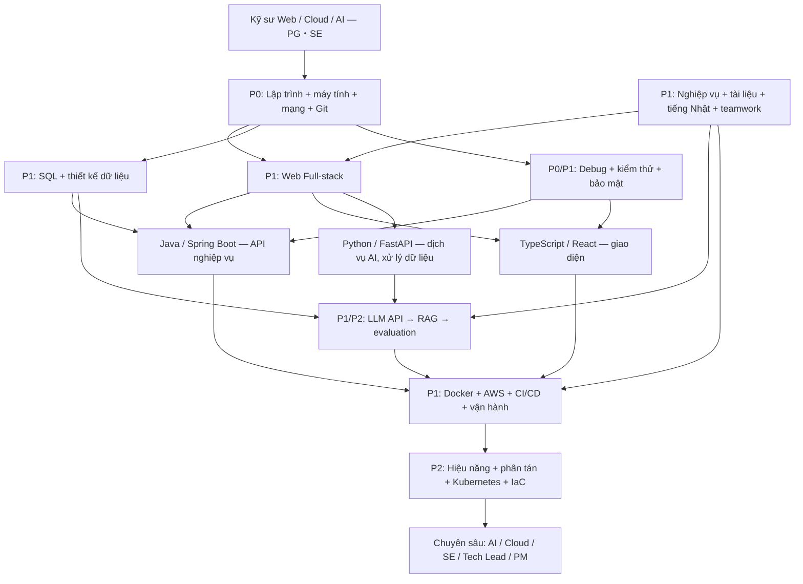
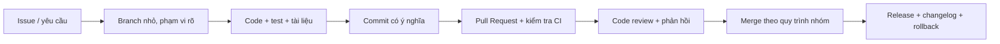
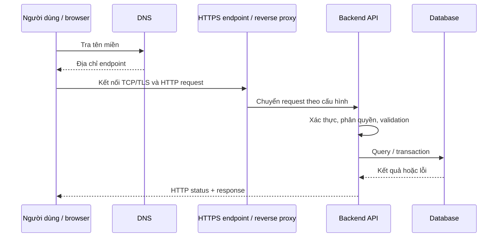
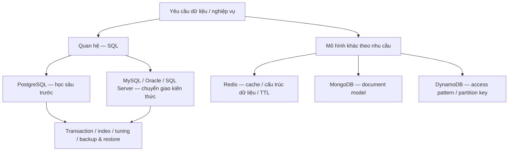
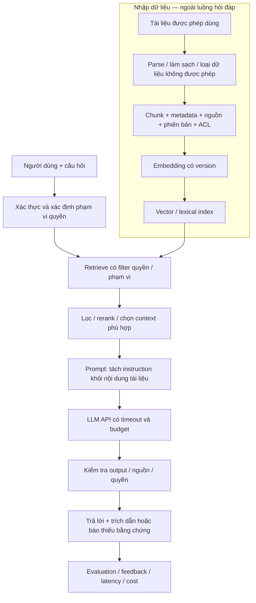
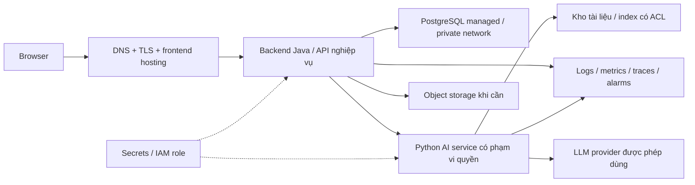
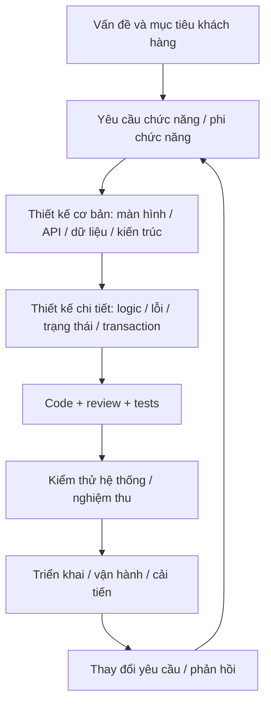
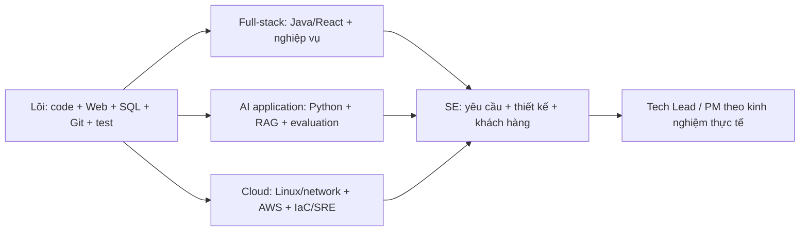
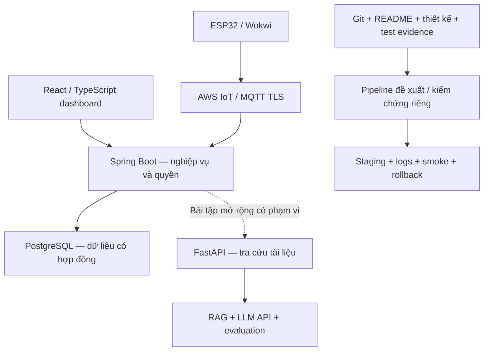

# Bản đồ kiến thức kỹ sư Web / Cloud / AI tại Nhật Bản

Cập nhật: **16/10/2026**. Nguồn định hướng: ảnh JD “Kỹ sư hệ thống Web / Hạ tầng
(PG・SE)” do người dùng cung cấp, có phát triển ứng dụng, API, AI tạo sinh,
RAG/LLM, cloud, Docker, CI/CD và làm việc với khách hàng.

Đây là **lộ trình học và tiêu chí thực hành**, không phải danh sách yêu cầu
bắt buộc nguyên văn của nhà tuyển dụng, cũng không phải xác nhận người học
đã có toàn bộ kỹ năng. Các mục bảo mật, kiểm thử, thiết kế, tiếng Nhật và vận
hành được bổ sung vì chúng giúp thực hiện tốt những công việc trong JD.

## 1. Đọc JD và chọn hướng học

| Công việc trong JD | Năng lực cần xây dựng | Bằng chứng nên có |
| --- | --- | --- |
| Lập kế hoạch, thiết kế, phát triển Web/nghiệp vụ | Hiểu yêu cầu, mô hình dữ liệu, thiết kế UI/API, lập trình và kiểm thử | Một tính năng đi từ yêu cầu → thiết kế → code → test → bàn giao |
| Backend, frontend, API bằng Python/Java/TypeScript | Một backend vững, một frontend vững, kết nối và xử lý lỗi đúng | React gọi Spring Boot; Python cung cấp một dịch vụ có mục đích rõ |
| Thử nghiệm, đánh giá, cải thiện AI/RAG/LLM | Tích hợp LLM, truy xuất tài liệu, đánh giá chất lượng, bảo vệ dữ liệu | Chatbot có nguồn trích dẫn, bộ câu hỏi đánh giá và báo cáo chi phí |
| Xây dựng/vận hành cloud, Docker, CI/CD | Linux, mạng, container, IAM, triển khai, giám sát và rollback | Môi trường staging triển khai được, có log, cảnh báo và cách phục hồi |
| Hướng phát triển AI/Cloud/upstream/PM | Giao tiếp khách hàng, phân tích nghiệp vụ, đánh đổi kỹ thuật và quản lý công việc | Tài liệu thiết kế, biên bản xác nhận, issue/PR và báo cáo tiến độ |

JD liệt kê nhiều công nghệ vì công ty có nhiều loại dự án. **Không cần học
tất cả ngôn ngữ, framework và ba cloud cùng lúc.**

Hướng phù hợp với nền Smart Farm hiện tại:

- **Trục chính:** Java → Spring Boot → PostgreSQL → TypeScript → React.
- **Cloud/DevOps:** Linux → Docker/Compose → AWS → GitHub Actions.
- **AI ứng dụng:** Python → FastAPI → LLM API → RAG → đánh giá/bảo mật.
- **Kỹ năng SE:** yêu cầu → thiết kế → kiểm thử → vận hành → giao tiếp tiếng Nhật.
- **Lợi thế bổ sung:** ESP32/C++/MQTT và xử lý dữ liệu thiết bị từ dự án IoT.

### Mức ưu tiên

| Mã | Cách học |
| --- | --- |
| P0 — Nền tảng | Học và tự thực hành trước khi mở rộng |
| P1 — Trọng tâm JD | Làm được trong một dự án hoàn chỉnh |
| P2 — Nâng cao | Học sau khi đã có sản phẩm chạy được hoặc khi dự án cần |
| P3 — Nhánh lựa chọn | Biết vị trí trong hệ sinh thái; chọn theo dự án ứng tuyển |

Không dùng số lượng framework đã đọc làm thước đo năng lực. Một stack có
thiết kế, test, bảo mật và vận hành rõ ràng có giá trị hơn nhiều demo rời rạc.

## 2. Sơ đồ tổng thể

Đọc sơ đồ theo thứ tự phụ thuộc. Bảo mật, kiểm thử và giao tiếp phải đi cùng
quá trình phát triển; không để đến cuối mới thêm vào.

## 3. Nền tảng máy tính và lập trình — P0

### 3.1. Máy tính, hệ điều hành và môi trường

| Cơ bản | Trung cấp | Nâng cao / P2 |
| --- | --- | --- |
| CPU, RAM, ổ đĩa; source code → compiler/interpreter → chương trình | Process/thread; biến môi trường; file descriptor; cổng mạng; exit code | Scheduler, context switch, profiling CPU/RAM/I/O, giới hạn tài nguyên |
| File/path, quyền đọc/ghi, UTF-8, newline, timezone | Linux permissions, user/group, signal, service, stdout/stderr | Phân tích memory leak, thread dump, core dump theo stack |
| Terminal, editor/IDE, debugger, package manager | Windows PowerShell/Git Bash và Linux Bash; shell quoting | Script idempotent, xử lý lỗi/timeout, không lộ secrets trong log |
| Cài và kiểm tra JDK, Node, Python, Docker | Version pin, virtual environment, lockfile, cấu hình dev/test | Môi trường tái lập; dependency provenance và supply-chain controls |

**Thực hành:** từ một máy mới, clone repo, cài theo README, chạy ứng dụng,
đọc log và sửa được lỗi thiếu dependency, sai PATH hoặc port đã bị chiếm.
Giải thích được lỗi ở editor khác lỗi compile, lỗi runtime và lỗi kết nối.

### 3.2. Lập trình và cấu trúc dữ liệu

- Biến, kiểu dữ liệu, điều kiện, vòng lặp, hàm, scope, module/package.
- Chuỗi Unicode, số nguyên/số thực, null/undefined/Optional và xử lý ngoại lệ.
- Array/list, stack, queue, set, map/hash table, tree, heap và graph cơ bản.
- Tìm kiếm, sắp xếp, đệ quy, duyệt cây/đồ thị; Big-O thời gian và bộ nhớ.
- OOP: encapsulation, interface, inheritance và composition; ưu tiên thiết kế
  dễ thay đổi/test, không áp dụng pattern chỉ để tăng số lớp.
- Bất biến, side effect, pure function; tách logic nghiệp vụ khỏi I/O.
- Đồng bộ/bất đồng bộ, race condition, deadlock, cancellation và timeout.
- P2: thuật toán nâng cao, tối ưu có đo lường, concurrency model theo ngôn ngữ.

**Đạt mức cơ bản khi:** tự viết một chương trình đọc file JSON/CSV, kiểm tra
dữ liệu, xử lý lỗi, thống kê kết quả và có test cho dữ liệu sai/thiếu/trùng.

### 3.3. Git và làm việc nhóm

Biết `status`, `diff`, `add`, `commit`, `log`, `fetch`, `pull`, `push`, branch,
merge và xử lý conflict. Hiểu remote khác local; working tree khác staging.
Học tiếp rebase/cherry-pick/revert khi đã hiểu lịch sử và quy tắc của nhóm.
Không ghi đè thay đổi của người khác, không commit secret, không dùng thao
tác phá hủy lịch sử dùng chung khi chưa thống nhất.

## 4. Web và mạng — P0 → P1

### 4.1. Luồng một request

Cần giải thích được:

- IP/subnet, DNS, port, TCP/UDP; private/public network; NAT và firewall cơ bản.
- HTTP method, header/body, status code; JSON, multipart, content type.
- HTTPS/TLS, certificate, CA, hostname verification; không tắt xác minh để sửa lỗi.
- Cookie/session, cache, CORS, CSRF; CORS không thay xác thực/phân quyền.
- Browser DevTools, Network tab, `curl`; phân biệt DNS, TLS, timeout,
  connection refused, 401/403, 404, 409 và 500.
- Polling, Server-Sent Events, WebSocket: chọn theo nhu cầu, không dùng
  WebSocket chỉ vì màn hình có chữ “realtime”.
- P2: proxy/load balancer, CDN, HTTP/2/3, connection pooling và backpressure.

### 4.2. Thiết kế API

- Resource/endpoint rõ ràng; OpenAPI; request/response schema và validation.
- Pagination, filtering, sorting; cursor/keyset khi phù hợp; giới hạn kết quả.
- Error response nhất quán; phân biệt lỗi input, conflict và lỗi hạ tầng.
- Authentication khác authorization; kiểm tra quyền trên từng tài nguyên.
- Idempotency cho nghiệp vụ nhạy cảm; retry không được tạo giao dịch trùng.
- Timeout, bounded retry, backoff/jitter; không retry mọi lỗi hoặc retry vô hạn.
- Versioning và tương thích ngược; hợp đồng giữa frontend/backend/service AI.
- P2: rate limit, circuit breaker, API gateway, event-driven integration.

**Bài tập:** API đăng ký thiết bị không nhận mã trùng, API danh sách có phân
trang, API gửi lệnh có request ID và API đọc kết quả khi client mất phản hồi.

## 5. Ngôn ngữ và framework theo JD

### 5.1. Java → Spring Boot — trục backend chính, P1

| Cơ bản | Làm dự án | Nâng cao / P2 |
| --- | --- | --- |
| Class/interface, generics, collection, exception, lambda/stream | Maven/Gradle; Spring DI/IoC; cấu hình theo môi trường | JVM memory, GC, profiling, thread dump |
| equals/hashCode, immutable object, date/time | REST controller, DTO, Bean Validation, exception handler | Concurrency, executor/virtual thread khi phù hợp, giới hạn tài nguyên |
| JUnit, debugger, logging | Service/repository; JDBC/JPA; transaction; Flyway/Liquibase | Locking/isolation, batch, N+1, connection pool, query tuning |
| Java I/O, HTTP client | Spring Security, session/JWT/OIDC, role/resource permission | Modulith/DDD; resilience; messaging; thiết kế phân tán |

Phải hiểu transaction bắt đầu/kết thúc ở đâu, điều gì được rollback, và
vì sao không giữ database lock qua một network call kéo dài. Phân biệt
annotation/proxy của Spring với một lời gọi Java thông thường.

**Bài tập:** Spring Boot + PostgreSQL quản lý farm/device/channel, migration,
validation, phân quyền theo farm và integration test có database riêng.

### 5.2. JavaScript → TypeScript → React — P1

- HTML semantic, form, accessibility; CSS box model, Flexbox/Grid, responsive.
- JavaScript scope, closure, object/array, module, Promise, async/await,
  event loop và xử lý lỗi.
- TypeScript type/interface, union/narrowing, generics, unknown; tránh dùng
  `any` để che dữ liệu API không hợp lệ. Type không tự validate JSON runtime.
- React component, props/state, hook, effect/cleanup, key và controlled form.
- Routing, API client, loading/empty/error states, validation và permission UI.
- Hủy request hoặc kiểm tra version để phản hồi cũ không ghi đè màn hình mới.
- Quản lý state local/server; pagination/filter; chỉ thêm thư viện state khi cần.
- a11y, bàn phím, i18n/tiếng Nhật, timezone, định dạng số/ngày.
- Testing Library/Playwright; test hành vi người dùng, không chỉ snapshot markup.
- P2: render performance, code splitting, SSR/SSG, cache và Next.js.

**Bài tập:** dashboard thiết bị có filter, form thêm mới, trạng thái stale,
API lỗi, history/CSV và kiểm thử thao tác trên trình duyệt.

### 5.3. Python → FastAPI — P1 cho công cụ và AI

- Kiểu dữ liệu, function/module, comprehension, exception, context manager.
- Type hint, dataclass/Pydantic, package, virtual environment, dependency pin.
- File/JSON/CSV, HTTP client, SQL, logging, configuration và pytest.
- FastAPI routing, schema/validation, dependency, auth và error handling.
- Async I/O khác xử lý CPU-heavy; chọn thread/process/job worker đúng chỗ.
- API timeout/cancellation, retry có giới hạn, streaming và background task.
- P2: queue/worker, profiling, data pipeline, batch ingestion và evaluation jobs.

**Bài tập:** service nhận câu hỏi, kiểm tra input, gọi LLM bằng credential
server-side, trả câu trả lời có request ID và xử lý timeout/rate limit.

### 5.4. Các nhánh lựa chọn P3 trong JD

| Hệ sinh thái | Khi nên học sâu | Kiến thức tương ứng |
| --- | --- | --- |
| Go | Backend/network service của dự án dùng Go | Module, interface, goroutine/channel, context/cancellation, HTTP/test |
| C#/.NET | Hệ thống doanh nghiệp dùng Microsoft stack | C#, LINQ, ASP.NET Core, EF Core, async/await, DI/test |
| Ruby | Dự án nghiệp vụ dùng Ruby | Ruby idiom, framework dự án, ORM, test và bảo trì |
| PHP/Laravel | Dự án Web dùng Laravel | PHP là nền tảng của Laravel; routing, Eloquent, queue, auth/test |
| Python/Django | Ứng dụng nghiệp vụ/admin cần Django | ORM, migration, admin, auth, security; API khi cần |
| Vue.js | Frontend dự án dùng Vue | Component, reactivity, routing, state và TypeScript |
| Next.js | React cần server rendering hoặc full-stack framework | Server/client boundary, routing, cache, auth, deployment |
| C/C++ | IoT/embedded/native hoặc hệ thống cần hiệu năng | Memory/pointer/RAII, build, concurrency; GPIO/protocol theo thiết bị |
| Swift / Kotlin | iOS / Android native | Lifecycle, state, network, persistence, permission và UI testing |
| Flutter | Mobile đa nền tảng | Dart, widget/state, navigation, platform integration và build/release |

Danh sách trong ảnh không có nghĩa phải thành thạo mọi nhánh trước khi ứng
tuyển. Học sâu Java/React/Python trước, rồi bổ sung theo mô tả dự án cụ thể.

## 6. Database và thiết kế dữ liệu — P0 → P2

### SQL và PostgreSQL trước

- Table, type, primary/foreign key, unique/check/not-null, normalization.
- SELECT, JOIN, GROUP BY, subquery, CTE; window function khi cần.
- INSERT/UPDATE/DELETE; parameterized query; SQL injection prevention.
- Transaction, ACID, isolation, MVCC, optimistic/pessimistic lock, deadlock.
- Index và chi phí ghi; đọc EXPLAIN/EXPLAIN ANALYZE trên môi trường phù hợp.
- Migration, seed test tách dữ liệu thật, backward-compatible schema change.
- Connection pool, pagination, tránh N+1 và query lấy dữ liệu không giới hạn.
- Decimal cho tiền và lựa chọn type theo nghiệp vụ; lưu UTC, hiển thị timezone.
- Backup **và thử restore**, retention; xác định RPO/RTO theo yêu cầu.

### Học thêm theo nhu cầu

| Công nghệ | Cần hiểu | Tránh hiểu sai |
| --- | --- | --- |
| MySQL, Oracle, SQL Server | Khác biệt dialect, transaction, index, migration, tooling | Không mặc định mọi SQL chạy giống PostgreSQL |
| Redis | TTL, eviction, cache-aside, invalidation, atomic operation | Cache không tự là nguồn dữ liệu bền vững |
| MongoDB | Document/schema validation, embed/reference, index, consistency | Không có schema cứng không có nghĩa dữ liệu không cần hợp đồng |
| DynamoDB | Access pattern trước, partition/sort key, GSI, capacity/cost | Không thiết kế bằng cách chuyển nguyên JOIN sang NoSQL |
| Vector index / pgvector | Embedding dimension, similarity, filter, index/evaluation | Vector search không tự thay auth hoặc SQL nghiệp vụ |

P2: partitioning, replication, read replica, CDC, outbox và data warehouse.
Chỉ chọn khi có bài toán tải/độ sẵn sàng cụ thể, không thêm vào demo để đủ tên.

## 7. AI tạo sinh, LLM API và RAG — P1 → P2

### 7.1. Kiến thức cần phân biệt

| Khái niệm | Cần biết |
| --- | --- |
| AI / ML / Deep Learning / GenAI | Phạm vi khác nhau; tích hợp model không đồng nghĩa tự huấn luyện model |
| LLM | Token, context window, model/version, hallucination, nondeterminism |
| Prompt | Instruction, context, output schema, ví dụ và giới hạn; prompt không phải rào bảo mật |
| LLM API | Auth server-side, quota, timeout, streaming, structured output, tool calling |
| Embedding | Biểu diễn vector, similarity, model/version/dimension |
| RAG | Truy xuất nguồn phù hợp rồi đưa vào context để sinh câu trả lời |
| Fine-tuning | Thay đổi hành vi model theo dữ liệu huấn luyện; không thay thế kho kiến thức cập nhật |
| Agent | LLM chọn bước/tool; cần phạm vi quyền, giới hạn vòng lặp và kiểm tra kết quả |

Không cần tự huấn luyện LLM từ đầu để làm AI ứng dụng trong JD. Nền toán
hữu ích: xác suất/thống kê cơ bản, vector, cosine similarity, precision/recall.

### 7.2. Sơ đồ RAG hoàn chỉnh

### 7.3. Thứ tự học và thực hành

1. Gọi một LLM API từ backend; giữ key ngoài code/frontend; xử lý timeout.
2. Yêu cầu structured output, validate schema và xử lý kết quả sai format.
3. Đọc tài liệu, chia chunk, lưu metadata/source/version và tạo embedding.
4. Tìm kiếm cơ bản; đo xem tài liệu đúng có được retrieve hay không.
5. Thêm context và citation, cho phép trả lời “chưa có đủ thông tin”.
6. Lọc theo user/farm/tenant/quyền; không đưa tài liệu ngoài quyền vào context.
7. Tạo bộ câu hỏi đánh giá, có câu không có đáp án và câu cố vượt quyền.
8. Sau baseline mới thử hybrid search/rerank, chunking khác, cache hoặc agent.

### 7.4. Đánh giá, bảo mật và chi phí

- Tách **retrieval quality** khỏi **answer quality**: lấy đúng nguồn chưa bảo
  đảm trả lời đúng; câu trả lời hay chưa bảo đảm có nguồn đúng.
- Dataset có câu hỏi/nguồn kỳ vọng/tiêu chí; lưu version prompt/model/index.
- Đo recall@k hoặc hit-rate có định nghĩa; kiểm tra citation, factuality,
  completeness, refusal, latency và chi phí mỗi yêu cầu.
- Có human review; LLM-as-judge chỉ là một tín hiệu, cần kiểm tra thiên lệch.
- Thử prompt injection trong câu hỏi/tài liệu, data leakage, tool misuse,
  truy cập chéo tenant và câu hỏi không có nguồn.
- Không log nguyên secrets/PII; kiểm tra chính sách dữ liệu của nhà cung cấp,
  retention và điều kiện dùng dữ liệu nội bộ trước khi gửi ra ngoài.
- Giới hạn token, kích thước tài liệu, số tool call, thời gian, concurrency
  và chi phí; có fallback khi model/rate limit/API hỏng.
- Với thao tác có tác động: backend kiểm quyền và validation độc lập;
  dùng bước duyệt phù hợp. Không để text do LLM sinh thành lệnh SQL/shell
  hoặc lệnh bơm trực tiếp.

**Bài tập portfolio:** trợ lý tra cứu tài liệu Smart Farm có citation và
phân quyền, giải thích trạng thái lịch sử bằng nguồn đã lưu. Đây là ý tưởng
thực hành tiếp theo, **không phải chức năng AI đã được xác nhận của repo**.

## 8. Cloud và hạ tầng — học AWS trước, P1

### 8.1. Nền tảng chung

- Region/AZ; account/project/subscription; trách nhiệm của khách hàng và cloud.
- IAM, role, least privilege, MFA, temporary credential; không dùng root cho app.
- VPC/VNet, subnet, routing, security group/firewall, public/private endpoint.
- Compute, object storage, relational DB, cache, queue, load balancer, DNS/TLS.
- VM, container, managed service, serverless: chọn theo tải và vận hành;
  serverless vẫn có tài nguyên do nhà cung cấp quản lý.
- Log/metric/trace, audit log, alarm, backup/restore và quản lý chi phí.
- P2: multi-AZ, autoscale, disaster recovery, IaC và network troubleshooting.

### 8.2. Ánh xạ ba cloud trong JD

Các dịch vụ dưới đây cùng nhóm chức năng, **không tương đương hoàn toàn**
về tính năng, cách vận hành, bảo mật hoặc giá.

| Nhóm | AWS nên học trước | Azure để đối chiếu | GCP để đối chiếu |
| --- | --- | --- | --- |
| Identity | IAM, role, STS | Entra ID, managed identity, Azure RBAC | IAM, service account |
| Network | VPC, subnet, route, security group | VNet, subnet, NSG | VPC, subnet, firewall |
| VM | EC2 | Virtual Machines | Compute Engine |
| Object storage | S3 | Blob Storage | Cloud Storage |
| Managed PostgreSQL | RDS/Aurora PostgreSQL | Azure Database for PostgreSQL | Cloud SQL / AlloyDB |
| Container image/runtime | ECR, ECS/Fargate; EKS khi cần | ACR, Container Apps; AKS khi cần | Artifact Registry, Cloud Run; GKE khi cần |
| Serverless function | Lambda | Functions | Cloud Run functions |
| Secrets | Secrets Manager, Parameter Store | Key Vault | Secret Manager |
| Observability | CloudWatch, CloudTrail | Azure Monitor, Activity Log | Cloud Monitoring, Cloud Logging, Audit Logs |

**AWS + IoT bổ sung cho dự án hiện tại:** IoT Core, Thing, certificate,
device policy khác IAM policy, endpoint/region, TLS, MQTT topic và log.
Chứng chỉ riêng theo thiết bị, không mở wildcard quyền chỉ để hết lỗi.

### 8.3. Kiến trúc triển khai tham khảo

Đây là kiến trúc đích tham khảo, không xác nhận hệ thống hiện đã triển khai
toàn bộ lên production. Chọn VM/container/managed service sau khi cân nhắc
chi phí, tải, thời gian và năng lực vận hành.

## 9. Docker, CI/CD, IaC và Kubernetes

### 9.1. Docker / Compose — P1

- Image khác container; Dockerfile, build context, `.dockerignore`, layer/cache.
- Multi-stage build; version/digest; dependency pin; non-root khi phù hợp.
- Port publish, bind address, network, environment, volume và health check.
- Database volume cần backup; xóa container không tương đương xóa dữ liệu,
  nhưng thao tác volume có thể làm mất dữ liệu.
- Compose để chạy app + PostgreSQL + service phụ trong dev/test.
- Secret không được bake vào image hoặc đưa vào build log.
- Resource limit, graceful shutdown và log stdout/stderr.

**Bài tập:** một người khác chạy được stack từ README mà không cần sửa code;
có dữ liệu lưu bền và biết cách backup/restore đúng volume/database.

### 9.2. CI/CD — P1

```mermaid
flowchart LR
    Push["Push / Pull Request"] --> Static["Lint + typecheck + secret/security checks"]
    Static --> Test["Unit + integration + contract / browser theo phạm vi"]
    Test --> Build["Build artifact / container một lần"]
    Build --> Registry["Versioned artifact / image registry"]
    Registry --> Stage["Deploy staging + migration có kiểm soát"]
    Stage --> Smoke["Smoke test + quan sát"]
    Smoke --> Approve["Release approval theo quy trình"]
    Approve --> Prod["Deploy production"]
    Prod --> Observe["Monitor + rollback / recovery plan"]
```

Học GitHub Actions trước: workflow/job/step, runner, trigger, artifact/cache,
environment, permissions, concurrency và secret handling. Ưu tiên workload
identity/OIDC cho cloud khi hỗ trợ thay cho access key lâu dài trong CI.
Hiểu Jenkins pipeline để đọc/bảo trì dự án sử dụng Jenkins; không cần triển
khai hai hệ CI cho cùng bài tập.

Rollback code không tự rollback dữ liệu. Migration cần kế hoạch tương thích
ngược, backup/restore và chiến lược expand-contract khi phù hợp.

### 9.3. IaC và Kubernetes — P2

IaC: Terraform hoặc công cụ tương ứng; plan/apply, state, drift, module,
review, secret và cách tránh phá tài nguyên đang chạy. Bắt đầu từ môi trường
thử riêng, không dùng `apply/destroy` như lệnh sửa lỗi chung.

Kubernetes: Pod, Deployment, Service, Ingress, ConfigMap, Secret, namespace,
readiness/liveness/startup probe, resource request/limit, rollout/rollback,
RBAC và network policy. Secret dạng base64 không đồng nghĩa đã mã hóa an toàn.
Sau đó mới học Helm, autoscaling và GitOps nếu dự án yêu cầu.

**Mốc học:** chạy/vận hành Docker và một dịch vụ cloud vững trước khi học
quản trị cluster nâng cao. Kubernetes không phải điều kiện để mọi junior
Web developer bắt đầu ứng tuyển.

## 10. Chất lượng, bảo mật và vận hành — xuyên suốt

### 10.1. Kiểm thử và debug

| Tầng | Kiểm tra điều gì | Ví dụ |
| --- | --- | --- |
| Unit | Logic tách biệt | Validation, tính trạng thái, tính giá, parser |
| Integration | Thành phần kết hợp thật | API/service với PostgreSQL, transaction, migration |
| Contract | Producer/consumer có cùng hợp đồng | JSON schema, OpenAPI, MQTT payload |
| Browser/E2E | Luồng người dùng | Đăng nhập, tạo thiết bị, filter, lỗi API, quyền truy cập |
| Performance | Mức đáp ứng dưới tải định nghĩa | Latency, throughput, DB pool, memory |
| Resilience | Lỗi/gián đoạn | Timeout, retry, mất mạng, restart, duplicate, ACK muộn |
| AI evaluation | Chất lượng và quyền truy xuất | Tìm đúng nguồn, trả lời đúng, citation, refusal, cost |

Tách test fixture/mock khỏi kết nối thật; “build thành công” không chứng
minh production chạy được. Ghi rõ test đã chạy, skip, chưa chạy và giới hạn
của từng loại bằng chứng. Coverage chỉ là một chỉ số, không phải bảo đảm đúng.

Debug theo lớp: tái hiện → đọc lỗi gốc → giả thuyết → kiểm tra nhỏ → sửa →
chạy kiểm tra phù hợp. Dùng correlation/request ID, breakpoint và DB query
có phạm vi. Không sửa bằng cách tắt test, bỏ TLS hoặc nới quyền vô hạn.

### 10.2. Bảo mật

- Threat modeling cơ bản: ai truy cập gì, ranh giới tin cậy và tác động sai.
- OWASP: injection, XSS, CSRF, SSRF, broken access control, dependency risk.
- Password hashing phù hợp; session lifecycle; OAuth2/OIDC; JWT có chữ ký
  không mặc định mã hóa nội dung.
- RBAC/ABAC, kiểm tra ownership/farm/tenant ở backend, không chỉ ẩn nút UI.
- Secret manager/credential rotation; không ghi key/token vào Git, CSV hoặc log.
- TLS, encryption at rest theo yêu cầu; log redaction và bảo vệ dữ liệu cá nhân.
- Phân biệt giấy phép nguồn mở, quyền dùng dữ liệu và điều kiện dùng API/LLM.
- Test dữ liệu giả, môi trường tách biệt; không dùng thông tin khách hàng tùy tiện.

### 10.3. Vận hành và hiệu năng

- Health/readiness khác nhau; log/metric/trace; dashboard có câu hỏi vận hành rõ.
- Latency percentile, error rate, availability; SLI/SLO theo mục tiêu nghiệp vụ.
- Incident: phát hiện → giảm tác động → phục hồi → phân tích nguyên nhân → phòng ngừa.
- Runbook, on-call/escalation theo nhóm; postmortem tập trung hệ thống.
- Đo trước khi tối ưu: SQL, network call, serialization, render, memory.
- Quota, budget alert, retention log, tài nguyên bỏ quên; **budget alert không
  phải giới hạn cứng tự dừng mọi chi phí cloud**.
- Backup/restore drill, rollback drill; RPO/RTO được thống nhất với nghiệp vụ.

## 11. Thiết kế hệ thống và nghiệp vụ — từ PG lên SE

- **PG:** hiểu thiết kế, thực hiện tính năng, test, debug, báo cáo đúng tiến độ.
- **SE:** làm rõ yêu cầu, thiết kế/đánh đổi, phối hợp hệ thống và xác nhận với khách hàng.
- Cách phân công PG/SE thực tế tùy công ty/dự án; đây là hướng năng lực, không
  phải định nghĩa chức danh cố định cho mọi nơi.

Tài liệu cần biết viết/đọc:

1. Problem statement, phạm vi, stakeholder, use case/user story và acceptance criteria.
2. Yêu cầu phi chức năng: tải, bảo mật, availability, chi phí, retention, audit.
3. Wireframe/screen flow; ERD; API specification; sequence/state/deployment diagram.
4. Business rule, validation, trạng thái lỗi và quy trình khôi phục.
5. Test case/test evidence; issue/bug report; release/rollback/runbook.
6. ADR: quyết định, lựa chọn đã cân nhắc, lý do và hệ quả.
7. Estimate theo giả định, chia task, theo dõi risk/dependency và change request.

P2: modular architecture, DDD, CQRS, messaging/outbox, event ordering,
idempotency, eventual consistency và hệ thống phân tán. Microservice chỉ
hữu ích khi có ranh giới và nhu cầu rõ; monolith có module là lựa chọn hợp lệ.

### Hướng Tech Lead / PM — P2, phát triển qua dự án thực tế

- Chia phạm vi thành WBS/task có đầu ra và acceptance criteria; ước lượng
  dựa trên giả định, dependency, năng lực nhóm và phần chưa biết.
- Quản lý tiến độ, resource, cost, quality và risk; nhận ra đường găng khi
  có nhiều hạng mục phụ thuộc, không chỉ đếm số ticket đã đóng.
- Phân biệt risk có thể xảy ra với issue đã xảy ra; ghi owner, tác động,
  biện pháp và mốc cần quyết định.
- Quản lý thay đổi phạm vi và tác động lên thời gian/chi phí; xác nhận lại
  với stakeholder, không tự nhận mọi yêu cầu mới là “thay đổi nhỏ”.
- Điều phối review, bàn giao, release và vận hành; báo cáo bằng bằng chứng.
- Luyện phản hồi, mentoring, xử lý bất đồng và escalation phù hợp; vai trò
  lead/PM không chỉ là viết nhiều code hoặc dùng một công cụ quản lý dự án.

## 12. Tiếng Nhật và giao tiếp kỹ sư

JD có dự án làm việc trực tiếp với khách hàng, vì vậy đọc hiểu yêu cầu và
báo cáo vấn đề quan trọng cùng kỹ năng code. Ảnh cung cấp **không nêu cấp
JLPT bắt buộc**; cần xác nhận riêng với đơn vị tuyển dụng. Không tự suy ra
N2/N3 là điều kiện đã được công ty công bố.

### Kỹ năng thực hành

- Tự giới thiệu và giải thích dự án: mục tiêu, vai trò, stack, vấn đề và kết quả.
- Đọc ticket/spec; hỏi lại thuật ngữ, phạm vi, deadline và tiêu chí hoàn thành.
- Họp: nghe, ghi ý chính, xác nhận hiểu đúng, nêu điểm chưa rõ.
- 報連相 — báo cáo, liên lạc, trao đổi; báo sớm rủi ro thay vì chờ hết deadline.
- Viết bug report: hiện tượng, bước tái hiện, kỳ vọng/thực tế, log và ảnh có phạm vi.
- Báo cáo: đã làm gì, bằng chứng, vấn đề, tác động, kế hoạch và điểm cần quyết định.
- Không khẳng định chắc chắn khi chưa kiểm tra; tách “đã xác nhận” khỏi “giả thuyết”.

### Từ vựng để học cùng dự án

| Nhật | Cách đọc | Nghĩa trong công việc |
| --- | --- | --- |
| 要件定義 | ようけんていぎ | Xác định yêu cầu |
| 基本設計 | きほんせっけい | Thiết kế cơ bản |
| 詳細設計 | しょうさいせっけい | Thiết kế chi tiết |
| 実装 | じっそう | Triển khai bằng code |
| 単体テスト | たんたいテスト | Unit test |
| 結合テスト | けつごうテスト | Integration test |
| 仕様 | しよう | Đặc tả |
| 不具合 | ふぐあい | Lỗi phần mềm |
| 障害 | しょうがい | Sự cố |
| 調査 | ちょうさ | Điều tra/phân tích |
| 再現手順 | さいげんてじゅん | Bước tái hiện |
| 原因・対策 | げんいん・たいさく | Nguyên nhân/biện pháp |
| 進捗 | しんちょく | Tiến độ |
| 見積もり | みつもり | Ước lượng |
| 課題 | かだい | Vấn đề cần giải quyết |
| 運用・保守 | うんよう・ほしゅ | Vận hành/bảo trì |
| 認証・認可 | にんしょう・にんか | Xác thực/phân quyền |

**Bài tập:** thuyết trình Smart Farm 3–5 phút bằng tiếng Nhật; viết một bug
report và một báo cáo tiến độ ngắn. Đánh giá theo khả năng truyền đạt đúng,
không chỉ số chứng chỉ hoặc số từ đã học.

## 13. Lộ trình từ cơ bản đến nâng cao

Các giai đoạn là mốc năng lực, không phải cam kết số tuần hoặc bảo đảm được
tuyển. Nếu đã làm được phần nào, dùng bài kiểm tra thực hành để bỏ qua phần đó.

| Giai đoạn | Trọng tâm | Sản phẩm đầu ra | Điều kiện chuyển bước |
| --- | --- | --- | --- |
| G0 — Môi trường | Terminal, Git, IDE, Linux cơ bản, runtime | README cài/chạy, script có xử lý lỗi | Tự chạy và debug lỗi môi trường thường gặp |
| G1 — Lập trình | Java, JS/TS, Python cơ bản, DS/Big-O | CLI đọc/validate JSON/CSV có test | Giải thích được code và tự thêm yêu cầu mới |
| G2 — Web + dữ liệu | HTTP, SQL, Spring Boot, React | CRUD full-stack có migration, validation, error UI | Luồng chạy từ browser đến DB, không cần sửa tay dữ liệu |
| G3 — Chất lượng + bảo mật | Auth, phân quyền, transaction, tests | User/farm permission, integration/browser tests | Không truy cập chéo dữ liệu; lỗi có kiểm thử |
| G4 — Cloud + CI/CD | Docker, AWS, pipeline, quan sát | Staging, smoke test, backup/restore, rollback plan | Người khác triển khai theo hướng dẫn được |
| G5 — AI ứng dụng | FastAPI, LLM API, RAG, evaluation | Chatbot tra cứu có citation, ACL, bộ đánh giá | Có baseline chất lượng/latency/cost và ca từ chối |
| G6 — SE + chuyên sâu | Yêu cầu, thiết kế, performance, kiến trúc | Feature từ spec đến release, tài liệu/ADR/báo cáo Nhật | Tự giải thích quyết định và xử lý thay đổi/lỗi |

Tiếng Nhật, Git, test và bảo mật đi xuyên các giai đoạn. Không cần đợi G6
mới luyện giao tiếp hoặc viết tài liệu.

### Chọn nhánh sau phần lõi

## 14. Dùng Smart Farm làm bài thực hành tổng hợp

Tách rõ nền dự án hiện có và ý tưởng học tiếp. Xem trạng thái kiểm chứng ở
[bảng nghiệm thu](../book/ACCEPTANCE_STATUS.md); không lấy roadmap làm bằng
chứng đã triển khai production hoặc AI.

| Năng lực | Bài thực hành gắn Smart Farm | Cần chứng minh |
| --- | --- | --- |
| Backend/API/SQL | Device/channel/zone, telemetry, cảnh báo, history | Schema, transaction, validation, API/test |
| Frontend | Dashboard, form, filter, CSV, trạng thái stale | Không nhầm lỗi/thiếu dữ liệu với giá trị 0/false |
| Python | Helper cấu hình, validation, công cụ kiểm tra | Idempotency/phục hồi, error handling, test và không lộ key |
| IoT/distributed | ESP32/Wokwi, MQTT/TLS, ACK/status, timeout | Broker nhận khác thiết bị thực thi; không phát lại lệnh cũ |
| Cloud | AWS IoT và môi trường staging độc lập | IAM/device policy, TLS, monitoring, giới hạn chi phí |
| DevOps — học tiếp theo phạm vi thực tế | Pipeline build/test/deploy staging | Artifact/version, quyền CI, smoke và recovery |
| AI/RAG — bài tập mở rộng, chưa coi đã có | Tra cứu tài liệu vận hành theo quyền | Citation, evaluation, unknown/refusal; không tự điều khiển bơm |
| SE/tiếng Nhật | Viết thiết kế và trình bày một tính năng | Yêu cầu, sơ đồ, ca lỗi, kết quả test và giới hạn |

### Sơ đồ sản phẩm portfolio đề xuất

Nét đứt và các nhãn “đề xuất” là phần học mở rộng; sơ đồ không xác nhận
repo hiện đã có service AI hoặc pipeline deploy production.

## 15. Tự đánh giá và chuẩn bị phỏng vấn

### Thang đánh giá

| Mức | Ý nghĩa |
| --- | --- |
| 0 | Chưa học/chưa thực hành |
| 1 | Giải thích được khái niệm và ví dụ nhỏ |
| 2 | Làm theo hướng dẫn, debug lỗi thường gặp |
| 3 | Tự thiết kế và hoàn thành tính năng có test/tài liệu |
| 4 | Phân tích đánh đổi, xử lý sự cố và review/hướng dẫn người khác |

Tự chấm riêng Java, TS/React, SQL, Python, cloud, CI/CD, AI/RAG, security,
testing và tiếng Nhật. Điền link code/test/thiết kế cho mỗi điểm tự chấm;
không để công cụ tự suy ra mức thành thạo chỉ vì có package trong repo.

### Checklist hồ sơ

- [ ] Có một dự án chạy được với hướng dẫn cài/chạy rõ.
- [ ] Giải thích được kiến trúc và luồng dữ liệu mà không đọc nguyên source.
- [ ] Trình bày được một API, một query/index và một transaction cụ thể.
- [ ] Phân biệt auth/permission, dữ liệu cũ/dữ liệu mới, ACK/status và retry/idempotency.
- [ ] Có test cho lỗi, không chỉ happy path; nêu rõ mock/local/live.
- [ ] Có tài liệu triển khai, chi phí, backup/restore và giới hạn nếu đã triển khai.
- [ ] Nếu ghi AI/RAG trong CV: có demo, citation, bộ đánh giá và bảo vệ quyền dữ liệu.
- [ ] Nếu ghi CI/CD/cloud trong CV: nêu đúng pipeline/môi trường thực sự đã làm.
- [ ] Phân biệt PoC, staging, production; không dùng kết quả mô phỏng để nhận là phần cứng thật.
- [ ] Có thể trình bày dự án, bug và tiến độ bằng tiếng Nhật ở mức công việc cần.

### Câu hỏi nên tự trả lời được

1. Một request từ React đến PostgreSQL đi qua những bước nào?
2. Vì sao hệ thống cần cả validation trong code và constraint trong DB?
3. Hai người cùng sửa một bản ghi thì xử lý thế nào?
4. Mất phản hồi sau khi POST có nghĩa yêu cầu thất bại không? Làm sao tránh tạo trùng?
5. Vì sao không để API key trong frontend hoặc image Docker?
6. Làm sao chứng minh query chậm vì DB thay vì network hoặc frontend?
7. Khi deploy lỗi, code rollback được nhưng dữ liệu đã migration thì sao?
8. RAG khác fine-tuning ở đâu? Làm sao đo chatbot tốt hơn sau một thay đổi?
9. Tài liệu có instruction độc hại hoặc user hỏi dữ liệu ngoài quyền thì xử lý thế nào?
10. Trong Smart Farm, bạn đã kiểm chứng phần nào và phần nào chỉ là kế hoạch?

## 16. Nguồn học chính thức để tra cứu

Ưu tiên tài liệu theo version đang dùng và một bài tập xuyên suốt. Không
cần đọc hết các nguồn bên dưới trước khi viết code.

- [MDN Web Docs](https://developer.mozilla.org/): HTML/CSS/JavaScript/HTTP.
- [TypeScript Handbook](https://www.typescriptlang.org/docs/handbook/intro.html).
- [React Learn](https://react.dev/learn).
- [Java Learn](https://dev.java/learn/) và [Spring Guides](https://spring.io/guides).
- [Python Tutorial](https://docs.python.org/3/tutorial/) và [FastAPI](https://fastapi.tiangolo.com/).
- [PostgreSQL Documentation](https://www.postgresql.org/docs/).
- [Git Book](https://git-scm.com/book/en/v2).
- [Docker Documentation](https://docs.docker.com/) và [GitHub Actions](https://docs.github.com/en/actions).
- [AWS Documentation](https://docs.aws.amazon.com/), [Microsoft Learn](https://learn.microsoft.com/), [Google Cloud Documentation](https://cloud.google.com/docs).
- [Kubernetes Concepts](https://kubernetes.io/docs/concepts/).
- [OWASP Top 10](https://owasp.org/www-project-top-ten/) và [OWASP GenAI Security](https://genai.owasp.org/).
- [OpenTelemetry](https://opentelemetry.io/docs/) và [OpenAPI Specification](https://spec.openapis.org/oas/latest.html).
- Tài liệu API/model của nhà cung cấp LLM được dự án cho phép dùng; kiểm tra
  riêng giới hạn, giá, retention và điều khoản dữ liệu tại thời điểm tích hợp.

Các liên kết ngoài là điểm bắt đầu tra cứu, không phải xác nhận đã học hoặc
đã triển khai những công nghệ đó trong dự án.
