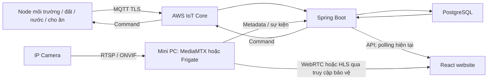
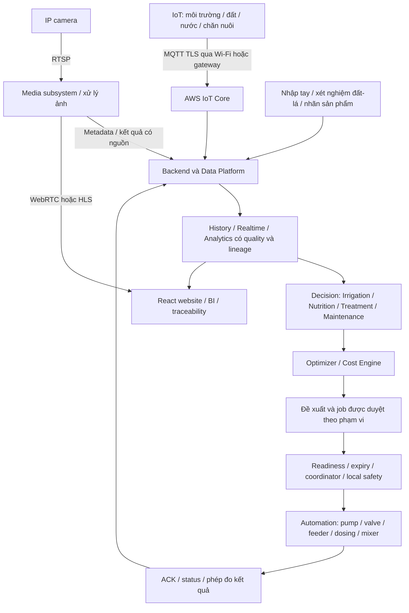

# Ý tưởng và lộ trình thiết bị IoT nông nghiệp

Cập nhật: 14/10/2026. Nguồn: hai bản ý tưởng người dùng gửi về các node
nông nghiệp và roadmap hợp nhất Monitoring/Nutrition & Treatment/Optimization.
Mốc nền relay/phao: `9730558`; nền node/kênh v2: `705094f`, xem
[báo cáo A1](../implementation/NODE_CHANNELS_REPORT.md).
**Đây là kiến trúc đích và backlog. Code/tests A1 và A2 monitoring đã có; các node mới,
Decision Engine, dinh dưỡng, tối ưu và AI chưa được nghiệm thu hoạt động.**
Trạng thái kiểm chứng đọc tại [bảng nghiệm thu](../book/ACCEPTANCE_STATUS.md).

## 1. Tầm nhìn và master plan hợp nhất

Trục phát triển:

**Smart Farm Monitoring → Precision Agriculture → Decision Support →
Automated Optimization → AI-assisted Farm Management.**

Vòng lặp mục tiêu: **Sense → Collect → Understand → Decide → Optimize →
Act → Verify → Learn**. Dữ liệu và kết quả thực hiện được nối với cùng cây,
dãy, zone, đợt chăm sóc và thiết bị; tránh tạo các tính năng rời rạc không có
nguồn dữ liệu hoặc feedback chung.

Một node vật lý có thể có nhiều cảm biến/actuator logic. Không bắt buộc mỗi
đầu đo có một ESP32; không xem mỗi actuator là một node vật lý riêng.

Bài toán thiết kế: **100 cây dừa, 4 dãy, khoảng 25 cây/dãy**. Đây chưa phải
số cây/vị trí đã lưu trong database hoặc số bộ thiết bị đã lắp. Dùng 3 điểm
đất đầu–giữa–cuối mỗi dãy để thử; độ sâu, vị trí và mật độ phải được khảo sát.

### 1.1. Tám phase triển khai

| Phase | Mục tiêu | Năng lực chính | Điều kiện chuyển bước |
|---|---|---|---|
| Phase 1 — Foundation | Có mô hình trang trại và dữ liệu nguồn đáng tin | Digital Twin dữ liệu thật, cây/dãy/zone, device/channel/actuator, MQTT/AWS, telemetry | Danh tính/mapping đúng, v1/v2 tương thích, phân biệt dữ liệu đo/nhập tay/ước tính |
| Phase 2 — Core Automation | Tưới và điều khiển có phản hồi | Soil → Water → Irrigation → Pump/Valve → Alerts; feeder/drinking/barn theo nhu cầu | Fault tests, nguồn đo đã hiệu chuẩn, quyền điều phối bơm, an toàn cục bộ và nghiệm thu live |
| Phase 3 — Nutrition | Quản lý dinh dưỡng và tính công thức có cơ sở | pH/EC, soil/lab/leaf records, crop requirements, fertilizer catalog, recipe/calculator, hồ sơ BVTV | Đơn vị/cơ sở dinh dưỡng nhất quán, thông tin sản phẩm và nguồn khuyến nghị có phiên bản |
| Phase 4 — Optimization | Tối ưu phân và chi phí có ràng buộc | Nutrition Optimizer, Farm Cost Engine, giá/tồn kho, phương án thay thế | Dữ liệu đầu vào kiểm chứng, nghiệm khả thi, không bỏ giới hạn để có kết quả rẻ |
| Phase 5 — Closed Loop | Fertigation theo feedback được kiểm soát | Dosing pump → mixing → settle → pH/EC feedback → irrigation | Hiệu chuẩn bơm/cảm biến, giới hạn tổng liều/thời gian, E-stop, job đã duyệt và xử lý lỗi |
| Phase 6 — Intelligence | Đề xuất dự báo và phát hiện bất thường | Predictive irrigation/maintenance, camera AI | Có dataset/baseline, đánh giá sai số và độ tin cậy, không biến prediction thành command trực tiếp |
| Phase 7 — Farm Intelligence | Đánh giá hiệu quả và truy xuất | Yield prediction, cost/kg, traceability/QR, BI | Yield/cost/batch có nguồn, phân bổ chi phí rõ ràng, dự báo tách số thực thu |
| Phase 8 — Scale | Mở rộng phủ sóng, nguồn và nền tảng thực địa | LoRa → solar/battery → edge processing → drone/robot | Khảo sát điện/mạng, offline recovery, dữ liệu và Decision Engine đủ ổn định; robot/drone sau cùng |

Phase là các gói năng lực, không phải 8 sprint hoặc cam kết thời gian. Thu
thập lịch sử chăm sóc/chi phí/traceability phải bắt đầu sớm, không đợi Phase 7.
Có thể đưa LoRa/solar lên sớm nếu khảo sát phủ sóng yêu cầu; không vì vậy đưa
robot lên trước. Predictive/camera cần dữ liệu phù hợp, không bắt buộc chờ mọi
chức năng fertigation hoàn tất. Chăn nuôi là nhánh nghiệp vụ được giữ lại,
không phải điều kiện bắt buộc trước khi bắt đầu dinh dưỡng cây.

Các mã A0–A6 ở mục 10 là backlog kỹ thuật IoT của nền hiện tại. Phase 1–8 là
lộ trình toàn nền tảng; WS01–WS16 ở mục 12 là các luồng nghiệp vụ. Dùng ba bộ
mã riêng để tránh nhầm các nhãn P1/P8 được dùng theo nhiều nghĩa trong ý tưởng.

### 1.2. Digital Twin và cây/dãy/zone

Mô hình đích: FARM001 → ROW01…ROW04 → TREE001…TREE100. ROW01 có TREE001–025;
ROW02 có TREE026–050; ROW03 có TREE051–075; ROW04 có TREE076–100. Zone là
phạm vi vận hành/tưới; dãy là bố trí canh tác, không mặc định hai khái niệm
luôn trùng nhau. Cần mapping có thời gian hiệu lực khi đổi zone hoặc trồng lại.

Hồ sơ cây gồm vị trí/giống/ngày trồng/tuổi/giai đoạn; tham chiếu dữ liệu đất,
pH/EC; nước/phân đã cấp, điều trị/bệnh/ảnh, năng suất và chi phí. Một sensor
đại diện zone có thể liên kết nhiều cây, nhưng phải ghi nguồn là đo tại zone.
Không ghi rằng từng cây đã nhận chính xác một lượng nước/phân chỉ từ tổng
flow của dãy; phần chia theo cây là phân bổ/ước tính có công thức và phiên bản.

Digital Twin hiện còn phần UI mock; mục tiêu ở đây là mô hình dữ liệu thật,
không phải xác nhận màn hình mô phỏng đã trở thành bản sao vận hành hoàn chỉnh.
Nền node/kênh A1 được giữ lại, không viết lại luồng AWS đang chạy để bắt đầu
Digital Twin. Dữ liệu cây/zone và mốc A2 trạm nước có thể phát triển theo nhu
cầu mà vẫn giữ ranh giới hợp đồng.

## 2. Nền đang có và việc phải giữ tương thích

| Hiện tại | Giới hạn |
|---|---|
| Một ESP32/Wokwi ENV01: DHT22, ADC đất; PUMP01 là actuator logic cùng board | Chưa có SOIL01/WATER01/IRRIGATION01/FEED01 độc lập |
| AWS MQTT TLS/QoS1 → Spring Boot → PostgreSQL → React polling | Camera chưa có; web không kết nối MQTT trực tiếp |
| Manual ON/OFF/timer, ACK/status; rule đất khô, cooldown, lịch tuần giờ VN | Dispatcher hiện giới hạn một PUMP01, chưa hỗ trợ 4 van dùng chung bơm |
| Registry sensor/khu vực, history/CSV, hai cảnh báo ngưỡng và xác nhận đã xem | Thêm registry không tự provision certificate hay flash firmware |
| A1/V14: nhiều node khai báo, channel/actuator binding, telemetry nước v2 và Sensor Realtime → Node & trạm nước | Có LOW/HIGH/FLOW/nhiệt nước và contract pressure; chưa có WATER firmware live hoặc control nhiều bơm |
| A2 monitoring: firmware WATER độc lập, LOW/HIGH/FLOW, source badge và project/certificate helper riêng | Có V16 alerts/đã xem và history/CSV; chưa AWS/Wokwi mới hoặc điều khiển theo WATER binding |
| Local flow guard ENV GPIO25 opt-in: mồi, hai cửa sổ thấp, OFF/khóa | Native/build đạt; mặc định tắt; chưa Wokwi/physical hoặc bằng chứng enablement từ status |
| Relay/LED tải NO + phao GPIO27, firmware opt-in WATER_LOW | Code/build/native/API tests đã có; relay/phao Wokwi mới chưa nghiệm thu live |

Giữ các topic `smartfarm/FARM001/ENV01/telemetry` và
`smartfarm/FARM001/PUMP01/{command,ack,status}` trong demo. `IRRIGATION01` sau
này là tên controller đề xuất; không đổi tên PUMP01 hoặc coi đó là alias đang
hoạt động. Tách deviceId vật lý, sensorId/channel và actuatorId có bảng ánh xạ
rõ ràng trước khi mở rộng. Lộ trình này không tự đổi schema, policy hoặc ID.

Phao hiện tại chỉ có nước/cạn; mất tín hiệu hở được coi là cạn. Chưa có phép
đo flow/áp suất live, phần trăm bồn hoặc bằng chứng bơm vật lý chạy. V2 đã
nhận/lưu được các loại measurement nước trong kiểm tra cloud, không đồng
nghĩa đã lắp đồng hồ thật. Mặc định khóa vẫn thuộc RAM; V31 đã thêm
NVS journal opt-in, mọi boot OFF/khóa và không resume ON, chưa nghiệm thu
retention/brownout thật (xem cập nhật V31 cuối tài liệu). Một status cũ không chứng minh
bồn hiện đang có nước.

## 3. Danh mục 18 nhóm thiết bị trong ý tưởng

Các linh kiện là lựa chọn khảo sát, chưa phải BOM chốt để mua. Mọi nhóm ngoài
phần demo và nền A1/A2 monitoring ở mục 2 đều ở trạng thái thiết kế/chưa nghiệm thu live.
Danh mục 18 nhóm được giữ nguyên; NUTRIENT01 là cấu hình node dinh dưỡng đề
xuất kết hợp năng lực đất/chất lượng nước, không phải node đã provision.
Drone/robot ở mục 17 là nền tảng mở rộng sau, chưa thêm vào sơ đồ hiện tại.

| Nhóm | Thiết bị tham khảo | Dữ liệu / hành động | Giai đoạn ưu tiên |
|---|---|---|---|
| 1. Environmental Node | ESP32, DHT22/SHT30, BH1750, rain sensor, leaf wetness tùy chọn | °C, %RH, lux, mưa; hỗ trợ quyết định tưới | Canh tác |
| 2. Soil Monitoring Node | ESP32, capacitive soil, cảm biến nhiệt đất | Độ ẩm từng điểm, °C đất; mapping dãy | Canh tác |
| 3. Irrigation Controller | ESP32, driver relay/MOSFET, bơm, van điện từ | Điều phối bơm/van, manual/auto, ACK/status | Canh tác |
| 4. Water Monitoring Node | Phao LOW/HIGH, flow, pressure, DS18B20, leak | Cạn/đầy, L/min, kPa, °C, rò nước | Canh tác ưu tiên |
| 5. Water Quality Node | pH, EC/TDS, DS18B20 | Chất lượng dung dịch; hiệu chuẩn và bù nhiệt | Sau tưới |
| 6. Fertigation Node | Dosing pump, mixer, pH/EC | Châm phân giới hạn liều, trộn, liên động | Sau chất lượng nước |
| 7. Energy Monitoring Node | INA219 cho DC; PZEM phù hợp tải AC | V, A, W, kWh đo thực tế | Sau tưới |
| 8. Animal Feeding Node | ESP32, DS3231, motor hộp số/auger, driver, HX711/load cell, limit switch, buzzer | Lịch cho ăn và lượng thực cấp | Chăn nuôi đầu tiên |
| 9. Feed Storage Node | Ultrasonic/ToF, load cell | Mức/khối lượng còn lại, gần hết | Cùng bộ cho ăn |
| 10. Animal Drinking Node | Phao, van điện từ, flow, nhiệt nước | Cấp nước uống theo mức, phát hiện bất thường | Chăn nuôi |
| 11. Livestock Environment Node | SHT30, CO₂, NH₃, fan, buzzer | Khí chuồng, nhiệt/ẩm, thông gió | Chăn nuôi |
| 12. Animal Identification | RFID reader/tag | ID và liên kết hồ sơ vật nuôi | Mở rộng |
| 13. Animal Weight Node | Load cell + HX711 | Khối lượng đã ổn định, lịch sử tăng trưởng | Mở rộng |
| 14. Camera Node | IP camera RTSP/ONVIF, mini PC | Video/snapshot, recording | Subsystem riêng |
| 15. AI Camera Node | Camera, máy xử lý ảnh/YOLO | Detection + confidence + sự kiện | Sau camera |
| 16. Security Node | Reed/PIR, cảm biến khói phù hợp | Cửa/chuyển động/khói, báo động | Theo nhu cầu |
| 17. Gateway | Wi-Fi/router; LoRa gateway hoặc mini PC khi cần | Kết nối/gom telemetry, chuyển tiếp | Sau khảo sát phủ sóng |
| 18. Backup/Power Node | Solar, battery, UPS, đo pin | Nguồn dự phòng và tình trạng pin | Theo triển khai thực địa |

Không xem các lựa chọn như INA219/PZEM, SHT30/DHT22 hoặc ultrasonic/load cell
là tương đương điện học hay đo lường. Chọn theo tải, môi trường, độ chính xác,
nguồn cấp và quy trình hiệu chuẩn. Cảm biến khói trong demo không thay hệ báo
cháy được chứng nhận; mạch relay/LED không thay contactor/bảo vệ bơm thật.

## 4. Bố trí vườn 4 dãy

| Dãy / zone dự kiến | Cây tham chiếu | Điểm độ ẩm đất | Van | Flow nhánh |
|---|---|---|---|---|
| ZONE01 | 1–25 | Đầu, giữa, cuối | VALVE01 | FLOW01 |
| ZONE02 | 26–50 | Đầu, giữa, cuối | VALVE02 | FLOW02 |
| ZONE03 | 51–75 | Đầu, giữa, cuối | VALVE03 | FLOW03 |
| ZONE04 | 76–100 | Đầu, giữa, cuối | VALVE04 | FLOW04 |

Tổng dự kiến: 12 điểm đất, 4 van, 4 flow nhánh; nếu trạm nước có flow chính
thì tổng là 5 đồng hồ flow. Có thể thử một dãy trước rồi nhân rộng, không mua
đủ 4 bộ trước khi chứng minh đo/calibration/kết nối. Mỗi dãy dùng một ESP32 là
phương án bố trí, chưa phải ràng buộc thiết kế bắt buộc.

Quy tắc tổng hợp độ ẩm phải được định nghĩa trước khi tự động hóa. Không lấy
một điểm khô rồi bỏ qua hai điểm khác hoặc lặng lẽ dùng reading cũ. Bước thử
ban đầu chỉ giám sát riêng 3 điểm; sau hiệu chuẩn chọn quy tắc như ít nhất
2/3 điểm hợp lệ, có freshness và xử lý trường hợp thiếu điểm rõ ràng. Đây là
đề xuất cần thử, không thay rule ENV01 hiện tại hoặc khuyến nghị tưới cố định.

Một bơm chung bắt đầu với **mỗi lần chỉ tưới một dãy**. Một coordinator giữ
quyền điều phối trạm, không tạo 4 rule độc lập cùng tranh bơm. Chu trình đề
xuất: kiểm tra readiness → yêu cầu mở van → xác minh theo khả năng phản hồi
thực có → bật bơm → giám sát flow/áp suất/thời hạn → tắt bơm → đóng van theo
quy trình thủy lực đã khảo sát. ACK relay chỉ chứng minh lệnh/GPIO, không chứng
minh van đã mở hay có nước. Chưa có feedback thì ghi UNKNOWN, không tự nhận OK.

## 5. Trạm nước trung tâm WATER01

Thiết kế gồm ESP32, phao LOW/HIGH, nhiệt nước DS18B20, main flow, áp suất,
đầu ra bơm/contactor, leak sensor và đo điện tùy chọn. Hai phao là các trạng
thái rời rạc; không suy ra mức nước liên tục hoặc lít nếu chưa có phép đo và
hiệu chuẩn thể tích bồn.

| Tình huống | Phản ứng dự kiến | Điều kiện để kết luận |
|---|---|---|
| LOW cạn / hở dây | Cấm ON, tắt bơm và latch lockout tại controller bơm | Liên động cục bộ, không phụ thuộc AWS |
| Hai phao có tổ hợp bất khả thi | SENSOR_FAULT, OFF/lockout | Xác định cực tính và thứ tự LOW/HIGH |
| Bơm đã yêu cầu ON nhưng flow=0 | Sau thời gian mồi cấu hình: nghi mất nước/lỗi bơm, dừng | Xung hợp lệ, freshness, hiệu chuẩn và grace period |
| Áp cao + flow thấp | Nghi tắc, cảnh báo/dừng theo giới hạn | Ngưỡng đã khảo sát đường ống, lọc nhiễu |
| Áp thấp + flow bất thường | Nghi rò, cảnh báo và yêu cầu kiểm tra | Không khẳng định nguyên nhân chỉ từ một mẫu |
| Mất dữ liệu flow/pressure quan trọng | Trạng thái UNKNOWN; từ chối khởi chạy hoặc dừng theo policy | Không thay mất dữ liệu bằng số 0 |

Các ngưỡng, thời gian mồi và thời gian xác nhận lỗi cần thử với thiết bị thật,
không chốt con số từ bản ý tưởng. Khi nhiều node tách rời, quyền an toàn cuối
cùng nằm ở controller bơm với đầu vào cạn cục bộ. Chỉ gửi mức nước qua MQTT
không cung cấp cùng mức bảo vệ khi gateway/broker mất mạng.

## 6. Môi trường và điều kiện được tưới

Đề xuất 1–2 trạm môi trường tùy khảo sát vị trí: nhiệt độ, %RH, lux, mưa;
leaf wetness để sau. Chưa thay DHT22 bằng SHT30 trong firmware hiện tại.

Quy tắc tương lai: đất khô đủ mẫu hợp lệ + lịch cho phép + rain=false fresh
+ trạm nước sẵn sàng + không lockout + coordinator giữ quyền zone → có thể
yêu cầu tưới. Đây là AND của điều kiện, không phải đến giờ luôn ON. Reading
mưa UNKNOWN không được đổi thành false. Chính sách override thủ công, thời
hạn và khóa an toàn phải được tách rõ; không override liên động cạn nước.

## 7. Chăn nuôi

FEED01 là bước đầu sau canh tác: motor/auger + driver, cân HX711/load cell,
DS3231 khi cần lịch tại edge, cảm biến tồn kho, công tắc giới hạn và buzzer.
Các lịch 06h/12h/17h và lượng 2 / 1.5 / 2 kg trong ý tưởng chỉ là ví dụ giao diện,
không phải khẩu phần đã xác định hoặc cấu hình mặc định để vận hành.

Cho ăn theo khối lượng dùng tare, kiểm tra cân ổn định, lượng tăng so với
baseline, bù quán tính và giới hạn thời gian/khối lượng tối đa. Không dừng chỉ
vì số đọc tổng cân chạm 2 kg khi máng đã có thức ăn. Kẹt motor, cân lỗi, hết
thức ăn, timeout hoặc mất kết nối phải được xử lý; không retry để cấp trùng
khẩu phần. Lịch edge cần lưu ID đợt cấp đã thực hiện qua reboot trước khi dùng
không giám sát. Đợt bị gián đoạn không tự bù cấp lại sau reboot.

DRINK01: phao mức máng + van + flow + nhiệt nước; đóng van khi đầy, giới hạn
lượng/thời gian cấp và xử lý flow bất thường. BARN01: nhiệt/ẩm, CO₂/NH₃ và
thông gió, mỗi loại khí có sensor/range/calibration riêng. RFID và cân vật nuôi
liên kết hồ sơ sau; không dùng cùng một measurementType cho cân thức ăn và
cân con vật.

## 8. Camera là subsystem riêng

MediaMTX và Frigate là lựa chọn cần đánh giá, không mặc định phải triển khai
cả hai. Video/recording không truyền qua MQTT; không mở camera trực tiếp ra
Internet để thử. Website không phát RTSP trực tiếp. Bắt đầu xem luồng và lưu
snapshot/retention có giới hạn, sau đó mới AI detection và cảnh báo có confidence.
“Healthy/abnormal” là mục tiêu nghiên cứu, không phải chẩn đoán bệnh cây đã
được kiểm chứng. Chưa thêm dịch vụ camera/AI trong repository ở đợt này.

## 9. Danh tính, hợp đồng và giao diện cần mở rộng

Mỗi device vật lý đăng ký farm/zone, hardwareId, sensor channels, actuator
capabilities, firmwareVersion và trạng thái provisioning. Certificate riêng
cho từng client, policy chỉ đủ farm/device/actuator được gán, có thu hồi/rotate;
không chia sẻ private key ENV01 cho mọi node. AWS service-linked role không
phải thứ cần tạo cho từng cảm biến. Chưa có tự động onboarding/fleet provisioning.

Giữ topic hiện tại; ví dụ tương lai dưới cùng prefix:
`smartfarm/FARM001/SOIL01/telemetry`, `.../WATER01/telemetry`,
`.../FEED01/{telemetry,command,ack,status}`. Chỉ dùng sau khi có firmware,
contract, routing, policy và kiểm thử; wildcard subscribe không tự cấp publish.

Nền A1 đã có channelId, metric, unit, calibrationVersion, quality, timestamp
nguồn và receivedAt cho nước v2. Mở rộng sang pH/EC/NPK/feed cần hợp đồng
riêng hoặc version được thiết kế và kiểm thử; schema nước hiện không nhận
các metric đó. Giữ bootId/sequence để dedupe và chống sai thứ tự. Độ ẩm đất ADC quy đổi % không tự tương đương %VWC; EC (mS/cm),
TDS (ppm), flow (L/min), pressure (kPa), điện năng (kWh) phải có định nghĩa đo.

Không nhét node nước/feed vào schema v1 đang bắt buộc temperature/humidity/
soilMoisture hoặc tự suy diễn missing=0. Giữ water v2 đã có, thiết kế version/
contract theo capability cho nhóm khác; có parser và migration tương thích
v1 trước khi flash node mới. Tách config đã lưu, lệnh đã gửi, ACK thực thi và trạng thái
được đo/báo; control phải giữ expiry, bounded runtime, dedupe, safe boot.

Màn hình mục tiêu: registry/capabilities theo zone → Sensor Realtime theo
metric → water station/zone control → alert/history/event liên kết nguồn →
resource usage chỉ khi có đồng hồ thật. Giữ nguồn đo/giả lập/mock rõ ràng;
không tính lít từ thời gian relay ON nếu chưa đo hoặc công bố hệ số ước tính.
Tab Node & trạm nước cùng API inventory/water v2 đã có trong A1. Các tab
metric dinh dưỡng/feed, Decision Engine và lượng tiêu thụ đo thật còn là mục
tiêu; lần cập nhật roadmap này không bổ sung code hoặc thiết bị.

## 10. Backlog theo thứ tự triển khai

Năm nhóm MVP đích theo ý tưởng: **ENV01, SOIL01, WATER01, IRRIGATION01,
FEED01**. Đây là danh mục đích để xây từng bước, không phải 5 node đã provision
hay cam kết triển khai cả 5 ngay trong một đợt/tuần. FEED01 làm sau canh tác.

| Mốc | Phạm vi cụ thể | Điều kiện hoàn thành |
|---|---|---|
| A0 | Nghiệm thu relay/phao hiện tại trên Wokwi | Boot OFF, ON/timer, cạn OFF/lockout, khôi phục không auto ON, reset khi đủ nước; lưu bằng chứng chương21 |
| A1 | Mô hình physical device / sensor channel / actuator và contract mở rộng | v1 vẫn chạy; node/channel/zone không nhập nhằng; loại payload không hợp lệ bị từ chối; capability chưa provision không tự hoạt động |
| A2 | WATER01: LOW/HIGH + flow, cạn/không flow | Có calibration và grace period; bảo vệ cục bộ; web/alert/history hiển thị dữ liệu thật hoặc simulator được gắn nhãn; fault tests mất tín hiệu |
| A3 | SOIL + IRRIGATION: một dãy 3 điểm/van, rồi 4 dãy | Coordinator chung không tranh bơm; chỉ tưới zone giữ quyền; không coi ACK là feedback van/nước; flow/timer/stop/reset có kiểm thử |
| A4 | Mưa/ánh sáng vào quyết định tưới | Sensor fresh + ngưỡng có hysteresis; rain unknown không coi khô ráo; không vượt liên động cạn |
| A5 | FEED01 + tồn thức ăn, sau đó DRINK01/BARN01 | Cân đúng tare/định lượng; chống cấp trùng/reboot, jam/timeout và giới hạn cấp nước/khí |
| A6 | ENERGY01, camera, chất lượng nước/fertigation/RFID/AI theo nhánh | Tách thành các mốc của Phase 3–8; đo/hiệu chuẩn, quyền truy cập và bảo vệ từng loại tải; không nghiệm thu bằng mock |

Ánh xạ: A0/A1 thuộc Phase 1 và điều kiện nghiệm thu Phase 2; A2–A4 là
trục canh tác Phase 2; A5 là nhánh chăn nuôi; A6 phân rã qua Phase 3–8.
Không coi một hàng A6 rộng là một task triển khai duy nhất. Không đổi số A
trong các báo cáo cũ hoặc coi A1 đã hoàn thành firmware/enrollment.

A1 là điều kiện trước khi đưa nhiều node độc lập vào backend; không cần làm
một framework rule tổng quát hoặc thay toàn bộ UI để thử một dãy. A2 có thể
thử flow trên board demo trước khi tách hardware WATER01, nhưng vẫn ghi rõ ID
và nguồn dữ liệu, không báo đã có một Thing độc lập khi chưa provision.

Nền A1 đã có model node/channel, mapping legacy, water contract/router/storage
và UI khai báo, xem [chương22](../book/CHAPTER_22_NODES_AND_WATER_CHANNELS.md).
Đã có firmware monitor WATER riêng và helper provisioning do người dùng
chủ động chạy theo [chương23](../book/CHAPTER_23_WATER_NODE_MONITOR.md), chưa
fleet onboarding tự động. A2 monitoring có code/build nhưng live/A0 cần đối
chiếu; V16 có central water alert LOW/fault, source riêng và đã xem
([chương 24](../book/CHAPTER_24_WATER_ALERTS.md)); chưa live.
Sau V16 có [water history/CSV](../book/CHAPTER_25_WATER_HISTORY.md), dữ liệu gốc
và source/calibration theo mẫu; chưa live. Liên kết pump ON, flow fault/grace/
cutoff theo WATER binding và water consumption vẫn chờ. Ngày 15/10/2026 có
[prototype flow guard local](../book/CHAPTER_26_LOCAL_FLOW_GUARD.md) trên ENV GPIO25,
opt-in, grace/two-window/OFF-lock; native/build đạt nhưng chưa Wokwi/physical.
Không coi A2 toàn bộ hoàn tất hoặc guard mặc định đang bật từ thay đổi này.
A3 đã bắt đầu nền SOIL ba điểm, xem [chương27](../book/CHAPTER_27_SOIL_MULTIPOINT.md);
controller/van/coordinator A3 và A4–A6 còn trong kế hoạch. Không tự tạo Jira
tasks hay AWS resources từ bảng backlog này.

## 11. Simulator, chi phí và sổ bằng chứng

Wokwi là bước thử logic: phao có thể dùng switch, độ ẩm đất dùng potentiometer,
tải dùng LED/relay. Các tín hiệu flow/pressure/feed nếu chưa có model phù hợp
phải được mô tả là giả lập tín hiệu có điều khiển; không gọi đó là đo vật lý,
độ chính xác cảm biến hoặc hiệu chuẩn thành công. Chưa thêm các phần đó vào
sơ đồ trong lượt cập nhật ý tưởng này.

Mỗi mốc lưu firmware/config version không chứa secrets, schema version,
calibration, điều kiện đầu vào, commandId/ACK/status, fault injection và kết
quả thực tế. Unit/integration/browser fixtures, Wokwi live và phần cứng thật
là ba lớp bằng chứng riêng. NVS/store-and-forward, reconnect và recovery qua
reboot cần acceptance riêng; không tự khẳng định đã có nhờ thêm node.

Giữ Budget và kiểm tra Billing theo dịch vụ. Thêm Thing/registry không đồng
nghĩa toàn hệ miễn phí: MQTT connections/messages/delivery, rules/shadow nếu
dùng, log retention, DB/compute, video/storage và phần cứng có chi phí theo
cấu hình/usage. Chưa chọn LoRa/mini PC/cloud camera hoặc provision thêm dịch vụ
trước khi khảo sát khoảng cách, điện, mạng, tải và dự toán.

## 12. Các luồng nghiệp vụ hợp nhất

Bảng này chuẩn hóa 16 chủ đề chi tiết trong ý tưởng mới. Trạng thái là mục
tiêu, trừ những phần nền đã ghi cụ thể ở mục 2 và báo cáo implementation.

| Mã | Luồng | Nội dung chính | Phase |
|---|---|---|---|
| WS01 | Digital Twin | Farm/row/zone/tree, mapping sensor, hồ sơ và dữ liệu đại diện | 1 |
| WS02 | IoT Monitoring | Soil/water/weather/nutrient/livestock/energy, nguồn/đơn vị/quality | 1–3 |
| WS03 | Automation | Irrigation/feeding/pump/valve có feedback, coordinator và fail-safe | 2 |
| WS04 | Nutrition Management | Soil nutrition, crop requirements, catalog, recipes, calculator, crop protection | 3 |
| WS05 | Farm Decision Engine | Kết hợp sensor, lab/lá, giai đoạn cây, lịch sử và thời tiết | 3–6 |
| WS06 | Predictive Irrigation | Dự báo nhu cầu tưới theo đất/cây/khí tượng/nước sẵn có | 6 |
| WS07 | Nutrition Optimizer | Phương án phân đáp ứng dinh dưỡng/tồn kho với chi phí thấp | 4 |
| WS08 | Automatic Fertigation | Dosing/mixing/feedback/job và giới hạn cục bộ | 5 |
| WS09 | Crop Protection | Sản phẩm/nhãn, calculator, human approval, treatment job và PHI/REI | 3; liên kết 5–7 |
| WS10 | Camera AI | Surveillance riêng với AI vision, ảnh theo cây và lịch sử | 6 |
| WS11 | Predictive Maintenance | Baseline dòng/áp/flow/runtime/nhiệt, phát hiện suy giảm | 6 |
| WS12 | Farm Cost Engine | Chi phí trực tiếp/phân bổ/ước tính theo job/cây/dãy/zone/farm | 4; báo cáo ở 7 |
| WS13 | Yield Prediction | Dự báo cây/dãy/farm cùng sai số và nguồn dữ liệu | 7 |
| WS14 | Traceability | Tree/zone → harvest/batch → storage/processing/sale → QR | 1–7 |
| WS15 | Edge + LoRa + Solar | Nguồn/phủ sóng, store-and-forward, dedupe và offline policy | 8; hạ tầng có thể sớm hơn |
| WS16 | Robot / Drone | Khảo sát ảnh/bản đồ, GPS/RTK, nhiệm vụ có kiểm soát | 8 sau cùng |

## 13. Nutrition & Treatment là miền nghiệp vụ riêng

Dinh dưỡng và xử lý cây là một miền cấp 1 trong kiến trúc đích, có nghiệp vụ
và dữ liệu riêng; không chỉ thêm vài sensor vào IoT. Vị trí menu/module sẽ
được chốt khi triển khai; chưa thêm subsystem runtime mới hoặc đổi sáu phân
hệ đang có chỉ bằng tài liệu này.

Phạm vi đích: Soil Nutrition → Crop Requirements → Fertilizer Catalog →
Recipes → Mixing Calculator → Cost Optimizer → Fertigation → Crop Protection
→ Analytics. Liên kết cây trồng, kho/vật tư, IoT, công việc chăm sóc và chi phí
thông qua ID/job và dữ liệu đã xác nhận.

### 13.1. Dữ liệu dinh dưỡng

NUTRIENT01 dự kiến gồm ESP32, độ ẩm/nhiệt đất, pH/EC và kết quả lấy mẫu NPK.
NPK có thể là kết quả xét nghiệm/nhập tay có nguồn, không mặc định là một số
đo liên tục chính xác từ cảm biến rẻ. Ghi loại phép đo, đơn vị, phương pháp,
độ sâu/vị trí, thời điểm, calibration, người/đơn vị cung cấp và quality.

Kết quả đất/lá, khuyến nghị chuyên môn, giống/tuổi/giai đoạn cây và mục tiêu
năng suất là đầu vào để xây crop requirements. Không suy ra kg phân cần bón
trực tiếp từ một reading NPK ppm hoặc EC, không quy đổi ppm thành kg/zone
khi thiếu cơ sở lấy mẫu/khối lượng đất/phương pháp và mô hình nông học.

### 13.2. Catalog, recipe và calculator

Catalog lưu sản phẩm/nhà cung cấp, thành phần và cơ sở công bố, dạng phân,
khối lượng/đơn vị, giá có ngày hiệu lực, lô/tồn kho, độ tan và khả năng phối
trộn theo thông tin đã kiểm chứng. Ví dụ UREA 46% N, giá 13.000 đ/kg, tồn 125 kg;
NPK 16-16-8 với N/P₂O₅/K₂O 16/16/8%, giá 15.000 đ/kg chỉ là dữ liệu minh họa,
không phải bảng giá/tồn kho đang có.

Phân biệt N–P–K nguyên tố với N–P₂O₅–K₂O trên nhãn. Mỗi target/recipe phải
ghi cơ sở thành phần, phạm vi farm/zone/treeCount, thời kỳ và đơn vị; chuẩn
hóa trước khi tính, không cộng lẫn hai cơ sở. ROW02 trong mô hình này có
25 cây; ví dụ nhu cầu cho 100 cây phải gắn scope toàn vườn, không áp nguyên
số đó cho một dãy. Công thức lưu phiên bản dữ liệu sản phẩm/requirements và
kết quả tính để có thể tái lập.

Calculator trước hết là công cụ đề xuất được kiểm tra và duyệt cho job.
Không ghi “đã cấp phân” khi chỉ lưu recipe hoặc gửi lệnh; lượng thực cấp lấy
từ phép đo/phản hồi phù hợp, có sai số và phần thất thoát nếu xác định được.

## 14. Decision Engine, tưới dự báo và tối ưu

### 14.1. Quyết định có bằng chứng

Đầu vào: soil sensor + soil lab + leaf analysis + crop stage + weather +
irrigation/fertilizer/treatment/disease/yield history + ảnh và nguồn lực sẵn
có. Các engine con dự kiến: Irrigation, Nutrition, Fertilizer Optimizer,
Disease/Treatment, Cost và Maintenance. Đây là module nghiệp vụ trong cùng
kiến trúc, chưa có yêu cầu tách thành nhiều microservice.

Mỗi đề xuất trả scope, mục tiêu, dữ liệu nguồn và tuổi dữ liệu, version model/
rule, lý do, đơn vị, độ không chắc chắn, điều kiện còn thiếu, thời hạn hiệu
lực và bước duyệt cần thiết. Phân biệt **recommendation → approved plan →
execution job → command → ACK/status/measurement → verified outcome**.
Thiếu dữ liệu quan trọng thì trả chưa đủ cơ sở, không tự gán zero hoặc ON.
Với tưới tự động, quyền thực hiện có thể đến từ rule/policy đã bật với phạm
vi và giới hạn rõ ràng, không mặc định yêu cầu duyệt thủ công từng chu kỳ.
BVTV vẫn dùng bước duyệt Treatment Job riêng theo mục 15.2.

Rule đất khô hiện tại là automation hữu hạn; chưa phải Decision Engine đa
nguồn. Recommendation dù được duyệt vẫn phải qua readiness, expiry, quyền
điều phối và liên động cục bộ khi thực thi. Duyệt recipe không cấp quyền bỏ
qua cạn bồn, quá liều hoặc emergency stop.

### 14.2. Predictive irrigation

Mở rộng đầu vào đất/độ sâu rễ/loại đất, thời tiết và dự báo mưa, giai đoạn cây,
bốc thoát hơi, lần tưới trước, lượng đã đo và nước sẵn có. Chỉ tính nhu cầu
lít khi có mô hình cân bằng nước, diện tích/phạm vi và hiệu suất hệ tưới được
hiệu chuẩn. Giá trị % ADC đất hiện tại chưa tự tương đương %VWC hoặc thiếu
hụt nước theo mm.

Ví dụ “ROW03, đất 25%, tưới ngày mai 05:30, 320 L vì ít mưa/nóng” là định dạng
đầu ra minh họa. Không cố định 320 L hay lịch này vào rule đang chạy. Nêu
khoảng bất định và cập nhật khi forecast thay đổi; bắt đầu ở chế độ đề xuất,
đối chiếu với thực tế trước khi tự động phát job. Mất forecast không được
ngầm coi là trời không mưa.

### 14.3. Nutrition Optimizer

Mục tiêu cơ bản: giảm `Σ(amount_kg × price_per_kg)` với lượng không âm,
khoảng dinh dưỡng N/P₂O₅/K₂O/Ca/Mg theo cùng cơ sở, tồn kho, giới hạn sản phẩm
và điều kiện canh tác. Ví dụ nhu cầu 3,5 / 1,2 / 4,0 kg hay phương án phân 12,4 kg +
8,1 kg / 319.000 đ chỉ minh họa; không là requirement/recipe để vận hành.

LP phù hợp khi quan hệ thành phần và ràng buộc thực sự tuyến tính. Chọn sản
phẩm rời rạc hoặc cấm một số cặp phối trộn có thể cần MILP hoặc tập tổ hợp
đã duyệt. pH/EC và phản ứng dung dịch không mặc định cộng tuyến tính theo kg
phân; cần mô hình/kiểm tra hòa tan và đo feedback đã xác nhận. Một solver LP
không tự chứng minh phối trộn hóa học an toàn hoặc EC đạt giới hạn.

Nếu không có nghiệm khả thi, báo nguyên nhân/ràng buộc thiếu; không tự nới
liều/EC/tồn kho để tạo phương án rẻ. Trả ít nhất phương án, chi phí theo giá
hiệu lực, chênh lệch mục tiêu, tồn kho dự kiến và các giả định. Giữ lịch sử
phương án thay thế, không gọi “tiết kiệm” là tiền đã tiết kiệm nếu chưa thực
hiện và đối chiếu baseline.

## 15. Fertigation và Crop Protection

### 15.1. Fertigation có phản hồi giới hạn

Thiết kế gồm bồn nguồn/bồn trộn/bồn stock A–B–C, dosing pump, cân/flow,
DS18B20, pH/EC, mixer, phao, van, E-stop và controller. Lựa chọn số bồn và
vật liệu phải theo sản phẩm/khả năng phối trộn, không mặc định mọi dung dịch
đều được pha chung hoặc châm vào cùng bồn stock.

Luồng đích: **calculate/approve → dose → mix → settle → measure pH/EC →
compare → irrigate khi đạt**. Nếu chưa đạt, chỉ cho phép hiệu chỉnh trong
ngân sách liều/thời gian/số vòng đã xác định và được duyệt. Vượt giới hạn,
reading không ổn định, đo lỗi hoặc phối trộn bất khả thi → dừng, báo lỗi và
chờ xử lý; không lặp adjust/mix vô hạn hoặc vẫn tưới dung dịch chưa đạt.

Cần đo riêng lượng thực cấp, hiệu chuẩn từng bơm, giới hạn rate/volume/tổng
liều, mức bồn, chống chạy cạn và xử lý valve/pump/flow fault. Job/command có
ID/idempotency, cutoff và trạng thái bền vững để không châm trùng sau retry/
reboot. Khởi động lại không tự tiếp tục job hóa chất bị gián đoạn. Hệ điều
khiển này chưa được triển khai chỉ vì demo GPIO26 đã có ACK.

### 15.2. BVTV tách với phân bón

Luồng đề xuất: **AI phát hiện nghi ngờ → đối chiếu/đánh giá → khuyến nghị xử
lý → sản phẩm đã xác nhận phù hợp → nhãn và liều áp dụng → calculator →
người phụ trách duyệt → Treatment Job → ghi nhận kết quả**.

Catalog BVTV, nhãn/version, cây/đối tượng được áp dụng, đơn vị/liều, thời gian
cách ly thu hoạch (PHI), thời gian vào lại (REI nếu có), người duyệt và lịch
sử thực hiện tách rõ với fertilizer catalog. Chỉ tính từ thông tin nhãn đã
nhập/xác nhận và dữ liệu phù hợp; thiếu nhãn/đơn vị/điều kiện thì không tạo
hướng dẫn pha để thực hiện. Không dùng output AI như chẩn đoán xác nhận.

Phạm vi V1 của miền Nutrition & Treatment dự kiến **không cho ESP32 tự pha
hoặc phun thuốc BVTV**. Đây là ranh giới thiết kế từ ý tưởng, không phải một
workflow phê duyệt đã được cài đặt trong backend hiện tại. Camera, robot hoặc
optimizer không tự vượt bước duyệt/kiểm tra nhãn để phát lệnh xử lý hóa chất.

## 16. Intelligence, chi phí và truy xuất

### 16.1. Camera AI và bảo trì dự báo

Giữ hai nhánh surveillance và AI vision riêng. Có thể lấy ảnh định kỳ/theo
job, gắn treeId/zoneId, timestamp, modelVersion và chất lượng ảnh; chưa cần
AI chạy liên tục 24/7. Lưu nghi ngờ/bất thường, confidence theo định nghĩa
model và lịch sử đối chiếu; không coi tỷ lệ “yellowing 32% → 76%” là mức bệnh được xác nhận nếu
chưa có phép đo/dataset tương ứng.

Maintenance dùng baseline theo thiết bị/chế độ tải từ dòng/áp điện, flow,
áp nước, runtime và nhiệt độ. Ví dụ dòng 1,4 → 2,1 A, flow 18 → 12 L/min, áp 2,1 → 1,4 bar
là mẫu minh họa, không phải ngưỡng hỏng chung cho mọi bơm. Chuẩn hóa đơn vị
(bar/kPa) và phân biệt tải thay đổi với suy giảm; bắt đầu cảnh báo kiểm tra,
không tự kết luận nguyên nhân hoặc thay thế bảo trì thực tế.

### 16.2. Farm Cost Engine

Ghi chi phí nước, phân, BVTV, điện, lao động, thức ăn và bảo trì theo job,
ngày hiệu lực giá, đơn vị tiền và scope. Phân biệt thực chi/tiêu thụ đã đo,
phân bổ chi phí dùng chung và ước tính. Tổng hợp tree → row/zone → farm không
đếm trùng cùng một hóa đơn hoặc cùng job vừa gán cây vừa cộng lại toàn dãy.

Ví dụ TREE037 tổng 125.000 đ / thực thu 48 kg → khoảng 2.604 đ/kg chỉ minh họa phép
tính. Khi yield=0/chưa thu thì trả chưa tính được, không chia cho 0 hoặc dùng
forecast yield để gắn nhãn actual cost/kg. Giá/tồn kho/inventory thuộc nguồn
nghiệp vụ được đồng bộ, không giả định module kho UI hiện đã là sổ kế toán.
Nếu phân bổ nước/phân từ flow zone theo 25 cây thì công bố quy tắc và sai số,
không ghi thành đo độc lập tại từng cây.

### 16.3. Dự báo năng suất

Đầu vào dự kiến: tuổi/giai đoạn/giống, weather, nước, dinh dưỡng, bệnh, ảnh,
năng suất các vụ và đặc điểm canh tác. Đầu ra cây/dãy/farm có horizon, phạm
vi dữ liệu, modelVersion, sai số/interval và phương pháp đánh giá với mùa vụ
được giữ ngoài tập huấn luyện.

Ví dụ TREE037 = 51 kg / confidence 82% hay farm ≈ 5.040 kg là mock định dạng, không
phải forecast đã kiểm chứng. Không bịa confidence; nếu chưa hiệu chuẩn xác
suất/interval thì trình bày giới hạn đánh giá. Không cộng số ước tính thiếu
cây hoặc trộn vụ khác nhau thành tổng farm mà không báo coverage.

### 16.4. Traceability và BI

Chuỗi đích: tree/zone → harvest → batch → storage → processing → sale → QR.
Ghi được split/merge batch và khối lượng đối chiếu, ngày thu hoạch, vùng
trồng, lịch nước/phân/điều trị có nguồn và quyền hiển thị. QR trỏ hồ sơ công
khai được chọn, không chứa credentials hoặc mở toàn bộ dữ liệu vận hành.

Nếu thu hoạch theo zone/lô, không suy ra truy xuất chính xác từng cây khi
chưa ghi nguồn cây. Lịch sử approval/job/actual outcome cần lưu phiên bản
và chỉnh sửa có vết; Event Log hiện là read model, chưa phải audit bất biến.
BI chỉ báo cost/kg/yield/ROI hoặc tiết kiệm khi có dữ liệu và phương pháp
phù hợp; KPI mock/forecast/estimated phải được phân biệt với kết quả thực tế.

## 17. Edge, LoRa, solar và robot/drone

Node ở xa có thể dùng ESP32 + LoRa → gateway → Internet → AWS, nguồn solar/
battery theo ngân sách điện và thời gian tự chủ. Khảo sát phủ sóng, điện,
băng thông, tần suất gửi, latency và vận hành trước khi chọn hạ tầng. Video
camera vẫn cần đường truyền phù hợp, không mặc định truyền RTSP qua LoRa.

Offline policy gồm cấu hình có phiên bản, store-and-forward telemetry,
clock/freshness, dedupe và execution ledger bền vững cho job rủi ro. Reading
cũ sau reconnect không trở thành quyền bật bơm/châm phân/cho ăn lại. NVS/
phục hồi job chưa được xác nhận trong demo; đo lại và nghiệm thu từng lỗi
mạng/điện/reboot trước khi dùng không giám sát.

Drone giai đoạn cuối: RGB/multispectral/GPS → ảnh/bản đồ sức khỏe/điểm bất
thường → Decision Engine. Robot dự kiến camera/GPS hoặc RTK/sensor và phần
chấp hành theo nhiệm vụ đã được duyệt. Bắt đầu quan sát/khảo sát; công việc
chuyển động/phun phải có thiết kế bảo vệ, phạm vi và nghiệm thu riêng, không
kế thừa khả năng vận hành chỉ từ một mô hình AI phát hiện bất thường.

## 18. Kiến trúc đích và việc làm tiếp

Đây là kiến trúc logic. Tiếp tục Spring Boot/PostgreSQL/React hiện tại, không
mặc định cần thêm microservice, cloud AI hoặc hạ tầng tính phí ngay lập tức.
Phê duyệt đề xuất, job đã thực hiện và outcome đo thật là ba trạng thái riêng.

**Thứ tự gần nhất:** giữ ENV01/PUMP01 v1 và water v2 tương thích → đối chiếu
A0 relay/phao → nghiệm thu A2 monitor, bổ sung liên kết pump/flow safety có hiệu chuẩn →
A3 một dãy rồi 4 dãy → A4 weather gate. Hoàn thiện model cây/zone và nguồn dữ
liệu dinh dưỡng theo Phase 1/3, không nhảy từ water registry sang tự châm phân.
Mỗi mốc cần implementation report, fault tests và bằng chứng live riêng trước
khi mở rộng hành động tự động hoặc gắn nhãn đã hoàn thành.

Lần cập nhật roadmap này chỉ sửa tài liệu. Các ví dụ liều, chi phí, giờ tưới,
khối lượng, confidence và số lượng cây trong bản ý tưởng không được nhập tự
động vào DB, không thay rule/cấu hình hiện tại, không tạo Jira/AWS resources.
Những câu trong nguồn nói một chức năng “đã xác định/đã mô tả trong tài liệu”
không được dùng làm bằng chứng code hay runtime đã có chức năng đó.

## Cập nhật triển khai 15/10/2026 — A3 bước đầu SOIL

Đã thêm SOIL/v2 với migration V17, registry/API/UI/history/CSV theo từng điểm.
Firmware và sơ đồ SOIL01 độc lập có ba ADC1 34/35/32, ba công tắc fault;
SIM_LINEAR_V1 chỉ thang demo, không phải hiệu chuẩn đất thật. Helper WATER có
--node-type SOIL để tạo project/cert riêng, mặc định WATER giữ nguyên.

A3 mới hoàn thành **nền giám sát đất**, chưa hoàn tất SOIL+IRRIGATION trong
bảng giai đoạn: chưa có van/controller IRRIGATION01, binding từng zone,
coordinator chung bơm, soil alerts hoặc rule từ SOIL01. Mọi channel thuộc
khu vực của node; chưa gán ba channel thành ba zone. Rule cũ vẫn ENV01/PUMP01.

152 backend/22 browser node-history/13 unit frontend/17 Python WATER/7 Python
SOIL, native/Pio và full-app PostgreSQL fixture đạt; MQTT/control tắt. Sáu ca
SOIL AWS/Wokwi thật vẫn **Chưa chạy**, xem
[chương27](../book/CHAPTER_27_SOIL_MULTIPOINT.md) và
[báo cáo](../implementation/LOCAL_SOIL_NODE_REPORT.md). Phần A3 tiếp theo là
controller một dãy và quyền bơm trước khi mở rộng bốn dãy; không suy ra đủ
bảo vệ vật lý chỉ từ ACK hoặc telemetry mô phỏng.

## Cập nhật 15/10/2026 — cảnh báo từng điểm SOIL

V18 thêm DRY_SOIL/SENSOR_FAULT theo kênh và nguồn; hai mẫu mới liên tiếp,
hysteresis30/35, không tự đóng khi mất dữ liệu. Trung tâm Cảnh báo có tab đất,
ACK/note/evidence riêng. 167 backend/24 browser alerts/11 unit và full-app
PostgreSQL fixture ACK/restart/clear đạt; AWS/Wokwi thật mới chưa chạy.
Xem [chương28](../book/CHAPTER_28_SOIL_ALERTS.md) và
[báo cáo](../implementation/LOCAL_SOIL_ALERTS_REPORT.md).

A3 hiện có giám sát và cảnh báo đất; chưa coi controller/valve/coordinator đã
xong. Rule hiện tại vẫn ENV01, SOIL không phát lệnh bơm. Ngưỡng cảnh báo cố định
cho demo, calibration thực/từng cây/zone và hợp nhất các read model còn sau.

## Cập nhật 15/10/2026 — vùng tưới V19, nền gán dữ liệu A3

Có create/edit zone, đúng ba kênh SOIL cùng node/khu vực, source và ngưỡng,
revision và unique node/channel. Khảo sát2/3 chỉ khi cả ba mới/hợp lệ/đúng nguồn/
cùng packet; partial/fault/stale không tạo đa số. UI Node & trạm nước → Vùng tưới.
176 backend/29browser node-history-zone/17unit và full-app PostgreSQL fixture
create/edit/restart đạt; command0/run0, MQTT/control tắt. Năm ca live mới Chưa chạy,
xem [chương29](../book/CHAPTER_29_IRRIGATION_ZONES.md) và
[báo cáo](../implementation/LOCAL_IRRIGATION_ZONES_REPORT.md).

Đây là gán dữ liệu độc quyền, chưa lease bơm hoặc điều khiển van. A3 vẫn cần
controller một dãy, actuator binding/coordinator/timeout/safety trước4dãy.
Ngưỡng vùng chỉ khảo sát, không đổi alert30/35 hoặc rule ENV01 độc lập.

## Cập nhật 15/10/2026 — tổng quan nông nghiệp

Tổng quan IoT đã tổng hợp node đất/nước, khảo sát vùng và count cảnh báo ba
nhóm (ENV/WATER/SOIL). Snapshot đọc RR, source/freshness theo kênh, survey tự
hết hạn; ACK/mẫu cũ không giảm số episode mở.179 backend/15browser/6unit và
full-app local fresh/stale đạt, MQTT/control tắt;5 ca live mới Chưa chạy.
Xem [chương30](../book/CHAPTER_30_AGRICULTURE_OVERVIEW.md). Không đổi firmware
hoặc V19; A3 controller/van/coordinator còn chờ. Các màn EventLog/Safety/
DeviceMonitoring/header chưa hợp nhất soil/water alerts trong lượt này.

## Cập nhật 15/10/2026 — ước tính thể tích FLOW

Tiêu thụ Nước & Điện bỏ tổng mẫu, dùng hình thang lịch sử FLOW theo source/
boot/seq/calibration/quality/receipt/gap, coverage và nhóm hiệu chuẩn. Không
ngoại suy biên/mất mẫu, không coi unknown là0; Điện chưa có dữ liệu đo.194
backend/16browser/5unit/lintbuild và full-app GET-only với lịch sử giữ lại đạt.
Không migration/firmware/IAM mới;5ca Windows/AWS/Wokwi Chưa chạy. Xem
[chương31](../book/CHAPTER_31_WATER_VOLUME.md). Chưa công tơ tích lũy, chi phí,
chia volume cho cây/zone, leak detection hoặc coordinator/van A3.

## Cập nhật 15/10/2026 — A3 controller một van LED

Có IRRIGATION01/VALVE01 riêng, V20 binding vùng SIMULATOR/ledger/status,
manual OPEN1–30s/CLOSE, mốc chặn HTTP theo thời điểm yêu cầu, ordinal và boot
cho MQTT. Timer độc lập, mặc định tắt; chưa pump binding, feedback vật lý,
rule SOIL hoặc coordinator. UI ở Điều khiển Actuator, firmware/diagram riêng,
helper chỉ render policy.212 backend/9 browser/2 unit/native/public ESP32/
buildfs/merge/full-app đạt; sáu ca AWS/Wokwi mới Chưa chạy. Đọc
[chương32](../book/CHAPTER_32_IRRIGATION_VALVE_DEMO.md). A3 mới có prototype
đầu ra một van; chưa điều phối bơm hoặc mở rộng bốn dãy.

## Cập nhật 15/10/2026 — A3 hàng chờ diễn tập V21

Có FIFO nhiều vùng SIMULATOR, snapshot/revision, TTL5phút/cap50, hủy và một
suất diễn tập1–30giây. Restart interrupted không resume, lượt sau cần bấm.
229backend/12queue browser/5unit/9valve browser/lintbuild/full-app PostgreSQL
restart đạt; migration V20→V21 giữ dữ liệu van, không MQTT/command/run.
Đây là nền kiểm tra hàng chờ **PREVIEW_ONLY**, chưa lease PUMP01 hay chuỗi
van→bơm. Không hoàn tất coordinator A3; cần chống lệnh muộn/boot ở PUMP01,
ngăn manual/rule tranh bơm, mapping nhiều van/feedback và interlock trước
khi nối dispatch. [Chương33](../book/CHAPTER_33_IRRIGATION_QUEUE_PREVIEW.md),
Windows5ca Chưa chạy.

## Cập nhật 15/10/2026 — bảo vệ MQTT PUMP01 V22

Thêm opt-in boot/ordinal/reservation DB, ACK/status validation và legacy OFF
latch đến reboot. Mặc định legacy; không IAM/Thing/cert/wiring mới.247backend/
6pump browser/12queue browser/17contracts/native/public firmware default và
opt-in/lintbuild/full-app native status+restart đạt; queue V21→22 giữ4lượt.
6ca Windows/AWS/Wokwi Chưa chạy. Đây là chống MQTT cũ, chưa HTTP identity/
intent fence hoặc pump lease/loại trừ manual-rule/sequence nhiều van. Queue
vẫn PREVIEW_ONLY, coordinator A3 chưa hoàn tất.
[Chương34](../book/CHAPTER_34_PUMP_COMMAND_FENCING.md).

## Cập nhật 15/10/2026 — HTTP intent V23

Protected manual HTTP thêm UUID/review version/boot/deadline, restart fence
và GET đối chiếu; OFF offline giữ stop intent dù không publish. UI giữ ID
trước POST, reload không tự gửi lại.262backend/11pump browser/4unit/lintbuild/
full-app native/offline fixture restart và bảo toàn4queue records đạt.6ca
Windows/AWS/Wokwi Chưa chạy; legacy default không HTTP fence. Còn quyền sở
hữu chung/manual-rule exclusion và sequence van-bơm trước dispatch queue;
coordinator A3 chưa hoàn tất. [Chương35](../book/CHAPTER_35_PUMP_HTTP_INTENT.md).

## Cập nhật 15/10/2026 — A3 nền quyền sử dụng bơm V24

Sau HTTP intent V23 có claim bền vững MANUAL/AUTOMATION/LEGACY cho PUMP01
protected profile, giữ qua timeout/restart và chỉ chuyển sau OFF proof.
Manual hold hoặc rule tracking cùng giao dịch claim; epoch chặn quyết định
cũ, OFF tự động gắn run-owner. Không phải lease hết hạn theo đồng hồ, chưa
HA scheduler hoặc xác thực operator. 286backend/15browser/5unit/lintbuild và
full-app local/restart đạt; sáu ca Windows/Wokwi mới Chưa chạy.
Queue vẫn PREVIEW_ONLY, rule vẫn ENV01. Việc kế tiếp: gắn queue với owner,
sequencing van–bơm có feedback/interlock, rồi mới rule từ vùng SOIL. Không
coi coordinator A3 hoàn tất. [Chương36](../book/CHAPTER_36_PUMP_OWNERSHIP.md).

## Cập nhật 15/10/2026 — A3 phản hồi vị trí van V25

Bổ sung end stop CLOSED/OPEN độc lập ở IRRIGATION01, source SIMULATOR, GPIO32/33
và guard debounce/travel/fault cục bộ. V25 parser/storage/policy/UI phân biệt
GPIO/ACK với vị trí, không tự coi van đã mở hoặc nước đã đến. 300backend/13valve
browser/4unit/native/default+opt-in firmware/FSmerge/lintbuild/full-app native
PostgreSQL fresh→stale/restart đạt; sáu ca Windows/Wokwi mới Chưa chạy.
Default legacy giữ nguyên. Đây là một điều kiện trước dispatch queue, chưa
coordinator, chưa mapping nhiều van, local interlock xuyên van–bơm, flow proof
hoặc rule SOIL. Global incident cho fault vị trí còn sau.
[Chương37](../book/CHAPTER_37_VALVE_POSITION_FEEDBACK.md).

## Cập nhật 15/10/2026 — A3 cấu hình nhánh V26

Đã có registry nhánh: vùng/revision → controller/van dự kiến → PUMP01 và
WATER/kênh phao-flow. Vùng/van độc quyền, controller/trạm dùng chung;
optimistic revision và kiểm tra identity/source/kênh. Hàng chờ lưu snapshot
nhánh đã duyệt, invalidates/interrupts khi mapping đổi hoặc mới được thêm;
không tự chuyển đích, vẫn PREVIEW_ONLY. 315backend/11browser nhánh/16queue
browser/lintbuild/full-app PostgreSQL+restart thật đạt, command/run0.
5ca Windows mới Chưa chạy, firmware không đổi.
Đây là cấu hình nhiều nhánh, chưa provision/giữ chỗ registry, giao thức nhiều
van, coordinator/flow proof/interlock xuyên van–bơm hoặc tự tưới vùng SOIL.
Không đánh dấu A3 hoàn tất. [Chương38](../book/CHAPTER_38_IRRIGATION_CIRCUITS.md).

## Cập nhật 15/10/2026 — A3 nhận phản hồi nhiều van V27

Monitor-only cho controller/valve02–99, một van/board, status theo từng
circuit/zone revision. Firmware giữGPIOLOW, không command/ACK mới; policy
renderer chỉ quyềnstatus, chưa provision. Backendsubscribe exact configured
topics opt-in/worker riêng, kiểm tra sequence/retiredboot/source/capability/
fault; UI không mượn trạng thái giữa van. Default legacy01 giữ tương thích.
333backend/18browser nhánh/16queue browser/5policy/native/default+monitor
firmware/emptyFSmerge/lintbuild/full-app native→PostgreSQL+restart đạt; V26
rows giữ nguyên, command0. 5ca Windows/AWS/Wokwi mới Chưa chạy. Còn command
nhiều van, namespace/provisioning hoàn chỉnh, local interlock xuyên van–bơm,
flow proof/coordinator và dispatch queue trước khi tự tưới SOIL; A3 chưa xong.
[Chương39](../book/CHAPTER_39_CIRCUIT_VALVE_MONITOR.md).

## Cập nhật 15/10/2026 — A3 đợt cảnh báo van V28

Đã có lịch sử POSITION_FAULT/DEVICE_FAULT cho van02–99 monitor-only, bản chụp
nhánh, bằng chứng mở/phục hồi, hai mẫu khỏe mới và ghi chú đã xem bất biến.
Trung tâm Cảnh báo thêm tab van; Event Log phân biệt giờ đo/nhận/đã xem,
không bịa run/command. Thay mapping, mất packet hoặc ACK không tự xóa lỗi.
352backend/13browser van/24browser cảnh báo/11browser Event Log/nativeencoder/
lintbuild/full-app PostgreSQL+restart đạt; nâng V27 giữ cấu hình/queue/status.
Không firmware/IAM/dispatch mới; sáu ca Windows/AWS/Wokwi Chưa chạy. Chưa gom
demo01 hoặc cảnh báo offline. Còn command nhiều van, local interlock xuyên
van–bơm và flow proof/coordinator trước dispatch queue; A3 chưa hoàn tất.
[Chương40](../book/CHAPTER_40_VALVE_ALERTS.md).

## Cập nhật 15/10/2026 — lịch sử van V29

Giám sát van02–99 có lịch sử từng packet hợp lệ, cấu hình/phiên bản tại lúc
nhận, giờ đo/nhận riêng, lọc lỗi/vị trí/nhánh/van và CSV dữ liệu đã tải. Không
mượn trạng thái giữa van, không backfill hoặc chuyển lịch sử cũ sang mapping
mới. 369backend/11browser history/18browser nhánh/3unit/lintbuild/full-app
PostgreSQL+restart đạt; V28 rows giữ nguyên, commands0. Năm ca Windows/AWS/
Wokwi mới Chưa chạy; chưa retention tự động. Đây là khả năng đối chiếu WS02
phục vụ A3, chưa command nhiều van/coordinator/interlock/dispatch queue.
[Chương41](../book/CHAPTER_41_VALVE_HISTORY.md).

## Cập nhật 15/10/2026 — A3 liên động van tại bơm V30

PUMP01 có guard opt-in ở edge: hai công tắc CLOSED/OPEN độc lập tại board,
OPEN ổn định100ms mới ON; mất proof/conflict cắt GPIO ở timer riêng và latch.
Status có metadata SIMULATOR, Safety trình bày mới/cũ/thiếu; không lấy ACK
hoặc MQTT van làm proof. 384backend/43browser/9unit/8contract/13nativeguard,
public default+guard+fence firmware/emptyFSmerge/lintbuild/full-app native
PostgreSQL+restart đạt; V29 rows giữ nguyên, không AWS/commands.
Sáu ca Windows/AWS/Wokwi/GPIO mới Chưa chạy. Đây mới một đường công tắc mô
phỏng tại bơm, chưa biết nhánh/valveId, chưa interlock xuyên controller, NVS,
command nhiều van hoặc coordinator/dispatch queue. A3 chưa hoàn tất.
[Chương42](../book/CHAPTER_42_LOCAL_VALVE_PUMP_INTERLOCK.md).

## Cập nhật 15/10/2026 — nhật ký khóa bơm V31

ENV01/PUMP01 có NVS journal opt-in/default0, bắt buộc fence1. Mọi boot
OFF/khóa, commit/readback trước ON, chỉ reset đúng boot mở khóa; không
resume lệnh/timer. V31 metadata/UI chỉ báo khả năng thiết bị khai báo.
398backend/50browser/12unit/12contract/native17nhóm-19biến thể/public build/
emptyFSmerge/lintbuild/full-app memory model→PostgreSQL→React/JVM restart
đạt;37bảng V30 giữ ngoài epoch rule+1 đúng startup. Không AWS/dispatch.
Sáu ca Windows/AWS/Wokwi/ESP32 Chưa chạy; chưa chứng minh flash retention.
Còn command nhiều van, proof theo circuit, interlock xuyên controller và
coordinator/queue dispatch; A3 chưa hoàn tất.
[Chương43](../book/CHAPTER_43_DURABLE_PUMP_SAFETY.md).

## Cập nhật 15/10/2026 — chuẩn bị nhiều simulator từ nhánh

Có gói project Wokwi monitor theo mapping, controller/valve02–99 riêng,
circuit/zone revision, public source/diagram/config, status-only policy và
manifest SHA. API chặn cấu hình cũ/shared client/source sai; GPIO giữ OFF.
Không migration mới (vẫnV31), provisioning hoặc dispatch.416backend/42browser/
6unit/5policy/12contract/public2project/native config→PostgreSQL→React/restart
đạt; sửa JSON map ordering để core hash ổn định. Năm ca Windows/AWS/Wokwi
Chưa chạy. Người dùng còn phải cấp endpoint/certificate riêng và chạy board.
A3 còn command nhiều van, proof theo nhánh, interlock xuyên controller và
coordinator/dispatch queue. [Chương44](../book/CHAPTER_44_CIRCUIT_MONITOR_PACKAGE.md).

## Cập nhật 16/10/2026 — đăng ký board giám sát theo gói

Bổ sung CLI plan/apply từ project xuất ở chương44. Plan offline kiểm tra
manifest14hash/config/policy; apply dùng profile local, STS account, Thing/
policy riêng, certificate INACTIVE và checkpoint trước tạo. Lưu key trước
attach/activation, kiểm tra ownership/group/attachments/PEM, lỗi gián đoạn
không tự tạo thêm certificate. Web/backend không giữ credential hoặc apply
IAM. SchemaV31/firmware/monitor contract không đổi.

33test mới SDK giả lập/model pin,8regression provisioning/5policy/2ACL và
hai gói thật plan lặp đạt; chưa AWS/Wokwi thực tế. Năm ca live Chưa chạy.
[Chương45](../book/CHAPTER_45_CIRCUIT_MONITOR_PROVISIONING.md),
[bàn giao](../implementation/LOCAL_CIRCUIT_MONITOR_PROVISIONING_REPORT.md).
Đây là giảm bước đăng ký board, chưa command02–99, proof theo nhánh,
coordinator hoặc dispatch queue; A3 vẫn chưa hoàn tất.

## Cập nhật 16/10/2026 — A3 điều khiển LED theo nhánh V32

CIRCUIT_LED_DEMO riêng cho02–99/SIMULATOR/board riêng: API/UI OPEN1–30s,
CLOSE, ledger và status/boot/fence, topic /demo/ exact và worker riêng.
Commit trước publish, UUID HTTP/revision/boot, status CLOSED còn mới và
position độc lập, ACK không thay status; không replay khi restart. Sửa
nhánh/vùng/shared controller dùng chung gate và cần CLOSED mới sau lệnh.
Monitor/provisioning vẫn status-only, profile control mặc định tắt và policy
phải cấp riêng. Không chạm PUMP01 hoặc chạy AWS/GPIO trong cloud.

439backend/35browser/4unit/33provisioning/7policy,4native programs và3firmware
profiles/lintbuild đạt; native command→ACK/OPEN/timer CLOSED→DB/full-app/
restart/nâng monitor V31→V32 đạt. Sáu ca live Chưa chạy.
[Chương46](../book/CHAPTER_46_CIRCUIT_VALVE_LED_CONTROL.md),
[bàn giao](../implementation/LOCAL_CIRCUIT_VALVE_CONTROL_REPORT.md).
A3 còn proof theo nhánh, quyền bơm/coordinator/flow proof và dispatch queue;
LED độc lập cùng mở không chứng minh nhiều van an toàn trên bơm chung.

## Cập nhật 16/10/2026 — A3 bơm LED gắn nhánh cố định V33

PUMP01 có route khai báo tại proof contacts, gồm mã/revision nhánh và vùng,
controller/van02–99. HTTP ON/RESET phải chọn đúng route, van OPEN đã ACK và
status vị trí mới, các nhánh khác CLOSED mới, proof cục bộ OPEN. ON1–30s
trong cửa sổ van; không đủ thời gian thì từ chối. OFF không bị ràng route.
Giữ gate trước reservation, không di chuyển/sửa nhánh khi bơm chưa có OFF
xác nhận; generic/rule ENV01 không vượt qua route. V33 lưu route theo lệnh,
không backfill hoặc cấp IAM mới. UI panel riêng, không tự retry/resume.

461backend/44browser nhánh/17browser pump/20unit/10contract/native/public
3profiles/lintbuild đạt; pipeline native→receiver→PostgreSQL và full app
GET-only giữ dữ liệu sau restart. Sáu ca AWS/Wokwi vẫn Chưa chạy.
[Chương47](../book/CHAPTER_47_PUMP_CIRCUIT_ROUTE.md),
[bàn giao](../implementation/LOCAL_PUMP_CIRCUIT_ROUTE_REPORT.md).
A3 vẫn cần coordinator tự phối hợp, route switching/physical proof theo
thiết kế thực tế, interlock/flow xuyên controller và dispatch hàng chờ.
Một boot bơm chỉ khai báo một nhánh; chưa tự chuyển nhiều vùng để tưới.

## Cập nhật 16/10/2026 — truy vết bơm theo nhánh V34

Lưu status PUMP01 có route được chấp nhận từ V34, giữ tuple/boot/sequence,
source/receipt/local proof/NVS và commandId tương ứng ordinal. Không lấy
latest cũ làm lịch sử. UI chọn nhánh, giờ/ON/OFF/khóa, detail, cursor và hai
CSV riêng status/lệnh-ACK. Ledger lệnh là bản lưu lúc đọc; ACK không tự sinh
status hay chứng minh nước chảy. OFF không mang route, không tự gán nhánh
cho ý định đó. Không suy ra runtime hoặc lít từ các mẫu có khoảng trống.

477backend/54browser nhánh/20unit history-safety,lint/build đạt; native→DB→
full-app/CSV, nâng V33→V34 và restart giữ dữ liệu. Năm ca live Chưa chạy.
[Chương48](../book/CHAPTER_48_PUMP_CIRCUIT_HISTORY.md),
[bàn giao](../implementation/LOCAL_PUMP_CIRCUIT_HISTORY_REPORT.md).
Đây là nền Verify/Learn; A3 vẫn còn coordinator chuyển nhánh, interlock/flow
xuyên controller, dispatch queue và nghiệm thu phần cứng.

## Cập nhật 16/10/2026 — phiên tưới có người xác nhận V35

OPERATOR_STEPS giữ một phiên lưu bền: tạo không gửi, mỗi OPEN/ON/OFF/CLOSE/
FINISH cần xác nhận mới, identity/payload commit trước dispatch. Van OPEN30s,
bơm1–10s trong cửa sổ V33; chỉ khép khi OFF/CLOSED mới. Lệnh ngoài phiên và
sửa nhánh bị chặn, OFF khẩn vẫn dùng; restart chỉ RECOVERY_REQUIRED, không
replay/resume. UI có GET đối chiếu ý định chưa rõ và tắt khẩn độc lập.
Flag mặc địnhfalse, không MQTT/firmware/IAM mới, không tự lấy việc từ queue.

497backend/62browser nhánh/5unit parser,lint/build đạt; fixture synthetic5bước,
4command→DB, JVM restart PREPARED→RECOVERY, full-app GET-only; V34→V35 giữ
9bảng. Sáu ca live Chưa chạy. [Chương49](../book/CHAPTER_49_OPERATOR_IRRIGATION_SESSION.md),
[bàn giao](../implementation/LOCAL_IRRIGATION_SESSION_REPORT.md).
A3 vẫn còn coordinator tự chuyển bước/multi-route, flow proof xuyên
controller, queue dispatch và nghiệm thu phần cứng. Phiên này giữ nguyên
một route tĩnh mỗi boot, không tự phối hợp nhiều vùng.

## Cập nhật 16/10/2026 — lịch sử phiên tưới V36

Sau quy trình có người xác nhận V35, đã thêm tra cứu phiên cũ theo giờ tạo,
nhánh/trạng thái, xem tất cả bước bằng phân trang và hai CSV chỉ dòng đã
tải. Giữ config snapshot, kết quả gọi ban đầu và ACK ledger lúc đọc riêng;
không suy ra lượng nước/thời gian thực chạy hoặc bơm hiện đang bật. Migration
chỉ thêm identity/index; không đổi firmware, dispatch, topic hoặc IAM.
512 backend/75 browser nhánh/10 unit mới, lint/build, upgrade giữ 11 bảng,
full app GET-only/CSV đạt. Bốn ca live Chưa chạy. Chưa audit từng chuyển
phase/user identity, retention hoặc điều phối nhiều vùng. A3 còn mở.
[Chương 50](../book/CHAPTER_50_IRRIGATION_SESSION_HISTORY.md).

## Cập nhật 16/10/2026 — A4 bước giám sát thời tiết V37

WEATHER/v2 riêng có RAIN_DETECTED/boolean và LIGHT_ILLUMINANCE/lux, form/
history/CSV/dashboard. Firmware Wokwi mới có switch mưa, dial lux và fault
độc lập; không actuator. Source/quality/calibration, dữ liệu cũ không coi là
không mưa; đã sửa monotonic clock panel node. Provision/prepare helpers
hỗ trợ cert/project riêng, chưa chạy AWS/Wokwi thật. V37 không seed node.
525backend/37nodeBrowser/17dashboard/75circuit/19unit/9Pythonweather+17WATER+
7SOIL/native/ESP32/FSrỗng/merge/lintbuild đạt; pipeline native→DB→app/CSV và
restart, upgrade giữ 15 bảng đạt. Năm ca live Chưa chạy.
[Chương 51](../book/CHAPTER_51_WEATHER_NODE.md).
A4 mới giám sát: chưa weather gate, ánh sáng vào quyết định tưới, forecast
hoặc calibration thật. A3 coordinator/multi-route/flow-proof/queue còn mở.

## Cập nhật 16/10/2026 — A4 chốt mưa trước khi bắt đầu, V38

Mỗi vùng opt-in một RAIN_DETECTED từ WEATHER/v2 cùng khu vực, nguồn và hiệu
chuẩn; missing/stale/fault/skew/mismatch chặn, không thay bằng false. Phiên
bắt đầu/OPEN và ON theo route dùng gate; giữ chỗ ON kiểm tra lại và lưu policy
+sample trong command. OFF không bị gate chặn, không auto-resume. UI từ vùng
hoặc nhánh, revision/conflict/GET readback khi mất phản hồi lưu.

Đây là admission point, chưa tự OFF khi mưa xuất hiện sau khi ON được giữ chỗ,
chưa dùng lux/dự báo/ET hoặc điều phối queue nhiều vùng. Chưa hoàn tất A3/A4.
544backend/45node browser/75circuit/17pump/28unit đạt; fixture không transport,
upgrade/restart giữ dữ liệu; sáu ca AWS/Wokwi **Chưa chạy**.
[Chương52](../book/CHAPTER_52_ZONE_RAIN_GATE.md),
[bàn giao](../implementation/LOCAL_ZONE_RAIN_GATE_REPORT.md).

## Cập nhật17/10/2026 — A4 giám sát dừng phiên thời tiết V39

stopOnRain riêng từng vùng/backend mặc địnhfalse. Chỉ phiên operator đã
reserve ON: rain hoặc unknown/fault/stale/mismatch giữ một OFF identity và
bằng chứng rồi dispatch một lần. Manual stop/restart không bị ghi đè hoặc
replay; hết mưa không resume. Lịch sử GET-only tách kết quả gọi/ledger với
proof OFF. Backend/mạng down vẫn cần timer/interlock thiết bị, không đảm bảo
OFF từ server. Direct ON/rule ENV01 chưa thuộc chế độ giám sát này.
567backend/51nodeBrowser/75circuit/17pump/31unit,lint/build đạt,
scheduler thật/native packet→fake OFF/ACK/status→DB và full app/restart giữ
dữ liệu đạt. Sáu ca live **Chưa chạy**. A3/A4 chưa hoàn tất: multi-route,
flow xuyên controller, queue dispatch, forecast/ET và nghiệm thu phần cứng.
[Chương53](../book/CHAPTER_53_SESSION_WEATHER_STOP.md),
[bàn giao](../implementation/LOCAL_SESSION_WEATHER_STOP_REPORT.md).
