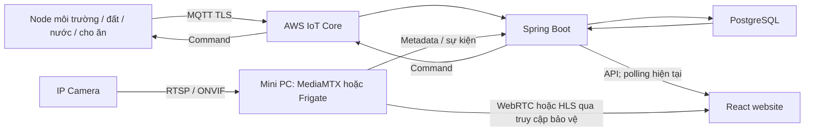

# Ý tưởng và lộ trình thiết bị IoT nông nghiệp

Cập nhật: 14/10/2026. Nguồn: bản ý tưởng người dùng gửi trong cuộc trò chuyện,
bao gồm cây trồng, tưới, chăn nuôi và camera. Mốc code ban đầu: `9730558`; nền A1 cập nhật tại [báo cáo node/kênh](../implementation/NODE_CHANNELS_REPORT.md).
**Danh mục là thiết kế đích. A1 registry/contract có code; chưa có các node vật lý mới chạy live.**
Trạng thái kiểm chứng đọc tại [bảng nghiệm thu](../book/ACCEPTANCE_STATUS.md).

## 1. Mục tiêu sử dụng

Phát triển thiết bị IoT phục vụ canh tác trước, sau đó đến chăn nuôi và camera.
Tổ chức theo node có nhiệm vụ, danh tính, khả năng đo/điều khiển và trạng thái
riêng. Một node vật lý có thể có nhiều cảm biến/actuator logic; không bắt buộc
mỗi loại cảm biến phải có một ESP32 riêng.

Bài toán thiết kế ban đầu: **100 cây dừa, 4 dãy, khoảng 25 cây/dãy**. Đây là
quy mô được nêu trong ý tưởng, chưa phải số cây/vị trí đã nhập vào database
hay số bộ phần cứng đã lắp đặt. Dùng 3 điểm đất đầu–giữa–cuối mỗi dãy để thử;
độ sâu, vị trí, mật độ cảm biến phải điều chỉnh theo đất/rễ và khảo sát thực tế.

## 2. Nền đang có và việc phải giữ tương thích

| Hiện tại | Giới hạn |
|---|---|
| Một ESP32/Wokwi ENV01: DHT22, ADC đất; PUMP01 là actuator logic cùng board | Chưa có SOIL01/WATER01/IRRIGATION01/FEED01 độc lập |
| AWS MQTT TLS/QoS1 → Spring Boot → PostgreSQL → React polling | Camera chưa có; web không kết nối MQTT trực tiếp |
| Manual ON/OFF/timer, ACK/status; rule đất khô, cooldown, lịch tuần giờ VN | Dispatcher hiện giới hạn một PUMP01, chưa hỗ trợ 4 van dùng chung bơm |
| Registry sensor/khu vực, history/CSV, hai cảnh báo ngưỡng và xác nhận đã xem | Thêm registry không tự provision certificate hay flash firmware |
| Relay/LED tải NO + phao GPIO27, firmware opt-in WATER_LOW | Code/build/native/API tests đã có; relay/phao Wokwi mới chưa nghiệm thu live |

Giữ các topic `smartfarm/FARM001/ENV01/telemetry` và
`smartfarm/FARM001/PUMP01/{command,ack,status}` trong demo. `IRRIGATION01` sau
này là tên controller đề xuất; không đổi tên PUMP01 hoặc coi đó là alias đang
hoạt động. Tách deviceId vật lý, sensorId/channel và actuatorId có bảng ánh xạ
rõ ràng trước khi mở rộng. Lộ trình này không tự đổi schema, policy hoặc ID.

Phao hiện tại chỉ có nước/cạn; mất tín hiệu hở được coi là cạn. Không có flow,
áp suất, phần trăm bồn hoặc bằng chứng bơm vật lý chạy. NVS chưa làm; sau reboot
chỉ đọc lại đầu vào, không bảo toàn latch RAM. Một status cũ không chứng minh
bồn hiện đang có nước.

## 3. Danh mục 18 nhóm thiết bị trong ý tưởng

Các linh kiện là lựa chọn khảo sát, chưa phải BOM chốt để mua. Mọi nhóm ngoài
phần demo ở mục2 đều ở trạng thái thiết kế/chưa nghiệm thu.

| Nhóm | Thiết bị tham khảo | Dữ liệu / hành động | Giai đoạn ưu tiên |
|---|---|---|---|
| 1. Environmental Node | ESP32, DHT22/SHT30, BH1750, rain sensor, leaf wetness tùy chọn | °C, %RH, lux, mưa; hỗ trợ quyết định tưới | Canh tác |
| 2. Soil Monitoring Node | ESP32, capacitive soil, cảm biến nhiệt đất | Độ ẩm từng điểm, °C đất; mapping dãy | Canh tác |
| 3. Irrigation Controller | ESP32, driver relay/MOSFET, bơm, van điện từ | Điều phối bơm/van, manual/auto, ACK/status | Canh tác |
| 4. Water Monitoring Node | Phao LOW/HIGH, flow, pressure, DS18B20, leak | Cạn/đầy, L/min, kPa, °C, rò nước | Canh tác ưu tiên |
| 5. Water Quality Node | pH, EC/TDS, DS18B20 | Chất lượng dung dịch; hiệu chuẩn và bù nhiệt | Sau tưới |
| 6. Fertigation Node | Dosing pump, mixer, pH/EC | Châm phân giới hạn liều, trộn, liên động | Sau chất lượng nước |
| 7. Energy Monitoring Node | INA219 cho DC; PZEM phù hợp tải AC | V, A, W, kWh đo thực tế | Sau tưới |
| 8. Animal Feeding Node | ESP32, DS3231, motor hộp số/auger, driver, HX711/load cell, limit switch, buzzer | Lịch cho ăn và lượng thực cấp | Chăn nuôi đầu tiên |
| 9. Feed Storage Node | Ultrasonic/ToF, load cell | Mức/khối lượng còn lại, gần hết | Cùng bộ cho ăn |
| 10. Animal Drinking Node | Phao, van điện từ, flow, nhiệt nước | Cấp nước uống theo mức, phát hiện bất thường | Chăn nuôi |
| 11. Livestock Environment Node | SHT30, CO₂, NH₃, fan, buzzer | Khí chuồng, nhiệt/ẩm, thông gió | Chăn nuôi |
| 12. Animal Identification | RFID reader/tag | ID và liên kết hồ sơ vật nuôi | Mở rộng |
| 13. Animal Weight Node | Load cell + HX711 | Khối lượng đã ổn định, lịch sử tăng trưởng | Mở rộng |
| 14. Camera Node | IP camera RTSP/ONVIF, mini PC | Video/snapshot, recording | Subsystem riêng |
| 15. AI Camera Node | Camera, máy xử lý ảnh/YOLO | Detection + confidence + sự kiện | Sau camera |
| 16. Security Node | Reed/PIR, cảm biến khói phù hợp | Cửa/chuyển động/khói, báo động | Theo nhu cầu |
| 17. Gateway | Wi-Fi/router; LoRa gateway hoặc mini PC khi cần | Kết nối/gom telemetry, chuyển tiếp | Sau khảo sát phủ sóng |
| 18. Backup/Power Node | Solar, battery, UPS, đo pin | Nguồn dự phòng và tình trạng pin | Theo triển khai thực địa |

Không xem các lựa chọn như INA219/PZEM, SHT30/DHT22 hoặc ultrasonic/load cell
là tương đương điện học hay đo lường. Chọn theo tải, môi trường, độ chính xác,
nguồn cấp và quy trình hiệu chuẩn. Cảm biến khói trong demo không thay hệ báo
cháy được chứng nhận; mạch relay/LED không thay contactor/bảo vệ bơm thật.

## 4. Bố trí vườn 4 dãy

| Dãy / zone dự kiến | Cây tham chiếu | Điểm độ ẩm đất | Van | Flow nhánh |
|---|---|---|---|---|
| ZONE01 | 1–25 | Đầu, giữa, cuối | VALVE01 | FLOW01 |
| ZONE02 | 26–50 | Đầu, giữa, cuối | VALVE02 | FLOW02 |
| ZONE03 | 51–75 | Đầu, giữa, cuối | VALVE03 | FLOW03 |
| ZONE04 | 76–100 | Đầu, giữa, cuối | VALVE04 | FLOW04 |

Tổng dự kiến: 12 điểm đất, 4 van, 4 flow nhánh; nếu trạm nước có flow chính
thì tổng là 5 đồng hồ flow. Có thể thử một dãy trước rồi nhân rộng, không mua
đủ 4 bộ trước khi chứng minh đo/calibration/kết nối. Mỗi dãy dùng một ESP32 là
phương án bố trí, chưa phải ràng buộc thiết kế bắt buộc.

Quy tắc tổng hợp độ ẩm phải được định nghĩa trước khi tự động hóa. Không lấy
một điểm khô rồi bỏ qua hai điểm khác hoặc lặng lẽ dùng reading cũ. Bước thử
ban đầu chỉ giám sát riêng 3 điểm; sau hiệu chuẩn chọn quy tắc như ít nhất
2/3 điểm hợp lệ, có freshness và xử lý trường hợp thiếu điểm rõ ràng. Đây là
đề xuất cần thử, không thay rule ENV01 hiện tại hoặc khuyến nghị tưới cố định.

Một bơm chung bắt đầu với **mỗi lần chỉ tưới một dãy**. Một coordinator giữ
quyền điều phối trạm, không tạo 4 rule độc lập cùng tranh bơm. Chu trình đề
xuất: kiểm tra readiness → yêu cầu mở van → xác minh theo khả năng phản hồi
thực có → bật bơm → giám sát flow/áp suất/thời hạn → tắt bơm → đóng van theo
quy trình thủy lực đã khảo sát. ACK relay chỉ chứng minh lệnh/GPIO, không chứng
minh van đã mở hay có nước. Chưa có feedback thì ghi UNKNOWN, không tự nhận OK.

## 5. Trạm nước trung tâm WATER01

Thiết kế gồm ESP32, phao LOW/HIGH, nhiệt nước DS18B20, main flow, áp suất,
đầu ra bơm/contactor, leak sensor và đo điện tùy chọn. Hai phao là các trạng
thái rời rạc; không suy ra mức nước liên tục hoặc lít nếu chưa có phép đo và
hiệu chuẩn thể tích bồn.

| Tình huống | Phản ứng dự kiến | Điều kiện để kết luận |
|---|---|---|
| LOW cạn / hở dây | Cấm ON, tắt bơm và latch lockout tại controller bơm | Liên động cục bộ, không phụ thuộc AWS |
| Hai phao có tổ hợp bất khả thi | SENSOR_FAULT, OFF/lockout | Xác định cực tính và thứ tự LOW/HIGH |
| Bơm đã yêu cầu ON nhưng flow=0 | Sau thời gian mồi cấu hình: nghi mất nước/lỗi bơm, dừng | Xung hợp lệ, freshness, hiệu chuẩn và grace period |
| Áp cao + flow thấp | Nghi tắc, cảnh báo/dừng theo giới hạn | Ngưỡng đã khảo sát đường ống, lọc nhiễu |
| Áp thấp + flow bất thường | Nghi rò, cảnh báo và yêu cầu kiểm tra | Không khẳng định nguyên nhân chỉ từ một mẫu |
| Mất dữ liệu flow/pressure quan trọng | Trạng thái UNKNOWN; từ chối khởi chạy hoặc dừng theo policy | Không thay mất dữ liệu bằng số0 |

Các ngưỡng, thời gian mồi và thời gian xác nhận lỗi cần thử với thiết bị thật,
không chốt con số từ bản ý tưởng. Khi nhiều node tách rời, quyền an toàn cuối
cùng nằm ở controller bơm với đầu vào cạn cục bộ. Chỉ gửi mức nước qua MQTT
không cung cấp cùng mức bảo vệ khi gateway/broker mất mạng.

## 6. Môi trường và điều kiện được tưới

Đề xuất 1–2 trạm môi trường tùy khảo sát vị trí: nhiệt độ, %RH, lux, mưa;
leaf wetness để sau. Chưa thay DHT22 bằng SHT30 trong firmware hiện tại.

Quy tắc tương lai: đất khô đủ mẫu hợp lệ + lịch cho phép + rain=false fresh
+ trạm nước sẵn sàng + không lockout + coordinator giữ quyền zone → có thể
yêu cầu tưới. Đây là AND của điều kiện, không phải đến giờ luôn ON. Reading
mưa UNKNOWN không được đổi thành false. Chính sách override thủ công, thời
hạn và khóa an toàn phải được tách rõ; không override liên động cạn nước.

## 7. Chăn nuôi

FEED01 là bước đầu sau canh tác: motor/auger + driver, cân HX711/load cell,
DS3231 khi cần lịch tại edge, cảm biến tồn kho, công tắc giới hạn và buzzer.
Các lịch 06h/12h/17h và lượng 2 / 1.5 / 2 kg trong ý tưởng chỉ là ví dụ giao diện,
không phải khẩu phần đã xác định hoặc cấu hình mặc định để vận hành.

Cho ăn theo khối lượng dùng tare, kiểm tra cân ổn định, lượng tăng so với
baseline, bù quán tính và giới hạn thời gian/khối lượng tối đa. Không dừng chỉ
vì số đọc tổng cân chạm 2 kg khi máng đã có thức ăn. Kẹt motor, cân lỗi, hết
thức ăn, timeout hoặc mất kết nối phải được xử lý; không retry để cấp trùng
khẩu phần. Lịch edge cần lưu ID đợt cấp đã thực hiện qua reboot trước khi dùng
không giám sát. Đợt bị gián đoạn không tự bù cấp lại sau reboot.

DRINK01: phao mức máng + van + flow + nhiệt nước; đóng van khi đầy, giới hạn
lượng/thời gian cấp và xử lý flow bất thường. BARN01: nhiệt/ẩm, CO₂/NH₃ và
thông gió, mỗi loại khí có sensor/range/calibration riêng. RFID và cân vật nuôi
liên kết hồ sơ sau; không dùng cùng một measurementType cho cân thức ăn và
cân con vật.

## 8. Camera là subsystem riêng

MediaMTX và Frigate là lựa chọn cần đánh giá, không mặc định phải triển khai
cả hai. Video/recording không truyền qua MQTT; không mở camera trực tiếp ra
Internet để thử. Website không phát RTSP trực tiếp. Bắt đầu xem luồng và lưu
snapshot/retention có giới hạn, sau đó mới AI detection và cảnh báo có confidence.
“Healthy/abnormal” là mục tiêu nghiên cứu, không phải chẩn đoán bệnh cây đã
được kiểm chứng. Chưa thêm dịch vụ camera/AI trong repository ở đợt này.

## 9. Danh tính, hợp đồng và giao diện cần mở rộng

Mỗi device vật lý đăng ký farm/zone, hardwareId, sensor channels, actuator
capabilities, firmwareVersion và trạng thái provisioning. Certificate riêng
cho từng client, policy chỉ đủ farm/device/actuator được gán, có thu hồi/rotate;
không chia sẻ private key ENV01 cho mọi node. AWS service-linked role không
phải thứ cần tạo cho từng cảm biến. Chưa có tự động onboarding/fleet provisioning.

Giữ topic hiện tại; ví dụ tương lai dưới cùng prefix:
`smartfarm/FARM001/SOIL01/telemetry`, `.../WATER01/telemetry`,
`.../FEED01/{telemetry,command,ack,status}`. Chỉ dùng sau khi có firmware,
contract, routing, policy và kiểm thử; wildcard subscribe không tự cấp publish.

Telemetry tương lai cần sensorId/channel, metricType, unit, calibrationVersion,
quality, timestamp nguồn và receivedAt. Giữ bootId/sequence để dedupe và chống
sai thứ tự. Độ ẩm đất ADC quy đổi % không tự tương đương %VWC; EC (mS/cm),
TDS (ppm), flow (L/min), pressure (kPa), điện năng (kWh) phải có định nghĩa đo.

Không nhét node nước/feed vào schema v1 đang bắt buộc temperature/humidity/
soilMoisture hoặc tự suy diễn missing=0. Thiết kế payload version mới hoặc
contract riêng theo capability, có parser và migration tương thích v1 trước
khi flash node mới. Tách config đã lưu, lệnh đã gửi, ACK thực thi và trạng thái
được đo/báo; control phải giữ expiry, bounded runtime, dedupe, safe boot.

Màn hình mục tiêu: registry/capabilities theo zone → Sensor Realtime theo
metric → water station/zone control → alert/history/event liên kết nguồn →
resource usage chỉ khi có đồng hồ thật. Giữ nguồn đo/giả lập/mock rõ ràng;
không tính lít từ thời gian relay ON nếu chưa đo hoặc công bố hệ số ước tính.
Đây là mục tiêu UI, chưa có các API/tab đo mới trong lần cập nhật ý tưởng.

## 10. Backlog theo thứ tự triển khai

Năm nhóm MVP đích theo ý tưởng: **ENV01, SOIL01, WATER01, IRRIGATION01,
FEED01**. Đây là danh mục đích để xây từng bước, không phải 5 node đã provision
hay cam kết triển khai cả 5 ngay trong một đợt/tuần. FEED01 làm sau canh tác.

| Mốc | Phạm vi cụ thể | Điều kiện hoàn thành |
|---|---|---|
| A0 | Nghiệm thu relay/phao hiện tại trên Wokwi | Boot OFF, ON/timer, cạn OFF/lockout, khôi phục không auto ON, reset khi đủ nước; lưu bằng chứng chương21 |
| A1 | Mô hình physical device / sensor channel / actuator và contract mở rộng | v1 vẫn chạy; node/channel/zone không nhập nhằng; loại payload không hợp lệ bị từ chối; capability chưa provision không tự hoạt động |
| A2 | WATER01: LOW/HIGH + flow, cạn/không flow | Có calibration và grace period; bảo vệ cục bộ; web/alert/history hiển thị dữ liệu thật hoặc simulator được gắn nhãn; fault tests mất tín hiệu |
| A3 | SOIL + IRRIGATION: một dãy 3 điểm/van, rồi 4 dãy | Coordinator chung không tranh bơm; chỉ tưới zone giữ quyền; không coi ACK là feedback van/nước; flow/timer/stop/reset có kiểm thử |
| A4 | Mưa/ánh sáng vào quyết định tưới | Sensor fresh + ngưỡng có hysteresis; rain unknown không coi khô ráo; không vượt liên động cạn |
| A5 | FEED01 + tồn thức ăn, sau đó DRINK01/BARN01 | Cân đúng tare/định lượng; chống cấp trùng/reboot, jam/timeout và giới hạn cấp nước/khí |
| A6 | ENERGY01 và camera, rồi chất lượng nước/fertigation/RFID/AI | Đo/hiệu chuẩn, phân quyền truy cập, bảo vệ riêng từng loại tải; không dùng số mock nghiệm thu |

A1 là điều kiện trước khi đưa nhiều node độc lập vào backend; không cần làm
một framework rule tổng quát hoặc thay toàn bộ UI để thử một dãy. A2 có thể
thử flow trên board demo trước khi tách hardware WATER01, nhưng vẫn ghi rõ ID
và nguồn dữ liệu, không báo đã có một Thing độc lập khi chưa provision.

Nền A1 đã có model node/channel, mapping legacy, water contract/router/storage
và UI khai báo, xem [chương22](../book/CHAPTER_22_NODES_AND_WATER_CHANNELS.md).
Chưa có tự động AWS provisioning hoặc firmware WATER riêng. Bước kế tiếp A2
là dữ liệu/logic trạm nước với nghiệm thu A0 vẫn phải được đối chiếu. A2–A6
còn trong kế hoạch. Không tự tạo Jira tasks hay AWS
resources từ bảng backlog này.

## 11. Simulator, chi phí và sổ bằng chứng

Wokwi là bước thử logic: phao có thể dùng switch, độ ẩm đất dùng potentiometer,
tải dùng LED/relay. Các tín hiệu flow/pressure/feed nếu chưa có model phù hợp
phải được mô tả là giả lập tín hiệu có điều khiển; không gọi đó là đo vật lý,
độ chính xác cảm biến hoặc hiệu chuẩn thành công. Chưa thêm các phần đó vào
sơ đồ trong lượt cập nhật ý tưởng này.

Mỗi mốc lưu firmware/config version không chứa secrets, schema version,
calibration, điều kiện đầu vào, commandId/ACK/status, fault injection và kết
quả thực tế. Unit/integration/browser fixtures, Wokwi live và phần cứng thật
là ba lớp bằng chứng riêng. NVS/store-and-forward, reconnect và recovery qua
reboot cần acceptance riêng; không tự khẳng định đã có nhờ thêm node.

Giữ Budget và kiểm tra Billing theo dịch vụ. Thêm Thing/registry không đồng
nghĩa toàn hệ miễn phí: MQTT connections/messages/delivery, rules/shadow nếu
dùng, log retention, DB/compute, video/storage và phần cứng có chi phí theo
cấu hình/usage. Chưa chọn LoRa/mini PC/cloud camera hoặc provision thêm dịch vụ
trước khi khảo sát khoảng cách, điện, mạng, tải và dự toán.
